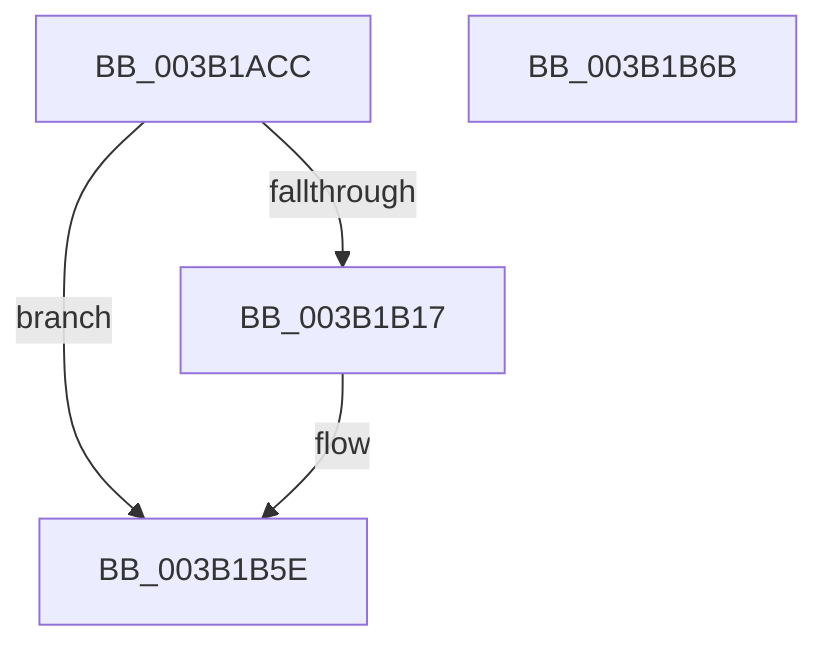

# SmKmStoreHelperStart

- RVA: `0x003B1ACC`–`0x003B1B6C` (길이 `160` bytes)
- VA: `0x00000001403B1ACC`
- 실행 섹션: `.text`
- PDB 이름 있음: `예`; PDB Function 태그: `아니요`
- unwind 정보 RVA: `0x0008C33C`
- 디코드: `41`개 명령, `160/160` bytes 표시
- 미해석 바이트: `0` (있으면 어셈블리에 `.byte`로 보존)

> 이 문서는 커널 이미지의 기계어와 PDB 기호를 분석해 생성했습니다. 4번과 5번은 함수 원형과 자료형을 바이너리 사용 방식에서 추정한 C 해석이며 원본 소스 복구 결과는 아닙니다.

## 1. Dependencies

- 직접 호출 지점: **3**; 고유 호출 대상: **3**
- 직접 호출자로 확인된 함수: **1**
- RIP 상대 이미지 참조: **1**

### Outgoing calls
- `0x003B1B0C` → [PsCreateSystemThreadEx](../../page/9E/PsCreateSystemThreadEx_function_009ED120.md) (function, `0x009ED120`)
- `0x003B1B40` → [ObReferenceObjectByHandle](../../page/86/ObReferenceObjectByHandle_function_00868DB0.md) (function, `0x00868DB0`)
- `0x003B1B59` → [ObCloseHandle](../../page/8A/ObCloseHandle_function_008A1870.md) (function, `0x008A1870`)

### Direct callers
- [SMKM_STORE&lt;SM_TRAITS&gt;::SmStStart](SMKM_STORE_SM_TRAITS_SmStStart_function_003B14DC.md) at `0x003B1795`
- [SMKM_STORE&lt;SM_TRAITS&gt;::SmStStart](SMKM_STORE_SM_TRAITS_SmStStart_function_003B14DC.md) at `0x003B17AE`

### Static image references
- `0x003B1ADD` → RVA `0x003C2BC0` (`SmKmStoreHelperWorker`; read)

## 2. Other-region calls and transfers

- 다른 실행 섹션으로 향하는 call: **3**
  - `0x003B1B0C` → [PsCreateSystemThreadEx](../../page/9E/PsCreateSystemThreadEx_function_009ED120.md) (`.text` → `PAGE`)
  - `0x003B1B40` → [ObReferenceObjectByHandle](../../page/86/ObReferenceObjectByHandle_function_00868DB0.md) (`.text` → `PAGE`)
  - `0x003B1B59` → [ObCloseHandle](../../page/8A/ObCloseHandle_function_008A1870.md) (`.text` → `PAGE`)
- 별도 외부 분기/꼬리 이동을 확인하지 못했습니다.

## 3. Assembly (complete function range)

```asm
003B1ACC  4C 8B DC                        mov r11, rsp
003B1ACF  49 89 5B 08                     mov qword ptr [r11 + 8], rbx
003B1AD3  57                              push rdi
003B1AD4  48 83 EC 60                     sub rsp, 0x60
003B1AD8  49 83 63 20 00                  and qword ptr [r11 + 0x20], 0
003B1ADD  48 8D 05 DC 10 01 00            lea rax, [rip + 0x110dc]
003B1AE4  4D 89 43 D8                     mov qword ptr [r11 - 0x28], r8
003B1AE8  48 8B F9                        mov rdi, rcx
003B1AEB  49 83 63 D0 00                  and qword ptr [r11 - 0x30], 0
003B1AF0  4C 8B CA                        mov r9, rdx
003B1AF3  49 89 4B C8                     mov qword ptr [r11 - 0x38], rcx
003B1AF7  45 33 C0                        xor r8d, r8d
003B1AFA  49 89 43 C0                     mov qword ptr [r11 - 0x40], rax
003B1AFE  49 8D 4B 20                     lea rcx, [r11 + 0x20]
003B1B02  49 83 63 B8 00                  and qword ptr [r11 - 0x48], 0
003B1B07  BA FF FF 1F 00                  mov edx, 0x1fffff
003B1B0C  E8 0F B6 63 00                  call 0x1409ed120
003B1B11  8B D8                           mov ebx, eax
003B1B13  85 C0                           test eax, eax
003B1B15  78 47                           js 0x1403b1b5e
003B1B17  48 83 64 24 28 00               and qword ptr [rsp + 0x28], 0
003B1B1D  48 8D 44 24 50                  lea rax, [rsp + 0x50]
003B1B22  48 8B 8C 24 88 00 00 00         mov rcx, qword ptr [rsp + 0x88]
003B1B2A  45 33 C9                        xor r9d, r9d
003B1B2D  48 83 64 24 50 00               and qword ptr [rsp + 0x50], 0
003B1B33  45 33 C0                        xor r8d, r8d
003B1B36  BA FF FF 1F 00                  mov edx, 0x1fffff
003B1B3B  48 89 44 24 20                  mov qword ptr [rsp + 0x20], rax
003B1B40  E8 6B 72 4B 00                  call 0x140868db0
003B1B45  48 8B 8C 24 88 00 00 00         mov rcx, qword ptr [rsp + 0x88]
003B1B4D  8B D8                           mov ebx, eax
003B1B4F  48 8B 44 24 50                  mov rax, qword ptr [rsp + 0x50]
003B1B54  33 D2                           xor edx, edx
003B1B56  48 89 07                        mov qword ptr [rdi], rax
003B1B59  E8 12 FD 4E 00                  call 0x1408a1870
003B1B5E  8B C3                           mov eax, ebx
003B1B60  48 8B 5C 24 70                  mov rbx, qword ptr [rsp + 0x70]
003B1B65  48 83 C4 60                     add rsp, 0x60
003B1B69  5F                              pop rdi
003B1B6A  C3                              ret
003B1B6B  CC                              int3
```

## 4. C-style interpretation (structured pseudocode)

```c
__int64 __fastcall SmKmStoreHelperStart(__int64 a1, __int64 a2, __int64 a3)
{
    __int64 result;
    __int64 v_rbx;
    __int64 v_rsp;
    unsigned __int64 v_stack_m18;
    unsigned __int64 v_stack_m40;
    unsigned __int64 v_stack_m48;
    unsigned __int64 v_stack_p20;
    unsigned __int64 v_stack_p8;

    *(unsigned __int64 *)(v_rsp + 8) = v_rbx;
    v_rsp = (v_rsp) - (96);
    *(unsigned __int64 *)(v_rsp - 40) = a3;
    *(unsigned __int64 *)(v_rsp - 56) = a1;
    a3 = 0;
    *(unsigned __int64 *)(v_rsp - 64) = v_rip + 69852;
    result = PsCreateSystemThreadEx(v_rsp + 32, (unsigned int)(0x1FFFFFULL), a3, a2);
    v_rbx = (unsigned int)((unsigned int)(result));
    if (!(sign_flag)) {
        result = v_stack_m18;
        a1 = v_stack_p20;
        a4 = 0;
        a3 = 0;
        a2 = 0x1FFFFFULL;
        v_stack_m48 = result;
        result = ObReferenceObjectByHandle(a1, a2, a3, a4);
        a1 = v_stack_p20;
        v_rbx = (unsigned int)(result);
        result = v_stack_m18;
        a2 = 0;
        *(unsigned __int64 *)(a1) = result;
        result = ObCloseHandle(a1, a2, a3, a4);
    }
    v_rsp = (v_rsp) + (96);
    return (unsigned int)((unsigned int)(v_rbx));
}
```

## 5. (Beta) C Style

```c
int64_t SmKmStoreHelperStart(void *Arg1, int64_t Arg2, int64_t Arg3)
{
    uint8_t *arg1 = (uint8_t *)Arg1;

    int64_t result;
    int64_t local_rbx;
    int64_t local_rsp;
    uint64_t v_stack_m18;
    uint64_t v_stack_m40;
    uint64_t v_stack_m48;
    uint64_t v_stack_p20;
    uint64_t v_stack_p8;

    *(uint64_t *)(local_rsp + 0x8) = local_rbx;
    local_rsp = (local_rsp) - (96);
    *(uint64_t *)(local_rsp - 0x28) = Arg3;
    *(void **)(local_rsp - 0x38) = Arg1;
    Arg3 = 0;
    *(uint64_t *)(local_rsp - 0x40) = v_rip + 69852;
    result = PsCreateSystemThreadEx(local_rsp + 32, (uint32_t)(0x1FFFFFULL), Arg3, Arg2);
    local_rbx = (uint32_t)((uint32_t)(result));
    if (!(sign_flag)) {
        result = v_stack_m18;
        Arg1 = v_stack_p20;
        a4 = 0;
        Arg3 = 0;
        Arg2 = 0x1FFFFFULL;
        v_stack_m48 = result;
        result = ObReferenceObjectByHandle(Arg1, Arg2, Arg3, a4);
        Arg1 = v_stack_p20;
        local_rbx = (uint32_t)(result);
        result = v_stack_m18;
        Arg2 = 0;
        *(uint64_t *)(arg1) = result;
        result = ObCloseHandle(Arg1, Arg2, Arg3, a4);
    }
    local_rsp = (local_rsp) + (96);
    return (uint32_t)((uint32_t)(local_rbx));
}
```

### 관측된 메모리 오프셋

구조체 형식이 확인되지 않은 접근은 인자 기준의 오프셋으로만 기록했습니다.

| 기준 인자 | 오프셋 표현 | 폭 (bit) | 접근 |
|---|---:|---:|---|
| `Arg1` | `+ 0x0` | `64` | `W` |

## 6. Execution-region graph

[열기: 2D/3D 그래프와 함수 탐색 컨트롤 패널](../../../control-panel.html?section=text&rva=0x003B1ACC&view=graph)

- 2D 그래프는 위에서 아래로 흐르고, 3D 그래프는 빈 공간을 드래그해 회전합니다. Shift+드래그는 이동, 휠은 확대·축소, 함수 노드 선택은 대상 보고서 이동입니다.

### Static fallback


