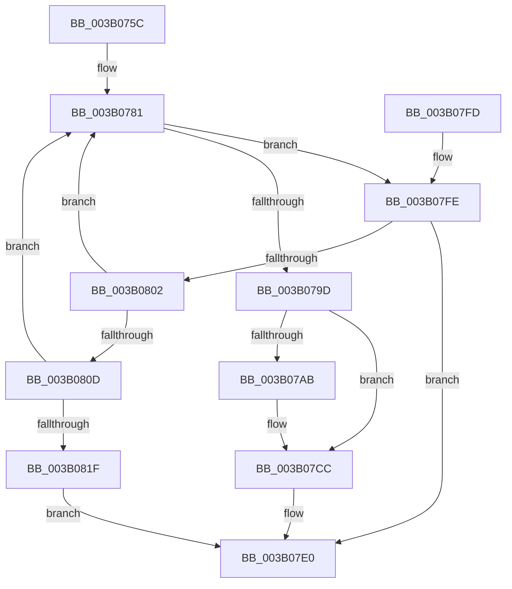

# SmKmStoreHelperWaitForCommand

- RVA: `0x003B075C`–`0x003B0826` (길이 `202` bytes)
- VA: `0x00000001403B075C`
- 실행 섹션: `.text`
- PDB 이름 있음: `예`; PDB Function 태그: `아니요`
- unwind 정보 RVA: `0x0008C240`
- 디코드: `60`개 명령, `202/202` bytes 표시
- 미해석 바이트: `0` (있으면 어셈블리에 `.byte`로 보존)

> 이 문서는 커널 이미지의 기계어와 PDB 기호를 분석해 생성했습니다. 4번과 5번은 함수 원형과 자료형을 바이너리 사용 방식에서 추정한 C 해석이며 원본 소스 복구 결과는 아닙니다.

## 1. Dependencies

- 직접 호출 지점: **2**; 고유 호출 대상: **2**
- 직접 호출자로 확인된 함수: **1**
- RIP 상대 이미지 참조: **0**

### Outgoing calls
- `0x003B0792` → [KeWaitForSingleObject](../20/KeWaitForSingleObject_function_0020E6B0.md) (function, `0x0020E6B0`)
- `0x003B07A1` → [KeResetEvent](../24/KeResetEvent_function_00248350.md) (function, `0x00248350`)

### Direct callers
- [SMKM_STORE&lt;SM_TRAITS&gt;::SmStHelperSendCommand](SMKM_STORE_SM_TRAITS_SmStHelperSendCommand_function_003B0530.md) at `0x003B061E`

### Static image references
- 디코드된 RIP-relative 메모리 참조가 없습니다.

## 2. Other-region calls and transfers

- 다른 실행 섹션으로 향하는 call: **0**
- 별도 외부 분기/꼬리 이동을 확인하지 못했습니다.

## 3. Assembly (complete function range)

```asm
003B075C  48 8B C4                        mov rax, rsp
003B075F  48 89 58 08                     mov qword ptr [rax + 8], rbx
003B0763  48 89 68 10                     mov qword ptr [rax + 0x10], rbp
003B0767  48 89 70 18                     mov qword ptr [rax + 0x18], rsi
003B076B  48 89 78 20                     mov qword ptr [rax + 0x20], rdi
003B076F  41 56                           push r14
003B0771  48 83 EC 30                     sub rsp, 0x30
003B0775  41 8B E9                        mov ebp, r9d
003B0778  4D 8B F0                        mov r14, r8
003B077B  48 8B FA                        mov rdi, rdx
003B077E  48 8B D9                        mov rbx, rcx
003B0781  45 33 C9                        xor r9d, r9d
003B0784  4C 89 74 24 20                  mov qword ptr [rsp + 0x20], r14
003B0789  45 33 C0                        xor r8d, r8d
003B078C  48 8D 4B 20                     lea rcx, [rbx + 0x20]
003B0790  33 D2                           xor edx, edx
003B0792  E8 19 DF E5 FF                  call 0x14020e6b0
003B0797  8B C8                           mov ecx, eax
003B0799  85 C0                           test eax, eax
003B079B  75 61                           jne 0x1403b07fe
003B079D  48 8D 4B 20                     lea rcx, [rbx + 0x20]
003B07A1  E8 AA 7B E9 FF                  call 0x140248350
003B07A6  48 85 FF                        test rdi, rdi
003B07A9  74 21                           je 0x1403b07cc
003B07AB  0F 10 43 40                     movups xmm0, xmmword ptr [rbx + 0x40]
003B07AF  0F 11 07                        movups xmmword ptr [rdi], xmm0
003B07B2  0F 10 4B 50                     movups xmm1, xmmword ptr [rbx + 0x50]
003B07B6  0F 11 4F 10                     movups xmmword ptr [rdi + 0x10], xmm1
003B07BA  0F 10 43 60                     movups xmm0, xmmword ptr [rbx + 0x60]
003B07BE  0F 11 47 20                     movups xmmword ptr [rdi + 0x20], xmm0
003B07C2  F2 0F 10 4B 70                  movsd xmm1, qword ptr [rbx + 0x70]
003B07C7  F2 0F 11 4F 30                  movsd qword ptr [rdi + 0x30], xmm1
003B07CC  8B 43 38                        mov eax, dword ptr [rbx + 0x38]
003B07CF  B9 20 01 00 C0                  mov ecx, 0xc0000120
003B07D4  83 63 38 00                     and dword ptr [rbx + 0x38], 0
003B07D8  24 02                           and al, 2
003B07DA  F6 D8                           neg al
003B07DC  1B C0                           sbb eax, eax
003B07DE  23 C8                           and ecx, eax
003B07E0  48 8B 5C 24 40                  mov rbx, qword ptr [rsp + 0x40]
003B07E5  8B C1                           mov eax, ecx
003B07E7  48 8B 6C 24 48                  mov rbp, qword ptr [rsp + 0x48]
003B07EC  48 8B 74 24 50                  mov rsi, qword ptr [rsp + 0x50]
003B07F1  48 8B 7C 24 58                  mov rdi, qword ptr [rsp + 0x58]
003B07F6  48 83 C4 30                     add rsp, 0x30
003B07FA  41 5E                           pop r14
003B07FC  C3                              ret
003B07FD  CC                              int3
003B07FE  85 ED                           test ebp, ebp
003B0800  74 DE                           je 0x1403b07e0
003B0802  8B 43 38                        mov eax, dword ptr [rbx + 0x38]
003B0805  A8 01                           test al, 1
003B0807  0F 85 74 FF FF FF               jne 0x1403b0781
003B080D  8B C8                           mov ecx, eax
003B080F  83 C9 02                        or ecx, 2
003B0812  F0 0F B1 4B 38                  lock cmpxchg dword ptr [rbx + 0x38], ecx
003B0817  A8 01                           test al, 1
003B0819  0F 85 62 FF FF FF               jne 0x1403b0781
003B081F  B9 20 01 00 C0                  mov ecx, 0xc0000120
003B0824  EB BA                           jmp 0x1403b07e0
```

## 4. C-style interpretation (structured pseudocode)

```c
__int64 __fastcall SmKmStoreHelperWaitForCommand(__int64 a1, __int64 a2, __int64 a3, int a4)
{
    __int64 result;
    __int64 v_rsp;
    unsigned __int64 v_stack_m18;
    unsigned __int64 v_stack_p10;
    unsigned __int64 v_stack_p18;
    unsigned __int64 v_stack_p20;
    unsigned __int64 v_stack_p8;

    *(unsigned __int64 *)(v_rsp + 8) = v_rbx;
    *(unsigned __int64 *)(v_rsp + 16) = v_rbp;
    *(unsigned __int64 *)(v_rsp + 24) = v_rsi;
    *(unsigned __int64 *)(v_rsp + 32) = v_rdi;
    v_rsp = (v_rsp) - (48);
loc_003B0781:
    a4 = 0;
    v_stack_m18 = a3;
    a3 = 0;
    a2 = 0;
    result = KeWaitForSingleObject(a1 + 32, a2, a3, a4);
    if ((unsigned int)(result) != 0) goto loc_003B07FE;
    result = KeResetEvent(a1 + 32, a2, a3, a4);
    if (0 != 0) {
        *(unsigned __int64 *)(a2) = v_xmm0;
        *(unsigned __int64 *)(a2 + 16) = v_xmm1;
        *(unsigned __int64 *)(a2 + 32) = v_xmm0;
        *(unsigned __int64 *)(a2 + 48) = v_xmm1;
    }
    result = (unsigned __int8)(((unsigned int)(*(unsigned int *)(a1 + 56))) & (2));
    result = (unsigned __int8)(-(result));
    a1 = (unsigned int)(((unsigned int)(0xC0000120ULL)) & ((unsigned int)(result)));
loc_003B07E0:
    v_rsp = (v_rsp) + (48);
    return (unsigned int)((unsigned int)(a1));
loc_003B07FE:
    if ((unsigned int)(v_stack_p10) == 0) goto loc_003B07E0;
    if ((((unsigned __int8)((unsigned int)(*(unsigned int *)(v_stack_p8 + 56)))) & (1)) != 0) goto loc_003B0781;
    a1 = (unsigned int)(((unsigned int)((unsigned int)((unsigned int)(*(unsigned int *)(v_stack_p8 + 56))))) | (2));
    if ((((unsigned __int8)((unsigned int)(*(unsigned int *)(v_stack_p8 + 56)))) & (1)) != 0) goto loc_003B0781;
    goto loc_003B07E0;
}
```

## 5. (Beta) C Style

```c
int64_t SmKmStoreHelperWaitForCommand(void *Arg1, int64_t Arg2, int64_t Arg3, int32_t Arg4)
{
    uint8_t *arg1 = (uint8_t *)Arg1;

    int64_t result;
    int64_t local_rsp;
    uint64_t v_stack_m18;
    uint64_t v_stack_p10;
    uint64_t v_stack_p18;
    uint64_t v_stack_p20;
    uint64_t v_stack_p8;

    *(uint64_t *)(local_rsp + 0x8) = local_rbx;
    *(uint64_t *)(local_rsp + 0x10) = local_rbp;
    *(uint64_t *)(local_rsp + 0x18) = local_rsi;
    *(uint64_t *)(local_rsp + 0x20) = local_rdi;
    local_rsp = (local_rsp) - (48);
loc_003B0781:
    Arg4 = 0;
    v_stack_m18 = Arg3;
    Arg3 = 0;
    Arg2 = 0;
    result = KeWaitForSingleObject(Arg1 + 32, Arg2, Arg3, Arg4);
    if ((uint32_t)(result) != 0) goto loc_003B07FE;
    result = KeResetEvent(Arg1 + 32, Arg2, Arg3, Arg4);
    if (0 != 0) {
        *(uint64_t *)(Arg2) = v_xmm0;
        *(uint64_t *)(Arg2 + 0x10) = v_xmm1;
        *(uint64_t *)(Arg2 + 0x20) = v_xmm0;
        *(uint64_t *)(Arg2 + 0x30) = v_xmm1;
    }
    result = (uint8_t)(((uint32_t)(*(uint32_t *)(arg1 + 0x38))) & (2));
    result = (uint8_t)(-(result));
    Arg1 = (uint32_t)(((uint32_t)(0xC0000120ULL)) & ((uint32_t)(result)));
loc_003B07E0:
    local_rsp = (local_rsp) + (48);
    return (uint32_t)((uint32_t)(Arg1));
loc_003B07FE:
    if ((uint32_t)(v_stack_p10) == 0) goto loc_003B07E0;
    if ((((uint8_t)((uint32_t)(*(uint32_t *)(v_stack_p8 + 0x38)))) & (1)) != 0) goto loc_003B0781;
    Arg1 = (uint32_t)(((uint32_t)((uint32_t)((uint32_t)(*(uint32_t *)(v_stack_p8 + 0x38))))) | (2));
    if ((((uint8_t)((uint32_t)(*(uint32_t *)(v_stack_p8 + 0x38)))) & (1)) != 0) goto loc_003B0781;
    goto loc_003B07E0;
}
```

### 관측된 메모리 오프셋

구조체 형식이 확인되지 않은 접근은 인자 기준의 오프셋으로만 기록했습니다.

| 기준 인자 | 오프셋 표현 | 폭 (bit) | 접근 |
|---|---:|---:|---|
| `Arg1` | `+ 0x20` | `64` | `R` |
| `Arg1` | `+ 0x38` | `32` | `R` |
| `Arg1` | `+ 0x38` | `32` | `R/W` |
| `Arg1` | `+ 0x40` | `128` | `R` |
| `Arg1` | `+ 0x50` | `128` | `R` |
| `Arg1` | `+ 0x60` | `128` | `R` |
| `Arg1` | `+ 0x70` | `64` | `R` |

## 6. Execution-region graph

[열기: 2D/3D 그래프와 함수 탐색 컨트롤 패널](../../../control-panel.html?section=text&rva=0x003B075C&view=graph)

- 2D 그래프는 위에서 아래로 흐르고, 3D 그래프는 빈 공간을 드래그해 회전합니다. Shift+드래그는 이동, 휠은 확대·축소, 함수 노드 선택은 대상 보고서 이동입니다.

### Static fallback


