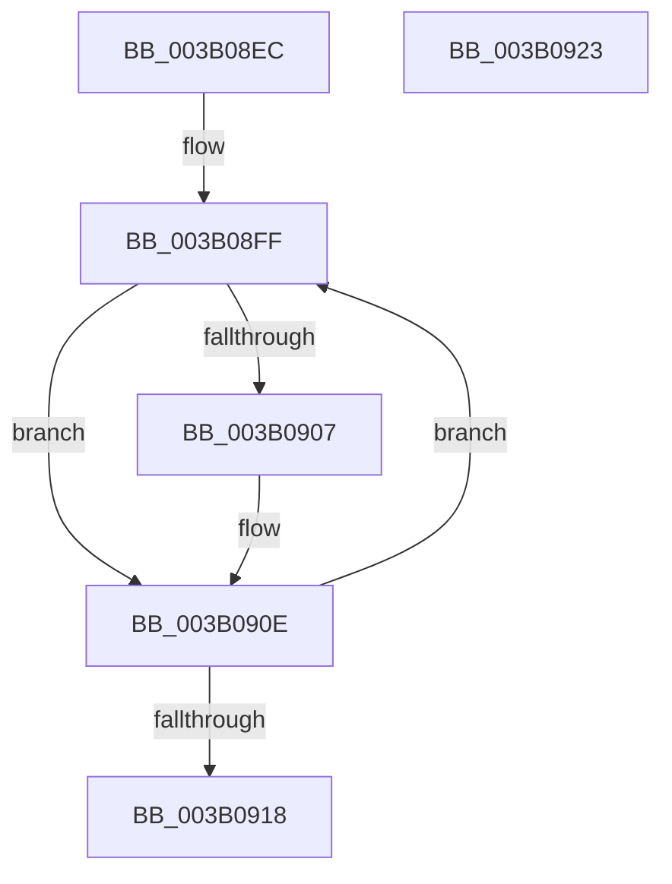

# StEtaCleanup

- RVA: `0x003B08EC`–`0x003B0924` (길이 `56` bytes)
- VA: `0x00000001403B08EC`
- 실행 섹션: `.text`
- PDB 이름 있음: `예`; PDB Function 태그: `아니요`
- unwind 정보 RVA: `0x0005CAAC`
- 디코드: `18`개 명령, `56/56` bytes 표시
- 미해석 바이트: `0` (있으면 어셈블리에 `.byte`로 보존)

> 이 문서는 커널 이미지의 기계어와 PDB 기호를 분석해 생성했습니다. 4번과 5번은 함수 원형과 자료형을 바이너리 사용 방식에서 추정한 C 해석이며 원본 소스 복구 결과는 아닙니다.

## 1. Dependencies

- 직접 호출 지점: **1**; 고유 호출 대상: **1**
- 직접 호출자로 확인된 함수: **2**
- RIP 상대 이미지 참조: **0**

### Outgoing calls
- `0x003B0909` → [ExFreePoolWithTag](../../poolcode/B8/ExFreePoolWithTag_function_00B82870.md) (function, `0x00B82870`)

### Direct callers
- [ST_STORE&lt;SM_TRAITS&gt;::StCleanup](ST_STORE_SM_TRAITS_StCleanup_function_003B03B4.md) at `0x003B042C`
- [SmcCacheCleanup](../../page/7A/SmcCacheCleanup_function_007AB7B4.md) at `0x007AB82B`

### Static image references
- 디코드된 RIP-relative 메모리 참조가 없습니다.

## 2. Other-region calls and transfers

- 다른 실행 섹션으로 향하는 call: **1**
  - `0x003B0909` → [ExFreePoolWithTag](../../poolcode/B8/ExFreePoolWithTag_function_00B82870.md) (`.text` → `POOLCODE`)
- 별도 외부 분기/꼬리 이동을 확인하지 못했습니다.

## 3. Assembly (complete function range)

```asm
003B08EC  48 89 5C 24 08                  mov qword ptr [rsp + 8], rbx
003B08F1  57                              push rdi
003B08F2  48 83 EC 20                     sub rsp, 0x20
003B08F6  48 8D 59 10                     lea rbx, [rcx + 0x10]
003B08FA  BF 02 00 00 00                  mov edi, 2
003B08FF  48 8B 0B                        mov rcx, qword ptr [rbx]
003B0902  48 85 C9                        test rcx, rcx
003B0905  74 07                           je 0x1403b090e
003B0907  33 D2                           xor edx, edx
003B0909  E8 62 1F 7D 00                  call 0x140b82870
003B090E  48 83 C3 08                     add rbx, 8
003B0912  48 83 EF 01                     sub rdi, 1
003B0916  75 E7                           jne 0x1403b08ff
003B0918  48 8B 5C 24 30                  mov rbx, qword ptr [rsp + 0x30]
003B091D  48 83 C4 20                     add rsp, 0x20
003B0921  5F                              pop rdi
003B0922  C3                              ret
003B0923  CC                              int3
```

## 4. C-style interpretation (structured pseudocode)

```c
__int64 __fastcall StEtaCleanup(__int64 a1, int a2)
{
    __int64 result;
    __int64 v_rbx;
    __int64 v_rdi;
    __int64 v_rsp;
    unsigned __int64 v_stack_p8;

    v_stack_p8 = v_rbx;
    v_rsp = (v_rsp) - (32);
loc_003B08FF:
    if (*(unsigned __int64 *)(a1 + 16) != 0) {
        a2 = 0;
        result = ExFreePoolWithTag(*(unsigned __int64 *)(a1 + 16), a2, a3, a4);
    }
    v_rbx = (a1 + 16) + (8);
    v_rdi = (2) - (1);
    if (condition_is_not_equal) goto loc_003B08FF;
    v_rsp = (v_rsp) + (32);
    return result;
}
```

## 5. (Beta) C Style

```c
int64_t StEtaCleanup(void *Arg1, int32_t Arg2)
{
    uint8_t *arg1 = (uint8_t *)Arg1;

    int64_t result;
    int64_t local_rbx;
    int64_t local_rdi;
    int64_t local_rsp;
    uint64_t v_stack_p8;

    v_stack_p8 = local_rbx;
    local_rsp = (local_rsp) - (32);
loc_003B08FF:
    if (*(uint64_t *)(arg1 + 0x10) != 0) {
        Arg2 = 0;
        result = ExFreePoolWithTag(*(uint64_t *)(arg1 + 0x10), Arg2, a3, a4);
    }
    local_rbx = (Arg1 + 16) + (8);
    local_rdi = (2) - (1);
    if (condition_is_not_equal) goto loc_003B08FF;
    local_rsp = (local_rsp) + (32);
    return result;
}
```

### 관측된 메모리 오프셋

구조체 형식이 확인되지 않은 접근은 인자 기준의 오프셋으로만 기록했습니다.

| 기준 인자 | 오프셋 표현 | 폭 (bit) | 접근 |
|---|---:|---:|---|
| `Arg1` | `+ 0x0` | `64` | `R` |
| `Arg1` | `+ 0x10` | `64` | `R` |

## 6. Execution-region graph

[열기: 2D/3D 그래프와 함수 탐색 컨트롤 패널](../../../control-panel.html?section=text&rva=0x003B08EC&view=graph)

- 2D 그래프는 위에서 아래로 흐르고, 3D 그래프는 빈 공간을 드래그해 회전합니다. Shift+드래그는 이동, 휠은 확대·축소, 함수 노드 선택은 대상 보고서 이동입니다.

### Static fallback


