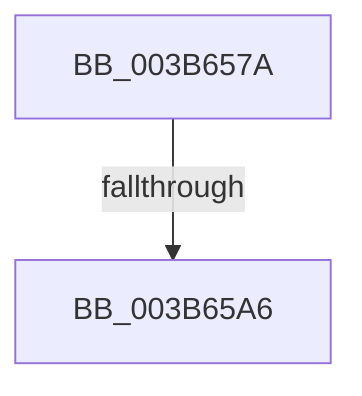

# sub_003B657A

- RVA: `0x003B657A`–`0x003B65C5` (길이 `75` bytes)
- VA: `0x00000001403B657A`
- 실행 섹션: `.text`
- PDB 이름 있음: `아니요`; PDB Function 태그: `아니요`
- unwind 정보 RVA: `0x0008C6F4`
- 디코드: `20`개 명령, `75/75` bytes 표시
- 미해석 바이트: `0` (있으면 어셈블리에 `.byte`로 보존)

> 이 문서는 커널 이미지의 기계어와 PDB 기호를 분석해 생성했습니다. 4번과 5번은 함수 원형과 자료형을 바이너리 사용 방식에서 추정한 C 해석이며 원본 소스 복구 결과는 아닙니다.

## 1. Dependencies

- 직접 호출 지점: **0**; 고유 호출 대상: **0**
- 직접 호출자로 확인된 함수: **0**
- RIP 상대 이미지 참조: **1**

### Outgoing calls
- 직접 디코드된 call 명령이 없습니다.

### Direct callers
- 이 함수 시작 RVA로 연결되는 직접 call은 확인되지 않았습니다. 간접 호출은 완전히 역산할 수 없습니다.

### Static image references
- `0x003B6595` → RVA `0x00000000` (`image boundary/outside`; read)

## 2. Other-region calls and transfers

- 다른 실행 섹션으로 향하는 call: **0**
- call이 아닌 외부 분기/꼬리 이동: **1**
  - `0x003B65A4` → [sub_003B65C6](Unknown_function_003B65C6.md) (`tail-transfer`)

## 3. Assembly (complete function range)

```asm
003B657A  48 89 74 24 38                  mov qword ptr [rsp + 0x38], rsi
003B657F  49 8B D8                        mov rbx, r8
003B6582  48 8B F2                        mov rsi, rdx
003B6585  48 89 6C 24 30                  mov qword ptr [rsp + 0x30], rbp
003B658A  83 E2 07                        and edx, 7
003B658D  48 C1 EE 03                     shr rsi, 3
003B6591  48 03 71 08                     add rsi, qword ptr [rcx + 8]
003B6595  48 8D 2D 64 9A C4 FF            lea rbp, [rip - 0x3b659c]
003B659C  4A 8D 04 02                     lea rax, [rdx + r8]
003B65A0  48 83 F8 08                     cmp rax, 8
003B65A4  77 20                           ja 0x1403b65c6
003B65A6  41 0F B6 84 28 90 C8 02 00      movzx eax, byte ptr [r8 + rbp + 0x2c890]
003B65AF  8B CA                           mov ecx, edx
003B65B1  D2 E0                           shl al, cl
003B65B3  08 06                           or byte ptr [rsi], al
003B65B5  48 8B 6C 24 30                  mov rbp, qword ptr [rsp + 0x30]
003B65BA  48 8B 74 24 38                  mov rsi, qword ptr [rsp + 0x38]
003B65BF  48 83 C4 20                     add rsp, 0x20
003B65C3  5B                              pop rbx
003B65C4  C3                              ret
```

## 4. C-style interpretation (structured pseudocode)

```c
__int64 __fastcall sub_003B657A(__int64 a1, __int64 a2, __int64 a3, __int64 a4, __int64 a5, __int64 a6, __int64 a7)
{
    __int64 result;
    __int64 v_rsi;
    __int64 v_rsp;
    unsigned __int64 v_stack_p30;
    unsigned __int64 v_stack_p38;

    v_stack_p38 = v_rsi;
    v_stack_p30 = v_rbp;
    a2 = (unsigned int)((a2) & (7));
    v_rsi = (a2) >> (3);
    v_rsi = (v_rsi) + (*(unsigned __int64 *)(a1 + 8));
    result = (unsigned __int8)((*(unsigned __int8 *)(a3 + v_rip - 3892636 * 1 + 182416)) << ((unsigned __int8)((unsigned int)((unsigned int)(a2)))));
    v_rsp = (v_rsp) + (32);
    return result;
}
```

## 5. (Beta) C Style

```c
int64_t sub_003B657A(void *Arg1, void *Arg2, void *Arg3, int64_t Arg4, uint64_t Arg5, int64_t Arg6, int64_t Arg7)
{
    uint8_t *arg1 = (uint8_t *)Arg1;
    uint8_t *arg2 = (uint8_t *)Arg2;
    uint8_t *arg3 = (uint8_t *)Arg3;

    int64_t result;
    int64_t local_rsi;
    int64_t local_rsp;
    uint64_t v_stack_p30;
    uint64_t v_stack_p38;

    v_stack_p38 = local_rsi;
    v_stack_p30 = local_rbp;
    Arg2 = (uint32_t)((Arg2) & (7));
    local_rsi = (Arg2) >> (3);
    local_rsi = (local_rsi) + (*(uint64_t *)(arg1 + 0x8));
    result = (uint8_t)((*(uint8_t *)(arg3 + v_rip - 0x3B659C * 1 + 0x2C890)) << ((uint8_t)((uint32_t)((uint32_t)(Arg2)))));
    local_rsp = (local_rsp) + (32);
    return result;
}
```

### 관측된 메모리 오프셋

구조체 형식이 확인되지 않은 접근은 인자 기준의 오프셋으로만 기록했습니다.

| 기준 인자 | 오프셋 표현 | 폭 (bit) | 접근 |
|---|---:|---:|---|
| `Arg1` | `+ 0x8` | `64` | `R` |
| `Arg2` | `+ 0x0 + r8*1` | `64` | `R` |
| `Arg3` | `+ 0x2C890 + rbp*1` | `8` | `R` |

## 6. Execution-region graph

[열기: 2D/3D 그래프와 함수 탐색 컨트롤 패널](../../../control-panel.html?section=text&rva=0x003B657A&view=graph)

- 2D 그래프는 위에서 아래로 흐르고, 3D 그래프는 빈 공간을 드래그해 회전합니다. Shift+드래그는 이동, 휠은 확대·축소, 함수 노드 선택은 대상 보고서 이동입니다.

### Static fallback


