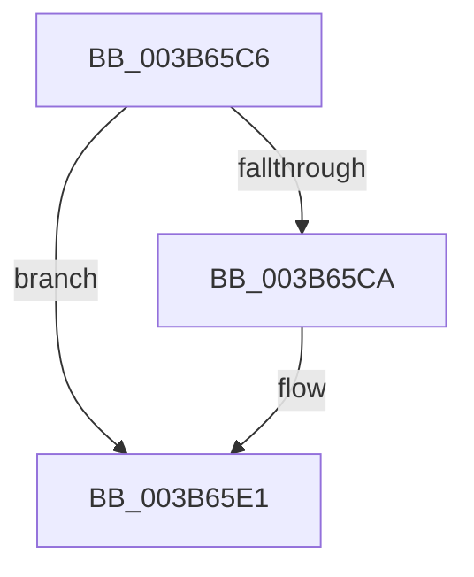

# sub_003B65C6

- RVA: `0x003B65C6`–`0x003B65E7` (길이 `33` bytes)
- VA: `0x00000001403B65C6`
- 실행 섹션: `.text`
- PDB 이름 있음: `아니요`; PDB Function 태그: `아니요`
- unwind 정보 RVA: `0x0008C720`
- 디코드: `10`개 명령, `33/33` bytes 표시
- 미해석 바이트: `0` (있으면 어셈블리에 `.byte`로 보존)

> 이 문서는 커널 이미지의 기계어와 PDB 기호를 분석해 생성했습니다. 4번과 5번은 함수 원형과 자료형을 바이너리 사용 방식에서 추정한 C 해석이며 원본 소스 복구 결과는 아닙니다.

## 1. Dependencies

- 직접 호출 지점: **0**; 고유 호출 대상: **0**
- 직접 호출자로 확인된 함수: **0**
- RIP 상대 이미지 참조: **0**

### Outgoing calls
- 직접 디코드된 call 명령이 없습니다.

### Direct callers
- 이 함수 시작 RVA로 연결되는 직접 call은 확인되지 않았습니다. 간접 호출은 완전히 역산할 수 없습니다.

### Static image references
- 디코드된 RIP-relative 메모리 참조가 없습니다.

## 2. Other-region calls and transfers

- 다른 실행 섹션으로 향하는 call: **0**
- call이 아닌 외부 분기/꼬리 이동: **1**
  - `0x003B65E5` → [sub_003B660E](Unknown_function_003B660E.md) (`tail-transfer`)

## 3. Assembly (complete function range)

```asm
003B65C6  85 D2                           test edx, edx
003B65C8  74 17                           je 0x1403b65e1
003B65CA  0F B6 84 2A 20 2D 01 00         movzx eax, byte ptr [rdx + rbp + 0x12d20]
003B65D2  08 06                           or byte ptr [rsi], al
003B65D4  B8 08 00 00 00                  mov eax, 8
003B65D9  2B C2                           sub eax, edx
003B65DB  48 FF C6                        inc rsi
003B65DE  48 2B D8                        sub rbx, rax
003B65E1  48 83 FB 08                     cmp rbx, 8
003B65E5  76 27                           jbe 0x1403b660e
```

## 4. C-style interpretation (structured pseudocode)

```c
__int64 __fastcall sub_003B65C6(__int64 a1, __int64 a2)
{
    __int64 result;
    __int64 v_rbx;
    __int64 v_rsi;

    if ((unsigned int)(a2) != 0) {
        result = *(unsigned __int8 *)(a2 + v_rbp * 1 + 77088);
        result = 8;
        result = (unsigned int)((result) - ((unsigned int)(a2)));
        v_rsi = (v_rsi) + 1;
        v_rbx = (v_rbx) - (result);
    }
}
```

## 5. (Beta) C Style

```c
int64_t sub_003B65C6(int64_t Arg1, int64_t Arg2)
{
    int64_t result;
    int64_t local_rbx;
    int64_t local_rsi;

    if ((uint32_t)(Arg2) != 0) {
        result = *(uint8_t *)(Arg2 + local_rbp * 1 + 0x12D20);
        result = 8;
        result = (uint32_t)((result) - ((uint32_t)(Arg2)));
        local_rsi = (local_rsi) + 1;
        local_rbx = (local_rbx) - (result);
    }
}
```

## 6. Execution-region graph

[열기: 2D/3D 그래프와 함수 탐색 컨트롤 패널](../../../control-panel.html?section=text&rva=0x003B65C6&view=graph)

- 2D 그래프는 위에서 아래로 흐르고, 3D 그래프는 빈 공간을 드래그해 회전합니다. Shift+드래그는 이동, 휠은 확대·축소, 함수 노드 선택은 대상 보고서 이동입니다.

### Static fallback


