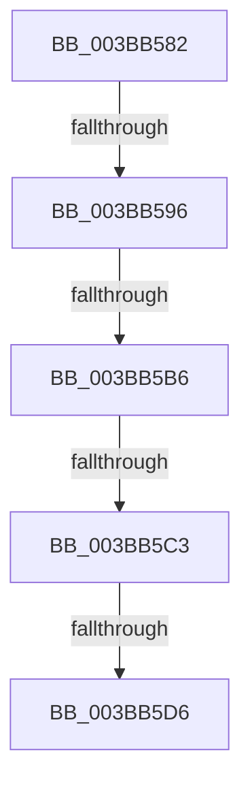

# sub_003BB582

- RVA: `0x003BB582`–`0x003BB5E1` (길이 `95` bytes)
- VA: `0x00000001403BB582`
- 실행 섹션: `.text`
- PDB 이름 있음: `아니요`; PDB Function 태그: `아니요`
- unwind 정보 RVA: `0x0008CC44`
- 디코드: `20`개 명령, `95/95` bytes 표시
- 미해석 바이트: `0` (있으면 어셈블리에 `.byte`로 보존)

> 이 문서는 커널 이미지의 기계어와 PDB 기호를 분석해 생성했습니다. 4번과 5번은 함수 원형과 자료형을 바이너리 사용 방식에서 추정한 C 해석이며 원본 소스 복구 결과는 아닙니다.

## 1. Dependencies

- 직접 호출 지점: **0**; 고유 호출 대상: **0**
- 직접 호출자로 확인된 함수: **0**
- RIP 상대 이미지 참조: **0**

### Outgoing calls
- 직접 디코드된 call 명령이 없습니다.

### Direct callers
- 이 함수 시작 RVA로 연결되는 직접 call은 확인되지 않았습니다. 간접 호출은 완전히 역산할 수 없습니다.

### Static image references
- 디코드된 RIP-relative 메모리 참조가 없습니다.

## 2. Other-region calls and transfers

- 다른 실행 섹션으로 향하는 call: **0**
- call이 아닌 외부 분기/꼬리 이동: **5**
  - `0x003BB594` → [sub_003BB605](Unknown_function_003BB605.md) (`tail-transfer`)
  - `0x003BB5B0` → [sub_003BB6FB](Unknown_function_003BB6FB.md) (`tail-transfer`)
  - `0x003BB5BD` → [sub_003BB6FB](Unknown_function_003BB6FB.md) (`tail-transfer`)
  - `0x003BB5D4` → [sub_003BB64A + 0x7](Unknown_function_003BB64A.md) (`tail-transfer`)
  - `0x003BB5DF` → [sub_003BB63E](Unknown_function_003BB63E.md) (`tail-transfer`)

## 3. Assembly (complete function range)

```asm
003BB582  4C 89 74 24 40                  mov qword ptr [rsp + 0x40], r14
003BB587  41 8B D9                        mov ebx, r9d
003BB58A  49 8B E8                        mov rbp, r8
003BB58D  48 8B F1                        mov rsi, rcx
003BB590  48 83 FA 01                     cmp rdx, 1
003BB594  75 6F                           jne 0x1403bb605
003BB596  48 C7 C7 FF FF FF FF            mov rdi, 0xffffffffffffffff
003BB59D  F0 48 0F C1 B9 00 49 00 00      lock xadd qword ptr [rcx + 0x4900], rdi
003BB5A6  48 FF CF                        dec rdi
003BB5A9  48 3B B9 00 41 00 00            cmp rdi, qword ptr [rcx + 0x4100]
003BB5B0  0F 84 45 01 00 00               je 0x1403bb6fb
003BB5B6  48 3B B9 08 41 00 00            cmp rdi, qword ptr [rcx + 0x4108]
003BB5BD  0F 84 38 01 00 00               je 0x1403bb6fb
003BB5C3  4C 8D 77 01                     lea r14, [rdi + 1]
003BB5C7  41 BF 01 00 00 00               mov r15d, 1
003BB5CD  48 81 FF 20 04 00 00            cmp rdi, 0x420
003BB5D4  76 7B                           jbe 0x1403bb651
003BB5D6  4C 8B 74 24 40                  mov r14, qword ptr [rsp + 0x40]
003BB5DB  48 83 FD FF                     cmp rbp, -1
003BB5DF  75 5D                           jne 0x1403bb63e
```

## 4. C-style interpretation (structured pseudocode)

```c
void __fastcall sub_003BB582(__int64 a1, __int64 a2, __int64 a3, int a4, __int64 a5, __int64 a6, __int64 a7, __int64 a8)
{
    __int64 v_rdi;
    unsigned __int64 v_stack_p40;

    v_stack_p40 = v_r14;
    v_rdi = (-1) - 1;
}
```

## 5. (Beta) C Style

```c
void sub_003BB582(void *Arg1, int64_t Arg2, int64_t Arg3, int32_t Arg4, uint64_t Arg5, uint64_t Arg6, uint64_t Arg7, int64_t Arg8)
{
    uint8_t *arg1 = (uint8_t *)Arg1;

    int64_t local_rdi;
    uint64_t v_stack_p40;

    v_stack_p40 = local_r14;
    local_rdi = (-1) - 1;
}
```

### 관측된 메모리 오프셋

구조체 형식이 확인되지 않은 접근은 인자 기준의 오프셋으로만 기록했습니다.

| 기준 인자 | 오프셋 표현 | 폭 (bit) | 접근 |
|---|---:|---:|---|
| `Arg1` | `+ 0x4100` | `64` | `R` |
| `Arg1` | `+ 0x4108` | `64` | `R` |
| `Arg1` | `+ 0x4900` | `64` | `R/W` |

## 6. Execution-region graph

[열기: 2D/3D 그래프와 함수 탐색 컨트롤 패널](../../../control-panel.html?section=text&rva=0x003BB582&view=graph)

- 2D 그래프는 위에서 아래로 흐르고, 3D 그래프는 빈 공간을 드래그해 회전합니다. Shift+드래그는 이동, 휠은 확대·축소, 함수 노드 선택은 대상 보고서 이동입니다.

### Static fallback


