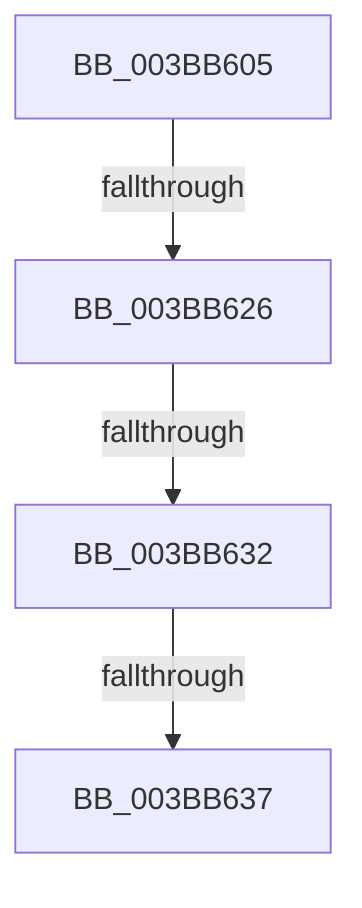

# sub_003BB605

- RVA: `0x003BB605`–`0x003BB63E` (길이 `57` bytes)
- VA: `0x00000001403BB605`
- 실행 섹션: `.text`
- PDB 이름 있음: `아니요`; PDB Function 태그: `아니요`
- unwind 정보 RVA: `0x0008CC6C`
- 디코드: `15`개 명령, `57/57` bytes 표시
- 미해석 바이트: `0` (있으면 어셈블리에 `.byte`로 보존)

> 이 문서는 커널 이미지의 기계어와 PDB 기호를 분석해 생성했습니다. 4번과 5번은 함수 원형과 자료형을 바이너리 사용 방식에서 추정한 C 해석이며 원본 소스 복구 결과는 아닙니다.

## 1. Dependencies

- 직접 호출 지점: **1**; 고유 호출 대상: **1**
- 직접 호출자로 확인된 함수: **0**
- RIP 상대 이미지 참조: **0**

### Outgoing calls
- `0x003BB637` → [MiUpdateAvailableEventsAtDpc](MiUpdateAvailableEventsAtDpc_function_003BC804.md) (function, `0x003BC804`)

### Direct callers
- 이 함수 시작 RVA로 연결되는 직접 call은 확인되지 않았습니다. 간접 호출은 완전히 역산할 수 없습니다.

### Static image references
- 디코드된 RIP-relative 메모리 참조가 없습니다.

## 2. Other-region calls and transfers

- 다른 실행 섹션으로 향하는 call: **0**
- call이 아닌 외부 분기/꼬리 이동: **4**
  - `0x003BB624` → [sub_003BB64A](Unknown_function_003BB64A.md) (`tail-transfer`)
  - `0x003BB630` → [sub_003BB582 + 0x45](Unknown_function_003BB582.md) (`tail-transfer`)
  - `0x003BB635` → [sub_003BB582 + 0x45](Unknown_function_003BB582.md) (`tail-transfer`)
  - `0x003BB63C` → [sub_003BB582 + 0x45](Unknown_function_003BB582.md) (`tail-transfer`)

## 3. Assembly (complete function range)

```asm
003BB605  4C 8B F2                        mov r14, rdx
003BB608  49 F7 DE                        neg r14
003BB60B  F0 4C 0F C1 B1 00 49 00 00      lock xadd qword ptr [rcx + 0x4900], r14
003BB614  48 8B 81 08 41 00 00            mov rax, qword ptr [rcx + 0x4108]
003BB61B  49 8B FE                        mov rdi, r14
003BB61E  48 2B FA                        sub rdi, rdx
003BB621  48 3B F8                        cmp rdi, rax
003BB624  76 24                           jbe 0x1403bb64a
003BB626  48 8B 81 00 41 00 00            mov rax, qword ptr [rcx + 0x4100]
003BB62D  48 3B F8                        cmp rdi, rax
003BB630  77 95                           ja 0x1403bb5c7
003BB632  4C 3B F0                        cmp r14, rax
003BB635  76 90                           jbe 0x1403bb5c7
003BB637  E8 C8 11 00 00                  call 0x1403bc804
003BB63C  EB 89                           jmp 0x1403bb5c7
```

## 4. C-style interpretation (structured pseudocode)

```c
__int64 __fastcall sub_003BB605(__int64 a1, __int64 a2)
{
    __int64 result;
    __int64 v_r14;
    __int64 v_rdi;

    v_r14 = -(a2);
    v_rdi = (v_r14) - (a2);
    result = MiUpdateAvailableEventsAtDpc(a1, a2, a3, a4);
}
```

## 5. (Beta) C Style

```c
int64_t sub_003BB605(void *Arg1, int64_t Arg2)
{
    uint8_t *arg1 = (uint8_t *)Arg1;

    int64_t result;
    int64_t local_r14;
    int64_t local_rdi;

    local_r14 = -(Arg2);
    local_rdi = (local_r14) - (Arg2);
    result = MiUpdateAvailableEventsAtDpc(Arg1, Arg2, a3, a4);
}
```

### 관측된 메모리 오프셋

구조체 형식이 확인되지 않은 접근은 인자 기준의 오프셋으로만 기록했습니다.

| 기준 인자 | 오프셋 표현 | 폭 (bit) | 접근 |
|---|---:|---:|---|
| `Arg1` | `+ 0x4100` | `64` | `R` |
| `Arg1` | `+ 0x4108` | `64` | `R` |
| `Arg1` | `+ 0x4900` | `64` | `R/W` |

## 6. Execution-region graph

[열기: 2D/3D 그래프와 함수 탐색 컨트롤 패널](../../../control-panel.html?section=text&rva=0x003BB605&view=graph)

- 2D 그래프는 위에서 아래로 흐르고, 3D 그래프는 빈 공간을 드래그해 회전합니다. Shift+드래그는 이동, 휠은 확대·축소, 함수 노드 선택은 대상 보고서 이동입니다.

### Static fallback


