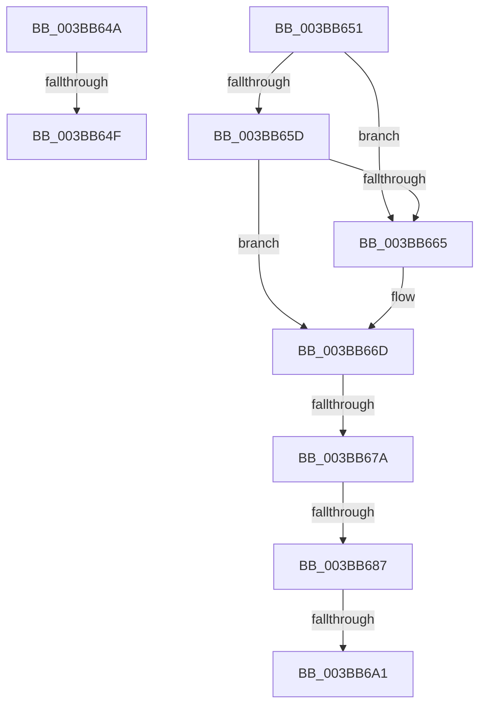

# sub_003BB64A

- RVA: `0x003BB64A`–`0x003BB6B7` (길이 `109` bytes)
- VA: `0x00000001403BB64A`
- 실행 섹션: `.text`
- PDB 이름 있음: `아니요`; PDB Function 태그: `아니요`
- unwind 정보 RVA: `0x0008CC90`
- 디코드: `26`개 명령, `109/109` bytes 표시
- 미해석 바이트: `0` (있으면 어셈블리에 `.byte`로 보존)

> 이 문서는 커널 이미지의 기계어와 PDB 기호를 분석해 생성했습니다. 4번과 5번은 함수 원형과 자료형을 바이너리 사용 방식에서 추정한 C 해석이며 원본 소스 복구 결과는 아닙니다.

## 1. Dependencies

- 직접 호출 지점: **3**; 고유 호출 대상: **3**
- 직접 호출자로 확인된 함수: **0**
- RIP 상대 이미지 참조: **0**

### Outgoing calls
- `0x003BB668` → [MiObtainFreePages](MiObtainFreePages_function_003BB724.md) (function, `0x003BB724`)
- `0x003BB68D` → [MiSlabDemotionLowMemoryConditionUpdate](MiSlabDemotionLowMemoryConditionUpdate_function_003BB7E0.md) (function, `0x003BB7E0`)
- `0x003BB6AD` → [KeSetEvent](../33/KeSetEvent_function_0033F310.md) (function, `0x0033F310`)

### Direct callers
- 이 함수 시작 RVA로 연결되는 직접 call은 확인되지 않았습니다. 간접 호출은 완전히 역산할 수 없습니다.

### Static image references
- 디코드된 RIP-relative 메모리 참조가 없습니다.

## 2. Other-region calls and transfers

- 다른 실행 섹션으로 향하는 call: **0**
- call이 아닌 외부 분기/꼬리 이동: **6**
  - `0x003BB64D` → [sub_003BB605 + 0x21](Unknown_function_003BB605.md) (`tail-transfer`)
  - `0x003BB64F` → [sub_003BB605 + 0x32](Unknown_function_003BB605.md) (`tail-transfer`)
  - `0x003BB674` → [sub_003BB582 + 0x54](Unknown_function_003BB582.md) (`tail-transfer`)
  - `0x003BB681` → [sub_003BB582 + 0x54](Unknown_function_003BB582.md) (`tail-transfer`)
  - `0x003BB69B` → [sub_003BB582 + 0x54](Unknown_function_003BB582.md) (`tail-transfer`)
  - `0x003BB6B2` → [sub_003BB582 + 0x54](Unknown_function_003BB582.md) (`tail-transfer`)

## 3. Assembly (complete function range)

```asm
003BB64A  4C 3B F0                        cmp r14, rax
003BB64D  76 D7                           jbe 0x1403bb626
003BB64F  EB E6                           jmp 0x1403bb637
003BB651  48 8B 86 C0 44 00 00            mov rax, qword ptr [rsi + 0x44c0]
003BB658  48 85 C0                        test rax, rax
003BB65B  74 08                           je 0x1403bb665
003BB65D  0F B6 40 34                     movzx eax, byte ptr [rax + 0x34]
003BB661  84 C0                           test al, al
003BB663  75 08                           jne 0x1403bb66d
003BB665  48 8B CE                        mov rcx, rsi
003BB668  E8 B7 00 00 00                  call 0x1403bb724
003BB66D  48 81 FF A0 00 00 00            cmp rdi, 0xa0
003BB674  0F 83 5C FF FF FF               jae 0x1403bb5d6
003BB67A  49 81 FE A0 00 00 00            cmp r14, 0xa0
003BB681  0F 82 4F FF FF FF               jb 0x1403bb5d6
003BB687  41 8B D7                        mov edx, r15d
003BB68A  48 8B CE                        mov rcx, rsi
003BB68D  E8 4E 01 00 00                  call 0x1403bb7e0
003BB692  8B 86 B4 04 00 00               mov eax, dword ptr [rsi + 0x4b4]
003BB698  83 F8 FF                        cmp eax, -1
003BB69B  0F 84 35 FF FF FF               je 0x1403bb5d6
003BB6A1  48 8D 8E 20 04 00 00            lea rcx, [rsi + 0x420]
003BB6A8  45 33 C0                        xor r8d, r8d
003BB6AB  33 D2                           xor edx, edx
003BB6AD  E8 5E 3C F8 FF                  call 0x14033f310
003BB6B2  E9 1F FF FF FF                  jmp 0x1403bb5d6
```

## 4. C-style interpretation (structured pseudocode)

```c
__int64 __fastcall sub_003BB64A(__int64 a1, __int64 a2, int a3)
{
}
```

## 5. (Beta) C Style

```c
int64_t sub_003BB64A(int64_t Arg1, int64_t Arg2, int32_t Arg3)
{
}
```

## 6. Execution-region graph

[열기: 2D/3D 그래프와 함수 탐색 컨트롤 패널](../../../control-panel.html?section=text&rva=0x003BB64A&view=graph)

- 2D 그래프는 위에서 아래로 흐르고, 3D 그래프는 빈 공간을 드래그해 회전합니다. Shift+드래그는 이동, 휠은 확대·축소, 함수 노드 선택은 대상 보고서 이동입니다.

### Static fallback


