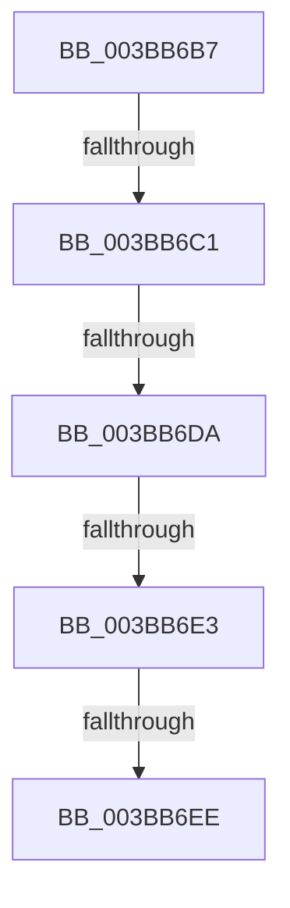

# sub_003BB6B7

- RVA: `0x003BB6B7`–`0x003BB6FB` (길이 `68` bytes)
- VA: `0x00000001403BB6B7`
- 실행 섹션: `.text`
- PDB 이름 있음: `아니요`; PDB Function 태그: `아니요`
- unwind 정보 RVA: `0x0008CCA4`
- 디코드: `17`개 명령, `68/68` bytes 표시
- 미해석 바이트: `0` (있으면 어셈블리에 `.byte`로 보존)

> 이 문서는 커널 이미지의 기계어와 PDB 기호를 분석해 생성했습니다. 4번과 5번은 함수 원형과 자료형을 바이너리 사용 방식에서 추정한 C 해석이며 원본 소스 복구 결과는 아닙니다.

## 1. Dependencies

- 직접 호출 지점: **0**; 고유 호출 대상: **0**
- 직접 호출자로 확인된 함수: **0**
- RIP 상대 이미지 참조: **0**

### Outgoing calls
- 직접 디코드된 call 명령이 없습니다.

### Direct callers
- 이 함수 시작 RVA로 연결되는 직접 call은 확인되지 않았습니다. 간접 호출은 완전히 역산할 수 없습니다.

### Static image references
- 디코드된 RIP-relative 메모리 참조가 없습니다.

## 2. Other-region calls and transfers

- 다른 실행 섹션으로 향하는 call: **0**
- call이 아닌 외부 분기/꼬리 이동: **5**
  - `0x003BB6BB` → [sub_003BB5E1 + 0xD](Unknown_function_003BB5E1.md) (`tail-transfer`)
  - `0x003BB6D4` → [sub_003BB5E1 + 0xD](Unknown_function_003BB5E1.md) (`tail-transfer`)
  - `0x003BB6E1` → [sub_003BB705 + 0xB](Unknown_function_003BB705.md) (`tail-transfer`)
  - `0x003BB6EC` → [sub_003BB705](Unknown_function_003BB705.md) (`tail-transfer`)
  - `0x003BB6F6` → [sub_003BB63E + 0x8](Unknown_function_003BB63E.md) (`tail-transfer`)

## 3. Assembly (complete function range)

```asm
003BB6B7  0F BA E3 09                     bt ebx, 9
003BB6BB  0F 82 2D FF FF FF               jb 0x1403bb5ee
003BB6C1  65 48 8B 0C 25 88 01 00 00      mov rcx, qword ptr gs:[0x188]
003BB6CA  8B 81 A4 05 00 00               mov eax, dword ptr [rcx + 0x5a4]
003BB6D0  24 0C                           and al, 0xc
003BB6D2  3C 08                           cmp al, 8
003BB6D4  0F 84 14 FF FF FF               je 0x1403bb5ee
003BB6DA  8B 46 04                        mov eax, dword ptr [rsi + 4]
003BB6DD  48 83 FF 20                     cmp rdi, 0x20
003BB6E1  72 2D                           jb 0x1403bb710
003BB6E3  8B 89 A4 05 00 00               mov ecx, dword ptr [rcx + 0x5a4]
003BB6E9  F6 C1 02                        test cl, 2
003BB6EC  75 17                           jne 0x1403bb705
003BB6EE  33 C9                           xor ecx, ecx
003BB6F0  A8 10                           test al, 0x10
003BB6F2  41 0F 45 CF                     cmovne ecx, r15d
003BB6F6  E9 4B FF FF FF                  jmp 0x1403bb646
```

## 4. C-style interpretation (structured pseudocode)

```c
__int64 __fastcall sub_003BB6B7(void)
{
    __int64 result;

    result = (unsigned __int8)(((unsigned int)(*(unsigned int *)(*(unsigned __int64 *)(gs_base + (0 + 392)) + 1444))) & (12));
    a1 = 0;
    if ((((unsigned __int8)((unsigned int)(*(unsigned int *)(v_rsi + 4)))) & (16)) != 0) { a1 = (unsigned int)(v_r15); }
}
```

## 5. (Beta) C Style

```c
void sub_003BB6B7(void)
{
    int64_t result;

    result = (uint8_t)(((uint32_t)(*(uint32_t *)(*(uint64_t *)(gs_base + (0 + 0x188)) + 0x5A4))) & (12));
    a1 = 0;
    if ((((uint8_t)((uint32_t)(*(uint32_t *)(local_rsi + 0x4)))) & (16)) != 0) { a1 = (uint32_t)(local_r15); }
}
```

## 6. Execution-region graph

[열기: 2D/3D 그래프와 함수 탐색 컨트롤 패널](../../../control-panel.html?section=text&rva=0x003BB6B7&view=graph)

- 2D 그래프는 위에서 아래로 흐르고, 3D 그래프는 빈 공간을 드래그해 회전합니다. Shift+드래그는 이동, 휠은 확대·축소, 함수 노드 선택은 대상 보고서 이동입니다.

### Static fallback


