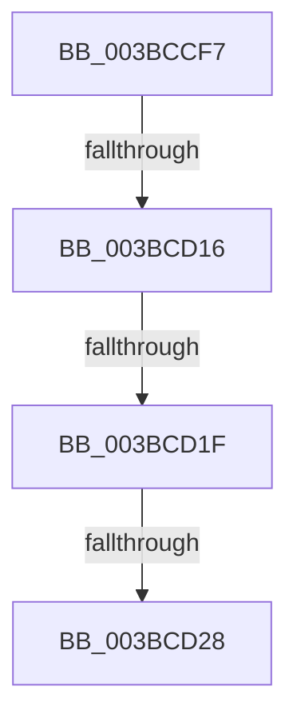

# sub_003BCCF7

- RVA: `0x003BCCF7`–`0x003BCD32` (길이 `59` bytes)
- VA: `0x00000001403BCCF7`
- 실행 섹션: `.text`
- PDB 이름 있음: `아니요`; PDB Function 태그: `아니요`
- unwind 정보 RVA: `0x0008CE04`
- 디코드: `12`개 명령, `59/59` bytes 표시
- 미해석 바이트: `0` (있으면 어셈블리에 `.byte`로 보존)

> 이 문서는 커널 이미지의 기계어와 PDB 기호를 분석해 생성했습니다. 4번과 5번은 함수 원형과 자료형을 바이너리 사용 방식에서 추정한 C 해석이며 원본 소스 복구 결과는 아닙니다.

## 1. Dependencies

- 직접 호출 지점: **0**; 고유 호출 대상: **0**
- 직접 호출자로 확인된 함수: **0**
- RIP 상대 이미지 참조: **0**

### Outgoing calls
- 직접 디코드된 call 명령이 없습니다.

### Direct callers
- 이 함수 시작 RVA로 연결되는 직접 call은 확인되지 않았습니다. 간접 호출은 완전히 역산할 수 없습니다.

### Static image references
- 디코드된 RIP-relative 메모리 참조가 없습니다.

## 2. Other-region calls and transfers

- 다른 실행 섹션으로 향하는 call: **0**
- call이 아닌 외부 분기/꼬리 이동: **4**
  - `0x003BCD14` → [sub_003BCD32](Unknown_function_003BCD32.md) (`tail-transfer`)
  - `0x003BCD1D` → [sub_003BCD32 + 0x24](Unknown_function_003BCD32.md) (`tail-transfer`)
  - `0x003BCD22` → [sub_003BCDB6](Unknown_function_003BCDB6.md) (`tail-transfer`)
  - `0x003BCD2D` → [MiIncreaseAvailablePages + 0x77](MiIncreaseAvailablePages_function_003BCC10.md) (`tail-transfer`)

## 3. Assembly (complete function range)

```asm
003BCCF7  4C 89 74 24 40                  mov qword ptr [rsp + 0x40], r14
003BCCFC  48 81 FF 20 04 00 00            cmp rdi, 0x420
003BCD03  41 BE 04 00 00 00               mov r14d, 4
003BCD09  44 0F 42 F2                     cmovb r14d, edx
003BCD0D  48 81 FE A0 00 00 00            cmp rsi, 0xa0
003BCD14  72 1C                           jb 0x1403bcd32
003BCD16  48 81 FE 20 01 00 00            cmp rsi, 0x120
003BCD1D  72 37                           jb 0x1403bcd56
003BCD1F  45 85 F6                        test r14d, r14d
003BCD22  0F 85 8E 00 00 00               jne 0x1403bcdb6
003BCD28  4C 8B 74 24 40                  mov r14, qword ptr [rsp + 0x40]
003BCD2D  E9 55 FF FF FF                  jmp 0x1403bcc87
```

## 4. C-style interpretation (structured pseudocode)

```c
void __fastcall sub_003BCCF7(__int64 a1, int a2, __int64 a3, __int64 a4, __int64 a5, __int64 a6, __int64 a7, __int64 a8)
{
    __int64 v_r14;
    unsigned __int64 v_stack_p40;

    v_stack_p40 = v_r14;
    v_r14 = 4;
    if (v_rdi < 0x420ULL) { v_r14 = a2; }
}
```

## 5. (Beta) C Style

```c
void sub_003BCCF7(int64_t Arg1, int32_t Arg2, int64_t Arg3, int64_t Arg4, uint64_t Arg5, uint64_t Arg6, uint64_t Arg7, int64_t Arg8)
{
    int64_t local_r14;
    uint64_t v_stack_p40;

    v_stack_p40 = local_r14;
    local_r14 = 4;
    if (local_rdi < 0x420ULL) { local_r14 = Arg2; }
}
```

## 6. Execution-region graph

[열기: 2D/3D 그래프와 함수 탐색 컨트롤 패널](../../../control-panel.html?section=text&rva=0x003BCCF7&view=graph)

- 2D 그래프는 위에서 아래로 흐르고, 3D 그래프는 빈 공간을 드래그해 회전합니다. Shift+드래그는 이동, 휠은 확대·축소, 함수 노드 선택은 대상 보고서 이동입니다.

### Static fallback


