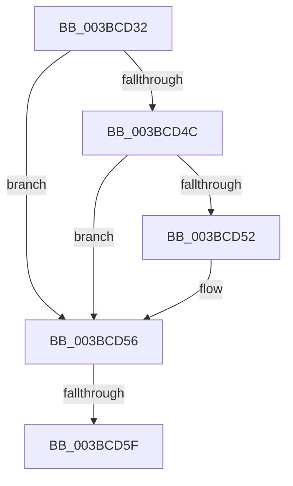

# sub_003BCD32

- RVA: `0x003BCD32`–`0x003BCD6B` (길이 `57` bytes)
- VA: `0x00000001403BCD32`
- 실행 섹션: `.text`
- PDB 이름 있음: `아니요`; PDB Function 태그: `아니요`
- unwind 정보 RVA: `0x0008CE18`
- 디코드: `15`개 명령, `57/57` bytes 표시
- 미해석 바이트: `0` (있으면 어셈블리에 `.byte`로 보존)

> 이 문서는 커널 이미지의 기계어와 PDB 기호를 분석해 생성했습니다. 4번과 5번은 함수 원형과 자료형을 바이너리 사용 방식에서 추정한 C 해석이며 원본 소스 복구 결과는 아닙니다.

## 1. Dependencies

- 직접 호출 지점: **1**; 고유 호출 대상: **1**
- 직접 호출자로 확인된 함수: **0**
- RIP 상대 이미지 참조: **0**

### Outgoing calls
- `0x003BCD64` → [MiSlabDemotionLowMemoryConditionUpdate](MiSlabDemotionLowMemoryConditionUpdate_function_003BB7E0.md) (function, `0x003BB7E0`)

### Direct callers
- 이 함수 시작 RVA로 연결되는 직접 call은 확인되지 않았습니다. 간접 호출은 완전히 역산할 수 없습니다.

### Static image references
- 디코드된 RIP-relative 메모리 참조가 없습니다.

## 2. Other-region calls and transfers

- 다른 실행 섹션으로 향하는 call: **0**
- call이 아닌 외부 분기/꼬리 이동: **2**
  - `0x003BCD5D` → [sub_003BCCF7 + 0x28](Unknown_function_003BCCF7.md) (`tail-transfer`)
  - `0x003BCD69` → [sub_003BCCF7 + 0x28](Unknown_function_003BCCF7.md) (`tail-transfer`)

## 3. Assembly (complete function range)

```asm
003BCD32  41 8B C6                        mov eax, r14d
003BCD35  83 C8 02                        or eax, 2
003BCD38  48 81 FF A0 00 00 00            cmp rdi, 0xa0
003BCD3F  41 0F 42 C6                     cmovb eax, r14d
003BCD43  44 8B F0                        mov r14d, eax
003BCD46  48 83 FE 22                     cmp rsi, 0x22
003BCD4A  73 0A                           jae 0x1403bcd56
003BCD4C  48 83 FF 22                     cmp rdi, 0x22
003BCD50  72 04                           jb 0x1403bcd56
003BCD52  41 83 CE 01                     or r14d, 1
003BCD56  48 81 FF 20 01 00 00            cmp rdi, 0x120
003BCD5D  72 C0                           jb 0x1403bcd1f
003BCD5F  BA 01 00 00 00                  mov edx, 1
003BCD64  E8 77 EA FF FF                  call 0x1403bb7e0
003BCD69  EB B4                           jmp 0x1403bcd1f
```

## 4. C-style interpretation (structured pseudocode)

```c
__int64 __fastcall sub_003BCD32(void)
{
    __int64 result;
    __int64 v_r14;

    result = (unsigned int)(((unsigned int)((unsigned int)(v_r14))) | (2));
    if (v_rdi < 160) { result = (unsigned int)(v_r14); }
    if (v_rsi >= 34) goto loc_003BCD56;
    v_r14 = (unsigned int)((unsigned int)(result));
    if (v_rdi >= 34) {
        v_r14 = (unsigned int)(((unsigned int)((unsigned int)(result))) | (1));
    }
    result = MiSlabDemotionLowMemoryConditionUpdate(a1, 1, a3, a4);
}
```

## 5. (Beta) C Style

```c
void sub_003BCD32(void)
{
    int64_t result;
    int64_t local_r14;

    result = (uint32_t)(((uint32_t)((uint32_t)(local_r14))) | (2));
    if (local_rdi < 160) { result = (uint32_t)(local_r14); }
    if (local_rsi >= 34) goto loc_003BCD56;
    local_r14 = (uint32_t)((uint32_t)(result));
    if (local_rdi >= 34) {
        local_r14 = (uint32_t)(((uint32_t)((uint32_t)(result))) | (1));
    }
    result = MiSlabDemotionLowMemoryConditionUpdate(a1, 1, a3, a4);
}
```

## 6. Execution-region graph

[열기: 2D/3D 그래프와 함수 탐색 컨트롤 패널](../../../control-panel.html?section=text&rva=0x003BCD32&view=graph)

- 2D 그래프는 위에서 아래로 흐르고, 3D 그래프는 빈 공간을 드래그해 회전합니다. Shift+드래그는 이동, 휠은 확대·축소, 함수 노드 선택은 대상 보고서 이동입니다.

### Static fallback


