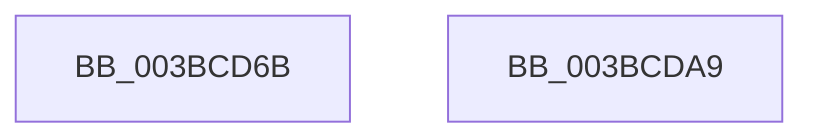

# sub_003BCD6B

- RVA: `0x003BCD6B`–`0x003BCDB6` (길이 `75` bytes)
- VA: `0x00000001403BCD6B`
- 실행 섹션: `.text`
- PDB 이름 있음: `아니요`; PDB Function 태그: `아니요`
- unwind 정보 RVA: `0x0008CE2C`
- 디코드: `16`개 명령, `75/75` bytes 표시
- 미해석 바이트: `0` (있으면 어셈블리에 `.byte`로 보존)

> 이 문서는 커널 이미지의 기계어와 PDB 기호를 분석해 생성했습니다. 4번과 5번은 함수 원형과 자료형을 바이너리 사용 방식에서 추정한 C 해석이며 원본 소스 복구 결과는 아닙니다.

## 1. Dependencies

- 직접 호출 지점: **4**; 고유 호출 대상: **4**
- 직접 호출자로 확인된 함수: **0**
- RIP 상대 이미지 참조: **0**

### Outgoing calls
- `0x003BCD7C` → [ExAcquireSpinLockExclusiveAtDpcLevel](../24/ExAcquireSpinLockExclusiveAtDpcLevel_function_00248E80.md) (function, `0x00248E80`)
- `0x003BCD8D` → [KeSetEvent](../33/KeSetEvent_function_0033F310.md) (function, `0x0033F310`)
- `0x003BCD9F` → [ExReleaseSpinLockExclusiveFromDpcLevel](../24/ExReleaseSpinLockExclusiveFromDpcLevel_function_002497E0.md) (function, `0x002497E0`)
- `0x003BCDAC` → [MiUpdateAvailableEventsAtDpc](MiUpdateAvailableEventsAtDpc_function_003BC804.md) (function, `0x003BC804`)

### Direct callers
- 이 함수 시작 RVA로 연결되는 직접 call은 확인되지 않았습니다. 간접 호출은 완전히 역산할 수 없습니다.

### Static image references
- 디코드된 RIP-relative 메모리 참조가 없습니다.

## 2. Other-region calls and transfers

- 다른 실행 섹션으로 향하는 call: **0**
- call이 아닌 외부 분기/꼬리 이동: **2**
  - `0x003BCDA4` → [MiIncreaseAvailablePages + 0x2D](MiIncreaseAvailablePages_function_003BCC10.md) (`tail-transfer`)
  - `0x003BCDB1` → [MiIncreaseAvailablePages + 0x4A](MiIncreaseAvailablePages_function_003BCC10.md) (`tail-transfer`)

## 3. Assembly (complete function range)

```asm
003BCD6B  33 D2                           xor edx, edx
003BCD6D  48 C1 E2 05                     shl rdx, 5
003BCD71  48 8D 3C 0A                     lea rdi, [rdx + rcx]
003BCD75  48 81 C1 40 3F 00 00            add rcx, 0x3f40
003BCD7C  E8 FF C0 E8 FF                  call 0x140248e80
003BCD81  45 33 C0                        xor r8d, r8d
003BCD84  48 8D 8F 48 3F 00 00            lea rcx, [rdi + 0x3f48]
003BCD8B  33 D2                           xor edx, edx
003BCD8D  E8 7E 25 F8 FF                  call 0x14033f310
003BCD92  FF 87 60 3F 00 00               inc dword ptr [rdi + 0x3f60]
003BCD98  48 8D 8D 40 3F 00 00            lea rcx, [rbp + 0x3f40]
003BCD9F  E8 3C CA E8 FF                  call 0x1402497e0
003BCDA4  E9 94 FE FF FF                  jmp 0x1403bcc3d
003BCDA9  48 8B CD                        mov rcx, rbp
003BCDAC  E8 53 FA FF FF                  call 0x1403bc804
003BCDB1  E9 A4 FE FF FF                  jmp 0x1403bcc5a
```

## 4. C-style interpretation (structured pseudocode)

```c
__int64 __fastcall sub_003BCD6B(__int64 a1, int a2, int a3)
{
    __int64 result;

    a2 = 0;
    a2 = (a2) << (5);
    a1 = (a1) + (0x3F40ULL);
    result = ExAcquireSpinLockExclusiveAtDpcLevel(a1, a2, a3, a4);
    a3 = 0;
    a2 = 0;
    result = KeSetEvent(a2 + a1 * 1 + 16200, a2, a3, a4);
    result = ExReleaseSpinLockExclusiveFromDpcLevel(v_rbp + 16192, a2, a3, a4);
}
```

## 5. (Beta) C Style

```c
int64_t sub_003BCD6B(int64_t Arg1, int32_t Arg2, int32_t Arg3)
{
    int64_t result;

    Arg2 = 0;
    Arg2 = (Arg2) << (5);
    Arg1 = (Arg1) + (0x3F40ULL);
    result = ExAcquireSpinLockExclusiveAtDpcLevel(Arg1, Arg2, Arg3, a4);
    Arg3 = 0;
    Arg2 = 0;
    result = KeSetEvent(Arg2 + Arg1 * 1 + 16200, Arg2, Arg3, a4);
    result = ExReleaseSpinLockExclusiveFromDpcLevel(local_rbp + 16192, Arg2, Arg3, a4);
}
```

## 6. Execution-region graph

[열기: 2D/3D 그래프와 함수 탐색 컨트롤 패널](../../../control-panel.html?section=text&rva=0x003BCD6B&view=graph)

- 2D 그래프는 위에서 아래로 흐르고, 3D 그래프는 빈 공간을 드래그해 회전합니다. Shift+드래그는 이동, 휠은 확대·축소, 함수 노드 선택은 대상 보고서 이동입니다.

### Static fallback


