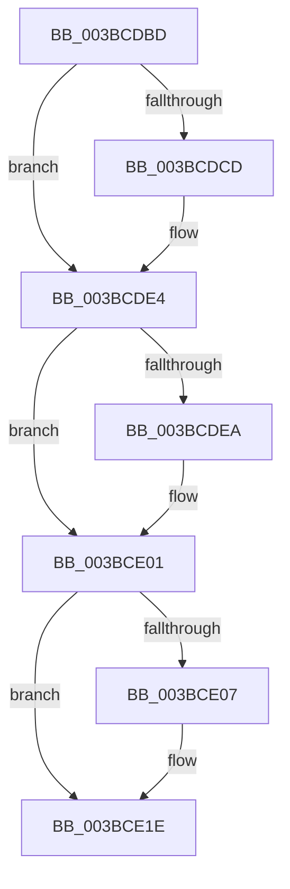

# sub_003BCDBD

- RVA: `0x003BCDBD`–`0x003BCE34` (길이 `119` bytes)
- VA: `0x00000001403BCDBD`
- 실행 섹션: `.text`
- PDB 이름 있음: `아니요`; PDB Function 태그: `아니요`
- unwind 정보 RVA: `0x0008CE50`
- 디코드: `27`개 명령, `119/119` bytes 표시
- 미해석 바이트: `0` (있으면 어셈블리에 `.byte`로 보존)

> 이 문서는 커널 이미지의 기계어와 PDB 기호를 분석해 생성했습니다. 4번과 5번은 함수 원형과 자료형을 바이너리 사용 방식에서 추정한 C 해석이며 원본 소스 복구 결과는 아닙니다.

## 1. Dependencies

- 직접 호출 지점: **5**; 고유 호출 대상: **3**
- 직접 호출자로 확인된 함수: **0**
- RIP 상대 이미지 참조: **0**

### Outgoing calls
- `0x003BCDC2` → [ExAcquireSpinLockExclusiveAtDpcLevel](../24/ExAcquireSpinLockExclusiveAtDpcLevel_function_00248E80.md) (function, `0x00248E80`)
- `0x003BCDD9` → [KeSetEvent](../33/KeSetEvent_function_0033F310.md) (function, `0x0033F310`)
- `0x003BCDF6` → [KeSetEvent](../33/KeSetEvent_function_0033F310.md) (function, `0x0033F310`)
- `0x003BCE13` → [KeSetEvent](../33/KeSetEvent_function_0033F310.md) (function, `0x0033F310`)
- `0x003BCE25` → [ExReleaseSpinLockExclusiveFromDpcLevel](../24/ExReleaseSpinLockExclusiveFromDpcLevel_function_002497E0.md) (function, `0x002497E0`)

### Direct callers
- 이 함수 시작 RVA로 연결되는 직접 call은 확인되지 않았습니다. 간접 호출은 완전히 역산할 수 없습니다.

### Static image references
- 디코드된 RIP-relative 메모리 참조가 없습니다.

## 2. Other-region calls and transfers

- 다른 실행 섹션으로 향하는 call: **0**
- call이 아닌 외부 분기/꼬리 이동: **1**
  - `0x003BCE2F` → [sub_003BCCF7 + 0x31](Unknown_function_003BCCF7.md) (`tail-transfer`)

## 3. Assembly (complete function range)

```asm
003BCDBD  4C 89 7C 24 50                  mov qword ptr [rsp + 0x50], r15
003BCDC2  E8 B9 C0 E8 FF                  call 0x140248e80
003BCDC7  41 F6 C6 01                     test r14b, 1
003BCDCB  74 17                           je 0x1403bcde4
003BCDCD  45 33 C0                        xor r8d, r8d
003BCDD0  48 8D 8D 48 3F 00 00            lea rcx, [rbp + 0x3f48]
003BCDD7  33 D2                           xor edx, edx
003BCDD9  E8 32 25 F8 FF                  call 0x14033f310
003BCDDE  FF 85 60 3F 00 00               inc dword ptr [rbp + 0x3f60]
003BCDE4  41 F6 C6 02                     test r14b, 2
003BCDE8  74 17                           je 0x1403bce01
003BCDEA  45 33 C0                        xor r8d, r8d
003BCDED  48 8D 8D 68 3F 00 00            lea rcx, [rbp + 0x3f68]
003BCDF4  33 D2                           xor edx, edx
003BCDF6  E8 15 25 F8 FF                  call 0x14033f310
003BCDFB  FF 85 80 3F 00 00               inc dword ptr [rbp + 0x3f80]
003BCE01  41 F6 C6 04                     test r14b, 4
003BCE05  74 17                           je 0x1403bce1e
003BCE07  45 33 C0                        xor r8d, r8d
003BCE0A  48 8D 8D 88 3F 00 00            lea rcx, [rbp + 0x3f88]
003BCE11  33 D2                           xor edx, edx
003BCE13  E8 F8 24 F8 FF                  call 0x14033f310
003BCE18  FF 85 A0 3F 00 00               inc dword ptr [rbp + 0x3fa0]
003BCE1E  48 8D 8D 40 3F 00 00            lea rcx, [rbp + 0x3f40]
003BCE25  E8 B6 C9 E8 FF                  call 0x1402497e0
003BCE2A  4C 8B 7C 24 50                  mov r15, qword ptr [rsp + 0x50]
003BCE2F  E9 F4 FE FF FF                  jmp 0x1403bcd28
```

## 4. C-style interpretation (structured pseudocode)

```c
__int64 __fastcall sub_003BCDBD(__int64 a1, int a2, int a3, __int64 a4, __int64 a5, __int64 a6, __int64 a7, __int64 a8, __int64 a9, __int64 a10)
{
    __int64 result;
    unsigned __int64 v_stack_p50;

    v_stack_p50 = v_r15;
    result = ExAcquireSpinLockExclusiveAtDpcLevel(a1, a2, a3, a4);
    if ((((unsigned __int8)(v_r14)) & (1)) != 0) {
        a3 = 0;
        a1 = v_rbp + 16200;
        a2 = 0;
        result = KeSetEvent(a1, a2, a3, a4);
    }
    if ((((unsigned __int8)(v_r14)) & (2)) != 0) {
        a3 = 0;
        a1 = v_rbp + 16232;
        a2 = 0;
        result = KeSetEvent(a1, a2, a3, a4);
    }
    if ((((unsigned __int8)(v_r14)) & (4)) != 0) {
        a3 = 0;
        a1 = v_rbp + 16264;
        a2 = 0;
        result = KeSetEvent(a1, a2, a3, a4);
    }
    result = ExReleaseSpinLockExclusiveFromDpcLevel(v_rbp + 16192, a2, a3, a4);
}
```

## 5. (Beta) C Style

```c
int64_t sub_003BCDBD(int64_t Arg1, int32_t Arg2, int32_t Arg3, int64_t Arg4, uint64_t Arg5, uint64_t Arg6, uint64_t Arg7, uint64_t Arg8, uint64_t Arg9, int64_t Arg10)
{
    int64_t result;
    uint64_t v_stack_p50;

    v_stack_p50 = local_r15;
    result = ExAcquireSpinLockExclusiveAtDpcLevel(Arg1, Arg2, Arg3, Arg4);
    if ((((uint8_t)(local_r14)) & (1)) != 0) {
        Arg3 = 0;
        Arg1 = local_rbp + 16200;
        Arg2 = 0;
        result = KeSetEvent(Arg1, Arg2, Arg3, Arg4);
    }
    if ((((uint8_t)(local_r14)) & (2)) != 0) {
        Arg3 = 0;
        Arg1 = local_rbp + 16232;
        Arg2 = 0;
        result = KeSetEvent(Arg1, Arg2, Arg3, Arg4);
    }
    if ((((uint8_t)(local_r14)) & (4)) != 0) {
        Arg3 = 0;
        Arg1 = local_rbp + 16264;
        Arg2 = 0;
        result = KeSetEvent(Arg1, Arg2, Arg3, Arg4);
    }
    result = ExReleaseSpinLockExclusiveFromDpcLevel(local_rbp + 16192, Arg2, Arg3, Arg4);
}
```

## 6. Execution-region graph

[열기: 2D/3D 그래프와 함수 탐색 컨트롤 패널](../../../control-panel.html?section=text&rva=0x003BCDBD&view=graph)

- 2D 그래프는 위에서 아래로 흐르고, 3D 그래프는 빈 공간을 드래그해 회전합니다. Shift+드래그는 이동, 휠은 확대·축소, 함수 노드 선택은 대상 보고서 이동입니다.

### Static fallback


