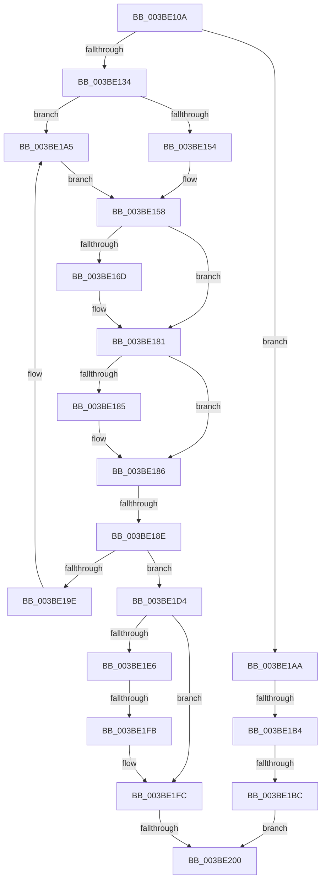

# sub_003BE10A

- RVA: `0x003BE10A`–`0x003BE21F` (길이 `277` bytes)
- VA: `0x00000001403BE10A`
- 실행 섹션: `.text`
- PDB 이름 있음: `아니요`; PDB Function 태그: `아니요`
- unwind 정보 RVA: `0x0008DD9C`
- 디코드: `84`개 명령, `277/277` bytes 표시
- 미해석 바이트: `0` (있으면 어셈블리에 `.byte`로 보존)

> 이 문서는 커널 이미지의 기계어와 PDB 기호를 분석해 생성했습니다. 4번과 5번은 함수 원형과 자료형을 바이너리 사용 방식에서 추정한 C 해석이며 원본 소스 복구 결과는 아닙니다.

## 1. Dependencies

- 직접 호출 지점: **2**; 고유 호출 대상: **2**
- 직접 호출자로 확인된 함수: **0**
- RIP 상대 이미지 참조: **0**

### Outgoing calls
- `0x003BE11F` → [KeAbPreAcquire](../21/KeAbPreAcquire_function_00210230.md) (function, `0x00210230`)
- `0x003BE1CD` → [ExpAcquireFastResourceExclusiveSlow](ExpAcquireFastResourceExclusiveSlow_function_003BE2E0.md) (function, `0x003BE2E0`)

### Direct callers
- 이 함수 시작 RVA로 연결되는 직접 call은 확인되지 않았습니다. 간접 호출은 완전히 역산할 수 없습니다.

### Static image references
- 디코드된 RIP-relative 메모리 참조가 없습니다.

## 2. Other-region calls and transfers

- 다른 실행 섹션으로 향하는 call: **0**
- call이 아닌 외부 분기/꼬리 이동: **5**
  - `0x003BE188` → [sub_003BE29A](Unknown_function_003BE29A.md) (`tail-transfer`)
  - `0x003BE1AE` → [sub_003BE220 + 0x21](Unknown_function_003BE220.md) (`tail-transfer`)
  - `0x003BE1B6` → [sub_003BE220 + 0x4B](Unknown_function_003BE220.md) (`tail-transfer`)
  - `0x003BE1F9` → [sub_003BE220](Unknown_function_003BE220.md) (`tail-transfer`)
  - `0x003BE1FE` → [sub_003BE220 + 0x37](Unknown_function_003BE220.md) (`tail-transfer`)

## 3. Assembly (complete function range)

```asm
003BE10A  4C 89 6C 24 60                  mov qword ptr [rsp + 0x60], r13
003BE10F  85 ED                           test ebp, ebp
003BE111  4C 89 7C 24 68                  mov qword ptr [rsp + 0x68], r15
003BE116  48 8B CF                        mov rcx, rdi
003BE119  41 0F 94 C0                     sete r8b
003BE11D  33 D2                           xor edx, edx
003BE11F  E8 0C 21 E5 FF                  call 0x140210230
003BE124  4C 8B E8                        mov r13, rax
003BE127  33 C0                           xor eax, eax
003BE129  F0 4C 0F B1 27                  lock cmpxchg qword ptr [rdi], r12
003BE12E  4C 8D 7F 40                     lea r15, [rdi + 0x40]
003BE132  75 76                           jne 0x1403be1aa
003BE134  41 F6 C6 10                     test r14b, 0x10
003BE138  B9 03 00 00 00                  mov ecx, 3
003BE13D  B8 0F 00 00 00                  mov eax, 0xf
003BE142  0F 45 C8                        cmovne ecx, eax
003BE145  8B E9                           mov ebp, ecx
003BE147  8B F9                           mov edi, ecx
003BE149  83 E5 02                        and ebp, 2
003BE14C  83 E7 04                        and edi, 4
003BE14F  F6 C1 08                        test cl, 8
003BE152  74 51                           je 0x1403be1a5
003BE154  45 0F B6 F4                     movzx r14d, r12b
003BE158  85 FF                           test edi, edi
003BE15A  45 89 67 20                     mov dword ptr [r15 + 0x20], r12d
003BE15E  0F 95 C3                        setne bl
003BE161  48 0B DE                        or rbx, rsi
003BE164  49 89 5F 10                     mov qword ptr [r15 + 0x10], rbx
003BE168  4D 85 ED                        test r13, r13
003BE16B  74 14                           je 0x1403be181
003BE16D  41 0F B6 45 08                  movzx eax, byte ptr [r13 + 8]
003BE172  24 3F                           and al, 0x3f
003BE174  45 88 65 0A                     mov byte ptr [r13 + 0xa], r12b
003BE178  02 C0                           add al, al
003BE17A  41 0A C4                        or al, r12b
003BE17D  41 88 47 24                     mov byte ptr [r15 + 0x24], al
003BE181  85 ED                           test ebp, ebp
003BE183  74 01                           je 0x1403be186
003BE185  FA                              cli
003BE186  85 FF                           test edi, edi
003BE188  0F 85 0C 01 00 00               jne 0x1403be29a
003BE18E  48 8D 86 B8 06 00 00            lea rax, [rsi + 0x6b8]
003BE195  48 8B 08                        mov rcx, qword ptr [rax]
003BE198  48 39 41 08                     cmp qword ptr [rcx + 8], rax
003BE19C  74 36                           je 0x1403be1d4
003BE19E  B9 03 00 00 00                  mov ecx, 3
003BE1A3  CD 29                           int 0x29
003BE1A5  45 32 F6                        xor r14b, r14b
003BE1A8  EB AE                           jmp 0x1403be158
003BE1AA  49 39 77 10                     cmp qword ptr [r15 + 0x10], rsi
003BE1AE  0F 84 8D 00 00 00               je 0x1403be241
003BE1B4  85 ED                           test ebp, ebp
003BE1B6  0F 84 AF 00 00 00               je 0x1403be26b
003BE1BC  4D 8B CD                        mov r9, r13
003BE1BF  44 89 74 24 20                  mov dword ptr [rsp + 0x20], r14d
003BE1C4  4C 8B C6                        mov r8, rsi
003BE1C7  48 8B D0                        mov rdx, rax
003BE1CA  48 8B CF                        mov rcx, rdi
003BE1CD  E8 0E 01 00 00                  call 0x1403be2e0
003BE1D2  EB 2C                           jmp 0x1403be200
003BE1D4  49 89 0F                        mov qword ptr [r15], rcx
003BE1D7  49 89 47 08                     mov qword ptr [r15 + 8], rax
003BE1DB  4C 89 79 08                     mov qword ptr [rcx + 8], r15
003BE1DF  4C 89 38                        mov qword ptr [rax], r15
003BE1E2  85 ED                           test ebp, ebp
003BE1E4  74 16                           je 0x1403be1fc
003BE1E6  65 48 8B 0C 25 20 00 00 00      mov rcx, qword ptr gs:[0x20]
003BE1EF  4C 8B 81 B8 8E 00 00            mov r8, qword ptr [rcx + 0x8eb8]
003BE1F6  4D 85 C0                        test r8, r8
003BE1F9  75 25                           jne 0x1403be220
003BE1FB  FB                              sti
003BE1FC  85 FF                           test edi, edi
003BE1FE  75 57                           jne 0x1403be257
003BE200  41 0F B6 C4                     movzx eax, r12b
003BE204  4C 8B 6C 24 60                  mov r13, qword ptr [rsp + 0x60]
003BE209  4C 8B 7C 24 68                  mov r15, qword ptr [rsp + 0x68]
003BE20E  48 8B 5C 24 70                  mov rbx, qword ptr [rsp + 0x70]
003BE213  48 83 C4 30                     add rsp, 0x30
003BE217  41 5E                           pop r14
003BE219  41 5C                           pop r12
003BE21B  5F                              pop rdi
003BE21C  5E                              pop rsi
003BE21D  5D                              pop rbp
003BE21E  C3                              ret
```

## 4. C-style interpretation (structured pseudocode)

```c
__int64 __fastcall sub_003BE10A(__int64 a1, int a2, __int64 a3, __int64 a4, __int64 a5, __int64 a6, __int64 a7, __int64 a8, __int64 a9, __int64 a10, __int64 a11, __int64 a12, __int64 a13, __int64 a14)
{
    __int64 result;
    __int64 v_r14;
    __int64 v_rbp;
    __int64 v_rbx;
    __int64 v_rdi;
    __int64 v_rsp;
    unsigned int v_stack_p20;
    unsigned __int64 v_stack_p60;
    unsigned __int64 v_stack_p68;

    v_stack_p60 = v_r13;
    v_stack_p68 = v_r15;
    a3 = ((unsigned int)(v_rbp) == 0) ? 1 : 0;
    a2 = 0;
    result = KeAbPreAcquire(v_rdi, a2, a3, a4);
    result = 0;
    if (condition_is_not_equal) goto loc_003BE1AA;
    a1 = 3;
    if ((((unsigned __int8)(v_r14)) & (16)) != 0) { a1 = 15; }
    v_rbp = (unsigned int)(((unsigned int)((unsigned int)(a1))) & (2));
    v_rdi = (unsigned int)(((unsigned int)((unsigned int)(a1))) & (4));
    if ((((unsigned __int8)(a1)) & (8)) == 0) goto loc_003BE1A5;
loc_003BE158:
    *(unsigned int *)(v_rdi + 64 + 32) = (unsigned int)(v_r12);
    v_rbx = ((unsigned int)(v_rdi) != 0) ? 1 : 0;
    v_rbx = (v_rbx) | (v_rsi);
    *(unsigned __int64 *)(v_rdi + 64 + 16) = v_rbx;
    result = 15;
    if (0 != 0) {
        result = *(unsigned __int8 *)(result + 8);
        result = (unsigned __int8)((result) & (63));
        *(unsigned __int8 *)(result + 10) = (unsigned __int8)(v_r12);
        result = (unsigned __int8)((result) + ((unsigned __int8)(result)));
        result = (unsigned __int8)((result) | ((unsigned __int8)(v_r12)));
        *(unsigned __int8 *)(v_rdi + 64 + 36) = (unsigned __int8)(result);
    }
    if ((unsigned int)(v_rbp) != 0) {
    }
    if ((*(unsigned __int64 *)(*(unsigned __int64 *)(v_rsi + 1720) + 8)) == (v_rsi + 1720)) goto loc_003BE1D4;
loc_003BE1A5:
    v_r14 = 0;
    goto loc_003BE158;
loc_003BE1AA:
    v_stack_p20 = 0;
    result = ExpAcquireFastResourceExclusiveSlow(v_rdi, v_rsi + 1720, v_rsi, result);
    goto loc_003BE200;
loc_003BE1D4:
    *(unsigned __int64 *)(v_rdi + 64) = v_rdi;
    *(unsigned __int64 *)(v_rdi + 64 + 8) = result;
    *(unsigned __int64 *)(v_rdi + 8) = v_rdi + 64;
    *(unsigned __int64 *)(result) = v_rdi + 64;
    if ((unsigned int)(v_rbp) == 0) goto loc_003BE1FC;
loc_003BE1FC:
loc_003BE200:
    v_rsp = (v_rsp) + (48);
    return (unsigned __int8)(v_r12);
}
```

## 5. (Beta) C Style

```c
int64_t sub_003BE10A(int64_t Arg1, int32_t Arg2, int64_t Arg3, int64_t Arg4, uint64_t Arg5, uint64_t Arg6, uint64_t Arg7, uint64_t Arg8, uint64_t Arg9, uint64_t Arg10, uint64_t Arg11, int64_t Arg12, int64_t Arg13, int64_t Arg14)
{
    int64_t result;
    int64_t local_r14;
    int64_t local_rbp;
    int64_t local_rbx;
    int64_t local_rdi;
    int64_t local_rsp;
    uint32_t v_stack_p20;
    uint64_t v_stack_p60;
    uint64_t v_stack_p68;

    v_stack_p60 = local_r13;
    v_stack_p68 = local_r15;
    Arg3 = ((uint32_t)(local_rbp) == 0) ? 1 : 0;
    Arg2 = 0;
    result = KeAbPreAcquire(local_rdi, Arg2, Arg3, Arg4);
    result = 0;
    if (condition_is_not_equal) goto loc_003BE1AA;
    Arg1 = 3;
    if ((((uint8_t)(local_r14)) & (16)) != 0) { Arg1 = 15; }
    local_rbp = (uint32_t)(((uint32_t)((uint32_t)(Arg1))) & (2));
    local_rdi = (uint32_t)(((uint32_t)((uint32_t)(Arg1))) & (4));
    if ((((uint8_t)(Arg1)) & (8)) == 0) goto loc_003BE1A5;
loc_003BE158:
    *(uint32_t *)(local_rdi + 0x40 + 0x20) = (uint32_t)(local_r12);
    local_rbx = ((uint32_t)(local_rdi) != 0) ? 1 : 0;
    local_rbx = (local_rbx) | (local_rsi);
    *(uint64_t *)(local_rdi + 0x40 + 0x10) = local_rbx;
    result = 15;
    if (0 != 0) {
        result = *(uint8_t *)(result + 0x8);
        result = (uint8_t)((result) & (63));
        *(uint8_t *)(result + 0xA) = (uint8_t)(local_r12);
        result = (uint8_t)((result) + ((uint8_t)(result)));
        result = (uint8_t)((result) | ((uint8_t)(local_r12)));
        *(uint8_t *)(local_rdi + 0x40 + 0x24) = (uint8_t)(result);
    }
    if ((uint32_t)(local_rbp) != 0) {
    }
    if ((*(uint64_t *)(*(uint64_t *)(local_rsi + 0x6B8) + 0x8)) == (local_rsi + 1720)) goto loc_003BE1D4;
loc_003BE1A5:
    local_r14 = 0;
    goto loc_003BE158;
loc_003BE1AA:
    v_stack_p20 = 0;
    result = ExpAcquireFastResourceExclusiveSlow(local_rdi, local_rsi + 1720, local_rsi, result);
    goto loc_003BE200;
loc_003BE1D4:
    *(uint64_t *)(local_rdi + 0x40) = local_rdi;
    *(uint64_t *)(local_rdi + 0x40 + 0x8) = result;
    *(uint64_t *)(local_rdi + 0x8) = local_rdi + 64;
    *(uint64_t *)(result) = local_rdi + 64;
    if ((uint32_t)(local_rbp) == 0) goto loc_003BE1FC;
loc_003BE1FC:
loc_003BE200:
    local_rsp = (local_rsp) + (48);
    return (uint8_t)(local_r12);
}
```

## 6. Execution-region graph

[열기: 2D/3D 그래프와 함수 탐색 컨트롤 패널](../../../control-panel.html?section=text&rva=0x003BE10A&view=graph)

- 2D 그래프는 위에서 아래로 흐르고, 3D 그래프는 빈 공간을 드래그해 회전합니다. Shift+드래그는 이동, 휠은 확대·축소, 함수 노드 선택은 대상 보고서 이동입니다.

### Static fallback


