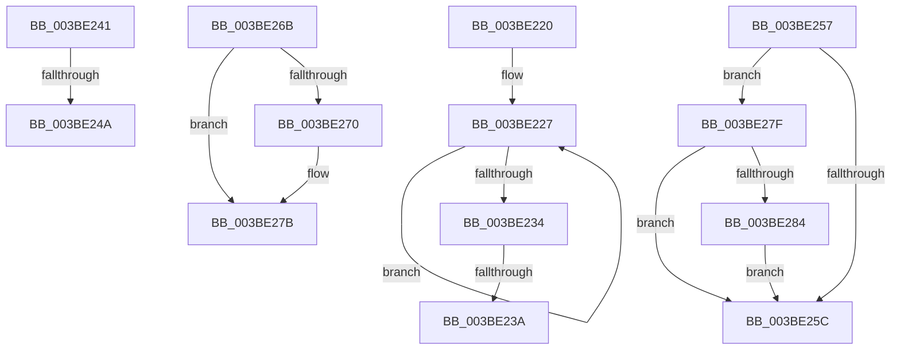

# sub_003BE220

- RVA: `0x003BE220`–`0x003BE28E` (길이 `110` bytes)
- VA: `0x00000001403BE220`
- 실행 섹션: `.text`
- PDB 이름 있음: `아니요`; PDB Function 태그: `아니요`
- unwind 정보 RVA: `0x0008DDC8`
- 디코드: `35`개 명령, `110/110` bytes 표시
- 미해석 바이트: `0` (있으면 어셈블리에 `.byte`로 보존)

> 이 문서는 커널 이미지의 기계어와 PDB 기호를 분석해 생성했습니다. 4번과 5번은 함수 원형과 자료형을 바이너리 사용 방식에서 추정한 C 해석이며 원본 소스 복구 결과는 아닙니다.

## 1. Dependencies

- 직접 호출 지점: **5**; 고유 호출 대상: **4**
- 직접 호출자로 확인된 함수: **0**
- RIP 상대 이미지 참조: **0**

### Outgoing calls
- `0x003BE23A` → [KiRemoveSystemWorkPriorityKick](../26/KiRemoveSystemWorkPriorityKick_function_002631D0.md) (function, `0x002631D0`)
- `0x003BE250` → [KeAbPostReleaseEx](../26/KeAbPostReleaseEx_function_00262210.md) (function, `0x00262210`)
- `0x003BE264` → [ObfReferenceObjectWithTag](../21/ObfReferenceObjectWithTag_function_00210710.md) (function, `0x00210710`)
- `0x003BE276` → [KeAbPostReleaseEx](../26/KeAbPostReleaseEx_function_00262210.md) (function, `0x00262210`)
- `0x003BE287` → [KeAbMarkCrossThreadReleasable](KeAbMarkCrossThreadReleasable_function_003BE8AC.md) (function, `0x003BE8AC`)

### Direct callers
- 이 함수 시작 RVA로 연결되는 직접 call은 확인되지 않았습니다. 간접 호출은 완전히 역산할 수 없습니다.

### Static image references
- 디코드된 RIP-relative 메모리 참조가 없습니다.

## 2. Other-region calls and transfers

- 다른 실행 섹션으로 향하는 call: **0**
- call이 아닌 외부 분기/꼬리 이동: **6**
  - `0x003BE238` → [sub_003BE10A + 0xF1](Unknown_function_003BE10A.md) (`tail-transfer`)
  - `0x003BE23F` → [sub_003BE10A + 0xF1](Unknown_function_003BE10A.md) (`tail-transfer`)
  - `0x003BE248` → [sub_003BE10A + 0xF6](Unknown_function_003BE10A.md) (`tail-transfer`)
  - `0x003BE255` → [sub_003BE10A + 0xF6](Unknown_function_003BE10A.md) (`tail-transfer`)
  - `0x003BE269` → [sub_003BE10A + 0xF6](Unknown_function_003BE10A.md) (`tail-transfer`)
  - `0x003BE27D` → [sub_003BE10A + 0xFA](Unknown_function_003BE10A.md) (`tail-transfer`)

## 3. Assembly (complete function range)

```asm
003BE220  41 0F 0D 08                     prefetchw byte ptr [r8]
003BE224  41 8B 00                        mov eax, dword ptr [r8]
003BE227  8B D0                           mov edx, eax
003BE229  0F BA F2 15                     btr edx, 0x15
003BE22D  F0 41 0F B1 10                  lock cmpxchg dword ptr [r8], edx
003BE232  75 F3                           jne 0x1403be227
003BE234  0F BA E0 15                     bt eax, 0x15
003BE238  73 C1                           jae 0x1403be1fb
003BE23A  E8 91 4F EA FF                  call 0x1402631d0
003BE23F  EB BA                           jmp 0x1403be1fb
003BE241  41 FF 47 20                     inc dword ptr [r15 + 0x20]
003BE245  4D 85 ED                        test r13, r13
003BE248  74 B6                           je 0x1403be200
003BE24A  49 8B D5                        mov rdx, r13
003BE24D  48 8B CF                        mov rcx, rdi
003BE250  E8 BB 3F EA FF                  call 0x140262210
003BE255  EB A9                           jmp 0x1403be200
003BE257  45 84 F6                        test r14b, r14b
003BE25A  75 23                           jne 0x1403be27f
003BE25C  BA 44 66 6C 74                  mov edx, 0x746c6644
003BE261  48 8B CE                        mov rcx, rsi
003BE264  E8 A7 24 E5 FF                  call 0x140210710
003BE269  EB 95                           jmp 0x1403be200
003BE26B  4D 85 ED                        test r13, r13
003BE26E  74 0B                           je 0x1403be27b
003BE270  49 8B D5                        mov rdx, r13
003BE273  48 8B CF                        mov rcx, rdi
003BE276  E8 95 3F EA FF                  call 0x140262210
003BE27B  32 C0                           xor al, al
003BE27D  EB 85                           jmp 0x1403be204
003BE27F  4D 85 ED                        test r13, r13
003BE282  74 D8                           je 0x1403be25c
003BE284  49 8B D5                        mov rdx, r13
003BE287  E8 20 06 00 00                  call 0x1403be8ac
003BE28C  EB CE                           jmp 0x1403be25c
```

## 4. C-style interpretation (structured pseudocode)

```c
__int64 __fastcall sub_003BE220(__int64 a1, __int64 a2, __int64 a3)
{
    __int64 result;

loc_003BE227:
    if (condition_is_not_equal) goto loc_003BE227;
    result = KiRemoveSystemWorkPriorityKick(a1, (unsigned int)((unsigned int)((unsigned int)(*(unsigned int *)(a3)))), a3, a4);
}
```

## 5. (Beta) C Style

```c
int64_t sub_003BE220(int64_t Arg1, int64_t Arg2, void *Arg3)
{
    uint8_t *arg3 = (uint8_t *)Arg3;

    int64_t result;

loc_003BE227:
    if (condition_is_not_equal) goto loc_003BE227;
    result = KiRemoveSystemWorkPriorityKick(Arg1, (uint32_t)((uint32_t)((uint32_t)(*(uint32_t *)(arg3)))), Arg3, a4);
}
```

### 관측된 메모리 오프셋

구조체 형식이 확인되지 않은 접근은 인자 기준의 오프셋으로만 기록했습니다.

| 기준 인자 | 오프셋 표현 | 폭 (bit) | 접근 |
|---|---:|---:|---|
| `Arg3` | `+ 0x0` | `8` | `R` |
| `Arg3` | `+ 0x0` | `32` | `R` |

## 6. Execution-region graph

[열기: 2D/3D 그래프와 함수 탐색 컨트롤 패널](../../../control-panel.html?section=text&rva=0x003BE220&view=graph)

- 2D 그래프는 위에서 아래로 흐르고, 3D 그래프는 빈 공간을 드래그해 회전합니다. Shift+드래그는 이동, 휠은 확대·축소, 함수 노드 선택은 대상 보고서 이동입니다.

### Static fallback


