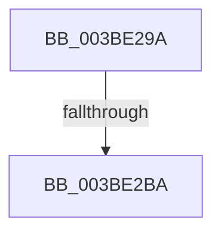

# sub_003BE29A

- RVA: `0x003BE29A`–`0x003BE2D9` (길이 `63` bytes)
- VA: `0x00000001403BE29A`
- 실행 섹션: `.text`
- PDB 이름 있음: `아니요`; PDB Function 태그: `아니요`
- unwind 정보 RVA: `0x0008DDF0`
- 디코드: `13`개 명령, `63/63` bytes 표시
- 미해석 바이트: `0` (있으면 어셈블리에 `.byte`로 보존)

> 이 문서는 커널 이미지의 기계어와 PDB 기호를 분석해 생성했습니다. 4번과 5번은 함수 원형과 자료형을 바이너리 사용 방식에서 추정한 C 해석이며 원본 소스 복구 결과는 아닙니다.

## 1. Dependencies

- 직접 호출 지점: **2**; 고유 호출 대상: **2**
- 직접 호출자로 확인된 함수: **0**
- RIP 상대 이미지 참조: **0**

### Outgoing calls
- `0x003BE2A1` → [KeAcquireSpinLockAtDpcLevel](../20/KeAcquireSpinLockAtDpcLevel_function_00208430.md) (function, `0x00208430`)
- `0x003BE2CF` → [KxReleaseSpinLock](../20/KxReleaseSpinLock_function_00206670.md) (function, `0x00206670`)

### Direct callers
- 이 함수 시작 RVA로 연결되는 직접 call은 확인되지 않았습니다. 간접 호출은 완전히 역산할 수 없습니다.

### Static image references
- 디코드된 RIP-relative 메모리 참조가 없습니다.

## 2. Other-region calls and transfers

- 다른 실행 섹션으로 향하는 call: **0**
- call이 아닌 외부 분기/꼬리 이동: **2**
  - `0x003BE2B4` → [sub_003BE10A + 0x94](Unknown_function_003BE10A.md) (`tail-transfer`)
  - `0x003BE2D4` → [sub_003BE10A + 0xD8](Unknown_function_003BE10A.md) (`tail-transfer`)

## 3. Assembly (complete function range)

```asm
003BE29A  48 8D 8E C8 06 00 00            lea rcx, [rsi + 0x6c8]
003BE2A1  E8 8A A1 E4 FF                  call 0x140208430
003BE2A6  48 8D 86 D0 06 00 00            lea rax, [rsi + 0x6d0]
003BE2AD  48 8B 10                        mov rdx, qword ptr [rax]
003BE2B0  48 39 42 08                     cmp qword ptr [rdx + 8], rax
003BE2B4  0F 85 E4 FE FF FF               jne 0x1403be19e
003BE2BA  49 89 17                        mov qword ptr [r15], rdx
003BE2BD  48 8D 8E C8 06 00 00            lea rcx, [rsi + 0x6c8]
003BE2C4  49 89 47 08                     mov qword ptr [r15 + 8], rax
003BE2C8  4C 89 7A 08                     mov qword ptr [rdx + 8], r15
003BE2CC  4C 89 38                        mov qword ptr [rax], r15
003BE2CF  E8 9C 83 E4 FF                  call 0x140206670
003BE2D4  E9 09 FF FF FF                  jmp 0x1403be1e2
```

## 4. C-style interpretation (structured pseudocode)

```c
__int64 __fastcall sub_003BE29A(void)
{
    __int64 result;

    result = KeAcquireSpinLockAtDpcLevel(v_rsi + 1736, a2, a3, a4);
    *(unsigned __int64 *)(v_r15) = *(unsigned __int64 *)(v_rsi + 1744);
    *(unsigned __int64 *)(v_r15 + 8) = v_rsi + 1744;
    *(unsigned __int64 *)(*(unsigned __int64 *)(v_rsi + 1744) + 8) = v_r15;
    *(unsigned __int64 *)(v_rsi + 1744) = v_r15;
    result = KxReleaseSpinLock(v_rsi + 1736, *(unsigned __int64 *)(v_rsi + 1744), a3, a4);
}
```

## 5. (Beta) C Style

```c
void sub_003BE29A(void)
{
    int64_t result;

    result = KeAcquireSpinLockAtDpcLevel(local_rsi + 1736, a2, a3, a4);
    *(uint64_t *)(local_r15) = *(uint64_t *)(local_rsi + 0x6D0);
    *(uint64_t *)(local_r15 + 0x8) = local_rsi + 1744;
    *(uint64_t *)(*(uint64_t *)(local_rsi + 0x6D0) + 0x8) = local_r15;
    *(uint64_t *)(local_rsi + 0x6D0) = local_r15;
    result = KxReleaseSpinLock(local_rsi + 1736, *(uint64_t *)(local_rsi + 0x6D0), a3, a4);
}
```

## 6. Execution-region graph

[열기: 2D/3D 그래프와 함수 탐색 컨트롤 패널](../../../control-panel.html?section=text&rva=0x003BE29A&view=graph)

- 2D 그래프는 위에서 아래로 흐르고, 3D 그래프는 빈 공간을 드래그해 회전합니다. Shift+드래그는 이동, 휠은 확대·축소, 함수 노드 선택은 대상 보고서 이동입니다.

### Static fallback


