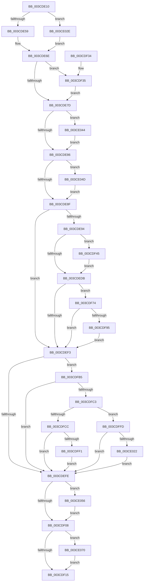

# CcChargeDirtyPagesInternal

- RVA: `0x003CDE10`–`0x003CE07F` (길이 `623` bytes)
- VA: `0x00000001403CDE10`
- 실행 섹션: `.text`
- PDB 이름 있음: `예`; PDB Function 태그: `아니요`
- unwind 정보 RVA: `0x0008FA84`
- 디코드: `130`개 명령, `623/623` bytes 표시
- 미해석 바이트: `0` (있으면 어셈블리에 `.byte`로 보존)

> 이 문서는 커널 이미지의 기계어와 PDB 기호를 분석해 생성했습니다. 4번과 5번은 함수 원형과 자료형을 바이너리 사용 방식에서 추정한 C 해석이며 원본 소스 복구 결과는 아닙니다.

## 1. Dependencies

- 직접 호출 지점: **4**; 고유 호출 대상: **4**
- 직접 호출자로 확인된 함수: **2**
- RIP 상대 이미지 참조: **1**

### Outgoing calls
- `0x003CDFDF` → [CcNotifyWriteBehindVolume](CcNotifyWriteBehindVolume_function_003CC134.md) (function, `0x003CC134`)
- `0x003CE010` → [CcNotifyWriteBehindInternal](CcNotifyWriteBehindInternal_function_003CC224.md) (function, `0x003CC224`)
- `0x003CE062` → [CcScheduleLazyWriteScan](CcScheduleLazyWriteScan_function_003CBD20.md) (function, `0x003CBD20`)
- `0x003CE075` → [CcAdjustWriteBehindThreadPoolIfNeeded](../38/CcAdjustWriteBehindThreadPoolIfNeeded_function_00386D94.md) (function, `0x00386D94`)

### Direct callers
- [CcUpdateExternalCacheInfoEx](../57/CcUpdateExternalCacheInfoEx_function_0057C420.md) at `0x0057C50F`
- [sub_006FCB7E](../6F/Unknown_function_006FCB7E.md) at `0x006FCBCE`

### Static image references
- `0x003CDE2D` → RVA `0x00E65B88` (`.data`; read)

## 2. Other-region calls and transfers

- 다른 실행 섹션으로 향하는 call: **0**
- 별도 외부 분기/꼬리 이동을 확인하지 못했습니다.

## 3. Assembly (complete function range)

```asm
003CDE10  48 8B C4                        mov rax, rsp
003CDE13  48 89 58 08                     mov qword ptr [rax + 8], rbx
003CDE17  48 89 68 10                     mov qword ptr [rax + 0x10], rbp
003CDE1B  48 89 70 18                     mov qword ptr [rax + 0x18], rsi
003CDE1F  48 89 78 20                     mov qword ptr [rax + 0x20], rdi
003CDE23  41 54                           push r12
003CDE25  41 56                           push r14
003CDE27  41 57                           push r15
003CDE29  48 83 EC 20                     sub rsp, 0x20
003CDE2D  80 3D 54 7D A9 00 00            cmp byte ptr [rip + 0xa97d54], 0
003CDE34  4C 8B DA                        mov r11, rdx
003CDE37  48 8B 7C 24 60                  mov rdi, qword ptr [rsp + 0x60]
003CDE3C  4C 8B D1                        mov r10, rcx
003CDE3F  48 8B 5C 24 68                  mov rbx, qword ptr [rsp + 0x68]
003CDE44  BA E0 03 00 00                  mov edx, 0x3e0
003CDE49  48 8B F3                        mov rsi, rbx
003CDE4C  48 8D 87 20 04 00 00            lea rax, [rdi + 0x420]
003CDE53  0F 84 D5 01 00 00               je 0x1403ce02e
003CDE59  4C 8D BB C4 02 00 00            lea r15, [rbx + 0x2c4]
003CDE60  4C 8D A3 94 04 00 00            lea r12, [rbx + 0x494]
003CDE67  48 8D AB E0 03 00 00            lea rbp, [rbx + 0x3e0]
003CDE6E  45 8B F1                        mov r14d, r9d
003CDE71  4C 01 30                        add qword ptr [rax], r14
003CDE74  48 85 DB                        test rbx, rbx
003CDE77  0F 85 B8 00 00 00               jne 0x1403cdf35
003CDE7D  4D 85 DB                        test r11, r11
003CDE80  0F 85 BE 01 00 00               jne 0x1403ce044
003CDE86  4D 85 C0                        test r8, r8
003CDE89  0F 85 BE 01 00 00               jne 0x1403ce04d
003CDE8F  4D 85 D2                        test r10, r10
003CDE92  74 5F                           je 0x1403cdef3
003CDE94  45 01 4A 70                     add dword ptr [r10 + 0x70], r9d
003CDE98  49 8B 82 00 02 00 00            mov rax, qword ptr [r10 + 0x200]
003CDE9F  F0 4C 01 70 28                  lock add qword ptr [rax + 0x28], r14
003CDEA4  4D 8B 82 00 02 00 00            mov r8, qword ptr [r10 + 0x200]
003CDEAB  49 8B 40 28                     mov rax, qword ptr [r8 + 0x28]
003CDEAF  49 01 80 F8 00 00 00            add qword ptr [r8 + 0xf8], rax
003CDEB6  49 8B 90 00 01 00 00            mov rdx, qword ptr [r8 + 0x100]
003CDEBD  49 8B 82 00 02 00 00            mov rax, qword ptr [r10 + 0x200]
003CDEC4  48 8B 48 28                     mov rcx, qword ptr [rax + 0x28]
003CDEC8  48 3B D1                        cmp rdx, rcx
003CDECB  48 0F 46 D1                     cmovbe rdx, rcx
003CDECF  49 89 90 00 01 00 00            mov qword ptr [r8 + 0x100], rdx
003CDED6  48 85 DB                        test rbx, rbx
003CDED9  75 6A                           jne 0x1403cdf45
003CDEDB  49 FF 80 20 01 00 00            inc qword ptr [r8 + 0x120]
003CDEE2  41 F7 82 98 00 00 00 00 00 00 01  test dword ptr [r10 + 0x98], 0x1000000
003CDEED  0F 85 81 00 00 00               jne 0x1403cdf74
003CDEF3  41 80 3C 24 00                  cmp byte ptr [r12], 0
003CDEF8  0F 85 B7 00 00 00               jne 0x1403cdfb5
003CDEFE  41 80 3F 00                     cmp byte ptr [r15], 0
003CDF02  0F 85 4E 01 00 00               jne 0x1403ce056
003CDF08  80 3D 79 7C A9 00 00            cmp byte ptr [rip + 0xa97c79], 0
003CDF0F  0F 84 5B 01 00 00               je 0x1403ce070
003CDF15  48 8B 5C 24 40                  mov rbx, qword ptr [rsp + 0x40]
003CDF1A  48 8B 6C 24 48                  mov rbp, qword ptr [rsp + 0x48]
003CDF1F  48 8B 74 24 50                  mov rsi, qword ptr [rsp + 0x50]
003CDF24  48 8B 7C 24 58                  mov rdi, qword ptr [rsp + 0x58]
003CDF29  48 83 C4 20                     add rsp, 0x20
003CDF2D  41 5F                           pop r15
003CDF2F  41 5E                           pop r14
003CDF31  41 5C                           pop r12
003CDF33  C3                              ret
003CDF34  CC                              int3
003CDF35  48 8B 0C 32                     mov rcx, qword ptr [rdx + rsi]
003CDF39  49 03 CE                        add rcx, r14
003CDF3C  48 89 0C 32                     mov qword ptr [rdx + rsi], rcx
003CDF40  E9 38 FF FF FF                  jmp 0x1403cde7d
003CDF45  48 8B 83 F8 03 00 00            mov rax, qword ptr [rbx + 0x3f8]
003CDF4C  49 01 80 08 01 00 00            add qword ptr [r8 + 0x108], rax
003CDF53  48 8B 83 00 04 00 00            mov rax, qword ptr [rbx + 0x400]
003CDF5A  49 89 80 10 01 00 00            mov qword ptr [r8 + 0x110], rax
003CDF61  48 8B 83 08 04 00 00            mov rax, qword ptr [rbx + 0x408]
003CDF68  49 89 80 18 01 00 00            mov qword ptr [r8 + 0x118], rax
003CDF6F  E9 67 FF FF FF                  jmp 0x1403cdedb
003CDF74  49 8B 82 F8 00 00 00            mov rax, qword ptr [r10 + 0xf8]
003CDF7B  F0 4C 01 70 18                  lock add qword ptr [rax + 0x18], r14
003CDF80  49 8B 82 F8 00 00 00            mov rax, qword ptr [r10 + 0xf8]
003CDF87  48 83 B8 88 00 00 00 FF         cmp qword ptr [rax + 0x88], -1
003CDF8F  0F 85 5E FF FF FF               jne 0x1403cdef3
003CDF95  48 B9 20 03 00 00 80 F7 FF FF   movabs rcx, 0xfffff78000000320
003CDF9F  48 8B 09                        mov rcx, qword ptr [rcx]
003CDFA2  49 8B 82 F8 00 00 00            mov rax, qword ptr [r10 + 0xf8]
003CDFA9  48 89 88 88 00 00 00            mov qword ptr [rax + 0x88], rcx
003CDFB0  E9 3E FF FF FF                  jmp 0x1403cdef3
003CDFB5  48 81 7D 00 00 20 00 00         cmp qword ptr [rbp], 0x2000
003CDFBD  0F 82 3B FF FF FF               jb 0x1403cdefe
003CDFC3  80 3D BE 7B A9 00 00            cmp byte ptr [rip + 0xa97bbe], 0
003CDFCA  74 31                           je 0x1403cdffd
003CDFCC  8A 83 94 04 00 00               mov al, byte ptr [rbx + 0x494]
003CDFD2  48 8B CB                        mov rcx, rbx
003CDFD5  F6 D8                           neg al
003CDFD7  1B D2                           sbb edx, edx
003CDFD9  83 E2 0C                        and edx, 0xc
003CDFDC  83 C2 04                        add edx, 4
003CDFDF  E8 50 E1 FF FF                  call 0x1403cc134
003CDFE4  80 BB 94 04 00 00 00            cmp byte ptr [rbx + 0x494], 0
003CDFEB  0F 85 0D FF FF FF               jne 0x1403cdefe
003CDFF1  C6 83 D9 03 00 00 01            mov byte ptr [rbx + 0x3d9], 1
003CDFF8  E9 01 FF FF FF                  jmp 0x1403cdefe
003CDFFD  8A 87 0C 05 00 00               mov al, byte ptr [rdi + 0x50c]
003CE003  48 8B CF                        mov rcx, rdi
003CE006  F6 D8                           neg al
003CE008  1B D2                           sbb edx, edx
003CE00A  83 E2 0C                        and edx, 0xc
003CE00D  83 C2 04                        add edx, 4
003CE010  E8 0F E2 FF FF                  call 0x1403cc224
003CE015  80 BF 0C 05 00 00 00            cmp byte ptr [rdi + 0x50c], 0
003CE01C  0F 85 DC FE FF FF               jne 0x1403cdefe
003CE022  C6 87 19 04 00 00 01            mov byte ptr [rdi + 0x419], 1
003CE029  E9 D0 FE FF FF                  jmp 0x1403cdefe
003CE02E  4C 8D BF 0C 03 00 00            lea r15, [rdi + 0x30c]
003CE035  48 8B E8                        mov rbp, rax
003CE038  4C 8D A7 0C 05 00 00            lea r12, [rdi + 0x50c]
003CE03F  E9 2A FE FF FF                  jmp 0x1403cde6e
003CE044  45 01 4B 08                     add dword ptr [r11 + 8], r9d
003CE048  E9 39 FE FF FF                  jmp 0x1403cde86
003CE04D  45 01 48 20                     add dword ptr [r8 + 0x20], r9d
003CE051  E9 39 FE FF FF                  jmp 0x1403cde8f
003CE056  45 33 C9                        xor r9d, r9d
003CE059  45 33 C0                        xor r8d, r8d
003CE05C  48 8B D3                        mov rdx, rbx
003CE05F  48 8B CF                        mov rcx, rdi
003CE062  E8 B9 DC FF FF                  call 0x1403cbd20
003CE067  41 C6 07 00                     mov byte ptr [r15], 0
003CE06B  E9 98 FE FF FF                  jmp 0x1403cdf08
003CE070  33 D2                           xor edx, edx
003CE072  48 8B CF                        mov rcx, rdi
003CE075  E8 1A 8D FB FF                  call 0x140386d94
003CE07A  E9 96 FE FF FF                  jmp 0x1403cdf15
```

## 4. C-style interpretation (structured pseudocode)

```c
__int64 __fastcall CcChargeDirtyPagesInternal(__int64 a1, __int64 a2, __int64 a3, int a4, __int64 a5, __int64 a6)
{
    __int64 result;
    __int64 v_rsp;
    unsigned __int64 v_stack_p10;
    unsigned __int64 v_stack_p18;
    unsigned __int64 v_stack_p20;
    unsigned __int64 v_stack_p8;

    *(unsigned __int64 *)(v_rsp + 8) = v_rbx;
    *(unsigned __int64 *)(v_rsp + 16) = v_rbp;
    *(unsigned __int64 *)(v_rsp + 24) = v_rsi;
    *(unsigned __int64 *)(v_rsp + 32) = v_rdi;
    v_rsp = (v_rsp) - (32);
    if ((*(unsigned __int8 *)(v_rip + 11107668)) == 0) goto loc_003CE02E;
loc_003CDE6E:
    if (a6 != 0) goto loc_003CDF35;
loc_003CDE7D:
    if (a2 != 0) goto loc_003CE044;
loc_003CDE86:
    if (a3 != 0) goto loc_003CE04D;
loc_003CDE8F:
    if (a1 == 0) goto loc_003CDEF3;
    a2 = *(unsigned __int64 *)(*(unsigned __int64 *)(a1 + 512) + 256);
    if ((*(unsigned __int64 *)(*(unsigned __int64 *)(a1 + 512) + 256)) <= (*(unsigned __int64 *)(*(unsigned __int64 *)(a1 + 512) + 40))) { a2 = *(unsigned __int64 *)(*(unsigned __int64 *)(a1 + 512) + 40); }
    *(unsigned __int64 *)(*(unsigned __int64 *)(a1 + 512) + 256) = a2;
    if (a6 != 0) goto loc_003CDF45;
loc_003CDEDB:
    if (((*(unsigned int *)(a1 + 152)) & (0x1000000ULL)) != 0) goto loc_003CDF74;
loc_003CDEF3:
    if ((*(unsigned __int8 *)(a6 + 1172)) != 0) goto loc_003CDFB5;
loc_003CDEFE:
    if ((*(unsigned __int8 *)(a6 + 708)) != 0) goto loc_003CE056;
loc_003CDF08:
    if ((*(unsigned __int8 *)(v_rip + 11107449)) == 0) goto loc_003CE070;
loc_003CDF15:
    v_rsp = (v_rsp) + (32);
    return *(unsigned __int64 *)(a1 + 512);
loc_003CDF35:
    a1 = (*(unsigned __int64 *)(a2 + v_stack_p18 * 1)) + ((unsigned int)(a4));
    *(unsigned __int64 *)(a2 + v_stack_p18 * 1) = a1;
    goto loc_003CDE7D;
loc_003CDF45:
    *(unsigned __int64 *)(*(unsigned __int64 *)(a1 + 512) + 272) = *(unsigned __int64 *)(v_stack_p8 + 1024);
    *(unsigned __int64 *)(*(unsigned __int64 *)(a1 + 512) + 280) = *(unsigned __int64 *)(v_stack_p8 + 1032);
    goto loc_003CDEDB;
loc_003CDF74:
    if ((*(unsigned __int64 *)(*(unsigned __int64 *)(a1 + 248) + 136)) != -1) goto loc_003CDEF3;
    *(unsigned __int64 *)(*(unsigned __int64 *)(a1 + 248) + 136) = *(unsigned __int64 *)(a1);
    goto loc_003CDEF3;
loc_003CDFB5:
    if ((*(unsigned __int64 *)(v_stack_p10)) < 0x2000ULL) goto loc_003CDEFE;
    if ((*(unsigned __int8 *)(v_rip + 11107262)) == 0) goto loc_003CDFFD;
    result = (unsigned __int8)(-(*(unsigned __int8 *)(v_stack_p8 + 1172)));
    a2 = (unsigned int)((a2) & (12));
    a2 = (unsigned int)((a2) + (4));
    result = CcNotifyWriteBehindVolume(v_stack_p8, a2, *(unsigned __int64 *)(a1 + 512), a4);
    if ((*(unsigned __int8 *)(v_stack_p8 + 1172)) != 0) goto loc_003CDEFE;
    *(unsigned __int8 *)(v_stack_p8 + 985) = 1;
    goto loc_003CDEFE;
loc_003CDFFD:
    result = (unsigned __int8)(-(*(unsigned __int8 *)(v_stack_p20 + 1292)));
    a2 = (unsigned int)((a2) & (12));
    a2 = (unsigned int)((a2) + (4));
    result = CcNotifyWriteBehindInternal(v_stack_p20, a2, *(unsigned __int64 *)(a1 + 512), a4);
    if ((*(unsigned __int8 *)(v_stack_p20 + 1292)) != 0) goto loc_003CDEFE;
    *(unsigned __int8 *)(v_stack_p20 + 1049) = 1;
    goto loc_003CDEFE;
loc_003CE02E:
    goto loc_003CDE6E;
loc_003CE044:
    goto loc_003CDE86;
loc_003CE04D:
    goto loc_003CDE8F;
loc_003CE056:
    a4 = 0;
    a3 = 0;
    result = CcScheduleLazyWriteScan(v_stack_p20, v_stack_p8, a3, a4);
    *(unsigned __int8 *)(v_stack_p20 + 780) = 0;
    goto loc_003CDF08;
loc_003CE070:
    a2 = 0;
    result = CcAdjustWriteBehindThreadPoolIfNeeded(v_stack_p20, a2, a3, a4);
    goto loc_003CDF15;
}
```

## 5. (Beta) C Style

```c
int64_t CcChargeDirtyPagesInternal(int64_t Arg1, int64_t Arg2, int64_t Arg3, int32_t Arg4, void *Arg5, void *Arg6)
{
    uint8_t *arg5 = (uint8_t *)Arg5;
    uint8_t *arg6 = (uint8_t *)Arg6;

    int64_t result;
    int64_t local_rsp;
    uint64_t v_stack_p10;
    uint64_t v_stack_p18;
    uint64_t v_stack_p20;
    uint64_t v_stack_p8;

    *(uint64_t *)(local_rsp + 0x8) = local_rbx;
    *(uint64_t *)(local_rsp + 0x10) = local_rbp;
    *(uint64_t *)(local_rsp + 0x18) = local_rsi;
    *(uint64_t *)(local_rsp + 0x20) = local_rdi;
    local_rsp = (local_rsp) - (32);
    if ((*(uint8_t *)(v_rip + 0xA97D54)) == 0) goto loc_003CE02E;
loc_003CDE6E:
    if (Arg6 != NULL) goto loc_003CDF35;
loc_003CDE7D:
    if (Arg2 != 0) goto loc_003CE044;
loc_003CDE86:
    if (Arg3 != 0) goto loc_003CE04D;
loc_003CDE8F:
    if (Arg1 == 0) goto loc_003CDEF3;
    Arg2 = *(uint64_t *)(*(uint64_t *)(Arg1 + 0x200) + 0x100);
    if ((*(uint64_t *)(*(uint64_t *)(Arg1 + 0x200) + 0x100)) <= (*(uint64_t *)(*(uint64_t *)(Arg1 + 0x200) + 0x28))) { Arg2 = *(uint64_t *)(*(uint64_t *)(Arg1 + 0x200) + 0x28); }
    *(uint64_t *)(*(uint64_t *)(Arg1 + 0x200) + 0x100) = Arg2;
    if (Arg6 != NULL) goto loc_003CDF45;
loc_003CDEDB:
    if (((*(uint32_t *)(Arg1 + 0x98)) & (0x1000000ULL)) != 0) goto loc_003CDF74;
loc_003CDEF3:
    if ((*(uint8_t *)(arg6 + 0x494)) != 0) goto loc_003CDFB5;
loc_003CDEFE:
    if ((*(uint8_t *)(arg6 + 0x2C4)) != 0) goto loc_003CE056;
loc_003CDF08:
    if ((*(uint8_t *)(v_rip + 0xA97C79)) == 0) goto loc_003CE070;
loc_003CDF15:
    local_rsp = (local_rsp) + (32);
    return *(uint64_t *)(Arg1 + 0x200);
loc_003CDF35:
    Arg1 = (*(uint64_t *)(Arg2 + v_stack_p18 * 1)) + ((uint32_t)(Arg4));
    *(uint64_t *)(Arg2 + v_stack_p18 * 1) = Arg1;
    goto loc_003CDE7D;
loc_003CDF45:
    *(uint64_t *)(*(uint64_t *)(Arg1 + 0x200) + 0x110) = *(uint64_t *)(v_stack_p8 + 0x400);
    *(uint64_t *)(*(uint64_t *)(Arg1 + 0x200) + 0x118) = *(uint64_t *)(v_stack_p8 + 0x408);
    goto loc_003CDEDB;
loc_003CDF74:
    if ((*(uint64_t *)(*(uint64_t *)(Arg1 + 0xF8) + 0x88)) != -1) goto loc_003CDEF3;
    *(uint64_t *)(*(uint64_t *)(Arg1 + 0xF8) + 0x88) = *(uint64_t *)(Arg1);
    goto loc_003CDEF3;
loc_003CDFB5:
    if ((*(uint64_t *)(v_stack_p10)) < 0x2000ULL) goto loc_003CDEFE;
    if ((*(uint8_t *)(v_rip + 0xA97BBE)) == 0) goto loc_003CDFFD;
    result = (uint8_t)(-(*(uint8_t *)(v_stack_p8 + 0x494)));
    Arg2 = (uint32_t)((Arg2) & (12));
    Arg2 = (uint32_t)((Arg2) + (4));
    result = CcNotifyWriteBehindVolume(v_stack_p8, Arg2, *(uint64_t *)(Arg1 + 0x200), Arg4);
    if ((*(uint8_t *)(v_stack_p8 + 0x494)) != 0) goto loc_003CDEFE;
    *(uint8_t *)(v_stack_p8 + 0x3D9) = 1;
    goto loc_003CDEFE;
loc_003CDFFD:
    result = (uint8_t)(-(*(uint8_t *)(v_stack_p20 + 0x50C)));
    Arg2 = (uint32_t)((Arg2) & (12));
    Arg2 = (uint32_t)((Arg2) + (4));
    result = CcNotifyWriteBehindInternal(v_stack_p20, Arg2, *(uint64_t *)(Arg1 + 0x200), Arg4);
    if ((*(uint8_t *)(v_stack_p20 + 0x50C)) != 0) goto loc_003CDEFE;
    *(uint8_t *)(v_stack_p20 + 0x419) = 1;
    goto loc_003CDEFE;
loc_003CE02E:
    goto loc_003CDE6E;
loc_003CE044:
    goto loc_003CDE86;
loc_003CE04D:
    goto loc_003CDE8F;
loc_003CE056:
    Arg4 = 0;
    Arg3 = 0;
    result = CcScheduleLazyWriteScan(v_stack_p20, v_stack_p8, Arg3, Arg4);
    *(uint8_t *)(v_stack_p20 + 0x30C) = 0;
    goto loc_003CDF08;
loc_003CE070:
    Arg2 = 0;
    result = CcAdjustWriteBehindThreadPoolIfNeeded(v_stack_p20, Arg2, Arg3, Arg4);
    goto loc_003CDF15;
}
```

### 관측된 메모리 오프셋

구조체 형식이 확인되지 않은 접근은 인자 기준의 오프셋으로만 기록했습니다.

| 기준 인자 | 오프셋 표현 | 폭 (bit) | 접근 |
|---|---:|---:|---|
| `Arg5` | `+ 0x0` | `64` | `R/W` |
| `Arg5` | `+ 0x30C` | `64` | `R` |
| `Arg5` | `+ 0x419` | `8` | `W` |
| `Arg5` | `+ 0x420` | `64` | `R` |
| `Arg5` | `+ 0x50C` | `8` | `R` |
| `Arg5` | `+ 0x50C` | `64` | `R` |
| `Arg6` | `+ 0x2C4` | `64` | `R` |
| `Arg6` | `+ 0x3E0` | `64` | `R` |
| `Arg6` | `+ 0x494` | `64` | `R` |

## 6. Execution-region graph

[열기: 2D/3D 그래프와 함수 탐색 컨트롤 패널](../../../control-panel.html?section=text&rva=0x003CDE10&view=graph)

- 2D 그래프는 위에서 아래로 흐르고, 3D 그래프는 빈 공간을 드래그해 회전합니다. Shift+드래그는 이동, 휠은 확대·축소, 함수 노드 선택은 대상 보고서 이동입니다.

### Static fallback


