# CcChargeDirtyPages

- RVA: `0x003CBEA0`–`0x003CC12B` (길이 `651` bytes)
- VA: `0x00000001403CBEA0`
- 실행 섹션: `.text`
- PDB 이름 있음: `예`; PDB Function 태그: `아니요`
- unwind 정보 RVA: `0x0008F86C`
- 디코드: `130`개 명령, `651/651` bytes 표시
- 미해석 바이트: `0` (있으면 어셈블리에 `.byte`로 보존)

> 이 문서는 커널 이미지의 기계어와 PDB 기호를 분석해 생성했습니다. 4번과 5번은 함수 원형과 자료형을 바이너리 사용 방식에서 추정한 C 해석이며 원본 소스 복구 결과는 아닙니다.

## 1. Dependencies

- 직접 호출 지점: **4**; 고유 호출 대상: **4**
- 직접 호출자로 확인된 함수: **2**
- RIP 상대 이미지 참조: **2**

### Outgoing calls
- `0x003CC078` → [CcNotifyWriteBehindVolume](CcNotifyWriteBehindVolume_function_003CC134.md) (function, `0x003CC134`)
- `0x003CC0A9` → [CcNotifyWriteBehindInternal](CcNotifyWriteBehindInternal_function_003CC224.md) (function, `0x003CC224`)
- `0x003CC10F` → [CcScheduleLazyWriteScan](CcScheduleLazyWriteScan_function_003CBD20.md) (function, `0x003CBD20`)
- `0x003CC121` → [CcAdjustWriteBehindThreadPoolIfNeeded](../38/CcAdjustWriteBehindThreadPoolIfNeeded_function_00386D94.md) (function, `0x00386D94`)

### Direct callers
- [CcSetDirtyPinnedData](../35/CcSetDirtyPinnedData_function_0035A120.md) at `0x0035A2BF`
- [CcSetDirtyInMask](CcSetDirtyInMask_function_003CB688.md) at `0x003CB88B`

### Static image references
- `0x003CBEC7` → RVA `0x00E65B88` (`.data`; read)
- `0x003CC0C7` → RVA `0x00FC6EA0` (`ALMOSTRO`; read)

## 2. Other-region calls and transfers

- 다른 실행 섹션으로 향하는 call: **0**
- 별도 외부 분기/꼬리 이동을 확인하지 못했습니다.

## 3. Assembly (complete function range)

```asm
003CBEA0  48 8B C4                        mov rax, rsp
003CBEA3  48 89 58 08                     mov qword ptr [rax + 8], rbx
003CBEA7  48 89 68 10                     mov qword ptr [rax + 0x10], rbp
003CBEAB  48 89 70 18                     mov qword ptr [rax + 0x18], rsi
003CBEAF  48 89 78 20                     mov qword ptr [rax + 0x20], rdi
003CBEB3  41 56                           push r14
003CBEB5  48 83 EC 20                     sub rsp, 0x20
003CBEB9  33 DB                           xor ebx, ebx
003CBEBB  4C 8B D1                        mov r10, rcx
003CBEBE  48 85 C9                        test rcx, rcx
003CBEC1  0F 84 00 02 00 00               je 0x1403cc0c7
003CBEC7  38 1D BB 9C A9 00               cmp byte ptr [rip + 0xa99cbb], bl
003CBECD  48 8B B9 18 02 00 00            mov rdi, qword ptr [rcx + 0x218]
003CBED4  0F 84 FD 01 00 00               je 0x1403cc0d7
003CBEDA  48 8B 99 58 02 00 00            mov rbx, qword ptr [rcx + 0x258]
003CBEE1  80 3D A0 9C A9 00 00            cmp byte ptr [rip + 0xa99ca0], 0
003CBEE8  0F 84 E9 01 00 00               je 0x1403cc0d7
003CBEEE  48 8D B3 C4 02 00 00            lea rsi, [rbx + 0x2c4]
003CBEF5  4C 8D B3 94 04 00 00            lea r14, [rbx + 0x494]
003CBEFC  48 8D AB E0 03 00 00            lea rbp, [rbx + 0x3e0]
003CBF03  45 8B D9                        mov r11d, r9d
003CBF06  4C 01 9F 20 04 00 00            add qword ptr [rdi + 0x420], r11
003CBF0D  48 85 DB                        test rbx, rbx
003CBF10  0F 85 B2 00 00 00               jne 0x1403cbfc8
003CBF16  48 85 D2                        test rdx, rdx
003CBF19  0F 85 D2 01 00 00               jne 0x1403cc0f1
003CBF1F  4D 85 C0                        test r8, r8
003CBF22  0F 85 D2 01 00 00               jne 0x1403cc0fa
003CBF28  4D 85 D2                        test r10, r10
003CBF2B  74 5F                           je 0x1403cbf8c
003CBF2D  45 01 4A 70                     add dword ptr [r10 + 0x70], r9d
003CBF31  49 8B 82 00 02 00 00            mov rax, qword ptr [r10 + 0x200]
003CBF38  F0 4C 01 58 28                  lock add qword ptr [rax + 0x28], r11
003CBF3D  4D 8B 82 00 02 00 00            mov r8, qword ptr [r10 + 0x200]
003CBF44  49 8B 40 28                     mov rax, qword ptr [r8 + 0x28]
003CBF48  49 01 80 F8 00 00 00            add qword ptr [r8 + 0xf8], rax
003CBF4F  49 8B 90 00 01 00 00            mov rdx, qword ptr [r8 + 0x100]
003CBF56  49 8B 82 00 02 00 00            mov rax, qword ptr [r10 + 0x200]
003CBF5D  48 8B 48 28                     mov rcx, qword ptr [rax + 0x28]
003CBF61  48 3B D1                        cmp rdx, rcx
003CBF64  48 0F 46 D1                     cmovbe rdx, rcx
003CBF68  49 89 90 00 01 00 00            mov qword ptr [r8 + 0x100], rdx
003CBF6F  48 85 DB                        test rbx, rbx
003CBF72  75 6A                           jne 0x1403cbfde
003CBF74  49 FF 80 20 01 00 00            inc qword ptr [r8 + 0x120]
003CBF7B  41 F7 82 98 00 00 00 00 00 00 01  test dword ptr [r10 + 0x98], 0x1000000
003CBF86  0F 85 81 00 00 00               jne 0x1403cc00d
003CBF8C  41 80 3E 00                     cmp byte ptr [r14], 0
003CBF90  0F 85 B8 00 00 00               jne 0x1403cc04e
003CBF96  80 3E 00                        cmp byte ptr [rsi], 0
003CBF99  0F 85 64 01 00 00               jne 0x1403cc103
003CBF9F  80 3D E2 9B A9 00 00            cmp byte ptr [rip + 0xa99be2], 0
003CBFA6  0F 84 70 01 00 00               je 0x1403cc11c
003CBFAC  48 8B 5C 24 30                  mov rbx, qword ptr [rsp + 0x30]
003CBFB1  48 8B 6C 24 38                  mov rbp, qword ptr [rsp + 0x38]
003CBFB6  48 8B 74 24 40                  mov rsi, qword ptr [rsp + 0x40]
003CBFBB  48 8B 7C 24 48                  mov rdi, qword ptr [rsp + 0x48]
003CBFC0  48 83 C4 20                     add rsp, 0x20
003CBFC4  41 5E                           pop r14
003CBFC6  C3                              ret
003CBFC7  CC                              int3
003CBFC8  48 8B 8B E0 03 00 00            mov rcx, qword ptr [rbx + 0x3e0]
003CBFCF  49 03 CB                        add rcx, r11
003CBFD2  48 89 8B E0 03 00 00            mov qword ptr [rbx + 0x3e0], rcx
003CBFD9  E9 38 FF FF FF                  jmp 0x1403cbf16
003CBFDE  48 8B 83 F8 03 00 00            mov rax, qword ptr [rbx + 0x3f8]
003CBFE5  49 01 80 08 01 00 00            add qword ptr [r8 + 0x108], rax
003CBFEC  48 8B 83 00 04 00 00            mov rax, qword ptr [rbx + 0x400]
003CBFF3  49 89 80 10 01 00 00            mov qword ptr [r8 + 0x110], rax
003CBFFA  48 8B 83 08 04 00 00            mov rax, qword ptr [rbx + 0x408]
003CC001  49 89 80 18 01 00 00            mov qword ptr [r8 + 0x118], rax
003CC008  E9 67 FF FF FF                  jmp 0x1403cbf74
003CC00D  49 8B 82 F8 00 00 00            mov rax, qword ptr [r10 + 0xf8]
003CC014  F0 4C 01 58 18                  lock add qword ptr [rax + 0x18], r11
003CC019  49 8B 82 F8 00 00 00            mov rax, qword ptr [r10 + 0xf8]
003CC020  48 83 B8 88 00 00 00 FF         cmp qword ptr [rax + 0x88], -1
003CC028  0F 85 5E FF FF FF               jne 0x1403cbf8c
003CC02E  48 B9 20 03 00 00 80 F7 FF FF   movabs rcx, 0xfffff78000000320
003CC038  48 8B 09                        mov rcx, qword ptr [rcx]
003CC03B  49 8B 82 F8 00 00 00            mov rax, qword ptr [r10 + 0xf8]
003CC042  48 89 88 88 00 00 00            mov qword ptr [rax + 0x88], rcx
003CC049  E9 3E FF FF FF                  jmp 0x1403cbf8c
003CC04E  48 81 7D 00 00 20 00 00         cmp qword ptr [rbp], 0x2000
003CC056  0F 82 3A FF FF FF               jb 0x1403cbf96
003CC05C  80 3D 25 9B A9 00 00            cmp byte ptr [rip + 0xa99b25], 0
003CC063  74 31                           je 0x1403cc096
003CC065  8A 83 94 04 00 00               mov al, byte ptr [rbx + 0x494]
003CC06B  48 8B CB                        mov rcx, rbx
003CC06E  F6 D8                           neg al
003CC070  1B D2                           sbb edx, edx
003CC072  83 E2 0C                        and edx, 0xc
003CC075  83 C2 04                        add edx, 4
003CC078  E8 B7 00 00 00                  call 0x1403cc134
003CC07D  80 BB 94 04 00 00 00            cmp byte ptr [rbx + 0x494], 0
003CC084  0F 85 0C FF FF FF               jne 0x1403cbf96
003CC08A  C6 83 D9 03 00 00 01            mov byte ptr [rbx + 0x3d9], 1
003CC091  E9 00 FF FF FF                  jmp 0x1403cbf96
003CC096  8A 87 0C 05 00 00               mov al, byte ptr [rdi + 0x50c]
003CC09C  48 8B CF                        mov rcx, rdi
003CC09F  F6 D8                           neg al
003CC0A1  1B D2                           sbb edx, edx
003CC0A3  83 E2 0C                        and edx, 0xc
003CC0A6  83 C2 04                        add edx, 4
003CC0A9  E8 76 01 00 00                  call 0x1403cc224
003CC0AE  80 BF 0C 05 00 00 00            cmp byte ptr [rdi + 0x50c], 0
003CC0B5  0F 85 DB FE FF FF               jne 0x1403cbf96
003CC0BB  C6 87 19 04 00 00 01            mov byte ptr [rdi + 0x419], 1
003CC0C2  E9 CF FE FF FF                  jmp 0x1403cbf96
003CC0C7  48 8B 05 D2 AD BF 00            mov rax, qword ptr [rip + 0xbfadd2]
003CC0CE  48 8B 78 08                     mov rdi, qword ptr [rax + 8]
003CC0D2  E9 0A FE FF FF                  jmp 0x1403cbee1
003CC0D7  48 8D B7 0C 03 00 00            lea rsi, [rdi + 0x30c]
003CC0DE  4C 8D B7 0C 05 00 00            lea r14, [rdi + 0x50c]
003CC0E5  48 8D AF 20 04 00 00            lea rbp, [rdi + 0x420]
003CC0EC  E9 12 FE FF FF                  jmp 0x1403cbf03
003CC0F1  44 01 4A 08                     add dword ptr [rdx + 8], r9d
003CC0F5  E9 25 FE FF FF                  jmp 0x1403cbf1f
003CC0FA  45 01 48 20                     add dword ptr [r8 + 0x20], r9d
003CC0FE  E9 25 FE FF FF                  jmp 0x1403cbf28
003CC103  45 33 C9                        xor r9d, r9d
003CC106  45 33 C0                        xor r8d, r8d
003CC109  48 8B D3                        mov rdx, rbx
003CC10C  48 8B CF                        mov rcx, rdi
003CC10F  E8 0C FC FF FF                  call 0x1403cbd20
003CC114  C6 06 00                        mov byte ptr [rsi], 0
003CC117  E9 83 FE FF FF                  jmp 0x1403cbf9f
003CC11C  33 D2                           xor edx, edx
003CC11E  48 8B CF                        mov rcx, rdi
003CC121  E8 6E AC FB FF                  call 0x140386d94
003CC126  E9 81 FE FF FF                  jmp 0x1403cbfac
```

## 4. C-style interpretation (structured pseudocode)

```c
__int64 __fastcall CcChargeDirtyPages(__int64 a1, __int64 a2, __int64 a3, int a4)
{
    __int64 result;
    __int64 v_rbx;
    __int64 v_rsp;
    unsigned __int64 v_stack_p10;
    unsigned __int64 v_stack_p18;
    unsigned __int64 v_stack_p20;
    unsigned __int64 v_stack_p8;

    *(unsigned __int64 *)(v_rsp + 8) = v_rbx;
    *(unsigned __int64 *)(v_rsp + 16) = v_rbp;
    *(unsigned __int64 *)(v_rsp + 24) = v_rsi;
    *(unsigned __int64 *)(v_rsp + 32) = v_rdi;
    v_rsp = (v_rsp) - (32);
    v_rbx = 0;
    if (a1 == 0) goto loc_003CC0C7;
    if ((*(unsigned __int8 *)(v_rip + 11115707)) == 0) goto loc_003CC0D7;
loc_003CBEE1:
    if ((*(unsigned __int8 *)(v_rip + 11115680)) == 0) goto loc_003CC0D7;
loc_003CBF03:
    if (*(unsigned __int64 *)(a1 + 600) != 0) goto loc_003CBFC8;
loc_003CBF16:
    if (a2 != 0) goto loc_003CC0F1;
loc_003CBF1F:
    if (a3 != 0) goto loc_003CC0FA;
loc_003CBF28:
    if (a1 == 0) goto loc_003CBF8C;
    a2 = *(unsigned __int64 *)(*(unsigned __int64 *)(a1 + 512) + 256);
    if ((*(unsigned __int64 *)(*(unsigned __int64 *)(a1 + 512) + 256)) <= (*(unsigned __int64 *)(*(unsigned __int64 *)(a1 + 512) + 40))) { a2 = *(unsigned __int64 *)(*(unsigned __int64 *)(a1 + 512) + 40); }
    *(unsigned __int64 *)(*(unsigned __int64 *)(a1 + 512) + 256) = a2;
    if (*(unsigned __int64 *)(a1 + 600) != 0) goto loc_003CBFDE;
loc_003CBF74:
    if (((*(unsigned int *)(a1 + 152)) & (0x1000000ULL)) != 0) goto loc_003CC00D;
loc_003CBF8C:
    if ((*(unsigned __int8 *)(*(unsigned __int64 *)(a1 + 600) + 1172)) != 0) goto loc_003CC04E;
loc_003CBF96:
    if ((*(unsigned __int8 *)(*(unsigned __int64 *)(a1 + 600) + 708)) != 0) goto loc_003CC103;
loc_003CBF9F:
    if ((*(unsigned __int8 *)(v_rip + 11115490)) == 0) goto loc_003CC11C;
loc_003CBFAC:
    v_rsp = (v_rsp) + (32);
    return *(unsigned __int64 *)(a1 + 512);
loc_003CBFC8:
    a1 = (*(unsigned __int64 *)(v_stack_p8 + 992)) + ((unsigned int)(a4));
    *(unsigned __int64 *)(v_stack_p8 + 992) = a1;
    goto loc_003CBF16;
loc_003CBFDE:
    *(unsigned __int64 *)(*(unsigned __int64 *)(a1 + 512) + 272) = *(unsigned __int64 *)(v_stack_p8 + 1024);
    *(unsigned __int64 *)(*(unsigned __int64 *)(a1 + 512) + 280) = *(unsigned __int64 *)(v_stack_p8 + 1032);
    goto loc_003CBF74;
loc_003CC00D:
    if ((*(unsigned __int64 *)(*(unsigned __int64 *)(a1 + 248) + 136)) != -1) goto loc_003CBF8C;
    *(unsigned __int64 *)(*(unsigned __int64 *)(a1 + 248) + 136) = *(unsigned __int64 *)(a1);
    goto loc_003CBF8C;
loc_003CC04E:
    if ((*(unsigned __int64 *)(v_stack_p10)) < 0x2000ULL) goto loc_003CBF96;
    if ((*(unsigned __int8 *)(v_rip + 11115301)) == 0) goto loc_003CC096;
    result = (unsigned __int8)(-(*(unsigned __int8 *)(v_stack_p8 + 1172)));
    a2 = (unsigned int)((a2) & (12));
    a2 = (unsigned int)((a2) + (4));
    result = CcNotifyWriteBehindVolume(v_stack_p8, a2, *(unsigned __int64 *)(a1 + 512), a4);
    if ((*(unsigned __int8 *)(v_stack_p8 + 1172)) != 0) goto loc_003CBF96;
    *(unsigned __int8 *)(v_stack_p8 + 985) = 1;
    goto loc_003CBF96;
loc_003CC096:
    result = (unsigned __int8)(-(*(unsigned __int8 *)(v_stack_p20 + 1292)));
    a2 = (unsigned int)((a2) & (12));
    a2 = (unsigned int)((a2) + (4));
    result = CcNotifyWriteBehindInternal(v_stack_p20, a2, *(unsigned __int64 *)(a1 + 512), a4);
    if ((*(unsigned __int8 *)(v_stack_p20 + 1292)) != 0) goto loc_003CBF96;
    *(unsigned __int8 *)(v_stack_p20 + 1049) = 1;
    goto loc_003CBF96;
loc_003CC0C7:
    goto loc_003CBEE1;
loc_003CC0D7:
    goto loc_003CBF03;
loc_003CC0F1:
    goto loc_003CBF1F;
loc_003CC0FA:
    goto loc_003CBF28;
loc_003CC103:
    a4 = 0;
    a3 = 0;
    result = CcScheduleLazyWriteScan(*(unsigned __int64 *)(*(unsigned __int64 *)(v_rip + 12561874) + 8), v_stack_p8, a3, a4);
    *(unsigned __int8 *)(*(unsigned __int64 *)(*(unsigned __int64 *)(v_rip + 12561874) + 8) + 780) = 0;
    goto loc_003CBF9F;
loc_003CC11C:
    a2 = 0;
    result = CcAdjustWriteBehindThreadPoolIfNeeded(*(unsigned __int64 *)(*(unsigned __int64 *)(v_rip + 12561874) + 8), a2, a3, a4);
    goto loc_003CBFAC;
}
```

## 5. (Beta) C Style

```c
int64_t CcChargeDirtyPages(int64_t Arg1, int64_t Arg2, int64_t Arg3, int32_t Arg4)
{
    int64_t result;
    int64_t local_rbx;
    int64_t local_rsp;
    uint64_t v_stack_p10;
    uint64_t v_stack_p18;
    uint64_t v_stack_p20;
    uint64_t v_stack_p8;

    *(uint64_t *)(local_rsp + 0x8) = local_rbx;
    *(uint64_t *)(local_rsp + 0x10) = local_rbp;
    *(uint64_t *)(local_rsp + 0x18) = local_rsi;
    *(uint64_t *)(local_rsp + 0x20) = local_rdi;
    local_rsp = (local_rsp) - (32);
    local_rbx = 0;
    if (Arg1 == 0) goto loc_003CC0C7;
    if ((*(uint8_t *)(v_rip + 0xA99CBB)) == 0) goto loc_003CC0D7;
loc_003CBEE1:
    if ((*(uint8_t *)(v_rip + 0xA99CA0)) == 0) goto loc_003CC0D7;
loc_003CBF03:
    if (*(uint64_t *)(Arg1 + 0x258) != 0) goto loc_003CBFC8;
loc_003CBF16:
    if (Arg2 != 0) goto loc_003CC0F1;
loc_003CBF1F:
    if (Arg3 != 0) goto loc_003CC0FA;
loc_003CBF28:
    if (Arg1 == 0) goto loc_003CBF8C;
    Arg2 = *(uint64_t *)(*(uint64_t *)(Arg1 + 0x200) + 0x100);
    if ((*(uint64_t *)(*(uint64_t *)(Arg1 + 0x200) + 0x100)) <= (*(uint64_t *)(*(uint64_t *)(Arg1 + 0x200) + 0x28))) { Arg2 = *(uint64_t *)(*(uint64_t *)(Arg1 + 0x200) + 0x28); }
    *(uint64_t *)(*(uint64_t *)(Arg1 + 0x200) + 0x100) = Arg2;
    if (*(uint64_t *)(Arg1 + 0x258) != 0) goto loc_003CBFDE;
loc_003CBF74:
    if (((*(uint32_t *)(Arg1 + 0x98)) & (0x1000000ULL)) != 0) goto loc_003CC00D;
loc_003CBF8C:
    if ((*(uint8_t *)(*(uint64_t *)(Arg1 + 0x258) + 0x494)) != 0) goto loc_003CC04E;
loc_003CBF96:
    if ((*(uint8_t *)(*(uint64_t *)(Arg1 + 0x258) + 0x2C4)) != 0) goto loc_003CC103;
loc_003CBF9F:
    if ((*(uint8_t *)(v_rip + 0xA99BE2)) == 0) goto loc_003CC11C;
loc_003CBFAC:
    local_rsp = (local_rsp) + (32);
    return *(uint64_t *)(Arg1 + 0x200);
loc_003CBFC8:
    Arg1 = (*(uint64_t *)(v_stack_p8 + 0x3E0)) + ((uint32_t)(Arg4));
    *(uint64_t *)(v_stack_p8 + 0x3E0) = Arg1;
    goto loc_003CBF16;
loc_003CBFDE:
    *(uint64_t *)(*(uint64_t *)(Arg1 + 0x200) + 0x110) = *(uint64_t *)(v_stack_p8 + 0x400);
    *(uint64_t *)(*(uint64_t *)(Arg1 + 0x200) + 0x118) = *(uint64_t *)(v_stack_p8 + 0x408);
    goto loc_003CBF74;
loc_003CC00D:
    if ((*(uint64_t *)(*(uint64_t *)(Arg1 + 0xF8) + 0x88)) != -1) goto loc_003CBF8C;
    *(uint64_t *)(*(uint64_t *)(Arg1 + 0xF8) + 0x88) = *(uint64_t *)(Arg1);
    goto loc_003CBF8C;
loc_003CC04E:
    if ((*(uint64_t *)(v_stack_p10)) < 0x2000ULL) goto loc_003CBF96;
    if ((*(uint8_t *)(v_rip + 0xA99B25)) == 0) goto loc_003CC096;
    result = (uint8_t)(-(*(uint8_t *)(v_stack_p8 + 0x494)));
    Arg2 = (uint32_t)((Arg2) & (12));
    Arg2 = (uint32_t)((Arg2) + (4));
    result = CcNotifyWriteBehindVolume(v_stack_p8, Arg2, *(uint64_t *)(Arg1 + 0x200), Arg4);
    if ((*(uint8_t *)(v_stack_p8 + 0x494)) != 0) goto loc_003CBF96;
    *(uint8_t *)(v_stack_p8 + 0x3D9) = 1;
    goto loc_003CBF96;
loc_003CC096:
    result = (uint8_t)(-(*(uint8_t *)(v_stack_p20 + 0x50C)));
    Arg2 = (uint32_t)((Arg2) & (12));
    Arg2 = (uint32_t)((Arg2) + (4));
    result = CcNotifyWriteBehindInternal(v_stack_p20, Arg2, *(uint64_t *)(Arg1 + 0x200), Arg4);
    if ((*(uint8_t *)(v_stack_p20 + 0x50C)) != 0) goto loc_003CBF96;
    *(uint8_t *)(v_stack_p20 + 0x419) = 1;
    goto loc_003CBF96;
loc_003CC0C7:
    goto loc_003CBEE1;
loc_003CC0D7:
    goto loc_003CBF03;
loc_003CC0F1:
    goto loc_003CBF1F;
loc_003CC0FA:
    goto loc_003CBF28;
loc_003CC103:
    Arg4 = 0;
    Arg3 = 0;
    result = CcScheduleLazyWriteScan(*(uint64_t *)(*(uint64_t *)(v_rip + 0xBFADD2) + 0x8), v_stack_p8, Arg3, Arg4);
    *(uint8_t *)(*(uint64_t *)(*(uint64_t *)(v_rip + 0xBFADD2) + 0x8) + 0x30C) = 0;
    goto loc_003CBF9F;
loc_003CC11C:
    Arg2 = 0;
    result = CcAdjustWriteBehindThreadPoolIfNeeded(*(uint64_t *)(*(uint64_t *)(v_rip + 0xBFADD2) + 0x8), Arg2, Arg3, Arg4);
    goto loc_003CBFAC;
}
```

## 6. Execution-region graph

[열기: 2D/3D 그래프와 함수 탐색 컨트롤 패널](../../../control-panel.html?section=text&rva=0x003CBEA0&view=graph)

- 2D 그래프는 위에서 아래로 흐르고, 3D 그래프는 빈 공간을 드래그해 회전합니다. Shift+드래그는 이동, 휠은 확대·축소, 함수 노드 선택은 대상 보고서 이동입니다.

### Static fallback

```mermaid
flowchart TD
  bb_003CBEA0[BB_003CBEA0]
  bb_003CBEC7[BB_003CBEC7]
  bb_003CBEDA[BB_003CBEDA]
  bb_003CBEE1[BB_003CBEE1]
  bb_003CBEEE[BB_003CBEEE]
  bb_003CBF03[BB_003CBF03]
  bb_003CBF16[BB_003CBF16]
  bb_003CBF1F[BB_003CBF1F]
  bb_003CBF28[BB_003CBF28]
  bb_003CBF2D[BB_003CBF2D]
  bb_003CBF74[BB_003CBF74]
  bb_003CBF8C[BB_003CBF8C]
  bb_003CBF96[BB_003CBF96]
  bb_003CBF9F[BB_003CBF9F]
  bb_003CBFAC[BB_003CBFAC]
  bb_003CBFC7[BB_003CBFC7]
  bb_003CBFC8[BB_003CBFC8]
  bb_003CBFDE[BB_003CBFDE]
  bb_003CC00D[BB_003CC00D]
  bb_003CC02E[BB_003CC02E]
  bb_003CC04E[BB_003CC04E]
  bb_003CC05C[BB_003CC05C]
  bb_003CC065[BB_003CC065]
  bb_003CC08A[BB_003CC08A]
  bb_003CC096[BB_003CC096]
  bb_003CC0BB[BB_003CC0BB]
  bb_003CC0C7[BB_003CC0C7]
  bb_003CC0D7[BB_003CC0D7]
  bb_003CC0F1[BB_003CC0F1]
  bb_003CC0FA[BB_003CC0FA]
  bb_003CC103[BB_003CC103]
  bb_003CC11C[BB_003CC11C]
  bb_003CBEA0 -->|branch| bb_003CC0C7
  bb_003CBEA0 -->|fallthrough| bb_003CBEC7
  bb_003CBEC7 -->|branch| bb_003CC0D7
  bb_003CBEC7 -->|fallthrough| bb_003CBEDA
  bb_003CBEDA -->|flow| bb_003CBEE1
  bb_003CBEE1 -->|branch| bb_003CC0D7
  bb_003CBEE1 -->|fallthrough| bb_003CBEEE
  bb_003CBEEE -->|flow| bb_003CBF03
  bb_003CBF03 -->|branch| bb_003CBFC8
  bb_003CBF03 -->|fallthrough| bb_003CBF16
  bb_003CBF16 -->|branch| bb_003CC0F1
  bb_003CBF16 -->|fallthrough| bb_003CBF1F
  bb_003CBF1F -->|branch| bb_003CC0FA
  bb_003CBF1F -->|fallthrough| bb_003CBF28
  bb_003CBF28 -->|branch| bb_003CBF8C
  bb_003CBF28 -->|fallthrough| bb_003CBF2D
  bb_003CBF2D -->|branch| bb_003CBFDE
  bb_003CBF2D -->|fallthrough| bb_003CBF74
  bb_003CBF74 -->|branch| bb_003CC00D
  bb_003CBF74 -->|fallthrough| bb_003CBF8C
  bb_003CBF8C -->|branch| bb_003CC04E
  bb_003CBF8C -->|fallthrough| bb_003CBF96
  bb_003CBF96 -->|branch| bb_003CC103
  bb_003CBF96 -->|fallthrough| bb_003CBF9F
  bb_003CBF9F -->|branch| bb_003CC11C
  bb_003CBF9F -->|fallthrough| bb_003CBFAC
  bb_003CBFC7 -->|flow| bb_003CBFC8
  bb_003CBFC8 -->|branch| bb_003CBF16
  bb_003CBFDE -->|branch| bb_003CBF74
  bb_003CC00D -->|branch| bb_003CBF8C
  bb_003CC00D -->|fallthrough| bb_003CC02E
  bb_003CC02E -->|branch| bb_003CBF8C
  bb_003CC04E -->|branch| bb_003CBF96
  bb_003CC04E -->|fallthrough| bb_003CC05C
  bb_003CC05C -->|branch| bb_003CC096
  bb_003CC05C -->|fallthrough| bb_003CC065
  bb_003CC065 -->|branch| bb_003CBF96
  bb_003CC065 -->|fallthrough| bb_003CC08A
  bb_003CC08A -->|branch| bb_003CBF96
  bb_003CC096 -->|branch| bb_003CBF96
  bb_003CC096 -->|fallthrough| bb_003CC0BB
  bb_003CC0BB -->|branch| bb_003CBF96
  bb_003CC0C7 -->|branch| bb_003CBEE1
  bb_003CC0D7 -->|branch| bb_003CBF03
  bb_003CC0F1 -->|branch| bb_003CBF1F
  bb_003CC0FA -->|branch| bb_003CBF28
  bb_003CC103 -->|branch| bb_003CBF9F
  bb_003CC11C -->|branch| bb_003CBFAC
```


