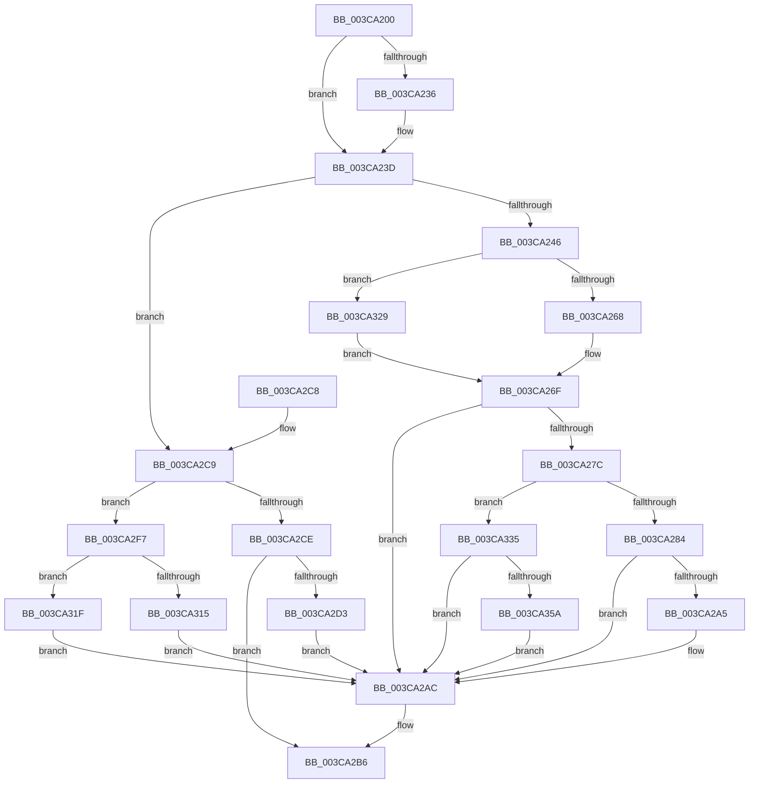

# CcCoalescingCallBackHelper

- RVA: `0x003CA200`–`0x003CA366` (길이 `358` bytes)
- VA: `0x00000001403CA200`
- 실행 섹션: `.text`
- PDB 이름 있음: `예`; PDB Function 태그: `아니요`
- unwind 정보 RVA: `0x0008F664`
- 디코드: `87`개 명령, `358/358` bytes 표시
- 미해석 바이트: `0` (있으면 어셈블리에 `.byte`로 보존)

> 이 문서는 커널 이미지의 기계어와 PDB 기호를 분석해 생성했습니다. 4번과 5번은 함수 원형과 자료형을 바이너리 사용 방식에서 추정한 C 해석이며 원본 소스 복구 결과는 아닙니다.

## 1. Dependencies

- 직접 호출 지점: **9**; 고유 호출 대상: **7**
- 직접 호출자로 확인된 함수: **1**
- RIP 상대 이미지 참조: **1**

### Outgoing calls
- `0x003CA252` → [KeAcquireInStackQueuedSpinLock](../27/KeAcquireInStackQueuedSpinLock_function_002757A0.md) (function, `0x002757A0`)
- `0x003CA297` → [CcNotifyWriteBehindVolume](CcNotifyWriteBehindVolume_function_003CC134.md) (function, `0x003CC134`)
- `0x003CA2B1` → [KeReleaseInStackQueuedSpinLock](../34/KeReleaseInStackQueuedSpinLock_function_00342CE0.md) (function, `0x00342CE0`)
- `0x003CA2DF` → [KeAcquireInStackQueuedSpinLock](../27/KeAcquireInStackQueuedSpinLock_function_002757A0.md) (function, `0x002757A0`)
- `0x003CA2F0` → [CcScheduleLazyWriteScan](CcScheduleLazyWriteScan_function_003CBD20.md) (function, `0x003CBD20`)
- `0x003CA303` → [KeAcquireInStackQueuedSpinLock](../27/KeAcquireInStackQueuedSpinLock_function_002757A0.md) (function, `0x002757A0`)
- `0x003CA318` → [CcRescheduleLazyWriteScanOnVolume](../22/CcRescheduleLazyWriteScanOnVolume_function_0022FE00.md) (function, `0x0022FE00`)
- `0x003CA322` → [CcRescheduleLazyWriteScan](CcRescheduleLazyWriteScan_function_003CA134.md) (function, `0x003CA134`)
- `0x003CA348` → [CcNotifyWriteBehindInternal](CcNotifyWriteBehindInternal_function_003CC224.md) (function, `0x003CC224`)

### Direct callers
- [CcCoalescingCallBack](CcCoalescingCallBack_function_003CA040.md) at `0x003CA11A`

### Static image references
- `0x003CA218` → RVA `0x00E65B88` (`.data`; read)

## 2. Other-region calls and transfers

- 다른 실행 섹션으로 향하는 call: **0**
- 별도 외부 분기/꼬리 이동을 확인하지 못했습니다.

## 3. Assembly (complete function range)

```asm
003CA200  48 89 5C 24 08                  mov qword ptr [rsp + 8], rbx
003CA205  48 89 74 24 10                  mov qword ptr [rsp + 0x10], rsi
003CA20A  57                              push rdi
003CA20B  48 83 EC 40                     sub rsp, 0x40
003CA20F  33 C0                           xor eax, eax
003CA211  48 8D B2 94 04 00 00            lea rsi, [rdx + 0x494]
003CA218  38 05 6A B9 A9 00               cmp byte ptr [rip + 0xa9b96a], al
003CA21E  0F 57 C0                        xorps xmm0, xmm0
003CA221  48 8B D9                        mov rbx, rcx
003CA224  48 89 44 24 30                  mov qword ptr [rsp + 0x30], rax
003CA229  41 8B 08                        mov ecx, dword ptr [r8]
003CA22C  48 8B FA                        mov rdi, rdx
003CA22F  0F 11 44 24 20                  movups xmmword ptr [rsp + 0x20], xmm0
003CA234  75 07                           jne 0x1403ca23d
003CA236  48 8D B3 0C 05 00 00            lea rsi, [rbx + 0x50c]
003CA23D  83 E9 01                        sub ecx, 1
003CA240  0F 85 83 00 00 00               jne 0x1403ca2c9
003CA246  48 8D 8B 00 03 00 00            lea rcx, [rbx + 0x300]
003CA24D  48 8D 54 24 20                  lea rdx, [rsp + 0x20]
003CA252  E8 49 B5 EA FF                  call 0x1402757a0
003CA257  8A 05 2B B9 A9 00               mov al, byte ptr [rip + 0xa9b92b]
003CA25D  C6 06 01                        mov byte ptr [rsi], 1
003CA260  84 C0                           test al, al
003CA262  0F 84 C1 00 00 00               je 0x1403ca329
003CA268  C6 87 D9 03 00 00 00            mov byte ptr [rdi + 0x3d9], 0
003CA26F  48 81 BB 20 04 00 00 00 20 00 00  cmp qword ptr [rbx + 0x420], 0x2000
003CA27A  72 30                           jb 0x1403ca2ac
003CA27C  84 C0                           test al, al
003CA27E  0F 84 B1 00 00 00               je 0x1403ca335
003CA284  8A 87 94 04 00 00               mov al, byte ptr [rdi + 0x494]
003CA28A  48 8B CF                        mov rcx, rdi
003CA28D  F6 D8                           neg al
003CA28F  1B D2                           sbb edx, edx
003CA291  83 E2 0C                        and edx, 0xc
003CA294  83 C2 04                        add edx, 4
003CA297  E8 98 1E 00 00                  call 0x1403cc134
003CA29C  80 BF 94 04 00 00 00            cmp byte ptr [rdi + 0x494], 0
003CA2A3  75 07                           jne 0x1403ca2ac
003CA2A5  C6 87 D9 03 00 00 01            mov byte ptr [rdi + 0x3d9], 1
003CA2AC  48 8D 4C 24 20                  lea rcx, [rsp + 0x20]
003CA2B1  E8 2A 8A F7 FF                  call 0x140342ce0
003CA2B6  48 8B 5C 24 50                  mov rbx, qword ptr [rsp + 0x50]
003CA2BB  B0 01                           mov al, 1
003CA2BD  48 8B 74 24 58                  mov rsi, qword ptr [rsp + 0x58]
003CA2C2  48 83 C4 40                     add rsp, 0x40
003CA2C6  5F                              pop rdi
003CA2C7  C3                              ret
003CA2C8  CC                              int3
003CA2C9  83 E9 01                        sub ecx, 1
003CA2CC  74 29                           je 0x1403ca2f7
003CA2CE  83 F9 01                        cmp ecx, 1
003CA2D1  75 E3                           jne 0x1403ca2b6
003CA2D3  48 8D 8B 00 03 00 00            lea rcx, [rbx + 0x300]
003CA2DA  48 8D 54 24 20                  lea rdx, [rsp + 0x20]
003CA2DF  E8 BC B4 EA FF                  call 0x1402757a0
003CA2E4  45 33 C9                        xor r9d, r9d
003CA2E7  41 B0 01                        mov r8b, 1
003CA2EA  48 8B D7                        mov rdx, rdi
003CA2ED  48 8B CB                        mov rcx, rbx
003CA2F0  E8 2B 1A 00 00                  call 0x1403cbd20
003CA2F5  EB B5                           jmp 0x1403ca2ac
003CA2F7  48 8D 8B 00 03 00 00            lea rcx, [rbx + 0x300]
003CA2FE  48 8D 54 24 20                  lea rdx, [rsp + 0x20]
003CA303  E8 98 B4 EA FF                  call 0x1402757a0
003CA308  33 D2                           xor edx, edx
003CA30A  C6 06 00                        mov byte ptr [rsi], 0
003CA30D  38 15 75 B8 A9 00               cmp byte ptr [rip + 0xa9b875], dl
003CA313  74 0A                           je 0x1403ca31f
003CA315  48 8B CF                        mov rcx, rdi
003CA318  E8 E3 5A E6 FF                  call 0x14022fe00
003CA31D  EB 8D                           jmp 0x1403ca2ac
003CA31F  48 8B CB                        mov rcx, rbx
003CA322  E8 0D FE FF FF                  call 0x1403ca134
003CA327  EB 83                           jmp 0x1403ca2ac
003CA329  C6 83 19 04 00 00 00            mov byte ptr [rbx + 0x419], 0
003CA330  E9 3A FF FF FF                  jmp 0x1403ca26f
003CA335  8A 83 0C 05 00 00               mov al, byte ptr [rbx + 0x50c]
003CA33B  48 8B CB                        mov rcx, rbx
003CA33E  F6 D8                           neg al
003CA340  1B D2                           sbb edx, edx
003CA342  83 E2 0C                        and edx, 0xc
003CA345  83 C2 04                        add edx, 4
003CA348  E8 D7 1E 00 00                  call 0x1403cc224
003CA34D  80 BB 0C 05 00 00 00            cmp byte ptr [rbx + 0x50c], 0
003CA354  0F 85 52 FF FF FF               jne 0x1403ca2ac
003CA35A  C6 83 19 04 00 00 01            mov byte ptr [rbx + 0x419], 1
003CA361  E9 46 FF FF FF                  jmp 0x1403ca2ac
```

## 4. C-style interpretation (structured pseudocode)

```c
__int64 __fastcall CcCoalescingCallBackHelper(__int64 a1, __int64 a2, __int64 a3, int a4)
{
    __int64 result;
    __int64 v_rsi;
    __int64 v_rsp;
    unsigned __int64 v_stack_m18;
    unsigned __int64 v_stack_m28;
    unsigned __int64 v_stack_p10;
    unsigned __int64 v_stack_p20;
    unsigned __int64 v_stack_p8;

    v_stack_p8 = v_rbx;
    v_stack_p10 = v_rsi;
    v_rsp = (v_rsp) - (64);
    result = 0;
    v_stack_m18 = 0;
    v_stack_m28 = v_xmm0;
    v_rsi = a2 + 1172;
    if ((*(unsigned __int8 *)(v_rip + 11123050)) == 0) {
        v_rsi = a1 + 1292;
    }
    a1 = (unsigned int)(((unsigned int)(*(unsigned int *)(a3))) - (1));
    if (condition_is_not_equal) goto loc_003CA2C9;
    result = KeAcquireInStackQueuedSpinLock(a1 + 768, v_stack_m28, a3, a4);
    *(unsigned __int8 *)(v_rsi) = 1;
    if ((unsigned __int8)(*(unsigned __int8 *)(v_rip + 11122987)) == 0) goto loc_003CA329;
    *(unsigned __int8 *)(a2 + 985) = 0;
loc_003CA26F:
    if ((*(unsigned __int64 *)(a1 + 1056)) < 0x2000ULL) goto loc_003CA2AC;
    if ((unsigned __int8)(*(unsigned __int8 *)(v_rip + 11122987)) == 0) goto loc_003CA335;
    result = (unsigned __int8)(-(*(unsigned __int8 *)(a2 + 1172)));
    a2 = (unsigned int)((v_stack_m28) & (12));
    a2 = (unsigned int)((a2) + (4));
    result = CcNotifyWriteBehindVolume(a2, a2, a3, a4);
    if ((*(unsigned __int8 *)(a2 + 1172)) == 0) {
        *(unsigned __int8 *)(a2 + 985) = 1;
    }
    result = KeReleaseInStackQueuedSpinLock(v_stack_m28, a2, a3, a4);
loc_003CA2B6:
    v_rsp = (v_rsp) + (64);
    return 1;
loc_003CA2C9:
    a1 = (unsigned int)((v_stack_m28) - (1));
    if (condition_is_equal) goto loc_003CA2F7;
    if (((unsigned int)(a1)) != 1) goto loc_003CA2B6;
    result = KeAcquireInStackQueuedSpinLock(v_stack_p8 + 768, v_stack_p20, a3, a4);
    a4 = 0;
    result = CcScheduleLazyWriteScan(v_stack_p8, a2, 1, a4);
    goto loc_003CA2AC;
loc_003CA2F7:
    result = KeAcquireInStackQueuedSpinLock(v_stack_p8 + 768, v_stack_p20, 1, a4);
    a2 = 0;
    *(unsigned __int8 *)(v_stack_p10) = 0;
    if ((*(unsigned __int8 *)(v_rip + 11122805)) == 0) goto loc_003CA31F;
    result = CcRescheduleLazyWriteScanOnVolume(0, a2, 1, a4);
    goto loc_003CA2AC;
loc_003CA31F:
    result = CcRescheduleLazyWriteScan(v_stack_p8, a2, 1, a4);
    goto loc_003CA2AC;
loc_003CA329:
    *(unsigned __int8 *)(v_stack_p8 + 1049) = 0;
    goto loc_003CA26F;
loc_003CA335:
    result = (unsigned __int8)(-(*(unsigned __int8 *)(v_stack_p8 + 1292)));
    a2 = (unsigned int)((a2) & (12));
    a2 = (unsigned int)((a2) + (4));
    result = CcNotifyWriteBehindInternal(v_stack_p8, a2, 1, a4);
    if ((*(unsigned __int8 *)(v_stack_p8 + 1292)) != 0) goto loc_003CA2AC;
    *(unsigned __int8 *)(v_stack_p8 + 1049) = 1;
    goto loc_003CA2AC;
}
```

## 5. (Beta) C Style

```c
int64_t CcCoalescingCallBackHelper(void *Arg1, void *Arg2, void *Arg3, int32_t Arg4)
{
    uint8_t *arg1 = (uint8_t *)Arg1;
    uint8_t *arg2 = (uint8_t *)Arg2;
    uint8_t *arg3 = (uint8_t *)Arg3;

    int64_t result;
    int64_t local_rsi;
    int64_t local_rsp;
    uint64_t v_stack_m18;
    uint64_t v_stack_m28;
    uint64_t v_stack_p10;
    uint64_t v_stack_p20;
    uint64_t v_stack_p8;

    v_stack_p8 = local_rbx;
    v_stack_p10 = local_rsi;
    local_rsp = (local_rsp) - (64);
    result = 0;
    v_stack_m18 = 0;
    v_stack_m28 = v_xmm0;
    local_rsi = Arg2 + 1172;
    if ((*(uint8_t *)(v_rip + 0xA9B96A)) == 0) {
        local_rsi = Arg1 + 1292;
    }
    Arg1 = (uint32_t)(((uint32_t)(*(uint32_t *)(arg3))) - (1));
    if (condition_is_not_equal) goto loc_003CA2C9;
    result = KeAcquireInStackQueuedSpinLock(Arg1 + 768, v_stack_m28, Arg3, Arg4);
    *(uint8_t *)(local_rsi) = 1;
    if ((uint8_t)(*(uint8_t *)(v_rip + 0xA9B92B)) == 0) goto loc_003CA329;
    *(uint8_t *)(arg2 + 0x3D9) = 0;
loc_003CA26F:
    if ((*(uint64_t *)(arg1 + 0x420)) < 0x2000ULL) goto loc_003CA2AC;
    if ((uint8_t)(*(uint8_t *)(v_rip + 0xA9B92B)) == 0) goto loc_003CA335;
    result = (uint8_t)(-(*(uint8_t *)(arg2 + 0x494)));
    Arg2 = (uint32_t)((v_stack_m28) & (12));
    Arg2 = (uint32_t)((Arg2) + (4));
    result = CcNotifyWriteBehindVolume(Arg2, Arg2, Arg3, Arg4);
    if ((*(uint8_t *)(arg2 + 0x494)) == 0) {
        *(uint8_t *)(arg2 + 0x3D9) = 1;
    }
    result = KeReleaseInStackQueuedSpinLock(v_stack_m28, Arg2, Arg3, Arg4);
loc_003CA2B6:
    local_rsp = (local_rsp) + (64);
    return 1;
loc_003CA2C9:
    Arg1 = (uint32_t)((v_stack_m28) - (1));
    if (condition_is_equal) goto loc_003CA2F7;
    if (((uint32_t)(Arg1)) != 1) goto loc_003CA2B6;
    result = KeAcquireInStackQueuedSpinLock(v_stack_p8 + 768, v_stack_p20, Arg3, Arg4);
    Arg4 = 0;
    result = CcScheduleLazyWriteScan(v_stack_p8, Arg2, 1, Arg4);
    goto loc_003CA2AC;
loc_003CA2F7:
    result = KeAcquireInStackQueuedSpinLock(v_stack_p8 + 768, v_stack_p20, 1, Arg4);
    Arg2 = 0;
    *(uint8_t *)(v_stack_p10) = 0;
    if ((*(uint8_t *)(v_rip + 0xA9B875)) == 0) goto loc_003CA31F;
    result = CcRescheduleLazyWriteScanOnVolume(0, Arg2, 1, Arg4);
    goto loc_003CA2AC;
loc_003CA31F:
    result = CcRescheduleLazyWriteScan(v_stack_p8, Arg2, 1, Arg4);
    goto loc_003CA2AC;
loc_003CA329:
    *(uint8_t *)(v_stack_p8 + 0x419) = 0;
    goto loc_003CA26F;
loc_003CA335:
    result = (uint8_t)(-(*(uint8_t *)(v_stack_p8 + 0x50C)));
    Arg2 = (uint32_t)((Arg2) & (12));
    Arg2 = (uint32_t)((Arg2) + (4));
    result = CcNotifyWriteBehindInternal(v_stack_p8, Arg2, 1, Arg4);
    if ((*(uint8_t *)(v_stack_p8 + 0x50C)) != 0) goto loc_003CA2AC;
    *(uint8_t *)(v_stack_p8 + 0x419) = 1;
    goto loc_003CA2AC;
}
```

### 관측된 메모리 오프셋

구조체 형식이 확인되지 않은 접근은 인자 기준의 오프셋으로만 기록했습니다.

| 기준 인자 | 오프셋 표현 | 폭 (bit) | 접근 |
|---|---:|---:|---|
| `Arg1` | `+ 0x300` | `64` | `R` |
| `Arg1` | `+ 0x419` | `8` | `W` |
| `Arg1` | `+ 0x420` | `64` | `R` |
| `Arg1` | `+ 0x50C` | `8` | `R` |
| `Arg1` | `+ 0x50C` | `64` | `R` |
| `Arg2` | `+ 0x3D9` | `8` | `W` |
| `Arg2` | `+ 0x494` | `8` | `R` |
| `Arg2` | `+ 0x494` | `64` | `R` |
| `Arg3` | `+ 0x0` | `32` | `R` |

## 6. Execution-region graph

[열기: 2D/3D 그래프와 함수 탐색 컨트롤 패널](../../../control-panel.html?section=text&rva=0x003CA200&view=graph)

- 2D 그래프는 위에서 아래로 흐르고, 3D 그래프는 빈 공간을 드래그해 회전합니다. Shift+드래그는 이동, 휠은 확대·축소, 함수 노드 선택은 대상 보고서 이동입니다.

### Static fallback


