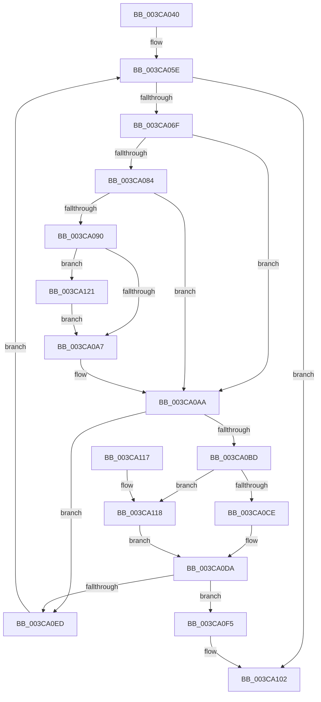

# CcCoalescingCallBack

- RVA: `0x003CA040`–`0x003CA12D` (길이 `237` bytes)
- VA: `0x00000001403CA040`
- 실행 섹션: `.text`
- PDB 이름 있음: `예`; PDB Function 태그: `아니요`
- unwind 정보 RVA: `0x0008C6A8`
- 디코드: `63`개 명령, `237/237` bytes 표시
- 미해석 바이트: `0` (있으면 어셈블리에 `.byte`로 보존)

> 이 문서는 커널 이미지의 기계어와 PDB 기호를 분석해 생성했습니다. 4번과 5번은 함수 원형과 자료형을 바이너리 사용 방식에서 추정한 C 해석이며 원본 소스 복구 결과는 아닙니다.

## 1. Dependencies

- 직접 호출 지점: **7**; 고유 호출 대상: **7**
- 직접 호출자로 확인된 함수: **0**
- RIP 상대 이미지 참조: **3**

### Outgoing calls
- `0x003CA05E` → [PsGetNextPartitionUnsafe](../2F/PsGetNextPartitionUnsafe_function_002F0E38.md) (function, `0x002F0E38`)
- `0x003CA076` → [KeAcquireSpinLockRaiseToDpc](../20/KeAcquireSpinLockRaiseToDpc_function_00208470.md) (function, `0x00208470`)
- `0x003CA0B3` → [KeReleaseSpinLock](../39/KeReleaseSpinLock_function_00392BA0.md) (function, `0x00392BA0`)
- `0x003CA0D5` → [CcForEachPrivateVolumeCacheMap](../38/CcForEachPrivateVolumeCacheMap_function_0038967C.md) (function, `0x0038967C`)
- `0x003CA0E0` → [CcDereferencePartition](../35/CcDereferencePartition_function_003572F0.md) (function, `0x003572F0`)
- `0x003CA0FD` → [ObfDereferenceObjectWithTag](../2F/ObfDereferenceObjectWithTag_function_002F78E0.md) (function, `0x002F78E0`)
- `0x003CA11A` → [CcCoalescingCallBackHelper](CcCoalescingCallBackHelper_function_003CA200.md) (function, `0x003CA200`)

### Direct callers
- 이 함수 시작 RVA로 연결되는 직접 call은 확인되지 않았습니다. 간접 호출은 완전히 역산할 수 없습니다.

### Static image references
- `0x003CA06F` → RVA `0x00F8F510` (`.data`; read)
- `0x003CA0BD` → RVA `0x00E65B88` (`.data`; read)
- `0x003CA0CE` → RVA `0x003CA200` (`CcCoalescingCallBackHelper`; read)

## 2. Other-region calls and transfers

- 다른 실행 섹션으로 향하는 call: **0**
- 별도 외부 분기/꼬리 이동을 확인하지 못했습니다.

## 3. Assembly (complete function range)

```asm
003CA040  48 8B C4                        mov rax, rsp
003CA043  48 89 58 10                     mov qword ptr [rax + 0x10], rbx
003CA047  48 89 68 18                     mov qword ptr [rax + 0x18], rbp
003CA04B  48 89 70 20                     mov qword ptr [rax + 0x20], rsi
003CA04F  57                              push rdi
003CA050  48 83 EC 20                     sub rsp, 0x20
003CA054  33 DB                           xor ebx, ebx
003CA056  89 48 08                        mov dword ptr [rax + 8], ecx
003CA059  40 32 F6                        xor sil, sil
003CA05C  33 C9                           xor ecx, ecx
003CA05E  E8 D5 6D F2 FF                  call 0x1402f0e38
003CA063  48 8B F8                        mov rdi, rax
003CA066  48 85 C0                        test rax, rax
003CA069  0F 84 93 00 00 00               je 0x1403ca102
003CA06F  48 8D 0D 9A 54 BC 00            lea rcx, [rip + 0xbc549a]
003CA076  E8 F5 E3 E3 FF                  call 0x140208470
003CA07B  48 8B 4F 08                     mov rcx, qword ptr [rdi + 8]
003CA07F  48 85 C9                        test rcx, rcx
003CA082  74 26                           je 0x1403ca0aa
003CA084  80 B9 0E 05 00 00 02            cmp byte ptr [rcx + 0x50e], 2
003CA08B  48 8B D9                        mov rbx, rcx
003CA08E  73 1A                           jae 0x1403ca0aa
003CA090  B9 01 00 00 00                  mov ecx, 1
003CA095  F0 48 0F C1 8B 10 05 00 00      lock xadd qword ptr [rbx + 0x510], rcx
003CA09E  48 FF C1                        inc rcx
003CA0A1  48 83 F9 01                     cmp rcx, 1
003CA0A5  7E 7A                           jle 0x1403ca121
003CA0A7  40 B6 01                        mov sil, 1
003CA0AA  8A D0                           mov dl, al
003CA0AC  48 8D 0D 5D 54 BC 00            lea rcx, [rip + 0xbc545d]
003CA0B3  E8 E8 8A FC FF                  call 0x140392ba0
003CA0B8  40 84 F6                        test sil, sil
003CA0BB  74 30                           je 0x1403ca0ed
003CA0BD  80 3D C4 BA A9 00 00            cmp byte ptr [rip + 0xa9bac4], 0
003CA0C4  4C 8D 44 24 30                  lea r8, [rsp + 0x30]
003CA0C9  48 8B CB                        mov rcx, rbx
003CA0CC  74 4A                           je 0x1403ca118
003CA0CE  48 8D 15 2B 01 00 00            lea rdx, [rip + 0x12b]
003CA0D5  E8 A2 F5 FB FF                  call 0x14038967c
003CA0DA  48 8B CB                        mov rcx, rbx
003CA0DD  40 8A E8                        mov bpl, al
003CA0E0  E8 0B D2 F8 FF                  call 0x1403572f0
003CA0E5  40 32 F6                        xor sil, sil
003CA0E8  40 84 ED                        test bpl, bpl
003CA0EB  74 08                           je 0x1403ca0f5
003CA0ED  48 8B CF                        mov rcx, rdi
003CA0F0  E9 69 FF FF FF                  jmp 0x1403ca05e
003CA0F5  BA 50 73 45 6E                  mov edx, 0x6e457350
003CA0FA  48 8B CF                        mov rcx, rdi
003CA0FD  E8 DE D7 F2 FF                  call 0x1402f78e0
003CA102  48 8B 5C 24 38                  mov rbx, qword ptr [rsp + 0x38]
003CA107  48 8B 6C 24 40                  mov rbp, qword ptr [rsp + 0x40]
003CA10C  48 8B 74 24 48                  mov rsi, qword ptr [rsp + 0x48]
003CA111  48 83 C4 20                     add rsp, 0x20
003CA115  5F                              pop rdi
003CA116  C3                              ret
003CA117  CC                              int3
003CA118  33 D2                           xor edx, edx
003CA11A  E8 E1 00 00 00                  call 0x1403ca200
003CA11F  EB B9                           jmp 0x1403ca0da
003CA121  B9 0E 00 00 00                  mov ecx, 0xe
003CA126  CD 29                           int 0x29
003CA128  E9 7A FF FF FF                  jmp 0x1403ca0a7
```

## 4. C-style interpretation (structured pseudocode)

```c
__int64 __fastcall CcCoalescingCallBack(int a1)
{
    __int64 result;
    __int64 v_rbx;
    __int64 v_rsi;
    __int64 v_rsp;
    unsigned __int64 v_stack_p10;
    unsigned __int64 v_stack_p18;
    unsigned __int64 v_stack_p20;
    unsigned __int64 v_stack_p8;

    *(unsigned __int64 *)(v_rsp + 16) = v_rbx;
    *(unsigned __int64 *)(v_rsp + 24) = v_rbp;
    *(unsigned __int64 *)(v_rsp + 32) = v_rsi;
    v_rsp = (v_rsp) - (32);
    v_rbx = 0;
    *(unsigned int *)(v_rsp + 8) = a1;
    v_rsi = 0;
    a1 = 0;
loc_003CA05E:
    result = PsGetNextPartitionUnsafe(a1, a2, a3, a4);
    if (result == 0) goto loc_003CA102;
    result = KeAcquireSpinLockRaiseToDpc(v_rip + 12342426, a2, a3, a4);
    if (*(unsigned __int64 *)(result + 8) == 0) goto loc_003CA0AA;
    if ((*(unsigned __int8 *)(*(unsigned __int64 *)(result + 8) + 1294)) >= 2) goto loc_003CA0AA;
    a1 = (1) + 1;
    if (a1 <= 1) goto loc_003CA121;
loc_003CA0A7:
loc_003CA0AA:
    result = KeReleaseSpinLock(v_rip + 12342365, (unsigned __int8)(result), a3, a4);
    if (1 == 0) goto loc_003CA0ED;
    if ((*(unsigned __int8 *)(v_rip + 11123396)) == 0) goto loc_003CA118;
    result = CcForEachPrivateVolumeCacheMap(*(unsigned __int64 *)(result + 8), v_rip + 299, v_stack_p8, a4);
loc_003CA0DA:
    result = CcDereferencePartition(*(unsigned __int64 *)(result + 8), v_rip + 299, v_stack_p8, a4);
    v_rsi = 0;
    if ((unsigned __int8)((unsigned __int8)(result)) == 0) goto loc_003CA0F5;
loc_003CA0ED:
    goto loc_003CA05E;
loc_003CA0F5:
    result = ObfDereferenceObjectWithTag(result, (unsigned int)(0x6E457350ULL), v_stack_p8, a4);
loc_003CA102:
    v_rsp = (v_rsp) + (32);
    return result;
loc_003CA118:
    a2 = 0;
    result = CcCoalescingCallBackHelper(result, a2, v_stack_p8, a4);
    goto loc_003CA0DA;
loc_003CA121:
    goto loc_003CA0A7;
}
```

## 5. (Beta) C Style

```c
int64_t CcCoalescingCallBack(int32_t Arg1)
{
    int64_t result;
    int64_t local_rbx;
    int64_t local_rsi;
    int64_t local_rsp;
    uint64_t v_stack_p10;
    uint64_t v_stack_p18;
    uint64_t v_stack_p20;
    uint64_t v_stack_p8;

    *(uint64_t *)(local_rsp + 0x10) = local_rbx;
    *(uint64_t *)(local_rsp + 0x18) = local_rbp;
    *(uint64_t *)(local_rsp + 0x20) = local_rsi;
    local_rsp = (local_rsp) - (32);
    local_rbx = 0;
    *(uint32_t *)(local_rsp + 0x8) = Arg1;
    local_rsi = 0;
    Arg1 = 0;
loc_003CA05E:
    result = PsGetNextPartitionUnsafe(Arg1, a2, a3, a4);
    if (result == 0) goto loc_003CA102;
    result = KeAcquireSpinLockRaiseToDpc(v_rip + 12342426, a2, a3, a4);
    if (*(uint64_t *)(result + 0x8) == 0) goto loc_003CA0AA;
    if ((*(uint8_t *)(*(uint64_t *)(result + 0x8) + 0x50E)) >= 2) goto loc_003CA0AA;
    Arg1 = (1) + 1;
    if (Arg1 <= 1) goto loc_003CA121;
loc_003CA0A7:
loc_003CA0AA:
    result = KeReleaseSpinLock(v_rip + 12342365, (uint8_t)(result), a3, a4);
    if (1 == 0) goto loc_003CA0ED;
    if ((*(uint8_t *)(v_rip + 0xA9BAC4)) == 0) goto loc_003CA118;
    result = CcForEachPrivateVolumeCacheMap(*(uint64_t *)(result + 0x8), v_rip + 299, v_stack_p8, a4);
loc_003CA0DA:
    result = CcDereferencePartition(*(uint64_t *)(result + 0x8), v_rip + 299, v_stack_p8, a4);
    local_rsi = 0;
    if ((uint8_t)((uint8_t)(result)) == 0) goto loc_003CA0F5;
loc_003CA0ED:
    goto loc_003CA05E;
loc_003CA0F5:
    result = ObfDereferenceObjectWithTag(result, (uint32_t)(0x6E457350ULL), v_stack_p8, a4);
loc_003CA102:
    local_rsp = (local_rsp) + (32);
    return result;
loc_003CA118:
    a2 = 0;
    result = CcCoalescingCallBackHelper(result, a2, v_stack_p8, a4);
    goto loc_003CA0DA;
loc_003CA121:
    goto loc_003CA0A7;
}
```

## 6. Execution-region graph

[열기: 2D/3D 그래프와 함수 탐색 컨트롤 패널](../../../control-panel.html?section=text&rva=0x003CA040&view=graph)

- 2D 그래프는 위에서 아래로 흐르고, 3D 그래프는 빈 공간을 드래그해 회전합니다. Shift+드래그는 이동, 휠은 확대·축소, 함수 노드 선택은 대상 보고서 이동입니다.

### Static fallback


