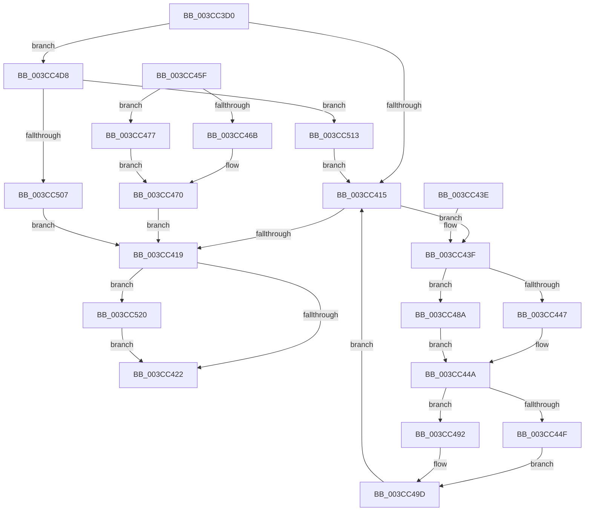

# CcCopyBytesToUserBuffer

- RVA: `0x003CC3D0`–`0x003CC535` (길이 `357` bytes)
- VA: `0x00000001403CC3D0`
- 실행 섹션: `.text`
- PDB 이름 있음: `예`; PDB Function 태그: `아니요`
- unwind 정보 RVA: `0x0008F8CC`
- 디코드: `98`개 명령, `357/357` bytes 표시
- 미해석 바이트: `0` (있으면 어셈블리에 `.byte`로 보존)

> 이 문서는 커널 이미지의 기계어와 PDB 기호를 분석해 생성했습니다. 4번과 5번은 함수 원형과 자료형을 바이너리 사용 방식에서 추정한 C 해석이며 원본 소스 복구 결과는 아닙니다.

## 1. Dependencies

- 직접 호출 지점: **6**; 고유 호출 대상: **6**
- 직접 호출자로 확인된 함수: **1**
- RIP 상대 이미지 참조: **0**

### Outgoing calls
- `0x003CC458` → [memcpy](../6C/memcpy_function_006C6840.md) (function, `0x006C6840`)
- `0x003CC479` → [FsRtlIsNtstatusExpected](../26/FsRtlIsNtstatusExpected_function_0026D390.md) (function, `0x0026D390`)
- `0x003CC495` → [HviCopyMemory](HviCopyMemory_function_003CC53C.md) (function, `0x003CC53C`)
- `0x003CC4F0` → [CcLockSystemCacheBuffer](CcLockSystemCacheBuffer_function_003CC5B8.md) (function, `0x003CC5B8`)
- `0x003CC523` → [MmUnlockPages](../29/MmUnlockPages_function_0029EEE0.md) (function, `0x0029EEE0`)
- `0x003CC52B` → [IoFreeMdl](../29/IoFreeMdl_function_0029EA80.md) (function, `0x0029EA80`)

### Direct callers
- [CcMapAndCopyFromCache](../../page/A4/CcMapAndCopyFromCache_function_00A47060.md) at `0x00A47206`

### Static image references
- 디코드된 RIP-relative 메모리 참조가 없습니다.

## 2. Other-region calls and transfers

- 다른 실행 섹션으로 향하는 call: **0**
- 별도 외부 분기/꼬리 이동을 확인하지 못했습니다.

## 3. Assembly (complete function range)

```asm
003CC3D0  48 8B C4                        mov rax, rsp
003CC3D3  48 89 58 10                     mov qword ptr [rax + 0x10], rbx
003CC3D7  48 89 70 18                     mov qword ptr [rax + 0x18], rsi
003CC3DB  48 89 48 08                     mov qword ptr [rax + 8], rcx
003CC3DF  57                              push rdi
003CC3E0  41 54                           push r12
003CC3E2  41 55                           push r13
003CC3E4  41 56                           push r14
003CC3E6  41 57                           push r15
003CC3E8  48 83 EC 50                     sub rsp, 0x50
003CC3EC  45 0F B6 F1                     movzx r14d, r9b
003CC3F0  41 8B D8                        mov ebx, r8d
003CC3F3  4C 8B FA                        mov r15, rdx
003CC3F6  33 FF                           xor edi, edi
003CC3F8  89 78 B8                        mov dword ptr [rax - 0x48], edi
003CC3FB  44 8B E7                        mov r12d, edi
003CC3FE  48 89 78 C0                     mov qword ptr [rax - 0x40], rdi
003CC402  8B D7                           mov edx, edi
003CC404  48 89 54 24 40                  mov qword ptr [rsp + 0x40], rdx
003CC409  89 78 20                        mov dword ptr [rax + 0x20], edi
003CC40C  45 84 C9                        test r9b, r9b
003CC40F  0F 85 C3 00 00 00               jne 0x1403cc4d8
003CC415  85 DB                           test ebx, ebx
003CC417  75 26                           jne 0x1403cc43f
003CC419  4D 85 E4                        test r12, r12
003CC41C  0F 85 FE 00 00 00               jne 0x1403cc520
003CC422  8B C7                           mov eax, edi
003CC424  4C 8D 5C 24 50                  lea r11, [rsp + 0x50]
003CC429  49 8B 5B 38                     mov rbx, qword ptr [r11 + 0x38]
003CC42D  49 8B 73 40                     mov rsi, qword ptr [r11 + 0x40]
003CC431  49 8B E3                        mov rsp, r11
003CC434  41 5F                           pop r15
003CC436  41 5E                           pop r14
003CC438  41 5D                           pop r13
003CC43A  41 5C                           pop r12
003CC43C  5F                              pop rdi
003CC43D  C3                              ret
003CC43E  CC                              int3
003CC43F  81 FB 00 00 04 00               cmp ebx, 0x40000
003CC445  73 43                           jae 0x1403cc48a
003CC447  44 8B EB                        mov r13d, ebx
003CC44A  45 84 F6                        test r14b, r14b
003CC44D  75 43                           jne 0x1403cc492
003CC44F  41 8B F5                        mov esi, r13d
003CC452  45 8B C5                        mov r8d, r13d
003CC455  49 8B D7                        mov rdx, r15
003CC458  E8 E3 A3 2F 00                  call 0x1406c6840
003CC45D  EB 3E                           jmp 0x1403cc49d
003CC45F  8B 7C 24 30                     mov edi, dword ptr [rsp + 0x30]
003CC463  81 FF 05 00 00 C0               cmp edi, 0xc0000005
003CC469  75 0C                           jne 0x1403cc477
003CC46B  BF E8 00 00 C0                  mov edi, 0xc00000e8
003CC470  4C 8B 64 24 38                  mov r12, qword ptr [rsp + 0x38]
003CC475  EB A2                           jmp 0x1403cc419
003CC477  8B CF                           mov ecx, edi
003CC479  E8 12 0F EA FF                  call 0x14026d390
003CC47E  B9 E9 00 00 C0                  mov ecx, 0xc00000e9
003CC483  84 C0                           test al, al
003CC485  0F 44 F9                        cmove edi, ecx
003CC488  EB E6                           jmp 0x1403cc470
003CC48A  41 BD 00 00 04 00               mov r13d, 0x40000
003CC490  EB B8                           jmp 0x1403cc44a
003CC492  45 8B C5                        mov r8d, r13d
003CC495  E8 A2 00 00 00                  call 0x1403cc53c
003CC49A  41 8B F5                        mov esi, r13d
003CC49D  41 2B DD                        sub ebx, r13d
003CC4A0  48 8B 8C 24 80 00 00 00         mov rcx, qword ptr [rsp + 0x80]
003CC4A8  48 03 CE                        add rcx, rsi
003CC4AB  48 89 8C 24 80 00 00 00         mov qword ptr [rsp + 0x80], rcx
003CC4B3  48 8B 54 24 40                  mov rdx, qword ptr [rsp + 0x40]
003CC4B8  48 8D 04 16                     lea rax, [rsi + rdx]
003CC4BC  45 84 F6                        test r14b, r14b
003CC4BF  48 0F 44 C2                     cmove rax, rdx
003CC4C3  48 8B D0                        mov rdx, rax
003CC4C6  48 89 44 24 40                  mov qword ptr [rsp + 0x40], rax
003CC4CB  4A 8D 04 3E                     lea rax, [rsi + r15]
003CC4CF  4C 0F 44 F8                     cmove r15, rax
003CC4D3  E9 3D FF FF FF                  jmp 0x1403cc415
003CC4D8  48 8D 84 24 98 00 00 00         lea rax, [rsp + 0x98]
003CC4E0  48 89 44 24 20                  mov qword ptr [rsp + 0x20], rax
003CC4E5  45 33 C9                        xor r9d, r9d
003CC4E8  48 8D 54 24 38                  lea rdx, [rsp + 0x38]
003CC4ED  49 8B CF                        mov rcx, r15
003CC4F0  E8 C3 00 00 00                  call 0x1403cc5b8
003CC4F5  48 8B D0                        mov rdx, rax
003CC4F8  48 89 44 24 40                  mov qword ptr [rsp + 0x40], rax
003CC4FD  4C 8B 64 24 38                  mov r12, qword ptr [rsp + 0x38]
003CC502  48 85 C0                        test rax, rax
003CC505  75 0C                           jne 0x1403cc513
003CC507  8B BC 24 98 00 00 00            mov edi, dword ptr [rsp + 0x98]
003CC50E  E9 06 FF FF FF                  jmp 0x1403cc419
003CC513  48 8B 8C 24 80 00 00 00         mov rcx, qword ptr [rsp + 0x80]
003CC51B  E9 F5 FE FF FF                  jmp 0x1403cc415
003CC520  49 8B CC                        mov rcx, r12
003CC523  E8 B8 29 ED FF                  call 0x14029eee0
003CC528  49 8B CC                        mov rcx, r12
003CC52B  E8 50 25 ED FF                  call 0x14029ea80
003CC530  E9 ED FE FF FF                  jmp 0x1403cc422
```

## 4. C-style interpretation (structured pseudocode)

```c
__int64 __fastcall CcCopyBytesToUserBuffer(__int64 a1, __int64 a2, int a3, int a4)
{
    __int64 result;
    __int64 v_rbx;
    __int64 v_rdi;
    __int64 v_rsp;
    unsigned __int64 v_stack_m10;
    unsigned __int64 v_stack_m18;
    unsigned int v_stack_m20;
    unsigned __int64 v_stack_m28;
    unsigned __int64 v_stack_m30;
    unsigned __int64 v_stack_m38;
    unsigned __int64 v_stack_p30;
    unsigned __int64 v_stack_p48;

    *(unsigned __int64 *)(v_rsp + 16) = v_rbx;
    *(unsigned __int64 *)(v_rsp + 24) = v_rsi;
    *(unsigned __int64 *)(v_rsp + 8) = a1;
    v_rsp = (v_rsp) - (80);
    v_rdi = 0;
    *(unsigned int *)(v_rsp - 72) = 0;
    *(unsigned __int64 *)(v_rsp - 64) = 0;
    v_stack_m38 = 0;
    *(unsigned int *)(v_rsp + 32) = 0;
    if ((unsigned __int8)(a4) != 0) goto loc_003CC4D8;
loc_003CC415:
    if ((unsigned int)((unsigned int)(a3)) != 0) goto loc_003CC43F;
loc_003CC419:
    if (0 != 0) goto loc_003CC520;
loc_003CC422:
    return 0;
loc_003CC43F:
    if (((unsigned int)(*(unsigned __int64 *)(v_stack_m28 + 56))) >= 0x40000ULL) goto loc_003CC48A;
loc_003CC44A:
    if ((unsigned __int8)((unsigned __int8)(a4)) != 0) goto loc_003CC492;
    result = memcpy(a1, a2, (unsigned int)((unsigned int)((unsigned int)((unsigned int)(*(unsigned __int64 *)(v_stack_m28 + 56))))), a4);
    goto loc_003CC49D;
loc_003CC48A:
    goto loc_003CC44A;
loc_003CC492:
    result = HviCopyMemory(a1, a2, (unsigned int)((unsigned int)((unsigned int)(0x40000ULL))), a4);
loc_003CC49D:
    v_rbx = (unsigned int)((*(unsigned __int64 *)(v_stack_m28 + 56)) - ((unsigned int)((unsigned int)(0x40000ULL))));
    a1 = (v_stack_p30) + ((unsigned int)((unsigned int)((unsigned int)(0x40000ULL))));
    v_stack_p30 = a1;
    result = (unsigned int)((unsigned int)((unsigned int)(0x40000ULL))) + v_stack_m10 * 1;
    if ((unsigned __int8)((unsigned __int8)(a4)) == 0) { result = v_stack_m10; }
    v_stack_m10 = result;
    if ((unsigned __int8)((unsigned __int8)(a4)) == 0) { a2 = (unsigned int)((unsigned int)((unsigned int)(0x40000ULL))) + a2 * 1; }
    goto loc_003CC415;
loc_003CC4D8:
    v_stack_m30 = v_stack_p48;
    a4 = 0;
    result = CcLockSystemCacheBuffer(a2, v_stack_m18, (unsigned int)((unsigned int)((unsigned int)(0x40000ULL))), a4);
    v_stack_m10 = result;
    if (result != 0) goto loc_003CC513;
    goto loc_003CC419;
loc_003CC513:
    goto loc_003CC415;
loc_003CC520:
    result = MmUnlockPages(v_stack_m18, result, (unsigned int)((unsigned int)((unsigned int)(0x40000ULL))), a4);
    result = IoFreeMdl(v_stack_m18, result, (unsigned int)((unsigned int)((unsigned int)(0x40000ULL))), a4);
    goto loc_003CC422;
}
```

## 5. (Beta) C Style

```c
int64_t CcCopyBytesToUserBuffer(int64_t Arg1, int64_t Arg2, int32_t Arg3, int32_t Arg4)
{
    int64_t result;
    int64_t local_rbx;
    int64_t local_rdi;
    int64_t local_rsp;
    uint64_t v_stack_m10;
    uint64_t v_stack_m18;
    uint32_t v_stack_m20;
    uint64_t v_stack_m28;
    uint64_t v_stack_m30;
    uint64_t v_stack_m38;
    uint64_t v_stack_p30;
    uint64_t v_stack_p48;

    *(uint64_t *)(local_rsp + 0x10) = local_rbx;
    *(uint64_t *)(local_rsp + 0x18) = local_rsi;
    *(uint64_t *)(local_rsp + 0x8) = Arg1;
    local_rsp = (local_rsp) - (80);
    local_rdi = 0;
    *(uint32_t *)(local_rsp - 0x48) = 0;
    *(uint64_t *)(local_rsp - 0x40) = 0;
    v_stack_m38 = 0;
    *(uint32_t *)(local_rsp + 0x20) = 0;
    if ((uint8_t)(Arg4) != 0) goto loc_003CC4D8;
loc_003CC415:
    if ((uint32_t)((uint32_t)(Arg3)) != 0) goto loc_003CC43F;
loc_003CC419:
    if (0 != 0) goto loc_003CC520;
loc_003CC422:
    return 0;
loc_003CC43F:
    if (((uint32_t)(*(uint64_t *)(v_stack_m28 + 0x38))) >= 0x40000ULL) goto loc_003CC48A;
loc_003CC44A:
    if ((uint8_t)((uint8_t)(Arg4)) != 0) goto loc_003CC492;
    result = memcpy(Arg1, Arg2, (uint32_t)((uint32_t)((uint32_t)((uint32_t)(*(uint64_t *)(v_stack_m28 + 0x38))))), Arg4);
    goto loc_003CC49D;
loc_003CC48A:
    goto loc_003CC44A;
loc_003CC492:
    result = HviCopyMemory(Arg1, Arg2, (uint32_t)((uint32_t)((uint32_t)(0x40000ULL))), Arg4);
loc_003CC49D:
    local_rbx = (uint32_t)((*(uint64_t *)(v_stack_m28 + 0x38)) - ((uint32_t)((uint32_t)(0x40000ULL))));
    Arg1 = (v_stack_p30) + ((uint32_t)((uint32_t)((uint32_t)(0x40000ULL))));
    v_stack_p30 = Arg1;
    result = (uint32_t)((uint32_t)((uint32_t)(0x40000ULL))) + v_stack_m10 * 1;
    if ((uint8_t)((uint8_t)(Arg4)) == 0) { result = v_stack_m10; }
    v_stack_m10 = result;
    if ((uint8_t)((uint8_t)(Arg4)) == 0) { Arg2 = (uint32_t)((uint32_t)((uint32_t)(0x40000ULL))) + Arg2 * 1; }
    goto loc_003CC415;
loc_003CC4D8:
    v_stack_m30 = v_stack_p48;
    Arg4 = 0;
    result = CcLockSystemCacheBuffer(Arg2, v_stack_m18, (uint32_t)((uint32_t)((uint32_t)(0x40000ULL))), Arg4);
    v_stack_m10 = result;
    if (result != 0) goto loc_003CC513;
    goto loc_003CC419;
loc_003CC513:
    goto loc_003CC415;
loc_003CC520:
    result = MmUnlockPages(v_stack_m18, result, (uint32_t)((uint32_t)((uint32_t)(0x40000ULL))), Arg4);
    result = IoFreeMdl(v_stack_m18, result, (uint32_t)((uint32_t)((uint32_t)(0x40000ULL))), Arg4);
    goto loc_003CC422;
}
```

## 6. Execution-region graph

[열기: 2D/3D 그래프와 함수 탐색 컨트롤 패널](../../../control-panel.html?section=text&rva=0x003CC3D0&view=graph)

- 2D 그래프는 위에서 아래로 흐르고, 3D 그래프는 빈 공간을 드래그해 회전합니다. Shift+드래그는 이동, 휠은 확대·축소, 함수 노드 선택은 대상 보고서 이동입니다.

### Static fallback


