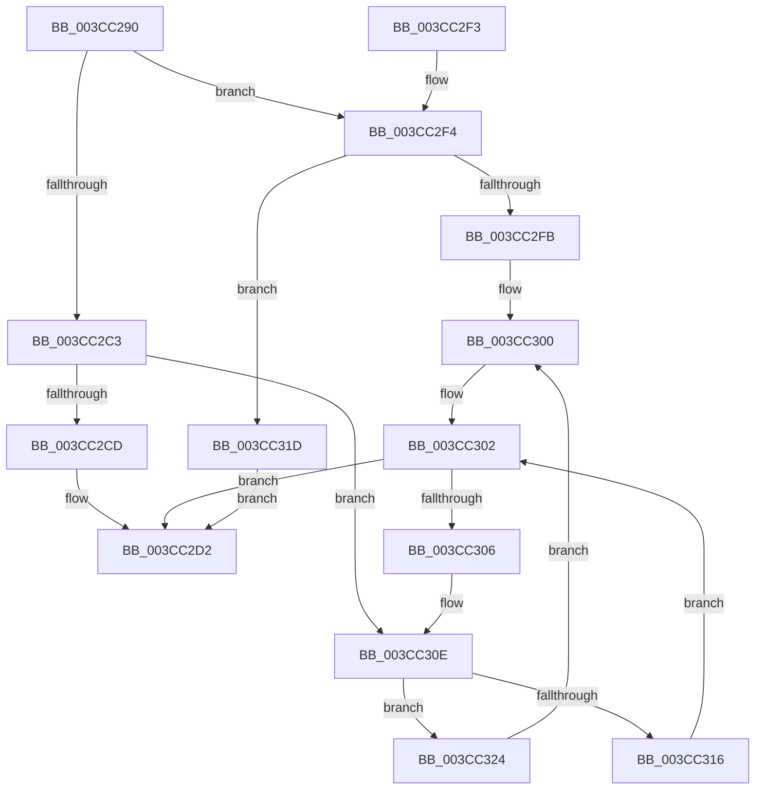

# CcCopyToCacheHelper

- RVA: `0x003CC290`–`0x003CC33D` (길이 `173` bytes)
- VA: `0x00000001403CC290`
- 실행 섹션: `.text`
- PDB 이름 있음: `예`; PDB Function 태그: `아니요`
- unwind 정보 RVA: `0x0008F8B4`
- 디코드: `53`개 명령, `173/173` bytes 표시
- 미해석 바이트: `0` (있으면 어셈블리에 `.byte`로 보존)

> 이 문서는 커널 이미지의 기계어와 PDB 기호를 분석해 생성했습니다. 4번과 5번은 함수 원형과 자료형을 바이너리 사용 방식에서 추정한 C 해석이며 원본 소스 복구 결과는 아닙니다.

## 1. Dependencies

- 직접 호출 지점: **7**; 고유 호출 대상: **6**
- 직접 호출자로 확인된 함수: **1**
- RIP 상대 이미지 참조: **0**

### Outgoing calls
- `0x003CC2CD` → [memcpy](../6C/memcpy_function_006C6840.md) (function, `0x006C6840`)
- `0x003CC2FB` → [HviCopyMemoryNonTemporal](HviCopyMemoryNonTemporal_function_003CC344.md) (function, `0x003CC344`)
- `0x003CC308` → [RtlRaiseStatus](../2F/RtlRaiseStatus_function_002F6A50.md) (function, `0x002F6A50`)
- `0x003CC316` → [RtlCopyMemoryNonTemporal](../6B/RtlCopyMemoryNonTemporal_function_006BA720.md) (function, `0x006BA720`)
- `0x003CC31D` → [HviCopyMemory](HviCopyMemory_function_003CC53C.md) (function, `0x003CC53C`)
- `0x003CC324` → [memcpy](../6C/memcpy_function_006C6840.md) (function, `0x006C6840`)
- `0x003CC336` → [RtlFlushNonVolatileMemory](../4F/RtlFlushNonVolatileMemory_function_004FCBF0.md) (function, `0x004FCBF0`)

### Direct callers
- [CcMapAndCopyInToCache](CcMapAndCopyInToCache_function_003CA7F0.md) at `0x003CADB1`

### Static image references
- 디코드된 RIP-relative 메모리 참조가 없습니다.

## 2. Other-region calls and transfers

- 다른 실행 섹션으로 향하는 call: **0**
- 별도 외부 분기/꼬리 이동을 확인하지 못했습니다.

## 3. Assembly (complete function range)

```asm
003CC290  48 89 5C 24 08                  mov qword ptr [rsp + 8], rbx
003CC295  48 89 6C 24 10                  mov qword ptr [rsp + 0x10], rbp
003CC29A  48 89 74 24 18                  mov qword ptr [rsp + 0x18], rsi
003CC29F  57                              push rdi
003CC2A0  48 83 EC 20                     sub rsp, 0x20
003CC2A4  8B 99 98 00 00 00               mov ebx, dword ptr [rcx + 0x98]
003CC2AA  48 8B EA                        mov rbp, rdx
003CC2AD  81 E3 00 00 00 40               and ebx, 0x40000000
003CC2B3  49 8B C0                        mov rax, r8
003CC2B6  80 7C 24 50 00                  cmp byte ptr [rsp + 0x50], 0
003CC2BB  48 8B D0                        mov rdx, rax
003CC2BE  48 8B CD                        mov rcx, rbp
003CC2C1  75 31                           jne 0x1403cc2f4
003CC2C3  41 8B F1                        mov esi, r9d
003CC2C6  44 8B C6                        mov r8d, esi
003CC2C9  85 DB                           test ebx, ebx
003CC2CB  75 41                           jne 0x1403cc30e
003CC2CD  E8 6E A5 2F 00                  call 0x1406c6840
003CC2D2  48 8B 44 24 58                  mov rax, qword ptr [rsp + 0x58]
003CC2D7  85 DB                           test ebx, ebx
003CC2D9  48 8B 5C 24 30                  mov rbx, qword ptr [rsp + 0x30]
003CC2DE  48 8B 6C 24 38                  mov rbp, qword ptr [rsp + 0x38]
003CC2E3  0F 94 C1                        sete cl
003CC2E6  48 8B 74 24 40                  mov rsi, qword ptr [rsp + 0x40]
003CC2EB  88 08                           mov byte ptr [rax], cl
003CC2ED  48 83 C4 20                     add rsp, 0x20
003CC2F1  5F                              pop rdi
003CC2F2  C3                              ret
003CC2F3  CC                              int3
003CC2F4  45 8B C1                        mov r8d, r9d
003CC2F7  85 DB                           test ebx, ebx
003CC2F9  74 22                           je 0x1403cc31d
003CC2FB  E8 44 00 00 00                  call 0x1403cc344
003CC300  8B F8                           mov edi, eax
003CC302  85 FF                           test edi, edi
003CC304  79 CC                           jns 0x1403cc2d2
003CC306  8B CF                           mov ecx, edi
003CC308  E8 43 A7 F2 FF                  call 0x1402f6a50
003CC30D  CC                              int3
003CC30E  33 FF                           xor edi, edi
003CC310  48 83 FE 08                     cmp rsi, 8
003CC314  72 0E                           jb 0x1403cc324
003CC316  E8 05 E4 2E 00                  call 0x1406ba720
003CC31B  EB E5                           jmp 0x1403cc302
003CC31D  E8 1A 02 00 00                  call 0x1403cc53c
003CC322  EB AE                           jmp 0x1403cc2d2
003CC324  E8 17 A5 2F 00                  call 0x1406c6840
003CC329  45 33 C9                        xor r9d, r9d
003CC32C  4C 8B C6                        mov r8, rsi
003CC32F  48 8B D5                        mov rdx, rbp
003CC332  49 8D 49 FF                     lea rcx, [r9 - 1]
003CC336  E8 B5 08 13 00                  call 0x1404fcbf0
003CC33B  EB C3                           jmp 0x1403cc300
```

## 4. C-style interpretation (structured pseudocode)

```c
__int64 __fastcall CcCopyToCacheHelper(__int64 a1, __int64 a2, __int64 a3, int a4, unsigned __int8 a5, __int64 a6)
{
    __int64 result;
    __int64 v_rbx;
    __int64 v_rdi;
    __int64 v_rsp;
    unsigned __int64 v_stack_p10;
    unsigned __int64 v_stack_p18;
    unsigned __int64 v_stack_p8;

    v_stack_p8 = v_rbx;
    v_stack_p10 = v_rbp;
    v_stack_p18 = v_rsi;
    v_rsp = (v_rsp) - (32);
    v_rbx = (unsigned int)(((unsigned int)(*(unsigned int *)(a1 + 152))) & (0x40000000ULL));
    if (a5 != 0) goto loc_003CC2F4;
    if ((unsigned int)(v_rbx) != 0) goto loc_003CC30E;
    result = memcpy(a2, a3, (unsigned int)((unsigned int)((unsigned int)(a4))), a4);
loc_003CC2D2:
    a1 = ((unsigned int)(v_rbx) == 0) ? 1 : 0;
    *(unsigned __int8 *)(a6) = (unsigned __int8)(a1);
    v_rsp = (v_rsp) + (32);
    return a6;
loc_003CC2F4:
    if ((unsigned int)(v_stack_p8) == 0) goto loc_003CC31D;
    result = HviCopyMemoryNonTemporal(a1, a3, (unsigned int)(a4), a4);
loc_003CC300:
loc_003CC302:
    if (!sign_flag) goto loc_003CC2D2;
    result = RtlRaiseStatus((unsigned int)((unsigned int)((unsigned int)((unsigned int)(result)))), a3, (unsigned int)(a4), a4);
loc_003CC30E:
    v_rdi = 0;
    if (v_stack_p18 < 8) goto loc_003CC324;
    result = RtlCopyMemoryNonTemporal((unsigned int)((unsigned int)((unsigned int)((unsigned int)(result)))), a3, (unsigned int)(a4), a4);
    goto loc_003CC302;
loc_003CC31D:
    result = HviCopyMemory((unsigned int)((unsigned int)((unsigned int)((unsigned int)(result)))), a3, (unsigned int)(a4), a4);
    goto loc_003CC2D2;
loc_003CC324:
    result = memcpy((unsigned int)((unsigned int)((unsigned int)((unsigned int)(result)))), a3, (unsigned int)(a4), a4);
    a4 = 0;
    result = RtlFlushNonVolatileMemory(a4 - 1, v_stack_p10, v_stack_p18, a4);
    goto loc_003CC300;
}
```

## 5. (Beta) C Style

```c
void *CcCopyToCacheHelper(void *Arg1, int64_t Arg2, int64_t Arg3, int32_t Arg4, uint8_t Arg5, void *Arg6)
{
    uint8_t *arg1 = (uint8_t *)Arg1;
    uint8_t *arg6 = (uint8_t *)Arg6;

    int64_t result;
    int64_t local_rbx;
    int64_t local_rdi;
    int64_t local_rsp;
    uint64_t v_stack_p10;
    uint64_t v_stack_p18;
    uint64_t v_stack_p8;

    v_stack_p8 = local_rbx;
    v_stack_p10 = local_rbp;
    v_stack_p18 = local_rsi;
    local_rsp = (local_rsp) - (32);
    local_rbx = (uint32_t)(((uint32_t)(*(uint32_t *)(arg1 + 0x98))) & (0x40000000ULL));
    if (Arg5 != 0) goto loc_003CC2F4;
    if ((uint32_t)(local_rbx) != 0) goto loc_003CC30E;
    result = memcpy(Arg2, Arg3, (uint32_t)((uint32_t)((uint32_t)(Arg4))), Arg4);
loc_003CC2D2:
    Arg1 = ((uint32_t)(local_rbx) == 0) ? 1 : 0;
    *(uint8_t *)(arg6) = (uint8_t)(Arg1);
    local_rsp = (local_rsp) + (32);
    return Arg6;
loc_003CC2F4:
    if ((uint32_t)(v_stack_p8) == 0) goto loc_003CC31D;
    result = HviCopyMemoryNonTemporal(Arg1, Arg3, (uint32_t)(Arg4), Arg4);
loc_003CC300:
loc_003CC302:
    if (!sign_flag) goto loc_003CC2D2;
    result = RtlRaiseStatus((uint32_t)((uint32_t)((uint32_t)((uint32_t)(result)))), Arg3, (uint32_t)(Arg4), Arg4);
loc_003CC30E:
    local_rdi = 0;
    if (v_stack_p18 < 8) goto loc_003CC324;
    result = RtlCopyMemoryNonTemporal((uint32_t)((uint32_t)((uint32_t)((uint32_t)(result)))), Arg3, (uint32_t)(Arg4), Arg4);
    goto loc_003CC302;
loc_003CC31D:
    result = HviCopyMemory((uint32_t)((uint32_t)((uint32_t)((uint32_t)(result)))), Arg3, (uint32_t)(Arg4), Arg4);
    goto loc_003CC2D2;
loc_003CC324:
    result = memcpy((uint32_t)((uint32_t)((uint32_t)((uint32_t)(result)))), Arg3, (uint32_t)(Arg4), Arg4);
    Arg4 = 0;
    result = RtlFlushNonVolatileMemory(Arg4 - 1, v_stack_p10, v_stack_p18, Arg4);
    goto loc_003CC300;
}
```

### 관측된 메모리 오프셋

구조체 형식이 확인되지 않은 접근은 인자 기준의 오프셋으로만 기록했습니다.

| 기준 인자 | 오프셋 표현 | 폭 (bit) | 접근 |
|---|---:|---:|---|
| `Arg1` | `+ 0x98` | `32` | `R` |
| `Arg6` | `+ 0x0` | `8` | `W` |

## 6. Execution-region graph

[열기: 2D/3D 그래프와 함수 탐색 컨트롤 패널](../../../control-panel.html?section=text&rva=0x003CC290&view=graph)

- 2D 그래프는 위에서 아래로 흐르고, 3D 그래프는 빈 공간을 드래그해 회전합니다. Shift+드래그는 이동, 휠은 확대·축소, 함수 노드 선택은 대상 보고서 이동입니다.

### Static fallback


