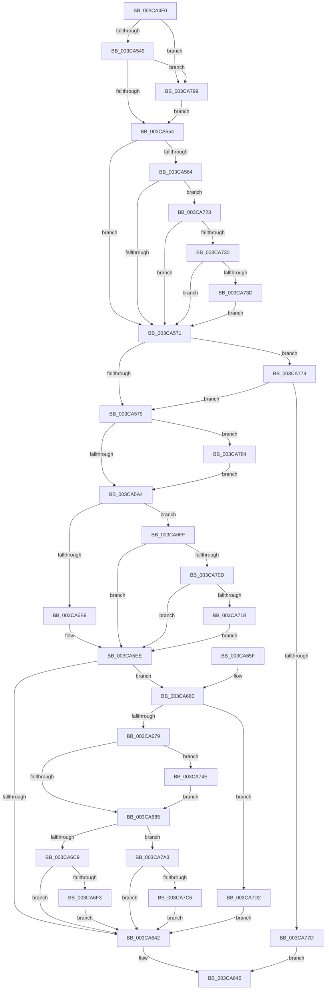

# CcCopyWriteEx

- RVA: `0x003CA4F0`–`0x003CA7E8` (길이 `760` bytes)
- VA: `0x00000001403CA4F0`
- 실행 섹션: `.text`
- PDB 이름 있음: `예`; PDB Function 태그: `아니요`
- unwind 정보 RVA: `0x0008F698`
- 디코드: `166`개 명령, `760/760` bytes 표시
- 미해석 바이트: `0` (있으면 어셈블리에 `.byte`로 보존)

> 이 문서는 커널 이미지의 기계어와 PDB 기호를 분석해 생성했습니다. 4번과 5번은 함수 원형과 자료형을 바이너리 사용 방식에서 추정한 C 해석이며 원본 소스 복구 결과는 아닙니다.

## 1. Dependencies

- 직접 호출 지점: **5**; 고유 호출 대상: **5**
- 직접 호출자로 확인된 함수: **4**
- RIP 상대 이미지 참조: **7**

### Outgoing calls
- `0x003CA53C` → [PsGetIoPriorityThread](../34/PsGetIoPriorityThread_function_00343930.md) (function, `0x00343930`)
- `0x003CA630` → [CcMapAndCopyInToCache](CcMapAndCopyInToCache_function_003CA7F0.md) (function, `0x003CA7F0`)
- `0x003CA6BB` → [CcTelemetryBucketizeLatency](../../page/A6/CcTelemetryBucketizeLatency_function_00A67334.md) (function, `0x00A67334`)
- `0x003CA744` → [CcSetTelemetryPeriodicTimer](../../page/AD/CcSetTelemetryPeriodicTimer_function_00ADB788.md) (function, `0x00ADB788`)
- `0x003CA750` → [KeQueryPerformanceCounter](../37/KeQueryPerformanceCounter_function_0037E7E0.md) (function, `0x0037E7E0`)

### Direct callers
- [CcCopyWrite](CcCopyWrite_function_003CA4C0.md) at `0x003CA4D4`
- [CcFastCopyWrite](../57/CcFastCopyWrite_function_0057CA50.md) at `0x0057CA6D`
- [DifCcCopyWriteExWrapper](../61/DifCcCopyWriteExWrapper_function_0061C0E0.md) at `0x0061C1FD`
- [DifCcCopyWriteWrapper](../61/DifCcCopyWriteWrapper_function_0061C2A0.md) at `0x0061C3AA`

### Static image references
- `0x003CA554` → RVA `0x00F8F2D0` (`.data`; read/write)
- `0x003CA55B` → RVA `0x00F8F3C0` (`.data`; read)
- `0x003CA564` → RVA `0x00F8F260` (`.data`; read)
- `0x003CA639` → RVA `0x00F8F2A1` (`.data`; read)
- `0x003CA723` → RVA `0x00F8F3C4` (`.data`; read)
- `0x003CA73D` → RVA `0x00F8F280` (`.data`; read)
- `0x003CA763` → RVA `0x00F8F268` (`.data`; read)

## 2. Other-region calls and transfers

- 다른 실행 섹션으로 향하는 call: **2**
  - `0x003CA6BB` → [CcTelemetryBucketizeLatency](../../page/A6/CcTelemetryBucketizeLatency_function_00A67334.md) (`.text` → `PAGE`)
  - `0x003CA744` → [CcSetTelemetryPeriodicTimer](../../page/AD/CcSetTelemetryPeriodicTimer_function_00ADB788.md) (`.text` → `PAGE`)
- 별도 외부 분기/꼬리 이동을 확인하지 못했습니다.

## 3. Assembly (complete function range)

```asm
003CA4F0  48 8B C4                        mov rax, rsp
003CA4F3  48 89 58 08                     mov qword ptr [rax + 8], rbx
003CA4F7  48 89 70 10                     mov qword ptr [rax + 0x10], rsi
003CA4FB  44 88 48 20                     mov byte ptr [rax + 0x20], r9b
003CA4FF  57                              push rdi
003CA500  41 56                           push r14
003CA502  41 57                           push r15
003CA504  48 81 EC 90 00 00 00            sub rsp, 0x90
003CA50B  41 8A F9                        mov dil, r9b
003CA50E  45 8B F0                        mov r14d, r8d
003CA511  4C 8B FA                        mov r15, rdx
003CA514  48 8B D9                        mov rbx, rcx
003CA517  48 83 60 D0 00                  and qword ptr [rax - 0x30], 0
003CA51C  48 83 60 C8 00                  and qword ptr [rax - 0x38], 0
003CA521  C6 40 A8 00                     mov byte ptr [rax - 0x58], 0
003CA525  33 F6                           xor esi, esi
003CA527  21 70 B8                        and dword ptr [rax - 0x48], esi
003CA52A  21 70 BC                        and dword ptr [rax - 0x44], esi
003CA52D  21 70 B0                        and dword ptr [rax - 0x50], esi
003CA530  21 70 B4                        and dword ptr [rax - 0x4c], esi
003CA533  65 48 8B 0C 25 88 01 00 00      mov rcx, qword ptr gs:[0x188]
003CA53C  E8 EF 93 F7 FF                  call 0x140343930
003CA541  85 C0                           test eax, eax
003CA543  0F 8E 50 02 00 00               jle 0x1403ca799
003CA549  8B 43 50                        mov eax, dword ptr [rbx + 0x50]
003CA54C  A8 10                           test al, 0x10
003CA54E  0F 85 45 02 00 00               jne 0x1403ca799
003CA554  48 FF 05 75 4D BC 00            inc qword ptr [rip + 0xbc4d75]
003CA55B  83 3D 5E 4E BC 00 00            cmp dword ptr [rip + 0xbc4e5e], 0
003CA562  75 0D                           jne 0x1403ca571
003CA564  80 3D F5 4C BC 00 00            cmp byte ptr [rip + 0xbc4cf5], 0
003CA56B  0F 85 B2 01 00 00               jne 0x1403ca723
003CA571  85 F6                           test esi, esi
003CA573  0F 85 FB 01 00 00               jne 0x1403ca774
003CA579  48 8B 43 28                     mov rax, qword ptr [rbx + 0x28]
003CA57D  48 8B 70 08                     mov rsi, qword ptr [rax + 8]
003CA581  48 89 B4 24 80 00 00 00         mov qword ptr [rsp + 0x80], rsi
003CA589  49 8B 07                        mov rax, qword ptr [r15]
003CA58C  48 89 44 24 78                  mov qword ptr [rsp + 0x78], rax
003CA591  BA FF 0F 00 00                  mov edx, 0xfff
003CA596  41 B8 02 00 00 00               mov r8d, 2
003CA59C  85 C2                           test edx, eax
003CA59E  0F 84 E0 01 00 00               je 0x1403ca784
003CA5A4  42 8D 0C 30                     lea ecx, [rax + r14]
003CA5A8  23 CA                           and ecx, edx
003CA5AA  41 8B D0                        mov edx, r8d
003CA5AD  83 CA 04                        or edx, 4
003CA5B0  85 C9                           test ecx, ecx
003CA5B2  41 0F 45 D0                     cmovne edx, r8d
003CA5B6  48 89 44 24 68                  mov qword ptr [rsp + 0x68], rax
003CA5BB  25 00 F0 FF FF                  and eax, 0xfffff000
003CA5C0  89 44 24 68                     mov dword ptr [rsp + 0x68], eax
003CA5C4  48 8B 43 18                     mov rax, qword ptr [rbx + 0x18]
003CA5C8  48 8B 40 28                     mov rax, qword ptr [rax + 0x28]
003CA5CC  48 89 44 24 70                  mov qword ptr [rsp + 0x70], rax
003CA5D1  48 8B 44 24 70                  mov rax, qword ptr [rsp + 0x70]
003CA5D6  48 2B 44 24 68                  sub rax, qword ptr [rsp + 0x68]
003CA5DB  48 89 44 24 68                  mov qword ptr [rsp + 0x68], rax
003CA5E0  48 85 C0                        test rax, rax
003CA5E3  0F 8F 16 01 00 00               jg 0x1403ca6ff
003CA5E9  83 CA 07                        or edx, 7
003CA5EC  8B CA                           mov ecx, edx
003CA5EE  48 8D 44 24 60                  lea rax, [rsp + 0x60]
003CA5F3  48 89 44 24 48                  mov qword ptr [rsp + 0x48], rax
003CA5F8  48 8B 84 24 D8 00 00 00         mov rax, qword ptr [rsp + 0xd8]
003CA600  48 89 44 24 40                  mov qword ptr [rsp + 0x40], rax
003CA605  40 88 7C 24 38                  mov byte ptr [rsp + 0x38], dil
003CA60A  48 8D 44 24 70                  lea rax, [rsp + 0x70]
003CA60F  48 89 44 24 30                  mov qword ptr [rsp + 0x30], rax
003CA614  48 89 5C 24 28                  mov qword ptr [rsp + 0x28], rbx
003CA619  89 4C 24 20                     mov dword ptr [rsp + 0x20], ecx
003CA61D  45 8B CE                        mov r9d, r14d
003CA620  4C 8D 44 24 78                  lea r8, [rsp + 0x78]
003CA625  48 8B 94 24 D0 00 00 00         mov rdx, qword ptr [rsp + 0xd0]
003CA62D  48 8B CE                        mov rcx, rsi
003CA630  E8 BB 01 00 00                  call 0x1403ca7f0
003CA635  88 44 24 50                     mov byte ptr [rsp + 0x50], al
003CA639  80 3D 61 4C BC 00 00            cmp byte ptr [rip + 0xbc4c61], 0
003CA640  74 1E                           je 0x1403ca660
003CA642  8A 44 24 50                     mov al, byte ptr [rsp + 0x50]
003CA646  4C 8D 9C 24 90 00 00 00         lea r11, [rsp + 0x90]
003CA64E  49 8B 5B 20                     mov rbx, qword ptr [r11 + 0x20]
003CA652  49 8B 73 28                     mov rsi, qword ptr [r11 + 0x28]
003CA656  49 8B E3                        mov rsp, r11
003CA659  41 5F                           pop r15
003CA65B  41 5E                           pop r14
003CA65D  5F                              pop rdi
003CA65E  C3                              ret
003CA65F  CC                              int3
003CA660  48 8B 9E 00 02 00 00            mov rbx, qword ptr [rsi + 0x200]
003CA667  48 81 C3 E8 00 00 00            add rbx, 0xe8
003CA66E  80 7C 24 50 00                  cmp byte ptr [rsp + 0x50], 0
003CA673  0F 84 59 01 00 00               je 0x1403ca7d2
003CA679  48 83 7C 24 60 00               cmp qword ptr [rsp + 0x60], 0
003CA67F  0F 85 C9 00 00 00               jne 0x1403ca74e
003CA685  40 8A C7                        mov al, dil
003CA688  F6 D8                           neg al
003CA68A  4D 1B C0                        sbb r8, r8
003CA68D  48 C7 C1 40 FF FF FF            mov rcx, 0xffffffffffffff40
003CA694  4C 23 C1                        and r8, rcx
003CA697  49 81 C0 B0 03 00 00            add r8, 0x3b0
003CA69E  4C 03 C3                        add r8, rbx
003CA6A1  40 8A C7                        mov al, dil
003CA6A4  F6 D8                           neg al
003CA6A6  48 1B D2                        sbb rdx, rdx
003CA6A9  48 23 D1                        and rdx, rcx
003CA6AC  48 81 C2 50 03 00 00            add rdx, 0x350
003CA6B3  48 03 D3                        add rdx, rbx
003CA6B6  48 8B 4C 24 58                  mov rcx, qword ptr [rsp + 0x58]
003CA6BB  E8 74 CC 69 00                  call 0x140a67334
003CA6C0  40 84 FF                        test dil, dil
003CA6C3  0F 84 DA 00 00 00               je 0x1403ca7a3
003CA6C9  48 8B 83 68 02 00 00            mov rax, qword ptr [rbx + 0x268]
003CA6D0  48 FF C0                        inc rax
003CA6D3  48 89 83 68 02 00 00            mov qword ptr [rbx + 0x268], rax
003CA6DA  48 8B 8E 00 02 00 00            mov rcx, qword ptr [rsi + 0x200]
003CA6E1  48 8B 44 24 58                  mov rax, qword ptr [rsp + 0x58]
003CA6E6  48 3B 81 68 03 00 00            cmp rax, qword ptr [rcx + 0x368]
003CA6ED  0F 86 4F FF FF FF               jbe 0x1403ca642
003CA6F3  48 89 83 80 02 00 00            mov qword ptr [rbx + 0x280], rax
003CA6FA  E9 43 FF FF FF                  jmp 0x1403ca642
003CA6FF  8B CA                           mov ecx, edx
003CA701  48 C1 E8 20                     shr rax, 0x20
003CA705  85 C0                           test eax, eax
003CA707  0F 85 E1 FE FF FF               jne 0x1403ca5ee
003CA70D  81 7C 24 68 00 10 00 00         cmp dword ptr [rsp + 0x68], 0x1000
003CA715  0F 87 D3 FE FF FF               ja 0x1403ca5ee
003CA71B  83 C9 06                        or ecx, 6
003CA71E  E9 CB FE FF FF                  jmp 0x1403ca5ee
003CA723  83 3D 9A 4C BC 00 00            cmp dword ptr [rip + 0xbc4c9a], 0
003CA72A  0F 85 41 FE FF FF               jne 0x1403ca571
003CA730  80 3D 6A 4B BC 00 00            cmp byte ptr [rip + 0xbc4b6a], 0
003CA737  0F 85 34 FE FF FF               jne 0x1403ca571
003CA73D  48 8B 0D 3C 4B BC 00            mov rcx, qword ptr [rip + 0xbc4b3c]
003CA744  E8 3F 10 71 00                  call 0x140adb788
003CA749  E9 23 FE FF FF                  jmp 0x1403ca571
003CA74E  33 C9                           xor ecx, ecx
003CA750  E8 8B 40 FB FF                  call 0x14037e7e0
003CA755  48 2B 44 24 60                  sub rax, qword ptr [rsp + 0x60]
003CA75A  48 69 C0 40 42 0F 00            imul rax, rax, 0xf4240
003CA761  48 99                           cqo
003CA763  48 F7 3D FE 4A BC 00            idiv qword ptr [rip + 0xbc4afe]
003CA76A  48 89 44 24 58                  mov qword ptr [rsp + 0x58], rax
003CA76F  E9 11 FF FF FF                  jmp 0x1403ca685
003CA774  40 84 FF                        test dil, dil
003CA777  0F 85 FC FD FF FF               jne 0x1403ca579
003CA77D  32 C0                           xor al, al
003CA77F  E9 C2 FE FF FF                  jmp 0x1403ca646
003CA784  B9 03 00 00 00                  mov ecx, 3
003CA789  41 81 FE 00 10 00 00            cmp r14d, 0x1000
003CA790  44 0F 43 C1                     cmovae r8d, ecx
003CA794  E9 0B FE FF FF                  jmp 0x1403ca5a4
003CA799  BE 01 00 00 00                  mov esi, 1
003CA79E  E9 B1 FD FF FF                  jmp 0x1403ca554
003CA7A3  48 8B 83 70 02 00 00            mov rax, qword ptr [rbx + 0x270]
003CA7AA  48 FF C0                        inc rax
003CA7AD  48 89 83 70 02 00 00            mov qword ptr [rbx + 0x270], rax
003CA7B4  48 8B 44 24 58                  mov rax, qword ptr [rsp + 0x58]
003CA7B9  48 3B 83 88 02 00 00            cmp rax, qword ptr [rbx + 0x288]
003CA7C0  0F 86 7C FE FF FF               jbe 0x1403ca642
003CA7C6  48 89 83 88 02 00 00            mov qword ptr [rbx + 0x288], rax
003CA7CD  E9 70 FE FF FF                  jmp 0x1403ca642
003CA7D2  48 8B 83 78 02 00 00            mov rax, qword ptr [rbx + 0x278]
003CA7D9  48 FF C0                        inc rax
003CA7DC  48 89 83 78 02 00 00            mov qword ptr [rbx + 0x278], rax
003CA7E3  E9 5A FE FF FF                  jmp 0x1403ca642
```

## 4. C-style interpretation (structured pseudocode)

```c
__int64 __fastcall CcCopyWriteEx(__int64 a1, __int64 a2, int a3, unsigned __int8 a4, __int64 a5, __int64 a6)
{
    __int64 result;
    __int64 v_rbx;
    __int64 v_rsi;
    __int64 v_rsp;
    unsigned __int64 v_stack_m18;
    unsigned __int64 v_stack_m28;
    unsigned __int64 v_stack_m30;
    unsigned __int64 v_stack_m38;
    unsigned __int64 v_stack_m40;
    unsigned __int64 v_stack_m48;
    unsigned __int8 v_stack_m58;
    unsigned __int64 v_stack_m60;
    unsigned __int64 v_stack_m68;
    unsigned __int8 v_stack_m70;
    unsigned __int64 v_stack_m78;
    unsigned __int64 v_stack_m80;
    unsigned int v_stack_m88;

    *(unsigned __int64 *)(v_rsp + 8) = v_rbx;
    *(unsigned __int64 *)(v_rsp + 16) = v_rsi;
    *(unsigned __int8 *)(v_rsp + 32) = a4;
    v_rsp = (v_rsp) - (144);
    *(unsigned __int8 *)(v_rsp - 88) = 0;
    v_rsi = 0;
    result = PsGetIoPriorityThread(*(unsigned __int64 *)(gs_base + (0 + 392)), a2, a3, a4);
    if (condition_is_less_or_equal) goto loc_003CA799;
    if ((((unsigned __int8)((unsigned int)(*(unsigned int *)(a1 + 80)))) & (16)) != 0) goto loc_003CA799;
loc_003CA554:
    if ((*(unsigned int *)(v_rip + 12340830)) != 0) goto loc_003CA571;
    if ((*(unsigned __int8 *)(v_rip + 12340469)) != 0) goto loc_003CA723;
loc_003CA571:
    if (0 != 0) goto loc_003CA774;
loc_003CA579:
    v_stack_m28 = *(unsigned __int64 *)(*(unsigned __int64 *)(a1 + 40) + 8);
    v_stack_m30 = *(unsigned __int64 *)(a2);
    if ((((unsigned int)((unsigned int)(0xFFFULL))) & ((unsigned int)(*(unsigned __int64 *)(a2)))) == 0) goto loc_003CA784;
loc_003CA5A4:
    a1 = (unsigned int)((*(unsigned __int64 *)(a2) + (unsigned int)(a3) * 1) & ((unsigned int)((unsigned int)(0xFFFULL))));
    a2 = (unsigned int)((2) | (4));
    if ((unsigned int)(a1) != 0) { a2 = 2; }
    v_stack_m40 = *(unsigned __int64 *)(a2);
    result = (unsigned int)((*(unsigned __int64 *)(a2)) & (0xFFFFF000ULL));
    v_stack_m40 = (unsigned int)(result);
    v_stack_m38 = *(unsigned __int64 *)(*(unsigned __int64 *)(a1 + 24) + 40);
    result = (v_stack_m38) - (v_stack_m40);
    v_stack_m40 = result;
    if (condition_is_greater) goto loc_003CA6FF;
    a2 = (unsigned int)((a2) | (7));
loc_003CA5EE:
    v_stack_m60 = v_stack_m48;
    v_stack_m68 = a6;
    v_stack_m70 = a4;
    v_stack_m78 = v_stack_m38;
    v_stack_m80 = a1;
    v_stack_m88 = (unsigned int)((unsigned int)((unsigned int)(a2)));
    result = CcMapAndCopyInToCache(*(unsigned __int64 *)(*(unsigned __int64 *)(a1 + 40) + 8), a5, v_stack_m30, (unsigned int)((unsigned int)((unsigned int)(a3))));
    v_stack_m58 = (unsigned __int8)(result);
    if ((*(unsigned __int8 *)(v_rip + 12340321)) == 0) goto loc_003CA660;
loc_003CA642:
loc_003CA646:
    return v_stack_m58;
loc_003CA660:
    v_rbx = (*(unsigned __int64 *)(*(unsigned __int64 *)(v_stack_m18 + 40) + 512)) + (232);
    if (v_stack_m40 == 0) goto loc_003CA7D2;
    if (v_stack_m30 != 0) goto loc_003CA74E;
loc_003CA685:
    result = (unsigned __int8)(-(a4));
    a3 = (v_stack_m30) & (-192);
    a3 = (a3) + (944);
    a3 = (a3) + (v_rbx);
    result = (unsigned __int8)(-(a4));
    a2 = (a5) & (-192);
    a2 = (a2) + (848);
    a2 = (a2) + (v_rbx);
    result = CcTelemetryBucketizeLatency(v_stack_m38, a2, a3, (unsigned int)((unsigned int)((unsigned int)(a3))));
    if (a4 == 0) goto loc_003CA7A3;
    result = (*(unsigned __int64 *)(v_rbx + 616)) + 1;
    *(unsigned __int64 *)(v_rbx + 616) = result;
    if (v_stack_m38 <= (*(unsigned __int64 *)(*(unsigned __int64 *)(*(unsigned __int64 *)(v_stack_m18 + 40) + 512) + 872))) goto loc_003CA642;
    *(unsigned __int64 *)(v_rbx + 640) = v_stack_m38;
    goto loc_003CA642;
loc_003CA6FF:
    result = (v_stack_m38) >> (32);
    if ((unsigned int)(result) != 0) goto loc_003CA5EE;
    if (v_stack_m28 > 0x1000ULL) goto loc_003CA5EE;
    a1 = (unsigned int)(((unsigned int)((unsigned int)(a2))) | (6));
    goto loc_003CA5EE;
loc_003CA723:
    if ((*(unsigned int *)(v_rip + 12340378)) != 0) goto loc_003CA571;
    if ((*(unsigned __int8 *)(v_rip + 12340074)) != 0) goto loc_003CA571;
    result = CcSetTelemetryPeriodicTimer(*(unsigned __int64 *)(v_rip + 12340028), a2, a3, (unsigned int)((unsigned int)((unsigned int)(a3))));
    goto loc_003CA571;
loc_003CA74E:
    a1 = 0;
    result = KeQueryPerformanceCounter(a1, a2, a3, (unsigned int)((unsigned int)((unsigned int)(a3))));
    result = (result) - (v_stack_m30);
    result = (result) * (result);
    v_stack_m38 = result;
    goto loc_003CA685;
loc_003CA774:
    if (a4 != 0) goto loc_003CA579;
    result = 0;
    goto loc_003CA646;
loc_003CA784:
    if (((unsigned int)((unsigned int)(a3))) >= 0x1000ULL) { a3 = 3; }
    goto loc_003CA5A4;
loc_003CA799:
    goto loc_003CA554;
loc_003CA7A3:
    result = (*(unsigned __int64 *)(v_rbx + 624)) + 1;
    *(unsigned __int64 *)(v_rbx + 624) = result;
    if (v_stack_m38 <= (*(unsigned __int64 *)(v_rbx + 648))) goto loc_003CA642;
    *(unsigned __int64 *)(v_rbx + 648) = v_stack_m38;
    goto loc_003CA642;
loc_003CA7D2:
    result = (*(unsigned __int64 *)(v_rbx + 632)) + 1;
    *(unsigned __int64 *)(v_rbx + 632) = result;
    goto loc_003CA642;
}
```

## 5. (Beta) C Style

```c
int64_t CcCopyWriteEx(void *Arg1, void *Arg2, int32_t Arg3, uint8_t Arg4, int64_t Arg5, int64_t Arg6)
{
    uint8_t *arg1 = (uint8_t *)Arg1;
    uint8_t *arg2 = (uint8_t *)Arg2;

    int64_t result;
    int64_t local_rbx;
    int64_t local_rsi;
    int64_t local_rsp;
    uint64_t v_stack_m18;
    uint64_t v_stack_m28;
    uint64_t v_stack_m30;
    uint64_t v_stack_m38;
    uint64_t v_stack_m40;
    uint64_t v_stack_m48;
    uint8_t v_stack_m58;
    uint64_t v_stack_m60;
    uint64_t v_stack_m68;
    uint8_t v_stack_m70;
    uint64_t v_stack_m78;
    uint64_t v_stack_m80;
    uint32_t v_stack_m88;

    *(uint64_t *)(local_rsp + 0x8) = local_rbx;
    *(uint64_t *)(local_rsp + 0x10) = local_rsi;
    *(uint8_t *)(local_rsp + 0x20) = Arg4;
    local_rsp = (local_rsp) - (144);
    *(uint8_t *)(local_rsp - 0x58) = 0;
    local_rsi = 0;
    result = PsGetIoPriorityThread(*(uint64_t *)(gs_base + (0 + 0x188)), Arg2, Arg3, Arg4);
    if (condition_is_less_or_equal) goto loc_003CA799;
    if ((((uint8_t)((uint32_t)(*(uint32_t *)(arg1 + 0x50)))) & (16)) != 0) goto loc_003CA799;
loc_003CA554:
    if ((*(uint32_t *)(v_rip + 0xBC4E5E)) != 0) goto loc_003CA571;
    if ((*(uint8_t *)(v_rip + 0xBC4CF5)) != 0) goto loc_003CA723;
loc_003CA571:
    if (0 != 0) goto loc_003CA774;
loc_003CA579:
    v_stack_m28 = *(uint64_t *)(*(uint64_t *)(arg1 + 0x28) + 0x8);
    v_stack_m30 = *(uint64_t *)(arg2);
    if ((((uint32_t)((uint32_t)(0xFFFULL))) & ((uint32_t)(*(uint64_t *)(arg2)))) == 0) goto loc_003CA784;
loc_003CA5A4:
    Arg1 = (uint32_t)((*(uint64_t *)(arg2) + (uint32_t)(Arg3) * 1) & ((uint32_t)((uint32_t)(0xFFFULL))));
    Arg2 = (uint32_t)((2) | (4));
    if ((uint32_t)(Arg1) != 0) { Arg2 = 2; }
    v_stack_m40 = *(uint64_t *)(arg2);
    result = (uint32_t)((*(uint64_t *)(arg2)) & (0xFFFFF000ULL));
    v_stack_m40 = (uint32_t)(result);
    v_stack_m38 = *(uint64_t *)(*(uint64_t *)(arg1 + 0x18) + 0x28);
    result = (v_stack_m38) - (v_stack_m40);
    v_stack_m40 = result;
    if (condition_is_greater) goto loc_003CA6FF;
    Arg2 = (uint32_t)((Arg2) | (7));
loc_003CA5EE:
    v_stack_m60 = v_stack_m48;
    v_stack_m68 = Arg6;
    v_stack_m70 = Arg4;
    v_stack_m78 = v_stack_m38;
    v_stack_m80 = Arg1;
    v_stack_m88 = (uint32_t)((uint32_t)((uint32_t)(Arg2)));
    result = CcMapAndCopyInToCache(*(uint64_t *)(*(uint64_t *)(arg1 + 0x28) + 0x8), Arg5, v_stack_m30, (uint32_t)((uint32_t)((uint32_t)(Arg3))));
    v_stack_m58 = (uint8_t)(result);
    if ((*(uint8_t *)(v_rip + 0xBC4C61)) == 0) goto loc_003CA660;
loc_003CA642:
loc_003CA646:
    return v_stack_m58;
loc_003CA660:
    local_rbx = (*(uint64_t *)(*(uint64_t *)(v_stack_m18 + 0x28) + 0x200)) + (232);
    if (v_stack_m40 == 0) goto loc_003CA7D2;
    if (v_stack_m30 != 0) goto loc_003CA74E;
loc_003CA685:
    result = (uint8_t)(-(Arg4));
    Arg3 = (v_stack_m30) & (-192);
    Arg3 = (Arg3) + (944);
    Arg3 = (Arg3) + (local_rbx);
    result = (uint8_t)(-(Arg4));
    Arg2 = (Arg5) & (-192);
    Arg2 = (Arg2) + (848);
    Arg2 = (Arg2) + (local_rbx);
    result = CcTelemetryBucketizeLatency(v_stack_m38, Arg2, Arg3, (uint32_t)((uint32_t)((uint32_t)(Arg3))));
    if (Arg4 == 0) goto loc_003CA7A3;
    result = (*(uint64_t *)(local_rbx + 0x268)) + 1;
    *(uint64_t *)(local_rbx + 0x268) = result;
    if (v_stack_m38 <= (*(uint64_t *)(*(uint64_t *)(*(uint64_t *)(v_stack_m18 + 0x28) + 0x200) + 0x368))) goto loc_003CA642;
    *(uint64_t *)(local_rbx + 0x280) = v_stack_m38;
    goto loc_003CA642;
loc_003CA6FF:
    result = (v_stack_m38) >> (32);
    if ((uint32_t)(result) != 0) goto loc_003CA5EE;
    if (v_stack_m28 > 0x1000ULL) goto loc_003CA5EE;
    Arg1 = (uint32_t)(((uint32_t)((uint32_t)(Arg2))) | (6));
    goto loc_003CA5EE;
loc_003CA723:
    if ((*(uint32_t *)(v_rip + 0xBC4C9A)) != 0) goto loc_003CA571;
    if ((*(uint8_t *)(v_rip + 0xBC4B6A)) != 0) goto loc_003CA571;
    result = CcSetTelemetryPeriodicTimer(*(uint64_t *)(v_rip + 0xBC4B3C), Arg2, Arg3, (uint32_t)((uint32_t)((uint32_t)(Arg3))));
    goto loc_003CA571;
loc_003CA74E:
    Arg1 = 0;
    result = KeQueryPerformanceCounter(Arg1, Arg2, Arg3, (uint32_t)((uint32_t)((uint32_t)(Arg3))));
    result = (result) - (v_stack_m30);
    result = (result) * (result);
    v_stack_m38 = result;
    goto loc_003CA685;
loc_003CA774:
    if (Arg4 != 0) goto loc_003CA579;
    result = 0;
    goto loc_003CA646;
loc_003CA784:
    if (((uint32_t)((uint32_t)(Arg3))) >= 0x1000ULL) { Arg3 = 3; }
    goto loc_003CA5A4;
loc_003CA799:
    goto loc_003CA554;
loc_003CA7A3:
    result = (*(uint64_t *)(local_rbx + 0x270)) + 1;
    *(uint64_t *)(local_rbx + 0x270) = result;
    if (v_stack_m38 <= (*(uint64_t *)(local_rbx + 0x288))) goto loc_003CA642;
    *(uint64_t *)(local_rbx + 0x288) = v_stack_m38;
    goto loc_003CA642;
loc_003CA7D2:
    result = (*(uint64_t *)(local_rbx + 0x278)) + 1;
    *(uint64_t *)(local_rbx + 0x278) = result;
    goto loc_003CA642;
}
```

### 관측된 메모리 오프셋

구조체 형식이 확인되지 않은 접근은 인자 기준의 오프셋으로만 기록했습니다.

| 기준 인자 | 오프셋 표현 | 폭 (bit) | 접근 |
|---|---:|---:|---|
| `Arg1` | `+ 0x18` | `64` | `R` |
| `Arg1` | `+ 0x28` | `64` | `R` |
| `Arg1` | `+ 0x50` | `32` | `R` |
| `Arg2` | `+ 0x0` | `64` | `R` |

## 6. Execution-region graph

[열기: 2D/3D 그래프와 함수 탐색 컨트롤 패널](../../../control-panel.html?section=text&rva=0x003CA4F0&view=graph)

- 2D 그래프는 위에서 아래로 흐르고, 3D 그래프는 빈 공간을 드래그해 회전합니다. Shift+드래그는 이동, 휠은 확대·축소, 함수 노드 선택은 대상 보고서 이동입니다.

### Static fallback


