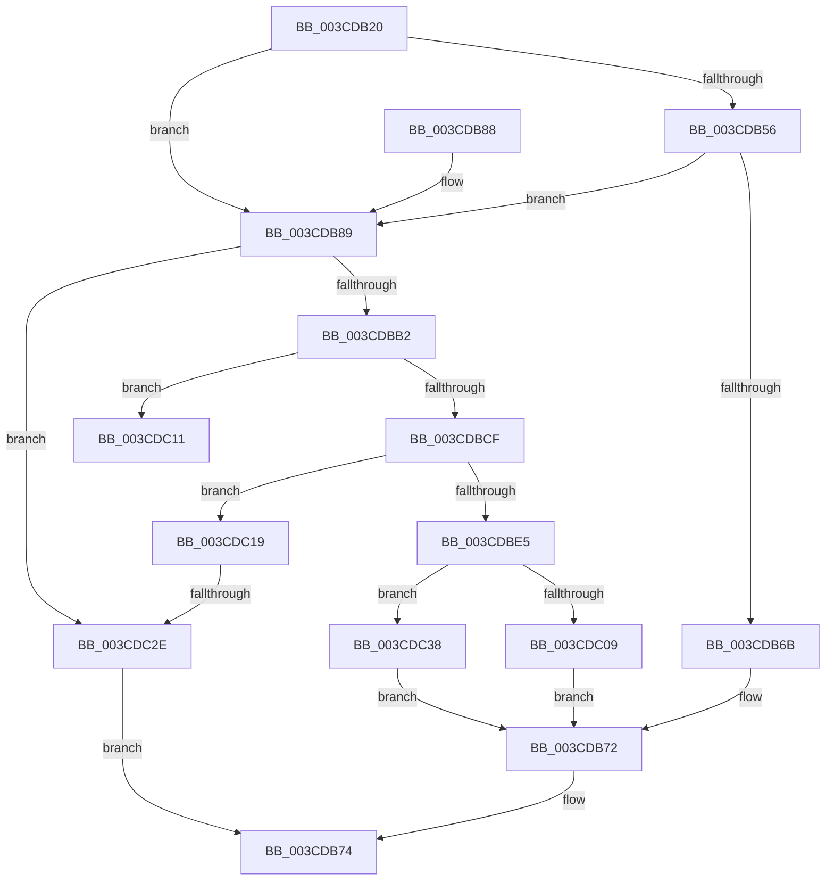

# CcCreatePrivateVolumeCacheMap

- RVA: `0x003CDB20`–`0x003CDC6D` (길이 `333` bytes)
- VA: `0x00000001403CDB20`
- 실행 섹션: `.text`
- PDB 이름 있음: `예`; PDB Function 태그: `예`
- unwind 정보 RVA: `0x0008FA34`
- 디코드: `91`개 명령, `333/333` bytes 표시
- 미해석 바이트: `0` (있으면 어셈블리에 `.byte`로 보존)

> 이 문서는 커널 이미지의 기계어와 PDB 기호를 분석해 생성했습니다. 4번과 5번은 함수 원형과 자료형을 바이너리 사용 방식에서 추정한 C 해석이며 원본 소스 복구 결과는 아닙니다.

## 1. Dependencies

- 직접 호출 지점: **10**; 고유 호출 대상: **8**
- 직접 호출자로 확인된 함수: **3**
- RIP 상대 이미지 참조: **1**

### Outgoing calls
- `0x003CDB61` → [CcFindPrivateVolumeCacheMap](CcFindPrivateVolumeCacheMap_function_003CDC80.md) (function, `0x003CDC80`)
- `0x003CDBA1` → [ExAllocatePoolWithTag](../../poolcode/B8/ExAllocatePoolWithTag_function_00B82010.md) (function, `0x00B82010`)
- `0x003CDBC2` → [ExAllocatePoolWithTag](../../poolcode/B8/ExAllocatePoolWithTag_function_00B82010.md) (function, `0x00B82010`)
- `0x003CDBDC` → [CcInitializePrivateVolumeCacheMap](CcInitializePrivateVolumeCacheMap_function_003CE088.md) (function, `0x003CE088`)
- `0x003CDC00` → [CcInsertPrivateVolumeCacheMap](CcInsertPrivateVolumeCacheMap_function_003CE714.md) (function, `0x003CE714`)
- `0x003CDC1C` → [CcDeletePrivateVolumeCacheMap](CcDeletePrivateVolumeCacheMap_function_003CE950.md) (function, `0x003CE950`)
- `0x003CDC4A` → [KeAcquireInStackQueuedSpinLock](../27/KeAcquireInStackQueuedSpinLock_function_002757A0.md) (function, `0x002757A0`)
- `0x003CDC52` → [CcDecrementPrivateVolumeUseCount](../38/CcDecrementPrivateVolumeUseCount_function_00389760.md) (function, `0x00389760`)
- `0x003CDC5B` → [KeReleaseInStackQueuedSpinLock](../34/KeReleaseInStackQueuedSpinLock_function_00342CE0.md) (function, `0x00342CE0`)
- `0x003CDC63` → [CcDeletePrivateVolumeCacheMap](CcDeletePrivateVolumeCacheMap_function_003CE950.md) (function, `0x003CE950`)

### Direct callers
- [CcInitializeCacheMapInternal](CcInitializeCacheMapInternal_function_003CC720.md) at `0x003CCF3C`
- [CcAddExternalCacheToVolumeEx](../57/CcAddExternalCacheToVolumeEx_function_0057B42C.md) at `0x0057B461`
- [CcRegisterExternalCache](../57/CcRegisterExternalCache_function_0057BFC0.md) at `0x0057C036`

### Static image references
- `0x003CDB89` → RVA `0x00E0A874` (`.data`; read)

## 2. Other-region calls and transfers

- 다른 실행 섹션으로 향하는 call: **2**
  - `0x003CDBA1` → [ExAllocatePoolWithTag](../../poolcode/B8/ExAllocatePoolWithTag_function_00B82010.md) (`.text` → `POOLCODE`)
  - `0x003CDBC2` → [ExAllocatePoolWithTag](../../poolcode/B8/ExAllocatePoolWithTag_function_00B82010.md) (`.text` → `POOLCODE`)
- call이 아닌 외부 분기/꼬리 이동: **2**
  - `0x003CDC14` → [sub_006E8924](../6E/Unknown_function_006E8924.md) (`tail-transfer`)
  - `0x003CDC28` → [sub_006E8924](../6E/Unknown_function_006E8924.md) (`tail-transfer`)

## 3. Assembly (complete function range)

```asm
003CDB20  48 89 5C 24 08                  mov qword ptr [rsp + 8], rbx
003CDB25  55                              push rbp
003CDB26  56                              push rsi
003CDB27  57                              push rdi
003CDB28  41 56                           push r14
003CDB2A  41 57                           push r15
003CDB2C  48 8B EC                        mov rbp, rsp
003CDB2F  48 83 EC 50                     sub rsp, 0x50
003CDB33  48 83 65 E0 00                  and qword ptr [rbp - 0x20], 0
003CDB38  33 C0                           xor eax, eax
003CDB3A  48 89 45 F8                     mov qword ptr [rbp - 8], rax
003CDB3E  0F 57 C0                        xorps xmm0, xmm0
003CDB41  88 45 38                        mov byte ptr [rbp + 0x38], al
003CDB44  4D 8B F8                        mov r15, r8
003CDB47  48 8B FA                        mov rdi, rdx
003CDB4A  48 8B F1                        mov rsi, rcx
003CDB4D  0F 11 45 E8                     movups xmmword ptr [rbp - 0x18], xmm0
003CDB51  48 85 D2                        test rdx, rdx
003CDB54  74 33                           je 0x1403cdb89
003CDB56  48 8B 82 00 02 00 00            mov rax, qword ptr [rdx + 0x200]
003CDB5D  48 8B 50 10                     mov rdx, qword ptr [rax + 0x10]
003CDB61  E8 1A 01 00 00                  call 0x1403cdc80
003CDB66  48 85 C0                        test rax, rax
003CDB69  74 1E                           je 0x1403cdb89
003CDB6B  48 89 87 58 02 00 00            mov qword ptr [rdi + 0x258], rax
003CDB72  33 C0                           xor eax, eax
003CDB74  48 8B 9C 24 80 00 00 00         mov rbx, qword ptr [rsp + 0x80]
003CDB7C  48 83 C4 50                     add rsp, 0x50
003CDB80  41 5F                           pop r15
003CDB82  41 5E                           pop r14
003CDB84  5F                              pop rdi
003CDB85  5E                              pop rsi
003CDB86  5D                              pop rbp
003CDB87  C3                              ret
003CDB88  CC                              int3
003CDB89  8B 05 E5 CC A3 00               mov eax, dword ptr [rip + 0xa3cce5]
003CDB8F  B9 00 06 00 00                  mov ecx, 0x600
003CDB94  48 69 D0 90 01 00 00            imul rdx, rax, 0x190
003CDB9B  41 B8 43 63 4E 75               mov r8d, 0x754e6343
003CDBA1  E8 6A 44 7B 00                  call 0x140b82010
003CDBA6  48 89 45 48                     mov qword ptr [rbp + 0x48], rax
003CDBAA  4C 8B F0                        mov r14, rax
003CDBAD  48 85 C0                        test rax, rax
003CDBB0  74 7C                           je 0x1403cdc2e
003CDBB2  BA 80 06 00 00                  mov edx, 0x680
003CDBB7  B9 00 02 00 00                  mov ecx, 0x200
003CDBBC  41 B8 43 63 56 6D               mov r8d, 0x6d566343
003CDBC2  E8 49 44 7B 00                  call 0x140b82010
003CDBC7  48 8B D8                        mov rbx, rax
003CDBCA  48 85 C0                        test rax, rax
003CDBCD  74 42                           je 0x1403cdc11
003CDBCF  4C 8B CF                        mov r9, rdi
003CDBD2  4C 8D 45 48                     lea r8, [rbp + 0x48]
003CDBD6  48 8B D0                        mov rdx, rax
003CDBD9  48 8B CE                        mov rcx, rsi
003CDBDC  E8 A7 04 00 00                  call 0x1403ce088
003CDBE1  84 C0                           test al, al
003CDBE3  74 34                           je 0x1403cdc19
003CDBE5  48 8D 45 38                     lea rax, [rbp + 0x38]
003CDBE9  45 33 C9                        xor r9d, r9d
003CDBEC  48 89 44 24 28                  mov qword ptr [rsp + 0x28], rax
003CDBF1  4C 8D 45 E0                     lea r8, [rbp - 0x20]
003CDBF5  48 8B D3                        mov rdx, rbx
003CDBF8  C6 44 24 20 00                  mov byte ptr [rsp + 0x20], 0
003CDBFD  48 8B CE                        mov rcx, rsi
003CDC00  E8 0F 0B 00 00                  call 0x1403ce714
003CDC05  84 C0                           test al, al
003CDC07  74 2F                           je 0x1403cdc38
003CDC09  49 89 1F                        mov qword ptr [r15], rbx
003CDC0C  E9 61 FF FF FF                  jmp 0x1403cdb72
003CDC11  49 8B CE                        mov rcx, r14
003CDC14  E9 0B AD 31 00                  jmp 0x1406e8924
003CDC19  48 8B CB                        mov rcx, rbx
003CDC1C  E8 2F 0D 00 00                  call 0x1403ce950
003CDC21  48 8B 4D 48                     mov rcx, qword ptr [rbp + 0x48]
003CDC25  48 85 C9                        test rcx, rcx
003CDC28  0F 85 F6 AC 31 00               jne 0x1406e8924
003CDC2E  B8 9A 00 00 C0                  mov eax, 0xc000009a
003CDC33  E9 3C FF FF FF                  jmp 0x1403cdb74
003CDC38  48 8B 45 E0                     mov rax, qword ptr [rbp - 0x20]
003CDC3C  48 8D 8E 00 03 00 00            lea rcx, [rsi + 0x300]
003CDC43  48 8D 55 E8                     lea rdx, [rbp - 0x18]
003CDC47  49 89 07                        mov qword ptr [r15], rax
003CDC4A  E8 51 7B EA FF                  call 0x1402757a0
003CDC4F  48 8B CB                        mov rcx, rbx
003CDC52  E8 09 BB FB FF                  call 0x140389760
003CDC57  48 8D 4D E8                     lea rcx, [rbp - 0x18]
003CDC5B  E8 80 50 F7 FF                  call 0x140342ce0
003CDC60  48 8B CB                        mov rcx, rbx
003CDC63  E8 E8 0C 00 00                  call 0x1403ce950
003CDC68  E9 05 FF FF FF                  jmp 0x1403cdb72
```

## 4. C-style interpretation (structured pseudocode)

```c
__int64 __fastcall CcCreatePrivateVolumeCacheMap(__int64 a1, __int64 a2, __int64 a3)
{
    __int64 result;
    __int64 v_rsp;
    unsigned __int64 v_stack_m30;
    unsigned __int64 v_stack_m40;
    unsigned __int64 v_stack_m48;
    unsigned __int8 v_stack_p10;
    unsigned __int64 v_stack_p20;
    unsigned __int64 v_stack_p28;
    unsigned __int64 v_stack_p8;

    v_stack_p8 = v_rbx;
    v_rsp = (v_rsp) - (80);
    result = 0;
    v_stack_m30 = 0;
    v_stack_p10 = 0;
    v_stack_m40 = v_xmm0;
    if (a2 == 0) goto loc_003CDB89;
    result = CcFindPrivateVolumeCacheMap(a1, *(unsigned __int64 *)(*(unsigned __int64 *)(a2 + 512) + 16), a3, a4);
    if (result == 0) goto loc_003CDB89;
    *(unsigned __int64 *)(a2 + 600) = result;
loc_003CDB72:
    result = 0;
loc_003CDB74:
    v_rsp = (v_rsp) + (80);
    return result;
loc_003CDB89:
    a2 = (*(unsigned __int64 *)(*(unsigned __int64 *)(a2 + 512) + 16)) * ((unsigned int)(*(unsigned int *)(v_rip + 10734821)));
    result = ExAllocatePoolWithTag((unsigned int)(0x600ULL), a2, (unsigned int)(0x754E6343ULL), a4);
    v_stack_p20 = result;
    if (result == 0) goto loc_003CDC2E;
    result = ExAllocatePoolWithTag(512, (unsigned int)(0x680ULL), (unsigned int)(0x6D566343ULL), a4);
    if (result == 0) goto loc_003CDC11;
    result = CcInitializePrivateVolumeCacheMap(a1, result, v_stack_p20, a2);
    if ((unsigned __int8)(result) == 0) goto loc_003CDC19;
    a4 = 0;
    v_stack_p28 = v_stack_p10;
    v_stack_p20 = 0;
    result = CcInsertPrivateVolumeCacheMap(a1, result, v_stack_m48, a4);
    if ((unsigned __int8)(result) == 0) goto loc_003CDC38;
    *(unsigned __int64 *)(a3) = result;
    goto loc_003CDB72;
loc_003CDC11:
loc_003CDC19:
    result = CcDeletePrivateVolumeCacheMap(result, result, v_stack_m48, a4);
loc_003CDC2E:
    goto loc_003CDB74;
loc_003CDC38:
    *(unsigned __int64 *)(a3) = v_stack_m48;
    result = KeAcquireInStackQueuedSpinLock(a1 + 768, v_stack_m40, v_stack_m48, a4);
    result = CcDecrementPrivateVolumeUseCount(result, v_stack_m40, v_stack_m48, a4);
    result = KeReleaseInStackQueuedSpinLock(v_stack_m40, v_stack_m40, v_stack_m48, a4);
    result = CcDeletePrivateVolumeCacheMap(result, v_stack_m40, v_stack_m48, a4);
    goto loc_003CDB72;
}
```

## 5. (Beta) C Style

```c
int64_t CcCreatePrivateVolumeCacheMap(void *Arg1, void *Arg2, void *Arg3)
{
    uint8_t *arg1 = (uint8_t *)Arg1;
    uint8_t *arg2 = (uint8_t *)Arg2;
    uint8_t *arg3 = (uint8_t *)Arg3;

    int64_t result;
    int64_t local_rsp;
    uint64_t v_stack_m30;
    uint64_t v_stack_m40;
    uint64_t v_stack_m48;
    uint8_t v_stack_p10;
    uint64_t v_stack_p20;
    uint64_t v_stack_p28;
    uint64_t v_stack_p8;

    v_stack_p8 = local_rbx;
    local_rsp = (local_rsp) - (80);
    result = 0;
    v_stack_m30 = 0;
    v_stack_p10 = 0;
    v_stack_m40 = v_xmm0;
    if (Arg2 == NULL) goto loc_003CDB89;
    result = CcFindPrivateVolumeCacheMap(Arg1, *(uint64_t *)(*(uint64_t *)(arg2 + 0x200) + 0x10), Arg3, a4);
    if (result == 0) goto loc_003CDB89;
    *(uint64_t *)(arg2 + 0x258) = result;
loc_003CDB72:
    result = 0;
loc_003CDB74:
    local_rsp = (local_rsp) + (80);
    return result;
loc_003CDB89:
    Arg2 = (*(uint64_t *)(*(uint64_t *)(arg2 + 0x200) + 0x10)) * ((uint32_t)(*(uint32_t *)(v_rip + 0xA3CCE5)));
    result = ExAllocatePoolWithTag((uint32_t)(0x600ULL), Arg2, (uint32_t)(0x754E6343ULL), a4);
    v_stack_p20 = result;
    if (result == 0) goto loc_003CDC2E;
    result = ExAllocatePoolWithTag(512, (uint32_t)(0x680ULL), (uint32_t)(0x6D566343ULL), a4);
    if (result == 0) goto loc_003CDC11;
    result = CcInitializePrivateVolumeCacheMap(Arg1, result, v_stack_p20, Arg2);
    if ((uint8_t)(result) == 0) goto loc_003CDC19;
    a4 = 0;
    v_stack_p28 = v_stack_p10;
    v_stack_p20 = 0;
    result = CcInsertPrivateVolumeCacheMap(Arg1, result, v_stack_m48, a4);
    if ((uint8_t)(result) == 0) goto loc_003CDC38;
    *(uint64_t *)(arg3) = result;
    goto loc_003CDB72;
loc_003CDC11:
loc_003CDC19:
    result = CcDeletePrivateVolumeCacheMap(result, result, v_stack_m48, a4);
loc_003CDC2E:
    goto loc_003CDB74;
loc_003CDC38:
    *(uint64_t *)(arg3) = v_stack_m48;
    result = KeAcquireInStackQueuedSpinLock(Arg1 + 768, v_stack_m40, v_stack_m48, a4);
    result = CcDecrementPrivateVolumeUseCount(result, v_stack_m40, v_stack_m48, a4);
    result = KeReleaseInStackQueuedSpinLock(v_stack_m40, v_stack_m40, v_stack_m48, a4);
    result = CcDeletePrivateVolumeCacheMap(result, v_stack_m40, v_stack_m48, a4);
    goto loc_003CDB72;
}
```

### 관측된 메모리 오프셋

구조체 형식이 확인되지 않은 접근은 인자 기준의 오프셋으로만 기록했습니다.

| 기준 인자 | 오프셋 표현 | 폭 (bit) | 접근 |
|---|---:|---:|---|
| `Arg1` | `+ 0x300` | `64` | `R` |
| `Arg2` | `+ 0x258` | `64` | `W` |
| `Arg3` | `+ 0x0` | `64` | `W` |

## 6. Execution-region graph

[열기: 2D/3D 그래프와 함수 탐색 컨트롤 패널](../../../control-panel.html?section=text&rva=0x003CDB20&view=graph)

- 2D 그래프는 위에서 아래로 흐르고, 3D 그래프는 빈 공간을 드래그해 회전합니다. Shift+드래그는 이동, 휠은 확대·축소, 함수 노드 선택은 대상 보고서 이동입니다.

### Static fallback


