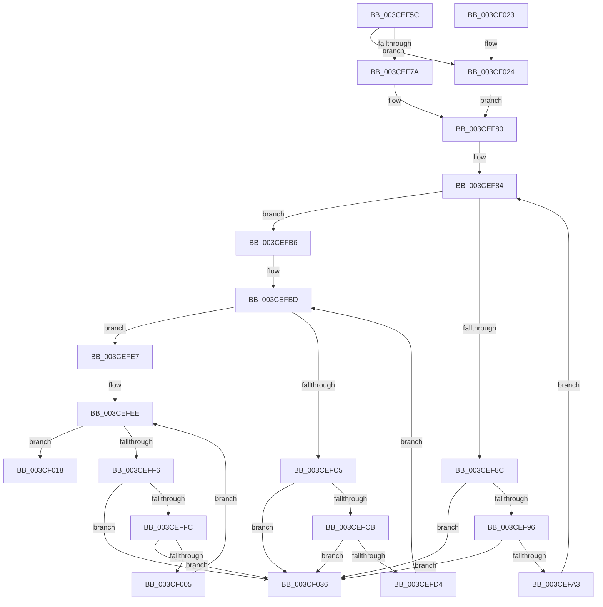

# CcDeleteNumaNode

- RVA: `0x003CEF5C`–`0x003CF03D` (길이 `225` bytes)
- VA: `0x00000001403CEF5C`
- 실행 섹션: `.text`
- PDB 이름 있음: `예`; PDB Function 태그: `아니요`
- unwind 정보 RVA: `0x0006D274`
- 디코드: `61`개 명령, `225/225` bytes 표시
- 미해석 바이트: `0` (있으면 어셈블리에 `.byte`로 보존)

> 이 문서는 커널 이미지의 기계어와 PDB 기호를 분석해 생성했습니다. 4번과 5번은 함수 원형과 자료형을 바이너리 사용 방식에서 추정한 C 해석이며 원본 소스 복구 결과는 아닙니다.

## 1. Dependencies

- 직접 호출 지점: **3**; 고유 호출 대상: **1**
- 직접 호출자로 확인된 함수: **4**
- RIP 상대 이미지 참조: **0**

### Outgoing calls
- `0x003CEFAF` → [ExFreePoolWithTag](../../poolcode/B8/ExFreePoolWithTag_function_00B82870.md) (function, `0x00B82870`)
- `0x003CEFE0` → [ExFreePoolWithTag](../../poolcode/B8/ExFreePoolWithTag_function_00B82870.md) (function, `0x00B82870`)
- `0x003CF011` → [ExFreePoolWithTag](../../poolcode/B8/ExFreePoolWithTag_function_00B82870.md) (function, `0x00B82870`)

### Direct callers
- [CcDeletePrivateVolumeCacheMap](CcDeletePrivateVolumeCacheMap_function_003CE950.md) at `0x003CEAFD`
- [CcInitializeNumaNodeForVolume](CcInitializeNumaNodeForVolume_function_003CEC44.md) at `0x003CED6F`
- [CcDeletePartition](../57/CcDeletePartition_function_0057DE9C.md) at `0x0057E04F`
- [CcInitializeNumaNode](../57/CcInitializeNumaNode_function_0057F2AC.md) at `0x0057F4D3`

### Static image references
- 디코드된 RIP-relative 메모리 참조가 없습니다.

## 2. Other-region calls and transfers

- 다른 실행 섹션으로 향하는 call: **3**
  - `0x003CEFAF` → [ExFreePoolWithTag](../../poolcode/B8/ExFreePoolWithTag_function_00B82870.md) (`.text` → `POOLCODE`)
  - `0x003CEFE0` → [ExFreePoolWithTag](../../poolcode/B8/ExFreePoolWithTag_function_00B82870.md) (`.text` → `POOLCODE`)
  - `0x003CF011` → [ExFreePoolWithTag](../../poolcode/B8/ExFreePoolWithTag_function_00B82870.md) (`.text` → `POOLCODE`)
- 별도 외부 분기/꼬리 이동을 확인하지 못했습니다.

## 3. Assembly (complete function range)

```asm
003CEF5C  48 89 5C 24 08                  mov qword ptr [rsp + 8], rbx
003CEF61  57                              push rdi
003CEF62  48 83 EC 20                     sub rsp, 0x20
003CEF66  48 8B 41 10                     mov rax, qword ptr [rcx + 0x10]
003CEF6A  48 8B D9                        mov rbx, rcx
003CEF6D  8B 49 18                        mov ecx, dword ptr [rcx + 0x18]
003CEF70  83 7B 04 01                     cmp dword ptr [rbx + 4], 1
003CEF74  0F 84 AA 00 00 00               je 0x1403cf024
003CEF7A  48 83 64 C8 40 00               and qword ptr [rax + rcx*8 + 0x40], 0
003CEF80  48 8D 7B 38                     lea rdi, [rbx + 0x38]
003CEF84  48 8B 0F                        mov rcx, qword ptr [rdi]
003CEF87  48 3B CF                        cmp rcx, rdi
003CEF8A  74 2A                           je 0x1403cefb6
003CEF8C  48 39 79 08                     cmp qword ptr [rcx + 8], rdi
003CEF90  0F 85 A0 00 00 00               jne 0x1403cf036
003CEF96  48 8B 01                        mov rax, qword ptr [rcx]
003CEF99  48 39 48 08                     cmp qword ptr [rax + 8], rcx
003CEF9D  0F 85 93 00 00 00               jne 0x1403cf036
003CEFA3  48 89 07                        mov qword ptr [rdi], rax
003CEFA6  BA 43 63 57 71                  mov edx, 0x71576343
003CEFAB  48 89 78 08                     mov qword ptr [rax + 8], rdi
003CEFAF  E8 BC 38 7B 00                  call 0x140b82870
003CEFB4  EB CE                           jmp 0x1403cef84
003CEFB6  48 8D BB 88 00 00 00            lea rdi, [rbx + 0x88]
003CEFBD  48 8B 0F                        mov rcx, qword ptr [rdi]
003CEFC0  48 3B CF                        cmp rcx, rdi
003CEFC3  74 22                           je 0x1403cefe7
003CEFC5  48 39 79 08                     cmp qword ptr [rcx + 8], rdi
003CEFC9  75 6B                           jne 0x1403cf036
003CEFCB  48 8B 01                        mov rax, qword ptr [rcx]
003CEFCE  48 39 48 08                     cmp qword ptr [rax + 8], rcx
003CEFD2  75 62                           jne 0x1403cf036
003CEFD4  48 89 07                        mov qword ptr [rdi], rax
003CEFD7  BA 43 63 57 71                  mov edx, 0x71576343
003CEFDC  48 89 78 08                     mov qword ptr [rax + 8], rdi
003CEFE0  E8 8B 38 7B 00                  call 0x140b82870
003CEFE5  EB D6                           jmp 0x1403cefbd
003CEFE7  48 81 C3 A0 00 00 00            add rbx, 0xa0
003CEFEE  48 8B 0B                        mov rcx, qword ptr [rbx]
003CEFF1  48 3B CB                        cmp rcx, rbx
003CEFF4  74 22                           je 0x1403cf018
003CEFF6  48 39 59 08                     cmp qword ptr [rcx + 8], rbx
003CEFFA  75 3A                           jne 0x1403cf036
003CEFFC  48 8B 01                        mov rax, qword ptr [rcx]
003CEFFF  48 39 48 08                     cmp qword ptr [rax + 8], rcx
003CF003  75 31                           jne 0x1403cf036
003CF005  48 89 03                        mov qword ptr [rbx], rax
003CF008  BA 43 63 57 71                  mov edx, 0x71576343
003CF00D  48 89 58 08                     mov qword ptr [rax + 8], rbx
003CF011  E8 5A 38 7B 00                  call 0x140b82870
003CF016  EB D6                           jmp 0x1403cefee
003CF018  48 8B 5C 24 30                  mov rbx, qword ptr [rsp + 0x30]
003CF01D  48 83 C4 20                     add rsp, 0x20
003CF021  5F                              pop rdi
003CF022  C3                              ret
003CF023  CC                              int3
003CF024  48 8B 43 08                     mov rax, qword ptr [rbx + 8]
003CF028  48 83 A4 C8 80 00 00 00 00      and qword ptr [rax + rcx*8 + 0x80], 0
003CF031  E9 4A FF FF FF                  jmp 0x1403cef80
003CF036  B9 03 00 00 00                  mov ecx, 3
003CF03B  CD 29                           int 0x29
```

## 4. C-style interpretation (structured pseudocode)

```c
__int64 __fastcall CcDeleteNumaNode(__int64 a1)
{
    __int64 result;
    __int64 v_rbx;
    __int64 v_rsp;
    unsigned __int64 v_stack_p8;

    v_stack_p8 = v_rbx;
    v_rsp = (v_rsp) - (32);
    if ((*(unsigned int *)(a1 + 4)) == 1) goto loc_003CF024;
loc_003CEF80:
loc_003CEF84:
    if ((*(unsigned __int64 *)(a1 + 56)) == (a1 + 56)) goto loc_003CEFB6;
    if ((*(unsigned __int64 *)(*(unsigned __int64 *)(a1 + 56) + 8)) != (a1 + 56)) goto loc_003CF036;
    if ((*(unsigned __int64 *)(*(unsigned __int64 *)(*(unsigned __int64 *)(a1 + 56)) + 8)) != (*(unsigned __int64 *)(a1 + 56))) goto loc_003CF036;
    *(unsigned __int64 *)(a1 + 56) = *(unsigned __int64 *)(*(unsigned __int64 *)(a1 + 56));
    *(unsigned __int64 *)(*(unsigned __int64 *)(*(unsigned __int64 *)(a1 + 56)) + 8) = a1 + 56;
    result = ExFreePoolWithTag(*(unsigned __int64 *)(a1 + 56), (unsigned int)(0x71576343ULL), a3, a4);
    goto loc_003CEF84;
loc_003CEFB6:
loc_003CEFBD:
    if ((*(unsigned __int64 *)(a1 + 136)) == (a1 + 136)) goto loc_003CEFE7;
    if ((*(unsigned __int64 *)(*(unsigned __int64 *)(a1 + 136) + 8)) != (a1 + 136)) goto loc_003CF036;
    if ((*(unsigned __int64 *)(*(unsigned __int64 *)(*(unsigned __int64 *)(a1 + 136)) + 8)) != (*(unsigned __int64 *)(a1 + 136))) goto loc_003CF036;
    *(unsigned __int64 *)(a1 + 136) = *(unsigned __int64 *)(*(unsigned __int64 *)(a1 + 136));
    *(unsigned __int64 *)(*(unsigned __int64 *)(*(unsigned __int64 *)(a1 + 136)) + 8) = a1 + 136;
    result = ExFreePoolWithTag(*(unsigned __int64 *)(a1 + 136), (unsigned int)(0x71576343ULL), a3, a4);
    goto loc_003CEFBD;
loc_003CEFE7:
    v_rbx = (a1) + (160);
loc_003CEFEE:
    if ((*(unsigned __int64 *)(v_rbx)) == v_rbx) goto loc_003CF018;
    if ((*(unsigned __int64 *)(*(unsigned __int64 *)(v_rbx) + 8)) != v_rbx) goto loc_003CF036;
    if ((*(unsigned __int64 *)(*(unsigned __int64 *)(*(unsigned __int64 *)(v_rbx)) + 8)) != (*(unsigned __int64 *)(v_rbx))) goto loc_003CF036;
    *(unsigned __int64 *)(v_rbx) = *(unsigned __int64 *)(*(unsigned __int64 *)(v_rbx));
    *(unsigned __int64 *)(*(unsigned __int64 *)(*(unsigned __int64 *)(v_rbx)) + 8) = v_rbx;
    result = ExFreePoolWithTag(*(unsigned __int64 *)(v_rbx), (unsigned int)(0x71576343ULL), a3, a4);
    goto loc_003CEFEE;
loc_003CF018:
    v_rsp = (v_rsp) + (32);
    return result;
loc_003CF024:
    goto loc_003CEF80;
loc_003CF036:
    return *(unsigned __int64 *)(v_stack_p8 + 8);
}
```

## 5. (Beta) C Style

```c
int64_t CcDeleteNumaNode(void *Arg1)
{
    uint8_t *arg1 = (uint8_t *)Arg1;

    int64_t result;
    int64_t local_rbx;
    int64_t local_rsp;
    uint64_t v_stack_p8;

    v_stack_p8 = local_rbx;
    local_rsp = (local_rsp) - (32);
    if ((*(uint32_t *)(arg1 + 0x4)) == 1) goto loc_003CF024;
loc_003CEF80:
loc_003CEF84:
    if ((*(uint64_t *)(arg1 + 0x38)) == (Arg1 + 56)) goto loc_003CEFB6;
    if ((*(uint64_t *)(*(uint64_t *)(arg1 + 0x38) + 0x8)) != (Arg1 + 56)) goto loc_003CF036;
    if ((*(uint64_t *)(*(uint64_t *)(*(uint64_t *)(arg1 + 0x38)) + 0x8)) != (*(uint64_t *)(arg1 + 0x38))) goto loc_003CF036;
    *(uint64_t *)(arg1 + 0x38) = *(uint64_t *)(*(uint64_t *)(arg1 + 0x38));
    *(void **)(*(uint64_t *)(*(uint64_t *)(arg1 + 0x38)) + 0x8) = Arg1 + 56;
    result = ExFreePoolWithTag(*(uint64_t *)(arg1 + 0x38), (uint32_t)(0x71576343ULL), a3, a4);
    goto loc_003CEF84;
loc_003CEFB6:
loc_003CEFBD:
    if ((*(uint64_t *)(arg1 + 0x88)) == (Arg1 + 136)) goto loc_003CEFE7;
    if ((*(uint64_t *)(*(uint64_t *)(arg1 + 0x88) + 0x8)) != (Arg1 + 136)) goto loc_003CF036;
    if ((*(uint64_t *)(*(uint64_t *)(*(uint64_t *)(arg1 + 0x88)) + 0x8)) != (*(uint64_t *)(arg1 + 0x88))) goto loc_003CF036;
    *(uint64_t *)(arg1 + 0x88) = *(uint64_t *)(*(uint64_t *)(arg1 + 0x88));
    *(void **)(*(uint64_t *)(*(uint64_t *)(arg1 + 0x88)) + 0x8) = Arg1 + 136;
    result = ExFreePoolWithTag(*(uint64_t *)(arg1 + 0x88), (uint32_t)(0x71576343ULL), a3, a4);
    goto loc_003CEFBD;
loc_003CEFE7:
    local_rbx = (Arg1) + (160);
loc_003CEFEE:
    if ((*(uint64_t *)(local_rbx)) == local_rbx) goto loc_003CF018;
    if ((*(uint64_t *)(*(uint64_t *)(local_rbx) + 0x8)) != local_rbx) goto loc_003CF036;
    if ((*(uint64_t *)(*(uint64_t *)(*(uint64_t *)(local_rbx)) + 0x8)) != (*(uint64_t *)(local_rbx))) goto loc_003CF036;
    *(uint64_t *)(local_rbx) = *(uint64_t *)(*(uint64_t *)(local_rbx));
    *(uint64_t *)(*(uint64_t *)(*(uint64_t *)(local_rbx)) + 0x8) = local_rbx;
    result = ExFreePoolWithTag(*(uint64_t *)(local_rbx), (uint32_t)(0x71576343ULL), a3, a4);
    goto loc_003CEFEE;
loc_003CF018:
    local_rsp = (local_rsp) + (32);
    return result;
loc_003CF024:
    goto loc_003CEF80;
loc_003CF036:
    return *(uint64_t *)(v_stack_p8 + 0x8);
}
```

### 관측된 메모리 오프셋

구조체 형식이 확인되지 않은 접근은 인자 기준의 오프셋으로만 기록했습니다.

| 기준 인자 | 오프셋 표현 | 폭 (bit) | 접근 |
|---|---:|---:|---|
| `Arg1` | `+ 0x0` | `64` | `R` |
| `Arg1` | `+ 0x0` | `64` | `W` |
| `Arg1` | `+ 0x4` | `32` | `R` |
| `Arg1` | `+ 0x8` | `64` | `R` |
| `Arg1` | `+ 0x10` | `64` | `R` |
| `Arg1` | `+ 0x18` | `32` | `R` |
| `Arg1` | `+ 0x38` | `64` | `R` |
| `Arg1` | `+ 0x88` | `64` | `R` |

## 6. Execution-region graph

[열기: 2D/3D 그래프와 함수 탐색 컨트롤 패널](../../../control-panel.html?section=text&rva=0x003CEF5C&view=graph)

- 2D 그래프는 위에서 아래로 흐르고, 3D 그래프는 빈 공간을 드래그해 회전합니다. Shift+드래그는 이동, 휠은 확대·축소, 함수 노드 선택은 대상 보고서 이동입니다.

### Static fallback


