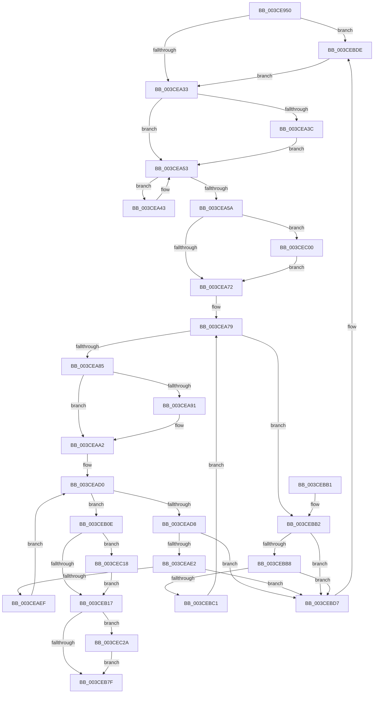

# CcDeletePrivateVolumeCacheMap

- RVA: `0x003CE950`–`0x003CEC3D` (길이 `749` bytes)
- VA: `0x00000001403CE950`
- 실행 섹션: `.text`
- PDB 이름 있음: `예`; PDB Function 태그: `아니요`
- unwind 정보 RVA: `0x0008FAF8`
- 디코드: `171`개 명령, `749/749` bytes 표시
- 미해석 바이트: `0` (있으면 어셈블리에 `.byte`로 보존)

> 이 문서는 커널 이미지의 기계어와 PDB 기호를 분석해 생성했습니다. 4번과 5번은 함수 원형과 자료형을 바이너리 사용 방식에서 추정한 C 해석이며 원본 소스 복구 결과는 아닙니다.

## 1. Dependencies

- 직접 호출 지점: **21**; 고유 호출 대상: **13**
- 직접 호출자로 확인된 함수: **3**
- RIP 상대 이미지 참조: **6**

### Outgoing calls
- `0x003CE9B7` → [DbgPrintEx](../35/DbgPrintEx_function_00359290.md) (function, `0x00359290`)
- `0x003CE9FC` → [DbgPrintEx](../35/DbgPrintEx_function_00359290.md) (function, `0x00359290`)
- `0x003CEA0D` → [KeSetEvent](../33/KeSetEvent_function_0033F310.md) (function, `0x0033F310`)
- `0x003CEA1E` → [KeSetEvent](../33/KeSetEvent_function_0033F310.md) (function, `0x0033F310`)
- `0x003CEA3C` → [CcDecrementVolumeUseCountWithDelete](../38/CcDecrementVolumeUseCountWithDelete_function_0038B888.md) (function, `0x0038B888`)
- `0x003CEA4E` → [KeDelayExecutionThread](../20/KeDelayExecutionThread_function_00209550.md) (function, `0x00209550`)
- `0x003CEA60` → [CcDereferencePartitionAndPrivateVolumeCacheMap](../38/CcDereferencePartitionAndPrivateVolumeCacheMap_function_0038B94C.md) (function, `0x0038B94C`)
- `0x003CEA96` → [ExFreePoolWithTag](../../poolcode/B8/ExFreePoolWithTag_function_00B82870.md) (function, `0x00B82870`)
- `0x003CEAB2` → [CcForEachNumaNode](CcForEachNumaNode_function_003CF070.md) (function, `0x003CF070`)
- `0x003CEAC7` → [CcForEachNumaNode](CcForEachNumaNode_function_003CF070.md) (function, `0x003CF070`)
- `0x003CEAFD` → [CcDeleteNumaNode](CcDeleteNumaNode_function_003CEF5C.md) (function, `0x003CEF5C`)
- `0x003CEB5F` → [DbgPrintEx](../35/DbgPrintEx_function_00359290.md) (function, `0x00359290`)
- `0x003CEB70` → [KeAcquireInStackQueuedSpinLock](../27/KeAcquireInStackQueuedSpinLock_function_002757A0.md) (function, `0x002757A0`)
- `0x003CEB84` → [KeReleaseInStackQueuedSpinLock](../34/KeReleaseInStackQueuedSpinLock_function_00342CE0.md) (function, `0x00342CE0`)
- `0x003CEB91` → [ExFreePoolWithTag](../../poolcode/B8/ExFreePoolWithTag_function_00B82870.md) (function, `0x00B82870`)
- `0x003CEBCD` → [ExFreePoolWithTag](../../poolcode/B8/ExFreePoolWithTag_function_00B82870.md) (function, `0x00B82870`)
- `0x003CEBE3` → [ZwWaitForSingleObject](../6A/ZwWaitForSingleObject_function_006AD150.md) (function, `0x006AD150`)
- `0x003CEBEF` → [ZwClose](../6A/ZwClose_function_006AD2B0.md) (function, `0x006AD2B0`)
- `0x003CEC0E` → [KeCancelTimer](../23/KeCancelTimer_function_002327E0.md) (function, `0x002327E0`)
- `0x003CEC20` → [ExFreePoolWithTag](../../poolcode/B8/ExFreePoolWithTag_function_00B82870.md) (function, `0x00B82870`)
- `0x003CEC33` → [KeSetEvent](../33/KeSetEvent_function_0033F310.md) (function, `0x0033F310`)

### Direct callers
- [CcCreatePrivateVolumeCacheMap](CcCreatePrivateVolumeCacheMap_function_003CDB20.md) at `0x003CDC1C`
- [CcCreatePrivateVolumeCacheMap](CcCreatePrivateVolumeCacheMap_function_003CDB20.md) at `0x003CDC63`
- [CcReapPrivateVolumeCachemap](CcReapPrivateVolumeCachemap_function_003CF1B8.md) at `0x003CF2CD`
- [CcDrainDelayDeleteForPartitionExit](../57/CcDrainDelayDeleteForPartitionExit_function_0057DBB0.md) at `0x0057DC39`

### Static image references
- `0x003CE96B` → RVA `0x006C8A60` (` ?? ::FNODOBFM::`string'`; read)
- `0x003CE9C5` → RVA `0x006C8AB0` (` ?? ::FNODOBFM::`string'`; read)
- `0x003CEA43` → RVA `0x00E0A850` (`.data`; read)
- `0x003CEAA5` → RVA `0x0049E600` (`CcUnInitializeAsyncReadForNodeHelper`; read)
- `0x003CEABA` → RVA `0x004CA090` (`CcUninitializeAsyncLazywriteForNodeHelper`; read)
- `0x003CEB4F` → RVA `0x006C89B0` (` ?? ::FNODOBFM::`string'`; read)

## 2. Other-region calls and transfers

- 다른 실행 섹션으로 향하는 call: **4**
  - `0x003CEA96` → [ExFreePoolWithTag](../../poolcode/B8/ExFreePoolWithTag_function_00B82870.md) (`.text` → `POOLCODE`)
  - `0x003CEB91` → [ExFreePoolWithTag](../../poolcode/B8/ExFreePoolWithTag_function_00B82870.md) (`.text` → `POOLCODE`)
  - `0x003CEBCD` → [ExFreePoolWithTag](../../poolcode/B8/ExFreePoolWithTag_function_00B82870.md) (`.text` → `POOLCODE`)
  - `0x003CEC20` → [ExFreePoolWithTag](../../poolcode/B8/ExFreePoolWithTag_function_00B82870.md) (`.text` → `POOLCODE`)
- 별도 외부 분기/꼬리 이동을 확인하지 못했습니다.

## 3. Assembly (complete function range)

```asm
003CE950  4C 8B DC                        mov r11, rsp
003CE953  49 89 5B 08                     mov qword ptr [r11 + 8], rbx
003CE957  49 89 6B 10                     mov qword ptr [r11 + 0x10], rbp
003CE95B  49 89 73 18                     mov qword ptr [r11 + 0x18], rsi
003CE95F  49 89 7B 20                     mov qword ptr [r11 + 0x20], rdi
003CE963  41 56                           push r14
003CE965  48 83 EC 60                     sub rsp, 0x60
003CE969  33 C0                           xor eax, eax
003CE96B  4C 8D 05 EE A0 2F 00            lea r8, [rip + 0x2fa0ee]
003CE972  0F 57 C0                        xorps xmm0, xmm0
003CE975  33 ED                           xor ebp, ebp
003CE977  0F 11 44 24 40                  movups xmmword ptr [rsp + 0x40], xmm0
003CE97C  49 89 43 E8                     mov qword ptr [r11 - 0x18], rax
003CE980  48 8B F9                        mov rdi, rcx
003CE983  65 48 8B 14 25 88 01 00 00      mov rdx, qword ptr gs:[0x188]
003CE98C  65 4C 8B 0C 25 88 01 00 00      mov r9, qword ptr gs:[0x188]
003CE995  8B 41 18                        mov eax, dword ptr [rcx + 0x18]
003CE998  89 44 24 30                     mov dword ptr [rsp + 0x30], eax
003CE99C  8B 82 10 05 00 00               mov eax, dword ptr [rdx + 0x510]
003CE9A2  8D 55 02                        lea edx, [rbp + 2]
003CE9A5  45 8B 89 08 05 00 00            mov r9d, dword ptr [r9 + 0x508]
003CE9AC  49 89 4B C0                     mov qword ptr [r11 - 0x40], rcx
003CE9B0  8D 4D 7F                        lea ecx, [rbp + 0x7f]
003CE9B3  89 44 24 20                     mov dword ptr [rsp + 0x20], eax
003CE9B7  E8 D4 A8 F8 FF                  call 0x140359290
003CE9BC  65 48 8B 0C 25 88 01 00 00      mov rcx, qword ptr gs:[0x188]
003CE9C5  4C 8D 05 E4 A0 2F 00            lea r8, [rip + 0x2fa0e4]
003CE9CC  65 4C 8B 0C 25 88 01 00 00      mov r9, qword ptr gs:[0x188]
003CE9D5  8D 55 02                        lea edx, [rbp + 2]
003CE9D8  8B 47 18                        mov eax, dword ptr [rdi + 0x18]
003CE9DB  48 8B 77 20                     mov rsi, qword ptr [rdi + 0x20]
003CE9DF  89 44 24 30                     mov dword ptr [rsp + 0x30], eax
003CE9E3  8B 81 10 05 00 00               mov eax, dword ptr [rcx + 0x510]
003CE9E9  8D 4D 7F                        lea ecx, [rbp + 0x7f]
003CE9EC  45 8B 89 08 05 00 00            mov r9d, dword ptr [r9 + 0x508]
003CE9F3  48 89 7C 24 28                  mov qword ptr [rsp + 0x28], rdi
003CE9F8  89 44 24 20                     mov dword ptr [rsp + 0x20], eax
003CE9FC  E8 8F A8 F8 FF                  call 0x140359290
003CEA01  48 8D 8F 98 04 00 00            lea rcx, [rdi + 0x498]
003CEA08  45 33 C0                        xor r8d, r8d
003CEA0B  33 D2                           xor edx, edx
003CEA0D  E8 FE 08 F7 FF                  call 0x14033f310
003CEA12  48 8D 8F B0 04 00 00            lea rcx, [rdi + 0x4b0]
003CEA19  45 33 C0                        xor r8d, r8d
003CEA1C  33 D2                           xor edx, edx
003CEA1E  E8 ED 08 F7 FF                  call 0x14033f310
003CEA23  48 8B 8F C8 04 00 00            mov rcx, qword ptr [rdi + 0x4c8]
003CEA2A  48 85 C9                        test rcx, rcx
003CEA2D  0F 85 AB 01 00 00               jne 0x1403cebde
003CEA33  48 8B 4F 28                     mov rcx, qword ptr [rdi + 0x28]
003CEA37  48 85 C9                        test rcx, rcx
003CEA3A  74 17                           je 0x1403cea53
003CEA3C  E8 47 CE FB FF                  call 0x14038b888
003CEA41  EB 10                           jmp 0x1403cea53
003CEA43  4C 8D 05 06 BE A3 00            lea r8, [rip + 0xa3be06]
003CEA4A  33 D2                           xor edx, edx
003CEA4C  33 C9                           xor ecx, ecx
003CEA4E  E8 FD AA E3 FF                  call 0x140209550
003CEA53  48 83 7F 08 01                  cmp qword ptr [rdi + 8], 1
003CEA58  75 E9                           jne 0x1403cea43
003CEA5A  48 8B D7                        mov rdx, rdi
003CEA5D  48 8B CE                        mov rcx, rsi
003CEA60  E8 E7 CE FB FF                  call 0x14038b94c
003CEA65  40 38 AF D8 03 00 00            cmp byte ptr [rdi + 0x3d8], bpl
003CEA6C  0F 85 8E 01 00 00               jne 0x1403cec00
003CEA72  48 8D 9F 18 06 00 00            lea rbx, [rdi + 0x618]
003CEA79  48 8B 0B                        mov rcx, qword ptr [rbx]
003CEA7C  48 3B CB                        cmp rcx, rbx
003CEA7F  0F 85 2D 01 00 00               jne 0x1403cebb2
003CEA85  48 8B 8F 30 04 00 00            mov rcx, qword ptr [rdi + 0x430]
003CEA8C  48 85 C9                        test rcx, rcx
003CEA8F  74 11                           je 0x1403ceaa2
003CEA91  BA 43 63 54 70                  mov edx, 0x70546343
003CEA96  E8 D5 3D 7B 00                  call 0x140b82870
003CEA9B  48 21 AF 30 04 00 00            and qword ptr [rdi + 0x430], rbp
003CEAA2  45 33 C9                        xor r9d, r9d
003CEAA5  48 8D 0D 54 FB 0C 00            lea rcx, [rip + 0xcfb54]
003CEAAC  4C 8B C7                        mov r8, rdi
003CEAAF  48 8B D6                        mov rdx, rsi
003CEAB2  E8 B9 05 00 00                  call 0x1403cf070
003CEAB7  45 33 C9                        xor r9d, r9d
003CEABA  48 8D 0D CF B5 0F 00            lea rcx, [rip + 0xfb5cf]
003CEAC1  4C 8B C7                        mov r8, rdi
003CEAC4  48 8B D6                        mov rdx, rsi
003CEAC7  E8 A4 05 00 00                  call 0x1403cf070
003CEACC  4C 8D 77 30                     lea r14, [rdi + 0x30]
003CEAD0  49 8B 1E                        mov rbx, qword ptr [r14]
003CEAD3  49 3B DE                        cmp rbx, r14
003CEAD6  74 36                           je 0x1403ceb0e
003CEAD8  4C 39 73 08                     cmp qword ptr [rbx + 8], r14
003CEADC  0F 85 F5 00 00 00               jne 0x1403cebd7
003CEAE2  48 8B 03                        mov rax, qword ptr [rbx]
003CEAE5  48 39 58 08                     cmp qword ptr [rax + 8], rbx
003CEAE9  0F 85 E8 00 00 00               jne 0x1403cebd7
003CEAEF  49 89 06                        mov qword ptr [r14], rax
003CEAF2  48 83 C3 E0                     add rbx, -0x20
003CEAF6  48 8B CB                        mov rcx, rbx
003CEAF9  4C 89 70 08                     mov qword ptr [rax + 8], r14
003CEAFD  E8 5A 04 00 00                  call 0x1403cef5c
003CEB02  48 85 ED                        test rbp, rbp
003CEB05  48 0F 45 DD                     cmovne rbx, rbp
003CEB09  48 8B EB                        mov rbp, rbx
003CEB0C  EB C2                           jmp 0x1403cead0
003CEB0E  48 85 ED                        test rbp, rbp
003CEB11  0F 85 01 01 00 00               jne 0x1403cec18
003CEB17  65 4C 8B 04 25 88 01 00 00      mov r8, qword ptr gs:[0x188]
003CEB20  BA 02 00 00 00                  mov edx, 2
003CEB25  65 4C 8B 0C 25 88 01 00 00      mov r9, qword ptr gs:[0x188]
003CEB2E  8B 46 30                        mov eax, dword ptr [rsi + 0x30]
003CEB31  FF C8                           dec eax
003CEB33  89 44 24 38                     mov dword ptr [rsp + 0x38], eax
003CEB37  8D 4A 7D                        lea ecx, [rdx + 0x7d]
003CEB3A  8B 47 18                        mov eax, dword ptr [rdi + 0x18]
003CEB3D  45 8B 89 08 05 00 00            mov r9d, dword ptr [r9 + 0x508]
003CEB44  89 44 24 30                     mov dword ptr [rsp + 0x30], eax
003CEB48  41 8B 80 10 05 00 00            mov eax, dword ptr [r8 + 0x510]
003CEB4F  4C 8D 05 5A 9E 2F 00            lea r8, [rip + 0x2f9e5a]
003CEB56  48 89 7C 24 28                  mov qword ptr [rsp + 0x28], rdi
003CEB5B  89 44 24 20                     mov dword ptr [rsp + 0x20], eax
003CEB5F  E8 2C A7 F8 FF                  call 0x140359290
003CEB64  48 8D 8E 00 03 00 00            lea rcx, [rsi + 0x300]
003CEB6B  48 8D 54 24 40                  lea rdx, [rsp + 0x40]
003CEB70  E8 2B 6C EA FF                  call 0x1402757a0
003CEB75  83 46 30 FF                     add dword ptr [rsi + 0x30], -1
003CEB79  0F 84 AB 00 00 00               je 0x1403cec2a
003CEB7F  48 8D 4C 24 40                  lea rcx, [rsp + 0x40]
003CEB84  E8 57 41 F7 FF                  call 0x140342ce0
003CEB89  BA 43 63 56 6D                  mov edx, 0x6d566343
003CEB8E  48 8B CF                        mov rcx, rdi
003CEB91  E8 DA 3C 7B 00                  call 0x140b82870
003CEB96  4C 8D 5C 24 60                  lea r11, [rsp + 0x60]
003CEB9B  49 8B 5B 10                     mov rbx, qword ptr [r11 + 0x10]
003CEB9F  49 8B 6B 18                     mov rbp, qword ptr [r11 + 0x18]
003CEBA3  49 8B 73 20                     mov rsi, qword ptr [r11 + 0x20]
003CEBA7  49 8B 7B 28                     mov rdi, qword ptr [r11 + 0x28]
003CEBAB  49 8B E3                        mov rsp, r11
003CEBAE  41 5E                           pop r14
003CEBB0  C3                              ret
003CEBB1  CC                              int3
003CEBB2  48 39 59 08                     cmp qword ptr [rcx + 8], rbx
003CEBB6  75 1F                           jne 0x1403cebd7
003CEBB8  48 8B 01                        mov rax, qword ptr [rcx]
003CEBBB  48 39 48 08                     cmp qword ptr [rax + 8], rcx
003CEBBF  75 16                           jne 0x1403cebd7
003CEBC1  48 89 03                        mov qword ptr [rbx], rax
003CEBC4  BA 43 63 57 71                  mov edx, 0x71576343
003CEBC9  48 89 58 08                     mov qword ptr [rax + 8], rbx
003CEBCD  E8 9E 3C 7B 00                  call 0x140b82870
003CEBD2  E9 A2 FE FF FF                  jmp 0x1403cea79
003CEBD7  B9 03 00 00 00                  mov ecx, 3
003CEBDC  CD 29                           int 0x29
003CEBDE  45 33 C0                        xor r8d, r8d
003CEBE1  33 D2                           xor edx, edx
003CEBE3  E8 68 E5 2D 00                  call 0x1406ad150
003CEBE8  48 8B 8F C8 04 00 00            mov rcx, qword ptr [rdi + 0x4c8]
003CEBEF  E8 BC E6 2D 00                  call 0x1406ad2b0
003CEBF4  48 21 AF C8 04 00 00            and qword ptr [rdi + 0x4c8], rbp
003CEBFB  E9 33 FE FF FF                  jmp 0x1403cea33
003CEC00  48 8D 8F 98 03 00 00            lea rcx, [rdi + 0x398]
003CEC07  40 88 AF D8 03 00 00            mov byte ptr [rdi + 0x3d8], bpl
003CEC0E  E8 CD 3B E6 FF                  call 0x1402327e0
003CEC13  E9 5A FE FF FF                  jmp 0x1403cea72
003CEC18  BA 43 63 4E 75                  mov edx, 0x754e6343
003CEC1D  48 8B CD                        mov rcx, rbp
003CEC20  E8 4B 3C 7B 00                  call 0x140b82870
003CEC25  E9 ED FE FF FF                  jmp 0x1403ceb17
003CEC2A  48 8D 4E 38                     lea rcx, [rsi + 0x38]
003CEC2E  45 33 C0                        xor r8d, r8d
003CEC31  33 D2                           xor edx, edx
003CEC33  E8 D8 06 F7 FF                  call 0x14033f310
003CEC38  E9 42 FF FF FF                  jmp 0x1403ceb7f
```

## 4. C-style interpretation (structured pseudocode)

```c
__int64 __fastcall CcDeletePrivateVolumeCacheMap(__int64 a1)
{
    __int64 result;
    __int64 v_rbp;
    __int64 v_rbx;
    __int64 v_rsp;
    unsigned __int64 v_stack_m28;
    unsigned int v_stack_m30;
    unsigned int v_stack_m38;
    unsigned __int64 v_stack_m40;
    unsigned int v_stack_m48;
    unsigned __int64 v_stack_m8;

    *(unsigned __int64 *)(v_rsp + 8) = v_rbx;
    *(unsigned __int64 *)(v_rsp + 16) = v_rbp;
    *(unsigned __int64 *)(v_rsp + 24) = v_rsi;
    *(unsigned __int64 *)(v_rsp + 32) = v_rdi;
    v_rsp = (v_rsp) - (96);
    result = 0;
    v_rbp = 0;
    v_stack_m28 = v_xmm0;
    *(unsigned __int64 *)(v_rsp - 24) = 0;
    v_stack_m38 = (unsigned int)((unsigned int)(*(unsigned int *)(a1 + 24)));
    *(unsigned __int64 *)(v_rsp - 64) = a1;
    v_stack_m48 = (unsigned int)((unsigned int)(*(unsigned int *)(*(unsigned __int64 *)(gs_base + (0 + 392)) + 1296)));
    result = DbgPrintEx(v_rbp + 127, v_rbp + 2, v_rip + 3121390, (unsigned int)(*(unsigned int *)(*(unsigned __int64 *)(gs_base + (0 + 392)) + 1288)));
    v_stack_m38 = (unsigned int)((unsigned int)(*(unsigned int *)(a1 + 24)));
    v_stack_m40 = a1;
    v_stack_m48 = (unsigned int)((unsigned int)(*(unsigned int *)(*(unsigned __int64 *)(gs_base + (0 + 392)) + 1296)));
    result = DbgPrintEx(v_rbp + 127, v_rbp + 2, v_rip + 3121380, (unsigned int)(*(unsigned int *)(*(unsigned __int64 *)(gs_base + (0 + 392)) + 1288)));
    a3 = 0;
    a2 = 0;
    result = KeSetEvent(a1 + 1176, a2, a3, (unsigned int)(*(unsigned int *)(*(unsigned __int64 *)(gs_base + (0 + 392)) + 1288)));
    a3 = 0;
    a2 = 0;
    result = KeSetEvent(a1 + 1200, a2, a3, (unsigned int)(*(unsigned int *)(*(unsigned __int64 *)(gs_base + (0 + 392)) + 1288)));
    if (*(unsigned __int64 *)(a1 + 1224) != 0) goto loc_003CEBDE;
loc_003CEA33:
    if (*(unsigned __int64 *)(a1 + 40) == 0) goto loc_003CEA53;
    result = CcDecrementVolumeUseCountWithDelete(*(unsigned __int64 *)(a1 + 40), a2, a3, (unsigned int)(*(unsigned int *)(*(unsigned __int64 *)(gs_base + (0 + 392)) + 1288)));
    goto loc_003CEA53;
loc_003CEA43:
    a2 = 0;
    a1 = 0;
    result = KeDelayExecutionThread(a1, a2, v_rip + 10731014, (unsigned int)(*(unsigned int *)(*(unsigned __int64 *)(gs_base + (0 + 392)) + 1288)));
loc_003CEA53:
    if ((*(unsigned __int64 *)(a1 + 8)) != 1) goto loc_003CEA43;
    result = CcDereferencePartitionAndPrivateVolumeCacheMap(*(unsigned __int64 *)(a1 + 32), 0, v_rip + 10731014, (unsigned int)(*(unsigned int *)(*(unsigned __int64 *)(gs_base + (0 + 392)) + 1288)));
    if ((*(unsigned __int8 *)(a1 + 984)) != 0) goto loc_003CEC00;
loc_003CEA72:
loc_003CEA79:
    if ((*(unsigned __int64 *)(a1 + 1560)) != (a1 + 1560)) goto loc_003CEBB2;
    if (*(unsigned __int64 *)(a1 + 1072) != 0) {
        a2 = 0x70546343ULL;
        result = ExFreePoolWithTag(*(unsigned __int64 *)(a1 + 1072), a2, v_rip + 10731014, (unsigned int)(*(unsigned int *)(*(unsigned __int64 *)(gs_base + (0 + 392)) + 1288)));
    }
    a4 = 0;
    result = CcForEachNumaNode(v_rip + 850772, *(unsigned __int64 *)(a1 + 32), 0, a4);
    a4 = 0;
    result = CcForEachNumaNode(v_rip + 1029583, *(unsigned __int64 *)(a1 + 32), 0, a4);
loc_003CEAD0:
    if ((*(unsigned __int64 *)(a1 + 48)) == (a1 + 48)) goto loc_003CEB0E;
    if ((*(unsigned __int64 *)(*(unsigned __int64 *)(a1 + 48) + 8)) != (a1 + 48)) goto loc_003CEBD7;
    if ((*(unsigned __int64 *)(*(unsigned __int64 *)(*(unsigned __int64 *)(a1 + 48)) + 8)) != (*(unsigned __int64 *)(a1 + 48))) goto loc_003CEBD7;
    *(unsigned __int64 *)(a1 + 48) = *(unsigned __int64 *)(*(unsigned __int64 *)(a1 + 48));
    v_rbx = (*(unsigned __int64 *)(a1 + 48)) + (-32);
    *(unsigned __int64 *)(*(unsigned __int64 *)(*(unsigned __int64 *)(a1 + 48)) + 8) = a1 + 48;
    result = CcDeleteNumaNode(v_rbx, *(unsigned __int64 *)(a1 + 32), 0, a4);
    if (0 != 0) { v_rbx = 0; }
    goto loc_003CEAD0;
loc_003CEB0E:
    if (v_rbx != 0) goto loc_003CEC18;
loc_003CEB17:
    result = (unsigned int)(((unsigned int)(*(unsigned int *)(*(unsigned __int64 *)(a1 + 32) + 48))) - 1);
    v_stack_m30 = (unsigned int)(result);
    v_stack_m38 = (unsigned int)((unsigned int)(*(unsigned int *)(a1 + 24)));
    v_stack_m40 = 0;
    v_stack_m48 = (unsigned int)((unsigned int)(*(unsigned int *)(*(unsigned __int64 *)(gs_base + (0 + 392)) + 1296)));
    result = DbgPrintEx(2 + 125, 2, v_rip + 3120730, (unsigned int)(*(unsigned int *)(*(unsigned __int64 *)(gs_base + (0 + 392)) + 1288)));
    result = KeAcquireInStackQueuedSpinLock(*(unsigned __int64 *)(a1 + 32) + 768, v_stack_m28, v_rip + 3120730, (unsigned int)(*(unsigned int *)(*(unsigned __int64 *)(gs_base + (0 + 392)) + 1288)));
    if (v_rbx == 0) goto loc_003CEC2A;
loc_003CEB7F:
    result = KeReleaseInStackQueuedSpinLock(v_stack_m28, v_stack_m28, v_rip + 3120730, (unsigned int)(*(unsigned int *)(*(unsigned __int64 *)(gs_base + (0 + 392)) + 1288)));
    result = ExFreePoolWithTag(0, (unsigned int)(0x6D566343ULL), v_rip + 3120730, (unsigned int)(*(unsigned int *)(*(unsigned __int64 *)(gs_base + (0 + 392)) + 1288)));
    return result;
loc_003CEBB2:
    if ((*(unsigned __int64 *)(0 + 8)) != (*(unsigned __int64 *)(v_stack_m8 + 16))) goto loc_003CEBD7;
    if ((*(unsigned __int64 *)(*(unsigned __int64 *)(0) + 8)) != 0) goto loc_003CEBD7;
    *(unsigned __int64 *)(*(unsigned __int64 *)(v_stack_m8 + 16)) = *(unsigned __int64 *)(0);
    *(unsigned __int64 *)(*(unsigned __int64 *)(0) + 8) = *(unsigned __int64 *)(v_stack_m8 + 16);
    result = ExFreePoolWithTag(0, (unsigned int)(0x71576343ULL), v_rip + 3120730, (unsigned int)(*(unsigned int *)(*(unsigned __int64 *)(gs_base + (0 + 392)) + 1288)));
    goto loc_003CEA79;
loc_003CEBD7:
loc_003CEBDE:
    a3 = 0;
    a2 = 0;
    result = ZwWaitForSingleObject(3, a2, a3, (unsigned int)(*(unsigned int *)(*(unsigned __int64 *)(gs_base + (0 + 392)) + 1288)));
    result = ZwClose(*(unsigned __int64 *)(*(unsigned __int64 *)(v_stack_m8 + 40) + 1224), a2, a3, (unsigned int)(*(unsigned int *)(*(unsigned __int64 *)(gs_base + (0 + 392)) + 1288)));
    goto loc_003CEA33;
loc_003CEC00:
    *(unsigned __int8 *)(*(unsigned __int64 *)(v_stack_m8 + 40) + 984) = (unsigned __int8)(*(unsigned __int64 *)(v_stack_m8 + 24));
    result = KeCancelTimer(*(unsigned __int64 *)(v_stack_m8 + 40) + 920, a2, a3, (unsigned int)(*(unsigned int *)(*(unsigned __int64 *)(gs_base + (0 + 392)) + 1288)));
    goto loc_003CEA72;
loc_003CEC18:
    result = ExFreePoolWithTag(*(unsigned __int64 *)(v_stack_m8 + 24), (unsigned int)(0x754E6343ULL), a3, (unsigned int)(*(unsigned int *)(*(unsigned __int64 *)(gs_base + (0 + 392)) + 1288)));
    goto loc_003CEB17;
loc_003CEC2A:
    a3 = 0;
    a2 = 0;
    result = KeSetEvent(*(unsigned __int64 *)(v_stack_m8 + 32) + 56, a2, a3, (unsigned int)(*(unsigned int *)(*(unsigned __int64 *)(gs_base + (0 + 392)) + 1288)));
    goto loc_003CEB7F;
}
```

## 5. (Beta) C Style

```c
int64_t CcDeletePrivateVolumeCacheMap(void *Arg1)
{
    uint8_t *arg1 = (uint8_t *)Arg1;

    int64_t result;
    int64_t local_rbp;
    int64_t local_rbx;
    int64_t local_rsp;
    uint64_t v_stack_m28;
    uint32_t v_stack_m30;
    uint32_t v_stack_m38;
    uint64_t v_stack_m40;
    uint32_t v_stack_m48;
    uint64_t v_stack_m8;

    *(uint64_t *)(local_rsp + 0x8) = local_rbx;
    *(uint64_t *)(local_rsp + 0x10) = local_rbp;
    *(uint64_t *)(local_rsp + 0x18) = local_rsi;
    *(uint64_t *)(local_rsp + 0x20) = local_rdi;
    local_rsp = (local_rsp) - (96);
    result = 0;
    local_rbp = 0;
    v_stack_m28 = v_xmm0;
    *(uint64_t *)(local_rsp - 0x18) = 0;
    v_stack_m38 = (uint32_t)((uint32_t)(*(uint32_t *)(arg1 + 0x18)));
    *(void **)(local_rsp - 0x40) = Arg1;
    v_stack_m48 = (uint32_t)((uint32_t)(*(uint32_t *)(*(uint64_t *)(gs_base + (0 + 0x188)) + 0x510)));
    result = DbgPrintEx(local_rbp + 127, local_rbp + 2, v_rip + 3121390, (uint32_t)(*(uint32_t *)(*(uint64_t *)(gs_base + (0 + 0x188)) + 0x508)));
    v_stack_m38 = (uint32_t)((uint32_t)(*(uint32_t *)(arg1 + 0x18)));
    v_stack_m40 = Arg1;
    v_stack_m48 = (uint32_t)((uint32_t)(*(uint32_t *)(*(uint64_t *)(gs_base + (0 + 0x188)) + 0x510)));
    result = DbgPrintEx(local_rbp + 127, local_rbp + 2, v_rip + 3121380, (uint32_t)(*(uint32_t *)(*(uint64_t *)(gs_base + (0 + 0x188)) + 0x508)));
    a3 = 0;
    a2 = 0;
    result = KeSetEvent(Arg1 + 1176, a2, a3, (uint32_t)(*(uint32_t *)(*(uint64_t *)(gs_base + (0 + 0x188)) + 0x508)));
    a3 = 0;
    a2 = 0;
    result = KeSetEvent(Arg1 + 1200, a2, a3, (uint32_t)(*(uint32_t *)(*(uint64_t *)(gs_base + (0 + 0x188)) + 0x508)));
    if (*(uint64_t *)(arg1 + 0x4C8) != 0) goto loc_003CEBDE;
loc_003CEA33:
    if (*(uint64_t *)(arg1 + 0x28) == 0) goto loc_003CEA53;
    result = CcDecrementVolumeUseCountWithDelete(*(uint64_t *)(arg1 + 0x28), a2, a3, (uint32_t)(*(uint32_t *)(*(uint64_t *)(gs_base + (0 + 0x188)) + 0x508)));
    goto loc_003CEA53;
loc_003CEA43:
    a2 = 0;
    Arg1 = 0;
    result = KeDelayExecutionThread(Arg1, a2, v_rip + 10731014, (uint32_t)(*(uint32_t *)(*(uint64_t *)(gs_base + (0 + 0x188)) + 0x508)));
loc_003CEA53:
    if ((*(uint64_t *)(arg1 + 0x8)) != 1) goto loc_003CEA43;
    result = CcDereferencePartitionAndPrivateVolumeCacheMap(*(uint64_t *)(arg1 + 0x20), 0, v_rip + 10731014, (uint32_t)(*(uint32_t *)(*(uint64_t *)(gs_base + (0 + 0x188)) + 0x508)));
    if ((*(uint8_t *)(arg1 + 0x3D8)) != 0) goto loc_003CEC00;
loc_003CEA72:
loc_003CEA79:
    if ((*(uint64_t *)(arg1 + 0x618)) != (Arg1 + 1560)) goto loc_003CEBB2;
    if (*(uint64_t *)(arg1 + 0x430) != 0) {
        a2 = 0x70546343ULL;
        result = ExFreePoolWithTag(*(uint64_t *)(arg1 + 0x430), a2, v_rip + 10731014, (uint32_t)(*(uint32_t *)(*(uint64_t *)(gs_base + (0 + 0x188)) + 0x508)));
    }
    a4 = 0;
    result = CcForEachNumaNode(v_rip + 850772, *(uint64_t *)(arg1 + 0x20), 0, a4);
    a4 = 0;
    result = CcForEachNumaNode(v_rip + 1029583, *(uint64_t *)(arg1 + 0x20), 0, a4);
loc_003CEAD0:
    if ((*(uint64_t *)(arg1 + 0x30)) == (Arg1 + 48)) goto loc_003CEB0E;
    if ((*(uint64_t *)(*(uint64_t *)(arg1 + 0x30) + 0x8)) != (Arg1 + 48)) goto loc_003CEBD7;
    if ((*(uint64_t *)(*(uint64_t *)(*(uint64_t *)(arg1 + 0x30)) + 0x8)) != (*(uint64_t *)(arg1 + 0x30))) goto loc_003CEBD7;
    *(uint64_t *)(arg1 + 0x30) = *(uint64_t *)(*(uint64_t *)(arg1 + 0x30));
    local_rbx = (*(uint64_t *)(arg1 + 0x30)) + (-32);
    *(void **)(*(uint64_t *)(*(uint64_t *)(arg1 + 0x30)) + 0x8) = Arg1 + 48;
    result = CcDeleteNumaNode(local_rbx, *(uint64_t *)(arg1 + 0x20), 0, a4);
    if (0 != 0) { local_rbx = 0; }
    goto loc_003CEAD0;
loc_003CEB0E:
    if (local_rbx != 0) goto loc_003CEC18;
loc_003CEB17:
    result = (uint32_t)(((uint32_t)(*(uint32_t *)(*(uint64_t *)(arg1 + 0x20) + 0x30))) - 1);
    v_stack_m30 = (uint32_t)(result);
    v_stack_m38 = (uint32_t)((uint32_t)(*(uint32_t *)(arg1 + 0x18)));
    v_stack_m40 = 0;
    v_stack_m48 = (uint32_t)((uint32_t)(*(uint32_t *)(*(uint64_t *)(gs_base + (0 + 0x188)) + 0x510)));
    result = DbgPrintEx(2 + 125, 2, v_rip + 3120730, (uint32_t)(*(uint32_t *)(*(uint64_t *)(gs_base + (0 + 0x188)) + 0x508)));
    result = KeAcquireInStackQueuedSpinLock(*(uint64_t *)(arg1 + 0x20) + 768, v_stack_m28, v_rip + 3120730, (uint32_t)(*(uint32_t *)(*(uint64_t *)(gs_base + (0 + 0x188)) + 0x508)));
    if (local_rbx == 0) goto loc_003CEC2A;
loc_003CEB7F:
    result = KeReleaseInStackQueuedSpinLock(v_stack_m28, v_stack_m28, v_rip + 3120730, (uint32_t)(*(uint32_t *)(*(uint64_t *)(gs_base + (0 + 0x188)) + 0x508)));
    result = ExFreePoolWithTag(0, (uint32_t)(0x6D566343ULL), v_rip + 3120730, (uint32_t)(*(uint32_t *)(*(uint64_t *)(gs_base + (0 + 0x188)) + 0x508)));
    return result;
loc_003CEBB2:
    if ((*(uint64_t *)(0 + 0x8)) != (*(uint64_t *)(v_stack_m8 + 0x10))) goto loc_003CEBD7;
    if ((*(uint64_t *)(*(uint64_t *)(0) + 0x8)) != 0) goto loc_003CEBD7;
    *(uint64_t *)(*(uint64_t *)(v_stack_m8 + 0x10)) = *(uint64_t *)(0);
    *(uint64_t *)(*(uint64_t *)(0) + 0x8) = *(uint64_t *)(v_stack_m8 + 0x10);
    result = ExFreePoolWithTag(0, (uint32_t)(0x71576343ULL), v_rip + 3120730, (uint32_t)(*(uint32_t *)(*(uint64_t *)(gs_base + (0 + 0x188)) + 0x508)));
    goto loc_003CEA79;
loc_003CEBD7:
loc_003CEBDE:
    a3 = 0;
    a2 = 0;
    result = ZwWaitForSingleObject(3, a2, a3, (uint32_t)(*(uint32_t *)(*(uint64_t *)(gs_base + (0 + 0x188)) + 0x508)));
    result = ZwClose(*(uint64_t *)(*(uint64_t *)(v_stack_m8 + 0x28) + 0x4C8), a2, a3, (uint32_t)(*(uint32_t *)(*(uint64_t *)(gs_base + (0 + 0x188)) + 0x508)));
    goto loc_003CEA33;
loc_003CEC00:
    *(uint8_t *)(*(uint64_t *)(v_stack_m8 + 0x28) + 0x3D8) = (uint8_t)(*(uint64_t *)(v_stack_m8 + 0x18));
    result = KeCancelTimer(*(uint64_t *)(v_stack_m8 + 0x28) + 920, a2, a3, (uint32_t)(*(uint32_t *)(*(uint64_t *)(gs_base + (0 + 0x188)) + 0x508)));
    goto loc_003CEA72;
loc_003CEC18:
    result = ExFreePoolWithTag(*(uint64_t *)(v_stack_m8 + 0x18), (uint32_t)(0x754E6343ULL), a3, (uint32_t)(*(uint32_t *)(*(uint64_t *)(gs_base + (0 + 0x188)) + 0x508)));
    goto loc_003CEB17;
loc_003CEC2A:
    a3 = 0;
    a2 = 0;
    result = KeSetEvent(*(uint64_t *)(v_stack_m8 + 0x20) + 56, a2, a3, (uint32_t)(*(uint32_t *)(*(uint64_t *)(gs_base + (0 + 0x188)) + 0x508)));
    goto loc_003CEB7F;
}
```

### 관측된 메모리 오프셋

구조체 형식이 확인되지 않은 접근은 인자 기준의 오프셋으로만 기록했습니다.

| 기준 인자 | 오프셋 표현 | 폭 (bit) | 접근 |
|---|---:|---:|---|
| `Arg1` | `+ 0x0` | `64` | `R` |
| `Arg1` | `+ 0x0` | `64` | `W` |
| `Arg1` | `+ 0x8` | `64` | `R` |
| `Arg1` | `+ 0x18` | `32` | `R` |
| `Arg1` | `+ 0x20` | `64` | `R` |
| `Arg1` | `+ 0x28` | `64` | `R` |
| `Arg1` | `+ 0x30` | `64` | `R` |
| `Arg1` | `+ 0x398` | `64` | `R` |
| `Arg1` | `+ 0x3D8` | `8` | `R` |
| `Arg1` | `+ 0x3D8` | `8` | `W` |
| `Arg1` | `+ 0x430` | `64` | `R` |
| `Arg1` | `+ 0x430` | `64` | `R/W` |
| `Arg1` | `+ 0x498` | `64` | `R` |
| `Arg1` | `+ 0x4B0` | `64` | `R` |
| `Arg1` | `+ 0x4C8` | `64` | `R` |
| `Arg1` | `+ 0x4C8` | `64` | `R/W` |
| `Arg1` | `+ 0x618` | `64` | `R` |

## 6. Execution-region graph

[열기: 2D/3D 그래프와 함수 탐색 컨트롤 패널](../../../control-panel.html?section=text&rva=0x003CE950&view=graph)

- 2D 그래프는 위에서 아래로 흐르고, 3D 그래프는 빈 공간을 드래그해 회전합니다. Shift+드래그는 이동, 휠은 확대·축소, 함수 노드 선택은 대상 보고서 이동입니다.

### Static fallback


