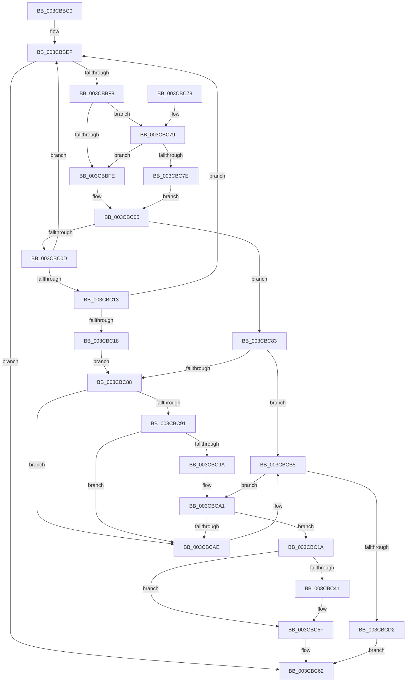

# CcFindBitmapRangeToDirty

- RVA: `0x003CBBC0`–`0x003CBCD4` (길이 `276` bytes)
- VA: `0x00000001403CBBC0`
- 실행 섹션: `.text`
- PDB 이름 있음: `예`; PDB Function 태그: `아니요`
- unwind 정보 RVA: `0x0008F844`
- 디코드: `78`개 명령, `276/276` bytes 표시
- 미해석 바이트: `0` (있으면 어셈블리에 `.byte`로 보존)

> 이 문서는 커널 이미지의 기계어와 PDB 기호를 분석해 생성했습니다. 4번과 5번은 함수 원형과 자료형을 바이너리 사용 방식에서 추정한 C 해석이며 원본 소스 복구 결과는 아닙니다.

## 1. Dependencies

- 직접 호출 지점: **2**; 고유 호출 대상: **2**
- 직접 호출자로 확인된 함수: **1**
- RIP 상대 이미지 참조: **0**

### Outgoing calls
- `0x003CBC4F` → [memset](../6C/memset_function_006C6C40.md) (function, `0x006C6C40`)
- `0x003CBCC5` → [ExAllocatePoolWithTag](../../poolcode/B8/ExAllocatePoolWithTag_function_00B82010.md) (function, `0x00B82010`)

### Direct callers
- [CcSetDirtyInMask](CcSetDirtyInMask_function_003CB688.md) at `0x003CB7CB`

### Static image references
- 디코드된 RIP-relative 메모리 참조가 없습니다.

## 2. Other-region calls and transfers

- 다른 실행 섹션으로 향하는 call: **1**
  - `0x003CBCC5` → [ExAllocatePoolWithTag](../../poolcode/B8/ExAllocatePoolWithTag_function_00B82010.md) (`.text` → `POOLCODE`)
- 별도 외부 분기/꼬리 이동을 확인하지 못했습니다.

## 3. Assembly (complete function range)

```asm
003CBBC0  48 89 5C 24 08                  mov qword ptr [rsp + 8], rbx
003CBBC5  48 89 74 24 10                  mov qword ptr [rsp + 0x10], rsi
003CBBCA  48 89 7C 24 18                  mov qword ptr [rsp + 0x18], rdi
003CBBCF  41 56                           push r14
003CBBD1  48 83 EC 20                     sub rsp, 0x20
003CBBD5  48 8B 41 10                     mov rax, qword ptr [rcx + 0x10]
003CBBD9  48 8B DA                        mov rbx, rdx
003CBBDC  48 8D 51 10                     lea rdx, [rcx + 0x10]
003CBBE0  33 F6                           xor esi, esi
003CBBE2  48 8B FA                        mov rdi, rdx
003CBBE5  4D 8B F0                        mov r14, r8
003CBBE8  48 81 E3 00 E0 FF FF            and rbx, 0xffffffffffffe000
003CBBEF  48 8B 48 10                     mov rcx, qword ptr [rax + 0x10]
003CBBF3  48 3B D9                        cmp rbx, rcx
003CBBF6  74 6A                           je 0x1403cbc62
003CBBF8  83 78 20 00                     cmp dword ptr [rax + 0x20], 0
003CBBFC  74 7B                           je 0x1403cbc79
003CBBFE  48 3B D9                        cmp rbx, rcx
003CBC01  48 0F 4F F8                     cmovg rdi, rax
003CBC05  48 8B 00                        mov rax, qword ptr [rax]
003CBC08  48 3B C2                        cmp rax, rdx
003CBC0B  74 76                           je 0x1403cbc83
003CBC0D  48 3B 58 10                     cmp rbx, qword ptr [rax + 0x10]
003CBC11  7D DC                           jge 0x1403cbbef
003CBC13  48 85 F6                        test rsi, rsi
003CBC16  74 D7                           je 0x1403cbbef
003CBC18  EB 6E                           jmp 0x1403cbc88
003CBC1A  48 89 06                        mov qword ptr [rsi], rax
003CBC1D  48 89 7E 08                     mov qword ptr [rsi + 8], rdi
003CBC21  48 89 70 08                     mov qword ptr [rax + 8], rsi
003CBC25  48 89 37                        mov qword ptr [rdi], rsi
003CBC28  48 83 7E 28 00                  cmp qword ptr [rsi + 0x28], 0
003CBC2D  48 89 5E 10                     mov qword ptr [rsi + 0x10], rbx
003CBC31  C7 46 18 FF FF FF FF            mov dword ptr [rsi + 0x18], 0xffffffff
003CBC38  C7 46 1C 00 00 00 00            mov dword ptr [rsi + 0x1c], 0
003CBC3F  75 1E                           jne 0x1403cbc5f
003CBC41  49 8B 1E                        mov rbx, qword ptr [r14]
003CBC44  33 D2                           xor edx, edx
003CBC46  48 8B CB                        mov rcx, rbx
003CBC49  41 B8 00 04 00 00               mov r8d, 0x400
003CBC4F  E8 EC AF 2F 00                  call 0x1406c6c40
003CBC54  48 89 5E 28                     mov qword ptr [rsi + 0x28], rbx
003CBC58  49 C7 06 00 00 00 00            mov qword ptr [r14], 0
003CBC5F  48 8B C6                        mov rax, rsi
003CBC62  48 8B 5C 24 30                  mov rbx, qword ptr [rsp + 0x30]
003CBC67  48 8B 74 24 38                  mov rsi, qword ptr [rsp + 0x38]
003CBC6C  48 8B 7C 24 40                  mov rdi, qword ptr [rsp + 0x40]
003CBC71  48 83 C4 20                     add rsp, 0x20
003CBC75  41 5E                           pop r14
003CBC77  C3                              ret
003CBC78  CC                              int3
003CBC79  48 85 F6                        test rsi, rsi
003CBC7C  75 80                           jne 0x1403cbbfe
003CBC7E  48 8B F0                        mov rsi, rax
003CBC81  EB 82                           jmp 0x1403cbc05
003CBC83  48 85 F6                        test rsi, rsi
003CBC86  74 2D                           je 0x1403cbcb5
003CBC88  48 8B 0E                        mov rcx, qword ptr [rsi]
003CBC8B  48 39 71 08                     cmp qword ptr [rcx + 8], rsi
003CBC8F  75 1D                           jne 0x1403cbcae
003CBC91  48 8B 46 08                     mov rax, qword ptr [rsi + 8]
003CBC95  48 39 30                        cmp qword ptr [rax], rsi
003CBC98  75 14                           jne 0x1403cbcae
003CBC9A  48 89 08                        mov qword ptr [rax], rcx
003CBC9D  48 89 41 08                     mov qword ptr [rcx + 8], rax
003CBCA1  48 8B 07                        mov rax, qword ptr [rdi]
003CBCA4  48 39 78 08                     cmp qword ptr [rax + 8], rdi
003CBCA8  0F 84 6C FF FF FF               je 0x1403cbc1a
003CBCAE  B9 03 00 00 00                  mov ecx, 3
003CBCB3  CD 29                           int 0x29
003CBCB5  BA 30 00 00 00                  mov edx, 0x30
003CBCBA  B9 00 06 00 00                  mov ecx, 0x600
003CBCBF  41 B8 43 63 42 72               mov r8d, 0x72426343
003CBCC5  E8 46 63 7B 00                  call 0x140b82010
003CBCCA  48 8B F0                        mov rsi, rax
003CBCCD  48 85 C0                        test rax, rax
003CBCD0  75 CF                           jne 0x1403cbca1
003CBCD2  EB 8E                           jmp 0x1403cbc62
```

## 4. C-style interpretation (structured pseudocode)

```c
__int64 __fastcall CcFindBitmapRangeToDirty(__int64 a1, __int64 a2, __int64 a3)
{
    __int64 result;
    __int64 v_rbx;
    __int64 v_rdi;
    __int64 v_rsi;
    __int64 v_rsp;
    unsigned __int64 v_stack_p10;
    unsigned __int64 v_stack_p18;
    unsigned __int64 v_stack_p8;

    v_stack_p8 = v_rbx;
    v_stack_p10 = v_rsi;
    v_stack_p18 = v_rdi;
    v_rsp = (v_rsp) - (32);
    v_rsi = 0;
    v_rbx = (a2) & (0xFFFFFFFFFFFFE000ULL);
loc_003CBBEF:
    if (v_rbx == (*(unsigned __int64 *)(*(unsigned __int64 *)(a1 + 16) + 16))) goto loc_003CBC62;
    if ((*(unsigned int *)(*(unsigned __int64 *)(a1 + 16) + 32)) == 0) goto loc_003CBC79;
loc_003CBBFE:
    v_rdi = a1 + 16;
    if (v_rbx > (*(unsigned __int64 *)(*(unsigned __int64 *)(a1 + 16) + 16))) { v_rdi = *(unsigned __int64 *)(a1 + 16); }
loc_003CBC05:
    if ((*(unsigned __int64 *)(*(unsigned __int64 *)(a1 + 16))) == (a1 + 16)) goto loc_003CBC83;
    if (v_rbx >= (*(unsigned __int64 *)(*(unsigned __int64 *)(*(unsigned __int64 *)(a1 + 16)) + 16))) goto loc_003CBBEF;
    if (0 == 0) goto loc_003CBBEF;
    goto loc_003CBC88;
loc_003CBC1A:
    *(unsigned __int64 *)(v_rsi) = *(unsigned __int64 *)(*(unsigned __int64 *)(a1 + 16));
    *(unsigned __int64 *)(v_rsi + 8) = v_rdi;
    *(unsigned __int64 *)(*(unsigned __int64 *)(*(unsigned __int64 *)(a1 + 16)) + 8) = 0;
    *(unsigned __int64 *)(v_rdi) = 0;
    *(unsigned __int64 *)(v_rsi + 16) = v_rbx;
    *(unsigned int *)(v_rsi + 24) = 0xFFFFFFFFULL;
    *(unsigned int *)(v_rsi + 28) = 0;
    result = *(unsigned __int64 *)(*(unsigned __int64 *)(a1 + 16));
    if ((*(unsigned __int64 *)(v_rsi + 40)) == 0) {
        v_rbx = *(unsigned __int64 *)(a3);
        a2 = 0;
        a1 = v_rbx;
        a3 = 0x400ULL;
        result = memset(a1, a2, a3, a4);
        *(unsigned __int64 *)(v_rsi + 40) = v_rbx;
        *(unsigned __int64 *)(a3) = 0;
    }
loc_003CBC62:
    v_rsp = (v_rsp) + (32);
    return 0;
loc_003CBC79:
    if (v_stack_p10 != 0) goto loc_003CBBFE;
    goto loc_003CBC05;
loc_003CBC83:
    if (0 == 0) goto loc_003CBCB5;
loc_003CBC88:
    if ((*(unsigned __int64 *)(*(unsigned __int64 *)(0) + 8)) != 0) goto loc_003CBCAE;
    if ((*(unsigned __int64 *)(*(unsigned __int64 *)(0 + 8))) != 0) goto loc_003CBCAE;
    *(unsigned __int64 *)(*(unsigned __int64 *)(0 + 8)) = *(unsigned __int64 *)(0);
    *(unsigned __int64 *)(*(unsigned __int64 *)(0) + 8) = *(unsigned __int64 *)(0 + 8);
loc_003CBCA1:
    if ((*(unsigned __int64 *)(*(unsigned __int64 *)(v_stack_p18) + 8)) == v_stack_p18) goto loc_003CBC1A;
loc_003CBCAE:
loc_003CBCB5:
    result = ExAllocatePoolWithTag((unsigned int)(0x600ULL), 48, (unsigned int)(0x72426343ULL), a4);
    if (result != 0) goto loc_003CBCA1;
    goto loc_003CBC62;
}
```

## 5. (Beta) C Style

```c
int64_t CcFindBitmapRangeToDirty(void *Arg1, int64_t Arg2, void *Arg3)
{
    uint8_t *arg1 = (uint8_t *)Arg1;
    uint8_t *arg3 = (uint8_t *)Arg3;

    int64_t result;
    int64_t local_rbx;
    int64_t local_rdi;
    int64_t local_rsi;
    int64_t local_rsp;
    uint64_t v_stack_p10;
    uint64_t v_stack_p18;
    uint64_t v_stack_p8;

    v_stack_p8 = local_rbx;
    v_stack_p10 = local_rsi;
    v_stack_p18 = local_rdi;
    local_rsp = (local_rsp) - (32);
    local_rsi = 0;
    local_rbx = (Arg2) & (0xFFFFFFFFFFFFE000ULL);
loc_003CBBEF:
    if (local_rbx == (*(uint64_t *)(*(uint64_t *)(arg1 + 0x10) + 0x10))) goto loc_003CBC62;
    if ((*(uint32_t *)(*(uint64_t *)(arg1 + 0x10) + 0x20)) == 0) goto loc_003CBC79;
loc_003CBBFE:
    local_rdi = Arg1 + 16;
    if (local_rbx > (*(uint64_t *)(*(uint64_t *)(arg1 + 0x10) + 0x10))) { local_rdi = *(uint64_t *)(arg1 + 0x10); }
loc_003CBC05:
    if ((*(uint64_t *)(*(uint64_t *)(arg1 + 0x10))) == (Arg1 + 16)) goto loc_003CBC83;
    if (local_rbx >= (*(uint64_t *)(*(uint64_t *)(*(uint64_t *)(arg1 + 0x10)) + 0x10))) goto loc_003CBBEF;
    if (0 == 0) goto loc_003CBBEF;
    goto loc_003CBC88;
loc_003CBC1A:
    *(uint64_t *)(local_rsi) = *(uint64_t *)(*(uint64_t *)(arg1 + 0x10));
    *(uint64_t *)(local_rsi + 0x8) = local_rdi;
    *(uint64_t *)(*(uint64_t *)(*(uint64_t *)(arg1 + 0x10)) + 0x8) = 0;
    *(uint64_t *)(local_rdi) = 0;
    *(uint64_t *)(local_rsi + 0x10) = local_rbx;
    *(uint32_t *)(local_rsi + 0x18) = 0xFFFFFFFFULL;
    *(uint32_t *)(local_rsi + 0x1C) = 0;
    result = *(uint64_t *)(*(uint64_t *)(arg1 + 0x10));
    if ((*(uint64_t *)(local_rsi + 0x28)) == 0) {
        local_rbx = *(uint64_t *)(arg3);
        Arg2 = 0;
        Arg1 = local_rbx;
        Arg3 = 0x400ULL;
        result = memset(Arg1, Arg2, Arg3, a4);
        *(uint64_t *)(local_rsi + 0x28) = local_rbx;
        *(uint64_t *)(arg3) = 0;
    }
loc_003CBC62:
    local_rsp = (local_rsp) + (32);
    return 0;
loc_003CBC79:
    if (v_stack_p10 != 0) goto loc_003CBBFE;
    goto loc_003CBC05;
loc_003CBC83:
    if (0 == 0) goto loc_003CBCB5;
loc_003CBC88:
    if ((*(uint64_t *)(*(uint64_t *)(0) + 0x8)) != 0) goto loc_003CBCAE;
    if ((*(uint64_t *)(*(uint64_t *)(0 + 0x8))) != 0) goto loc_003CBCAE;
    *(uint64_t *)(*(uint64_t *)(0 + 0x8)) = *(uint64_t *)(0);
    *(uint64_t *)(*(uint64_t *)(0) + 0x8) = *(uint64_t *)(0 + 0x8);
loc_003CBCA1:
    if ((*(uint64_t *)(*(uint64_t *)(v_stack_p18) + 0x8)) == v_stack_p18) goto loc_003CBC1A;
loc_003CBCAE:
loc_003CBCB5:
    result = ExAllocatePoolWithTag((uint32_t)(0x600ULL), 48, (uint32_t)(0x72426343ULL), a4);
    if (result != 0) goto loc_003CBCA1;
    goto loc_003CBC62;
}
```

### 관측된 메모리 오프셋

구조체 형식이 확인되지 않은 접근은 인자 기준의 오프셋으로만 기록했습니다.

| 기준 인자 | 오프셋 표현 | 폭 (bit) | 접근 |
|---|---:|---:|---|
| `Arg1` | `+ 0x10` | `64` | `R` |
| `Arg3` | `+ 0x0` | `64` | `R` |
| `Arg3` | `+ 0x0` | `64` | `W` |

## 6. Execution-region graph

[열기: 2D/3D 그래프와 함수 탐색 컨트롤 패널](../../../control-panel.html?section=text&rva=0x003CBBC0&view=graph)

- 2D 그래프는 위에서 아래로 흐르고, 3D 그래프는 빈 공간을 드래그해 회전합니다. Shift+드래그는 이동, 휠은 확대·축소, 함수 노드 선택은 대상 보고서 이동입니다.

### Static fallback


