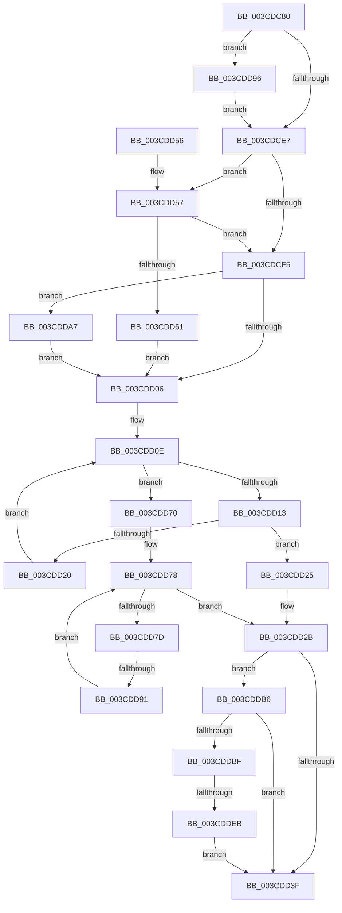

# CcFindPrivateVolumeCacheMap

- RVA: `0x003CDC80`–`0x003CDE08` (길이 `392` bytes)
- VA: `0x00000001403CDC80`
- 실행 섹션: `.text`
- PDB 이름 있음: `예`; PDB Function 태그: `예`
- unwind 정보 RVA: `0x0008FA5C`
- 디코드: `104`개 명령, `392/392` bytes 표시
- 미해석 바이트: `0` (있으면 어셈블리에 `.byte`로 보존)

> 이 문서는 커널 이미지의 기계어와 PDB 기호를 분석해 생성했습니다. 4번과 5번은 함수 원형과 자료형을 바이너리 사용 방식에서 추정한 C 해석이며 원본 소스 복구 결과는 아닙니다.

## 1. Dependencies

- 직접 호출 지점: **6**; 고유 호출 대상: **5**
- 직접 호출자로 확인된 함수: **1**
- RIP 상대 이미지 참조: **4**

### Outgoing calls
- `0x003CDD30` → [KeReleaseInStackQueuedSpinLock](../34/KeReleaseInStackQueuedSpinLock_function_00342CE0.md) (function, `0x00342CE0`)
- `0x003CDD69` → [KiAcquireQueuedSpinLockInstrumented](../27/KiAcquireQueuedSpinLockInstrumented_function_00275850.md) (function, `0x00275850`)
- `0x003CDD9D` → [KiRaiseIrqlProcessIrqlFlags](../4F/KiRaiseIrqlProcessIrqlFlags_function_004F56FC.md) (function, `0x004F56FC`)
- `0x003CDDAC` → [KxWaitForLockOwnerShip](../25/KxWaitForLockOwnerShip_function_00257EB0.md) (function, `0x00257EB0`)
- `0x003CDDCB` → [KeAcquireInStackQueuedSpinLock](../27/KeAcquireInStackQueuedSpinLock_function_002757A0.md) (function, `0x002757A0`)
- `0x003CDDFE` → [KeReleaseInStackQueuedSpinLock](../34/KeReleaseInStackQueuedSpinLock_function_00342CE0.md) (function, `0x00342CE0`)

### Direct callers
- [CcCreatePrivateVolumeCacheMap](CcCreatePrivateVolumeCacheMap_function_003CDB20.md) at `0x003CDB61`

### Static image references
- `0x003CDCDB` → RVA `0x00FC6D20` (`ALMOSTRO`; read)
- `0x003CDCE7` → RVA `0x00FC6B06` (`ALMOSTRO`; read)
- `0x003CDD57` → RVA `0x00F0DE58` (`.data`; read)
- `0x003CDDC4` → RVA `0x00E11CC0` (`.data`; read)

## 2. Other-region calls and transfers

- 다른 실행 섹션으로 향하는 call: **0**
- call이 아닌 외부 분기/꼬리 이동: **2**
  - `0x003CDD8B` → [sub_006E8934](../6E/Unknown_function_006E8934.md) (`tail-transfer`)
  - `0x003CDDE5` → [sub_006E8934 + 0x4A](../6E/Unknown_function_006E8934.md) (`tail-transfer`)

## 3. Assembly (complete function range)

```asm
003CDC80  4C 8B DC                        mov r11, rsp
003CDC83  49 89 5B 10                     mov qword ptr [r11 + 0x10], rbx
003CDC87  55                              push rbp
003CDC88  56                              push rsi
003CDC89  57                              push rdi
003CDC8A  41 56                           push r14
003CDC8C  41 57                           push r15
003CDC8E  48 83 EC 60                     sub rsp, 0x60
003CDC92  33 DB                           xor ebx, ebx
003CDC94  48 8D B1 00 03 00 00            lea rsi, [rcx + 0x300]
003CDC9B  33 C0                           xor eax, eax
003CDC9D  49 89 5B 18                     mov qword ptr [r11 + 0x18], rbx
003CDCA1  0F 57 C0                        xorps xmm0, xmm0
003CDCA4  41 88 43 08                     mov byte ptr [r11 + 8], al
003CDCA8  0F 11 44 24 30                  movups xmmword ptr [rsp + 0x30], xmm0
003CDCAD  49 89 43 B8                     mov qword ptr [r11 - 0x48], rax
003CDCB1  48 8B FA                        mov rdi, rdx
003CDCB4  0F 57 C9                        xorps xmm1, xmm1
003CDCB7  49 89 73 B0                     mov qword ptr [r11 - 0x50], rsi
003CDCBB  0F 11 4C 24 48                  movups xmmword ptr [rsp + 0x48], xmm1
003CDCC0  49 89 43 D0                     mov qword ptr [r11 - 0x30], rax
003CDCC4  4C 8B F9                        mov r15, rcx
003CDCC7  49 89 5B A8                     mov qword ptr [r11 - 0x58], rbx
003CDCCB  8B EB                           mov ebp, ebx
003CDCCD  90                              nop
003CDCCE  45 0F 20 C6                     mov r14, cr8
003CDCD2  B8 02 00 00 00                  mov eax, 2
003CDCD7  44 0F 22 C0                     mov cr8, rax
003CDCDB  39 1D 3F 90 BF 00               cmp dword ptr [rip + 0xbf903f], ebx
003CDCE1  0F 85 AF 00 00 00               jne 0x1403cdd96
003CDCE7  F6 05 18 8E BF 00 21            test byte ptr [rip + 0xbf8e18], 0x21
003CDCEE  44 88 74 24 40                  mov byte ptr [rsp + 0x40], r14b
003CDCF3  75 62                           jne 0x1403cdd57
003CDCF5  48 8D 54 24 30                  lea rdx, [rsp + 0x30]
003CDCFA  48 87 16                        xchg qword ptr [rsi], rdx
003CDCFD  48 85 D2                        test rdx, rdx
003CDD00  0F 85 A1 00 00 00               jne 0x1403cdda7
003CDD06  49 8B 47 20                     mov rax, qword ptr [r15 + 0x20]
003CDD0A  49 8D 4F 20                     lea rcx, [r15 + 0x20]
003CDD0E  48 3B C1                        cmp rax, rcx
003CDD11  74 5D                           je 0x1403cdd70
003CDD13  48 8D 98 C0 FD FF FF            lea rbx, [rax - 0x240]
003CDD1A  48 39 7B 10                     cmp qword ptr [rbx + 0x10], rdi
003CDD1E  74 05                           je 0x1403cdd25
003CDD20  48 8B 00                        mov rax, qword ptr [rax]
003CDD23  EB E9                           jmp 0x1403cdd0e
003CDD25  FF 43 04                        inc dword ptr [rbx + 4]
003CDD28  48 8B EB                        mov rbp, rbx
003CDD2B  48 8D 4C 24 30                  lea rcx, [rsp + 0x30]
003CDD30  E8 AB 4F F7 FF                  call 0x140342ce0
003CDD35  80 BC 24 90 00 00 00 00         cmp byte ptr [rsp + 0x90], 0
003CDD3D  75 77                           jne 0x1403cddb6
003CDD3F  48 8B 9C 24 98 00 00 00         mov rbx, qword ptr [rsp + 0x98]
003CDD47  48 8B C5                        mov rax, rbp
003CDD4A  48 83 C4 60                     add rsp, 0x60
003CDD4E  41 5F                           pop r15
003CDD50  41 5E                           pop r14
003CDD52  5F                              pop rdi
003CDD53  5E                              pop rsi
003CDD54  5D                              pop rbp
003CDD55  C3                              ret
003CDD56  CC                              int3
003CDD57  8B 05 FB 00 B4 00               mov eax, dword ptr [rip + 0xb400fb]
003CDD5D  85 C0                           test eax, eax
003CDD5F  75 94                           jne 0x1403cdcf5
003CDD61  48 8B D6                        mov rdx, rsi
003CDD64  48 8D 4C 24 30                  lea rcx, [rsp + 0x30]
003CDD69  E8 E2 7A EA FF                  call 0x140275850
003CDD6E  EB 96                           jmp 0x1403cdd06
003CDD70  49 8B 4F 70                     mov rcx, qword ptr [r15 + 0x70]
003CDD74  49 8D 47 70                     lea rax, [r15 + 0x70]
003CDD78  48 3B C8                        cmp rcx, rax
003CDD7B  74 AE                           je 0x1403cdd2b
003CDD7D  48 8B 11                        mov rdx, qword ptr [rcx]
003CDD80  48 8D 99 C0 FD FF FF            lea rbx, [rcx - 0x240]
003CDD87  48 39 7B 10                     cmp qword ptr [rbx + 0x10], rdi
003CDD8B  0F 84 A3 AB 31 00               je 0x1406e8934
003CDD91  48 8B CA                        mov rcx, rdx
003CDD94  EB E2                           jmp 0x1403cdd78
003CDD96  0F B6 D0                        movzx edx, al
003CDD99  41 0F B6 CE                     movzx ecx, r14b
003CDD9D  E8 5A 79 12 00                  call 0x1404f56fc
003CDDA2  E9 40 FF FF FF                  jmp 0x1403cdce7
003CDDA7  48 8D 4C 24 30                  lea rcx, [rsp + 0x30]
003CDDAC  E8 FF A0 E8 FF                  call 0x140257eb0
003CDDB1  E9 50 FF FF FF                  jmp 0x1403cdd06
003CDDB6  48 8B 7B 28                     mov rdi, qword ptr [rbx + 0x28]
003CDDBA  48 85 FF                        test rdi, rdi
003CDDBD  74 80                           je 0x1403cdd3f
003CDDBF  48 8D 54 24 48                  lea rdx, [rsp + 0x48]
003CDDC4  48 8D 0D F5 3E A4 00            lea rcx, [rip + 0xa43ef5]
003CDDCB  E8 D0 79 EA FF                  call 0x1402757a0
003CDDD0  48 8D 87 D8 00 00 00            lea rax, [rdi + 0xd8]
003CDDD7  48 81 C3 50 02 00 00            add rbx, 0x250
003CDDDE  48 8B 48 08                     mov rcx, qword ptr [rax + 8]
003CDDE2  48 39 01                        cmp qword ptr [rcx], rax
003CDDE5  0F 85 93 AB 31 00               jne 0x1406e897e
003CDDEB  48 89 4B 08                     mov qword ptr [rbx + 8], rcx
003CDDEF  48 89 03                        mov qword ptr [rbx], rax
003CDDF2  48 89 19                        mov qword ptr [rcx], rbx
003CDDF5  48 8D 4C 24 48                  lea rcx, [rsp + 0x48]
003CDDFA  48 89 58 08                     mov qword ptr [rax + 8], rbx
003CDDFE  E8 DD 4E F7 FF                  call 0x140342ce0
003CDE03  E9 37 FF FF FF                  jmp 0x1403cdd3f
```

## 4. C-style interpretation (structured pseudocode)

```c
__int64 __fastcall CcFindPrivateVolumeCacheMap(__int64 a1, __int64 a2)
{
    __int64 result;
    __int64 v_rbx;
    __int64 v_rsp;
    unsigned __int64 v_stack_m40;
    unsigned __int8 v_stack_m48;
    unsigned __int64 v_stack_m58;
    unsigned __int64 v_stack_p10;
    unsigned __int64 v_stack_p30;
    unsigned __int64 v_stack_p48;
    unsigned __int8 v_stack_p8;

    *(unsigned __int64 *)(v_rsp + 16) = v_rbx;
    v_rsp = (v_rsp) - (96);
    v_rbx = 0;
    result = 0;
    *(unsigned __int64 *)(v_rsp + 24) = 0;
    *(unsigned __int8 *)(v_rsp + 8) = 0;
    v_stack_m58 = v_xmm0;
    *(unsigned __int64 *)(v_rsp - 72) = 0;
    *(unsigned __int64 *)(v_rsp - 80) = a1 + 768;
    v_stack_m40 = v_xmm1;
    *(unsigned __int64 *)(v_rsp - 48) = 0;
    *(unsigned __int64 *)(v_rsp - 88) = 0;
    if ((*(unsigned int *)(v_rip + 12554303)) != 0) goto loc_003CDD96;
loc_003CDCE7:
    v_stack_m48 = (unsigned __int8)(v_cr8);
    if (((*(unsigned __int8 *)(v_rip + 12553752)) & (33)) != 0) goto loc_003CDD57;
loc_003CDCF5:
    if (v_stack_m58 != 0) goto loc_003CDDA7;
loc_003CDD06:
loc_003CDD0E:
    if ((*(unsigned __int64 *)(a1 + 32)) == (a1 + 32)) goto loc_003CDD70;
    if ((*(unsigned __int64 *)(*(unsigned __int64 *)(a1 + 32) - 576 + 16)) == a2) goto loc_003CDD25;
    goto loc_003CDD0E;
loc_003CDD25:
loc_003CDD2B:
    result = KeReleaseInStackQueuedSpinLock(v_stack_m58, v_stack_m58, a3, a4);
    if (v_stack_p8 != 0) goto loc_003CDDB6;
loc_003CDD3F:
    v_rsp = (v_rsp) + (96);
    return *(unsigned __int64 *)(a1 + 32) - 576;
loc_003CDD57:
    if ((unsigned int)((unsigned int)(*(unsigned int *)(v_rip + 11796731))) != 0) goto loc_003CDCF5;
    result = KiAcquireQueuedSpinLockInstrumented(v_stack_p30, a1 + 768, a3, a4);
    goto loc_003CDD06;
loc_003CDD70:
loc_003CDD78:
    if ((*(unsigned __int64 *)(a1 + 112)) == (a1 + 112)) goto loc_003CDD2B;
    goto loc_003CDD78;
loc_003CDD96:
    result = KiRaiseIrqlProcessIrqlFlags((unsigned __int8)(v_cr8), (unsigned __int8)(a1 + 112), a3, a4);
    goto loc_003CDCE7;
loc_003CDDA7:
    result = KxWaitForLockOwnerShip(v_stack_p30, (unsigned __int8)(a1 + 112), a3, a4);
    goto loc_003CDD06;
loc_003CDDB6:
    if (*(unsigned __int64 *)(*(unsigned __int64 *)(a1 + 112) - 576 + 40) == 0) goto loc_003CDD3F;
    result = KeAcquireInStackQueuedSpinLock(v_rip + 10764021, v_stack_p48, a3, a4);
    v_rbx = (*(unsigned __int64 *)(a1 + 112) - 576) + (592);
    *(unsigned __int64 *)(v_rbx + 8) = *(unsigned __int64 *)(*(unsigned __int64 *)(*(unsigned __int64 *)(a1 + 112) - 576 + 40) + 216 + 8);
    *(unsigned __int64 *)(v_rbx) = *(unsigned __int64 *)(*(unsigned __int64 *)(a1 + 112) - 576 + 40) + 216;
    *(unsigned __int64 *)(*(unsigned __int64 *)(*(unsigned __int64 *)(*(unsigned __int64 *)(a1 + 112) - 576 + 40) + 216 + 8)) = v_rbx;
    *(unsigned __int64 *)(*(unsigned __int64 *)(*(unsigned __int64 *)(a1 + 112) - 576 + 40) + 216 + 8) = v_rbx;
    result = KeReleaseInStackQueuedSpinLock(v_stack_p48, v_stack_p48, a3, a4);
    goto loc_003CDD3F;
}
```

## 5. (Beta) C Style

```c
int64_t CcFindPrivateVolumeCacheMap(void *Arg1, int64_t Arg2)
{
    uint8_t *arg1 = (uint8_t *)Arg1;

    int64_t result;
    int64_t local_rbx;
    int64_t local_rsp;
    uint64_t v_stack_m40;
    uint8_t v_stack_m48;
    uint64_t v_stack_m58;
    uint64_t v_stack_p10;
    uint64_t v_stack_p30;
    uint64_t v_stack_p48;
    uint8_t v_stack_p8;

    *(uint64_t *)(local_rsp + 0x10) = local_rbx;
    local_rsp = (local_rsp) - (96);
    local_rbx = 0;
    result = 0;
    *(uint64_t *)(local_rsp + 0x18) = 0;
    *(uint8_t *)(local_rsp + 0x8) = 0;
    v_stack_m58 = v_xmm0;
    *(uint64_t *)(local_rsp - 0x48) = 0;
    *(void **)(local_rsp - 0x50) = Arg1 + 768;
    v_stack_m40 = v_xmm1;
    *(uint64_t *)(local_rsp - 0x30) = 0;
    *(uint64_t *)(local_rsp - 0x58) = 0;
    if ((*(uint32_t *)(v_rip + 0xBF903F)) != 0) goto loc_003CDD96;
loc_003CDCE7:
    v_stack_m48 = (uint8_t)(v_cr8);
    if (((*(uint8_t *)(v_rip + 0xBF8E18)) & (33)) != 0) goto loc_003CDD57;
loc_003CDCF5:
    if (v_stack_m58 != 0) goto loc_003CDDA7;
loc_003CDD06:
loc_003CDD0E:
    if ((*(uint64_t *)(arg1 + 0x20)) == (Arg1 + 32)) goto loc_003CDD70;
    if ((*(uint64_t *)(*(uint64_t *)(arg1 + 0x20) - 0x240 + 0x10)) == Arg2) goto loc_003CDD25;
    goto loc_003CDD0E;
loc_003CDD25:
loc_003CDD2B:
    result = KeReleaseInStackQueuedSpinLock(v_stack_m58, v_stack_m58, a3, a4);
    if (v_stack_p8 != 0) goto loc_003CDDB6;
loc_003CDD3F:
    local_rsp = (local_rsp) + (96);
    return *(uint64_t *)(arg1 + 0x20) - 576;
loc_003CDD57:
    if ((uint32_t)((uint32_t)(*(uint32_t *)(v_rip + 0xB400FB))) != 0) goto loc_003CDCF5;
    result = KiAcquireQueuedSpinLockInstrumented(v_stack_p30, Arg1 + 768, a3, a4);
    goto loc_003CDD06;
loc_003CDD70:
loc_003CDD78:
    if ((*(uint64_t *)(arg1 + 0x70)) == (Arg1 + 112)) goto loc_003CDD2B;
    goto loc_003CDD78;
loc_003CDD96:
    result = KiRaiseIrqlProcessIrqlFlags((uint8_t)(v_cr8), (uint8_t)(Arg1 + 112), a3, a4);
    goto loc_003CDCE7;
loc_003CDDA7:
    result = KxWaitForLockOwnerShip(v_stack_p30, (uint8_t)(Arg1 + 112), a3, a4);
    goto loc_003CDD06;
loc_003CDDB6:
    if (*(uint64_t *)(*(uint64_t *)(arg1 + 0x70) - 0x240 + 0x28) == 0) goto loc_003CDD3F;
    result = KeAcquireInStackQueuedSpinLock(v_rip + 10764021, v_stack_p48, a3, a4);
    local_rbx = (*(uint64_t *)(arg1 + 0x70) - 576) + (592);
    *(uint64_t *)(local_rbx + 0x8) = *(uint64_t *)(*(uint64_t *)(*(uint64_t *)(arg1 + 0x70) - 0x240 + 0x28) + 0xD8 + 0x8);
    *(uint64_t *)(local_rbx) = *(uint64_t *)(*(uint64_t *)(arg1 + 0x70) - 0x240 + 0x28) + 216;
    *(uint64_t *)(*(uint64_t *)(*(uint64_t *)(*(uint64_t *)(arg1 + 0x70) - 0x240 + 0x28) + 0xD8 + 0x8)) = local_rbx;
    *(uint64_t *)(*(uint64_t *)(*(uint64_t *)(arg1 + 0x70) - 0x240 + 0x28) + 0xD8 + 0x8) = local_rbx;
    result = KeReleaseInStackQueuedSpinLock(v_stack_p48, v_stack_p48, a3, a4);
    goto loc_003CDD3F;
}
```

### 관측된 메모리 오프셋

구조체 형식이 확인되지 않은 접근은 인자 기준의 오프셋으로만 기록했습니다.

| 기준 인자 | 오프셋 표현 | 폭 (bit) | 접근 |
|---|---:|---:|---|
| `Arg1` | `+ 0x0` | `64` | `R/W` |
| `Arg1` | `+ 0x20` | `64` | `R` |
| `Arg1` | `+ 0x70` | `64` | `R` |
| `Arg1` | `+ 0x300` | `64` | `R` |

## 6. Execution-region graph

[열기: 2D/3D 그래프와 함수 탐색 컨트롤 패널](../../../control-panel.html?section=text&rva=0x003CDC80&view=graph)

- 2D 그래프는 위에서 아래로 흐르고, 3D 그래프는 빈 공간을 드래그해 회전합니다. Shift+드래그는 이동, 휠은 확대·축소, 함수 노드 선택은 대상 보고서 이동입니다.

### Static fallback


