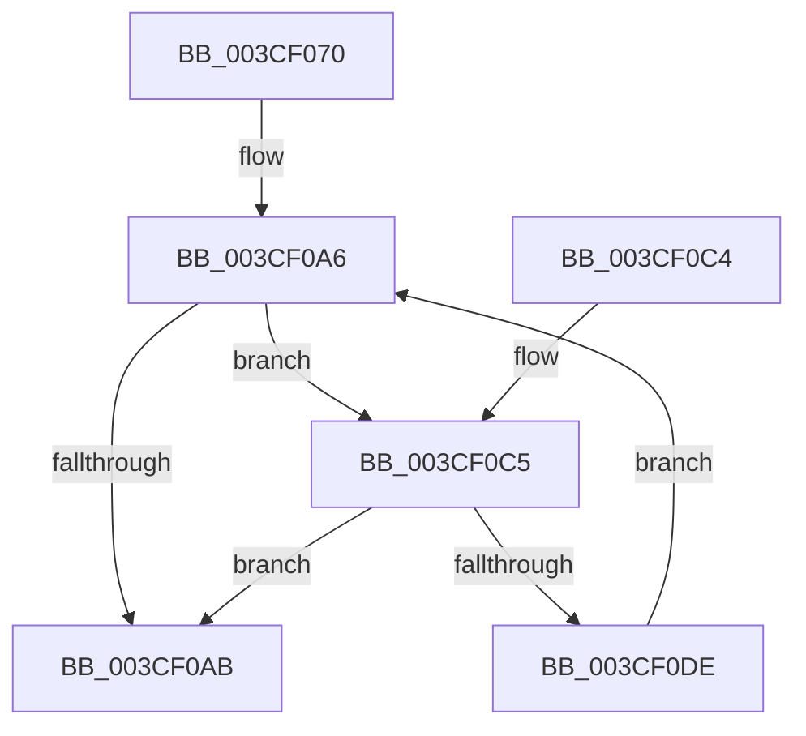

# CcForEachNumaNode

- RVA: `0x003CF070`–`0x003CF0E3` (길이 `115` bytes)
- VA: `0x00000001403CF070`
- 실행 섹션: `.text`
- PDB 이름 있음: `예`; PDB Function 태그: `아니요`
- unwind 정보 RVA: `0x0008FB30`
- 디코드: `37`개 명령, `115/115` bytes 표시
- 미해석 바이트: `0` (있으면 어셈블리에 `.byte`로 보존)

> 이 문서는 커널 이미지의 기계어와 PDB 기호를 분석해 생성했습니다. 4번과 5번은 함수 원형과 자료형을 바이너리 사용 방식에서 추정한 C 해석이며 원본 소스 복구 결과는 아닙니다.

## 1. Dependencies

- 직접 호출 지점: **1**; 고유 호출 대상: **1**
- 직접 호출자로 확인된 함수: **5**
- RIP 상대 이미지 참조: **0**

### Outgoing calls
- `0x003CF0D5` → [guard_dispatch_icall](../6B/guard_dispatch_icall_function_006BAAD0.md) (function, `0x006BAAD0`)

### Direct callers
- [CcInitializePrivateVolumeCacheMap](CcInitializePrivateVolumeCacheMap_function_003CE088.md) at `0x003CE639`
- [CcInitializePrivateVolumeCacheMap](CcInitializePrivateVolumeCacheMap_function_003CE088.md) at `0x003CE663`
- [CcDeletePrivateVolumeCacheMap](CcDeletePrivateVolumeCacheMap_function_003CE950.md) at `0x003CEAB2`
- [CcDeletePrivateVolumeCacheMap](CcDeletePrivateVolumeCacheMap_function_003CE950.md) at `0x003CEAC7`
- [CcGetActiveWorkerCountInPartition](CcGetActiveWorkerCountInPartition_function_003CF044.md) at `0x003CF05C`
- [CcDeletePartition](../57/CcDeletePartition_function_0057DE9C.md) at `0x0057E021`
- [CcInitializePartition](../57/CcInitializePartition_function_0057E4D8.md) at `0x0057EA7F`

### Static image references
- 디코드된 RIP-relative 메모리 참조가 없습니다.

## 2. Other-region calls and transfers

- 다른 실행 섹션으로 향하는 call: **0**
- 별도 외부 분기/꼬리 이동을 확인하지 못했습니다.

## 3. Assembly (complete function range)

```asm
003CF070  48 89 5C 24 08                  mov qword ptr [rsp + 8], rbx
003CF075  48 89 6C 24 10                  mov qword ptr [rsp + 0x10], rbp
003CF07A  48 89 74 24 18                  mov qword ptr [rsp + 0x18], rsi
003CF07F  57                              push rdi
003CF080  41 56                           push r14
003CF082  41 57                           push r15
003CF084  48 83 EC 30                     sub rsp, 0x30
003CF088  4D 85 C0                        test r8, r8
003CF08B  48 8D 42 10                     lea rax, [rdx + 0x10]
003CF08F  49 8D 78 30                     lea rdi, [r8 + 0x30]
003CF093  4D 8B F1                        mov r14, r9
003CF096  48 0F 44 F8                     cmove rdi, rax
003CF09A  49 8B F0                        mov rsi, r8
003CF09D  48 8B EA                        mov rbp, rdx
003CF0A0  4C 8B F9                        mov r15, rcx
003CF0A3  48 8B 1F                        mov rbx, qword ptr [rdi]
003CF0A6  48 3B DF                        cmp rbx, rdi
003CF0A9  75 1A                           jne 0x1403cf0c5
003CF0AB  48 8B 5C 24 50                  mov rbx, qword ptr [rsp + 0x50]
003CF0B0  48 8B 6C 24 58                  mov rbp, qword ptr [rsp + 0x58]
003CF0B5  48 8B 74 24 60                  mov rsi, qword ptr [rsp + 0x60]
003CF0BA  48 83 C4 30                     add rsp, 0x30
003CF0BE  41 5F                           pop r15
003CF0C0  41 5E                           pop r14
003CF0C2  5F                              pop rdi
003CF0C3  C3                              ret
003CF0C4  CC                              int3
003CF0C5  4C 8D 43 E0                     lea r8, [rbx - 0x20]
003CF0C9  4D 8B CE                        mov r9, r14
003CF0CC  48 8B D6                        mov rdx, rsi
003CF0CF  48 8B CD                        mov rcx, rbp
003CF0D2  49 8B C7                        mov rax, r15
003CF0D5  E8 F6 B9 2E 00                  call 0x1406baad0
003CF0DA  84 C0                           test al, al
003CF0DC  74 CD                           je 0x1403cf0ab
003CF0DE  48 8B 1B                        mov rbx, qword ptr [rbx]
003CF0E1  EB C3                           jmp 0x1403cf0a6
```

## 4. C-style interpretation (structured pseudocode)

```c
__int64 __fastcall CcForEachNumaNode(__int64 a1, __int64 a2, __int64 a3, __int64 a4)
{
    __int64 result;
    __int64 v_rdi;
    __int64 v_rsp;
    unsigned __int64 v_stack_p10;
    unsigned __int64 v_stack_p18;
    unsigned __int64 v_stack_p8;

    v_stack_p8 = v_rbx;
    v_stack_p10 = v_rbp;
    v_stack_p18 = v_rsi;
    v_rsp = (v_rsp) - (48);
    v_rdi = a3 + 48;
    if (a3 == 0) { v_rdi = a2 + 16; }
loc_003CF0A6:
    if ((*(unsigned __int64 *)(v_rdi)) != v_rdi) goto loc_003CF0C5;
loc_003CF0AB:
    v_rsp = (v_rsp) + (48);
    return a2 + 16;
loc_003CF0C5:
    result = guard_dispatch_icall(v_stack_p10, v_stack_p18, v_stack_p8 - 32, a4);
    if ((unsigned __int8)(result) == 0) goto loc_003CF0AB;
    goto loc_003CF0A6;
}
```

## 5. (Beta) C Style

```c
void *CcForEachNumaNode(int64_t Arg1, void *Arg2, int64_t Arg3, int64_t Arg4)
{
    uint8_t *arg2 = (uint8_t *)Arg2;

    int64_t result;
    int64_t local_rdi;
    int64_t local_rsp;
    uint64_t v_stack_p10;
    uint64_t v_stack_p18;
    uint64_t v_stack_p8;

    v_stack_p8 = local_rbx;
    v_stack_p10 = local_rbp;
    v_stack_p18 = local_rsi;
    local_rsp = (local_rsp) - (48);
    local_rdi = Arg3 + 48;
    if (Arg3 == 0) { local_rdi = Arg2 + 16; }
loc_003CF0A6:
    if ((*(uint64_t *)(local_rdi)) != local_rdi) goto loc_003CF0C5;
loc_003CF0AB:
    local_rsp = (local_rsp) + (48);
    return Arg2 + 16;
loc_003CF0C5:
    result = guard_dispatch_icall(v_stack_p10, v_stack_p18, v_stack_p8 - 32, Arg4);
    if ((uint8_t)(result) == 0) goto loc_003CF0AB;
    goto loc_003CF0A6;
}
```

### 관측된 메모리 오프셋

구조체 형식이 확인되지 않은 접근은 인자 기준의 오프셋으로만 기록했습니다.

| 기준 인자 | 오프셋 표현 | 폭 (bit) | 접근 |
|---|---:|---:|---|
| `Arg2` | `+ 0x10` | `64` | `R` |

## 6. Execution-region graph

[열기: 2D/3D 그래프와 함수 탐색 컨트롤 패널](../../../control-panel.html?section=text&rva=0x003CF070&view=graph)

- 2D 그래프는 위에서 아래로 흐르고, 3D 그래프는 빈 공간을 드래그해 회전합니다. Shift+드래그는 이동, 휠은 확대·축소, 함수 노드 선택은 대상 보고서 이동입니다.

### Static fallback


