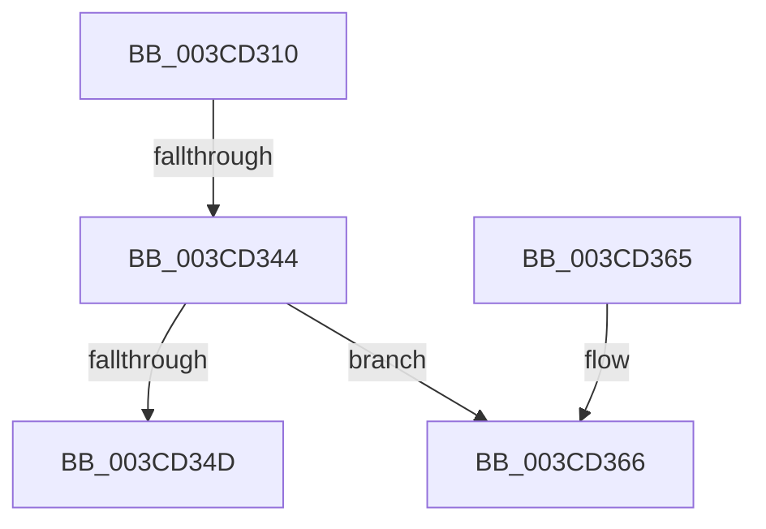

# CcGetPartitionWithCreate

- RVA: `0x003CD310`–`0x003CD385` (길이 `117` bytes)
- VA: `0x00000001403CD310`
- 실행 섹션: `.text`
- PDB 이름 있음: `예`; PDB Function 태그: `예`
- unwind 정보 RVA: `0x0008F988`
- 디코드: `32`개 명령, `117/117` bytes 표시
- 미해석 바이트: `0` (있으면 어셈블리에 `.byte`로 보존)

> 이 문서는 커널 이미지의 기계어와 PDB 기호를 분석해 생성했습니다. 4번과 5번은 함수 원형과 자료형을 바이너리 사용 방식에서 추정한 C 해석이며 원본 소스 복구 결과는 아닙니다.

## 1. Dependencies

- 직접 호출 지점: **1**; 고유 호출 대상: **1**
- 직접 호출자로 확인된 함수: **1**
- RIP 상대 이미지 참조: **0**

### Outgoing calls
- `0x003CD37F` → [KeBugCheckEx](../4F/KeBugCheckEx_function_004FD660.md) (function, `0x004FD660`)

### Direct callers
- [CcInitializeCacheMapInternal](CcInitializeCacheMapInternal_function_003CC720.md) at `0x003CC8A6`

### Static image references
- 디코드된 RIP-relative 메모리 참조가 없습니다.

## 2. Other-region calls and transfers

- 다른 실행 섹션으로 향하는 call: **0**
- call이 아닌 외부 분기/꼬리 이동: **1**
  - `0x003CD33E` → [sub_006E8790](../6E/Unknown_function_006E8790.md) (`tail-transfer`)

## 3. Assembly (complete function range)

```asm
003CD310  4C 8B DC                        mov r11, rsp
003CD313  49 89 5B 08                     mov qword ptr [r11 + 8], rbx
003CD317  49 89 6B 10                     mov qword ptr [r11 + 0x10], rbp
003CD31B  49 89 73 18                     mov qword ptr [r11 + 0x18], rsi
003CD31F  57                              push rdi
003CD320  48 83 EC 50                     sub rsp, 0x50
003CD324  48 8B 59 08                     mov rbx, qword ptr [rcx + 8]
003CD328  33 C0                           xor eax, eax
003CD32A  0F 57 C0                        xorps xmm0, xmm0
003CD32D  33 F6                           xor esi, esi
003CD32F  48 8B F9                        mov rdi, rcx
003CD332  0F 11 44 24 30                  movups xmmword ptr [rsp + 0x30], xmm0
003CD337  49 89 43 E8                     mov qword ptr [r11 - 0x18], rax
003CD33B  48 85 DB                        test rbx, rbx
003CD33E  0F 84 4C B4 31 00               je 0x1406e8790
003CD344  80 BB 0E 05 00 00 02            cmp byte ptr [rbx + 0x50e], 2
003CD34B  73 19                           jae 0x1403cd366
003CD34D  48 8B 6C 24 68                  mov rbp, qword ptr [rsp + 0x68]
003CD352  48 8B C3                        mov rax, rbx
003CD355  48 8B 5C 24 60                  mov rbx, qword ptr [rsp + 0x60]
003CD35A  48 8B 74 24 70                  mov rsi, qword ptr [rsp + 0x70]
003CD35F  48 83 C4 50                     add rsp, 0x50
003CD363  5F                              pop rdi
003CD364  C3                              ret
003CD365  CC                              int3
003CD366  48 83 64 24 20 00               and qword ptr [rsp + 0x20], 0
003CD36C  45 33 C9                        xor r9d, r9d
003CD36F  BA 8F 06 00 00                  mov edx, 0x68f
003CD374  49 C7 C0 20 04 00 C0            mov r8, 0xffffffffc0000420
003CD37B  41 8D 49 34                     lea ecx, [r9 + 0x34]
003CD37F  E8 DC 02 13 00                  call 0x1404fd660
003CD384  CC                              int3
```

## 4. C-style interpretation (structured pseudocode)

```c
__int64 __fastcall CcGetPartitionWithCreate(__int64 a1, __int64 a2, __int64 a3, int a4)
{
    __int64 result;
    __int64 v_rsi;
    __int64 v_rsp;
    unsigned __int64 v_stack_m28;
    unsigned __int64 v_stack_p10;
    unsigned __int64 v_stack_p18;
    unsigned __int64 v_stack_p20;
    unsigned __int64 v_stack_p8;

    *(unsigned __int64 *)(v_rsp + 8) = v_rbx;
    *(unsigned __int64 *)(v_rsp + 16) = v_rbp;
    *(unsigned __int64 *)(v_rsp + 24) = v_rsi;
    v_rsp = (v_rsp) - (80);
    result = 0;
    v_rsi = 0;
    v_stack_m28 = v_xmm0;
    *(unsigned __int64 *)(v_rsp - 24) = 0;
    if ((*(unsigned __int8 *)(*(unsigned __int64 *)(a1 + 8) + 1294)) >= 2) goto loc_003CD366;
    v_rsp = (v_rsp) + (80);
    return *(unsigned __int64 *)(a1 + 8);
loc_003CD366:
    a4 = 0;
    result = KeBugCheckEx(a4 + 52, (unsigned int)(0x68FULL), 0xFFFFFFFFC0000420ULL, a4);
    return result;
}
```

## 5. (Beta) C Style

```c
int64_t CcGetPartitionWithCreate(void *Arg1, int64_t Arg2, int64_t Arg3, int32_t Arg4)
{
    uint8_t *arg1 = (uint8_t *)Arg1;

    int64_t result;
    int64_t local_rsi;
    int64_t local_rsp;
    uint64_t v_stack_m28;
    uint64_t v_stack_p10;
    uint64_t v_stack_p18;
    uint64_t v_stack_p20;
    uint64_t v_stack_p8;

    *(uint64_t *)(local_rsp + 0x8) = local_rbx;
    *(uint64_t *)(local_rsp + 0x10) = local_rbp;
    *(uint64_t *)(local_rsp + 0x18) = local_rsi;
    local_rsp = (local_rsp) - (80);
    result = 0;
    local_rsi = 0;
    v_stack_m28 = v_xmm0;
    *(uint64_t *)(local_rsp - 0x18) = 0;
    if ((*(uint8_t *)(*(uint64_t *)(arg1 + 0x8) + 0x50E)) >= 2) goto loc_003CD366;
    local_rsp = (local_rsp) + (80);
    return *(uint64_t *)(arg1 + 0x8);
loc_003CD366:
    Arg4 = 0;
    result = KeBugCheckEx(Arg4 + 52, (uint32_t)(0x68FULL), 0xFFFFFFFFC0000420ULL, Arg4);
    return result;
}
```

### 관측된 메모리 오프셋

구조체 형식이 확인되지 않은 접근은 인자 기준의 오프셋으로만 기록했습니다.

| 기준 인자 | 오프셋 표현 | 폭 (bit) | 접근 |
|---|---:|---:|---|
| `Arg1` | `+ 0x8` | `64` | `R` |

## 6. Execution-region graph

[열기: 2D/3D 그래프와 함수 탐색 컨트롤 패널](../../../control-panel.html?section=text&rva=0x003CD310&view=graph)

- 2D 그래프는 위에서 아래로 흐르고, 3D 그래프는 빈 공간을 드래그해 회전합니다. Shift+드래그는 이동, 휠은 확대·축소, 함수 노드 선택은 대상 보고서 이동입니다.

### Static fallback


