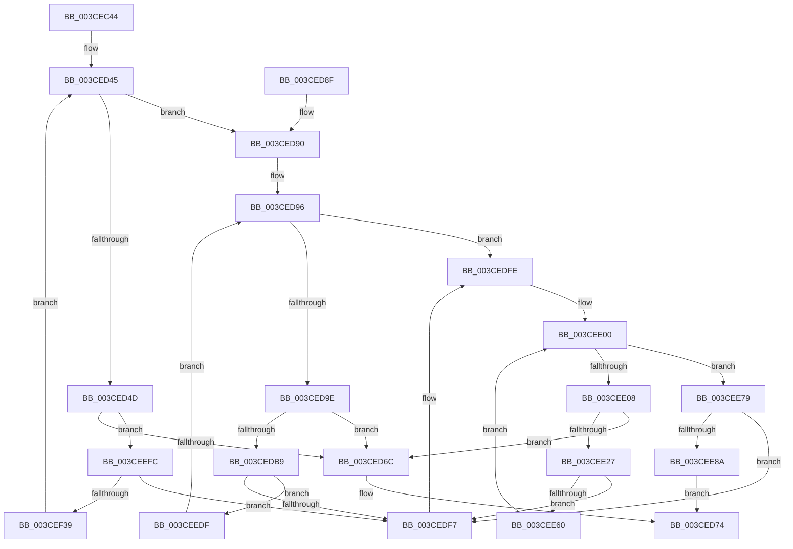

# CcInitializeNumaNodeForVolume

- RVA: `0x003CEC44`–`0x003CEF55` (길이 `785` bytes)
- VA: `0x00000001403CEC44`
- 실행 섹션: `.text`
- PDB 이름 있음: `예`; PDB Function 태그: `아니요`
- unwind 정보 RVA: `0x0008FB14`
- 디코드: `197`개 명령, `785/785` bytes 표시
- 미해석 바이트: `0` (있으면 어셈블리에 `.byte`로 보존)

> 이 문서는 커널 이미지의 기계어와 PDB 기호를 분석해 생성했습니다. 4번과 5번은 함수 원형과 자료형을 바이너리 사용 방식에서 추정한 C 해석이며 원본 소스 복구 결과는 아닙니다.

## 1. Dependencies

- 직접 호출 지점: **6**; 고유 호출 대상: **4**
- 직접 호출자로 확인된 함수: **1**
- RIP 상대 이미지 참조: **4**

### Outgoing calls
- `0x003CEC75` → [memset](../6C/memset_function_006C6C40.md) (function, `0x006C6C40`)
- `0x003CED5B` → [ExAllocatePoolWithTagFromNode](../35/ExAllocatePoolWithTagFromNode_function_0035A944.md) (function, `0x0035A944`)
- `0x003CED6F` → [CcDeleteNumaNode](CcDeleteNumaNode_function_003CEF5C.md) (function, `0x003CEF5C`)
- `0x003CEDAC` → [ExAllocatePoolWithTagFromNode](../35/ExAllocatePoolWithTagFromNode_function_0035A944.md) (function, `0x0035A944`)
- `0x003CEE16` → [ExAllocatePoolWithTagFromNode](../35/ExAllocatePoolWithTagFromNode_function_0035A944.md) (function, `0x0035A944`)
- `0x003CEED5` → [DbgPrintEx](../35/DbgPrintEx_function_00359290.md) (function, `0x00359290`)

### Direct callers
- [CcInitializePrivateVolumeCacheMap](CcInitializePrivateVolumeCacheMap_function_003CE088.md) at `0x003CE5CC`

### Static image references
- `0x003CEDC8` → RVA `0x0048F0F0` (`CcWorkerThread`; read)
- `0x003CEE36` → RVA `0x003569D0` (`CcCachemapUninitWorkerThread`; read)
- `0x003CEE92` → RVA `0x006C8C50` (` ?? ::FNODOBFM::`string'`; read)
- `0x003CEEBB` → RVA `0x00E0A874` (`.data`; read)

## 2. Other-region calls and transfers

- 다른 실행 섹션으로 향하는 call: **0**
- 별도 외부 분기/꼬리 이동을 확인하지 못했습니다.

## 3. Assembly (complete function range)

```asm
003CEC44  48 89 5C 24 08                  mov qword ptr [rsp + 8], rbx
003CEC49  44 89 4C 24 20                  mov dword ptr [rsp + 0x20], r9d
003CEC4E  44 89 44 24 18                  mov dword ptr [rsp + 0x18], r8d
003CEC53  55                              push rbp
003CEC54  56                              push rsi
003CEC55  57                              push rdi
003CEC56  41 54                           push r12
003CEC58  41 55                           push r13
003CEC5A  41 56                           push r14
003CEC5C  41 57                           push r15
003CEC5E  48 83 EC 40                     sub rsp, 0x40
003CEC62  48 8B F2                        mov rsi, rdx
003CEC65  48 8B D9                        mov rbx, rcx
003CEC68  48 8B CE                        mov rcx, rsi
003CEC6B  33 D2                           xor edx, edx
003CEC6D  41 B8 90 01 00 00               mov r8d, 0x190
003CEC73  33 FF                           xor edi, edi
003CEC75  E8 C6 7F 2F 00                  call 0x1406c6c40
003CEC7A  8B 94 24 98 00 00 00            mov edx, dword ptr [rsp + 0x98]
003CEC81  4C 8D 7E 20                     lea r15, [rsi + 0x20]
003CEC85  C7 06 F6 02 90 01               mov dword ptr [rsi], 0x19002f6
003CEC8B  4C 8D 76 38                     lea r14, [rsi + 0x38]
003CEC8F  C7 46 04 02 00 00 00            mov dword ptr [rsi + 4], 2
003CEC96  4C 8D A6 88 00 00 00            lea r12, [rsi + 0x88]
003CEC9D  48 89 5E 10                     mov qword ptr [rsi + 0x10], rbx
003CECA1  4C 8D AE A0 00 00 00            lea r13, [rsi + 0xa0]
003CECA8  48 8B 43 20                     mov rax, qword ptr [rbx + 0x20]
003CECAC  8B EF                           mov ebp, edi
003CECAE  48 89 46 08                     mov qword ptr [rsi + 8], rax
003CECB2  48 8D 46 48                     lea rax, [rsi + 0x48]
003CECB6  89 56 18                        mov dword ptr [rsi + 0x18], edx
003CECB9  4D 89 7F 08                     mov qword ptr [r15 + 8], r15
003CECBD  4D 89 3F                        mov qword ptr [r15], r15
003CECC0  4D 89 76 08                     mov qword ptr [r14 + 8], r14
003CECC4  4D 89 36                        mov qword ptr [r14], r14
003CECC7  48 89 40 08                     mov qword ptr [rax + 8], rax
003CECCB  48 89 00                        mov qword ptr [rax], rax
003CECCE  48 8D 46 58                     lea rax, [rsi + 0x58]
003CECD2  48 89 40 08                     mov qword ptr [rax + 8], rax
003CECD6  48 89 00                        mov qword ptr [rax], rax
003CECD9  48 8D 46 68                     lea rax, [rsi + 0x68]
003CECDD  48 89 40 08                     mov qword ptr [rax + 8], rax
003CECE1  48 89 00                        mov qword ptr [rax], rax
003CECE4  48 8D 46 78                     lea rax, [rsi + 0x78]
003CECE8  4D 89 64 24 08                  mov qword ptr [r12 + 8], r12
003CECED  4D 89 24 24                     mov qword ptr [r12], r12
003CECF1  48 89 40 08                     mov qword ptr [rax + 8], rax
003CECF5  48 89 00                        mov qword ptr [rax], rax
003CECF8  48 8D 86 20 01 00 00            lea rax, [rsi + 0x120]
003CECFF  4D 89 6D 08                     mov qword ptr [r13 + 8], r13
003CED03  4D 89 6D 00                     mov qword ptr [r13], r13
003CED07  48 89 40 08                     mov qword ptr [rax + 8], rax
003CED0B  48 89 00                        mov qword ptr [rax], rax
003CED0E  48 8D 86 68 01 00 00            lea rax, [rsi + 0x168]
003CED15  48 89 40 08                     mov qword ptr [rax + 8], rax
003CED19  48 89 00                        mov qword ptr [rax], rax
003CED1C  48 8D 86 38 01 00 00            lea rax, [rsi + 0x138]
003CED23  48 89 40 08                     mov qword ptr [rax + 8], rax
003CED27  48 89 00                        mov qword ptr [rax], rax
003CED2A  48 8D 86 80 01 00 00            lea rax, [rsi + 0x180]
003CED31  48 89 40 08                     mov qword ptr [rax + 8], rax
003CED35  48 89 00                        mov qword ptr [rax], rax
003CED38  8B C2                           mov eax, edx
003CED3A  0F BA E8 1F                     bts eax, 0x1f
003CED3E  89 84 24 90 00 00 00            mov dword ptr [rsp + 0x90], eax
003CED45  3B AB 08 03 00 00               cmp ebp, dword ptr [rbx + 0x308]
003CED4B  73 43                           jae 0x1403ced90
003CED4D  44 8B C8                        mov r9d, eax
003CED50  BA 50 00 00 00                  mov edx, 0x50
003CED55  41 B8 43 63 57 71               mov r8d, 0x71576343
003CED5B  E8 E4 BB F8 FF                  call 0x14035a944
003CED60  48 8B C8                        mov rcx, rax
003CED63  48 85 C0                        test rax, rax
003CED66  0F 85 90 01 00 00               jne 0x1403ceefc
003CED6C  48 8B CE                        mov rcx, rsi
003CED6F  E8 E8 01 00 00                  call 0x1403cef5c
003CED74  48 8B 9C 24 80 00 00 00         mov rbx, qword ptr [rsp + 0x80]
003CED7C  40 8A C7                        mov al, dil
003CED7F  48 83 C4 40                     add rsp, 0x40
003CED83  41 5F                           pop r15
003CED85  41 5E                           pop r14
003CED87  41 5D                           pop r13
003CED89  41 5C                           pop r12
003CED8B  5F                              pop rdi
003CED8C  5E                              pop rsi
003CED8D  5D                              pop rbp
003CED8E  C3                              ret
003CED8F  CC                              int3
003CED90  8B EF                           mov ebp, edi
003CED92  41 83 CE FF                     or r14d, 0xffffffff
003CED96  3B AB 20 03 00 00               cmp ebp, dword ptr [rbx + 0x320]
003CED9C  73 60                           jae 0x1403cedfe
003CED9E  44 8B C8                        mov r9d, eax
003CEDA1  BA 50 00 00 00                  mov edx, 0x50
003CEDA6  41 B8 43 63 57 71               mov r8d, 0x71576343
003CEDAC  E8 93 BB F8 FF                  call 0x14035a944
003CEDB1  48 8B C8                        mov rcx, rax
003CEDB4  48 85 C0                        test rax, rax
003CEDB7  74 B3                           je 0x1403ced6c
003CEDB9  C7 40 20 02 00 00 00            mov dword ptr [rax + 0x20], 2
003CEDC0  48 8B 43 20                     mov rax, qword ptr [rbx + 0x20]
003CEDC4  48 89 41 38                     mov qword ptr [rcx + 0x38], rax
003CEDC8  48 8D 05 21 03 0C 00            lea rax, [rip + 0xc0321]
003CEDCF  48 89 59 40                     mov qword ptr [rcx + 0x40], rbx
003CEDD3  48 89 71 48                     mov qword ptr [rcx + 0x48], rsi
003CEDD7  89 69 28                        mov dword ptr [rcx + 0x28], ebp
003CEDDA  44 89 71 24                     mov dword ptr [rcx + 0x24], r14d
003CEDDE  48 89 41 10                     mov qword ptr [rcx + 0x10], rax
003CEDE2  48 89 49 18                     mov qword ptr [rcx + 0x18], rcx
003CEDE6  48 89 39                        mov qword ptr [rcx], rdi
003CEDE9  49 8B 44 24 08                  mov rax, qword ptr [r12 + 8]
003CEDEE  4C 39 20                        cmp qword ptr [rax], r12
003CEDF1  0F 84 E8 00 00 00               je 0x1403ceedf
003CEDF7  B9 03 00 00 00                  mov ecx, 3
003CEDFC  CD 29                           int 0x29
003CEDFE  8B EF                           mov ebp, edi
003CEE00  3B AB 24 03 00 00               cmp ebp, dword ptr [rbx + 0x324]
003CEE06  73 71                           jae 0x1403cee79
003CEE08  44 8B C8                        mov r9d, eax
003CEE0B  BA 50 00 00 00                  mov edx, 0x50
003CEE10  41 B8 43 63 57 71               mov r8d, 0x71576343
003CEE16  E8 29 BB F8 FF                  call 0x14035a944
003CEE1B  48 8B C8                        mov rcx, rax
003CEE1E  48 85 C0                        test rax, rax
003CEE21  0F 84 45 FF FF FF               je 0x1403ced6c
003CEE27  C7 40 20 05 00 00 00            mov dword ptr [rax + 0x20], 5
003CEE2E  48 8B 43 20                     mov rax, qword ptr [rbx + 0x20]
003CEE32  48 89 41 38                     mov qword ptr [rcx + 0x38], rax
003CEE36  48 8D 05 93 7B F8 FF            lea rax, [rip - 0x7846d]
003CEE3D  48 89 59 40                     mov qword ptr [rcx + 0x40], rbx
003CEE41  48 89 71 48                     mov qword ptr [rcx + 0x48], rsi
003CEE45  89 69 28                        mov dword ptr [rcx + 0x28], ebp
003CEE48  44 89 71 24                     mov dword ptr [rcx + 0x24], r14d
003CEE4C  48 89 41 10                     mov qword ptr [rcx + 0x10], rax
003CEE50  48 89 49 18                     mov qword ptr [rcx + 0x18], rcx
003CEE54  48 89 39                        mov qword ptr [rcx], rdi
003CEE57  49 8B 45 08                     mov rax, qword ptr [r13 + 8]
003CEE5B  4C 39 28                        cmp qword ptr [rax], r13
003CEE5E  75 97                           jne 0x1403cedf7
003CEE60  4C 89 29                        mov qword ptr [rcx], r13
003CEE63  FF C5                           inc ebp
003CEE65  48 89 41 08                     mov qword ptr [rcx + 8], rax
003CEE69  48 89 08                        mov qword ptr [rax], rcx
003CEE6C  8B 84 24 90 00 00 00            mov eax, dword ptr [rsp + 0x90]
003CEE73  49 89 4D 08                     mov qword ptr [r13 + 8], rcx
003CEE77  EB 87                           jmp 0x1403cee00
003CEE79  48 8D 43 30                     lea rax, [rbx + 0x30]
003CEE7D  48 8B 48 08                     mov rcx, qword ptr [rax + 8]
003CEE81  48 39 01                        cmp qword ptr [rcx], rax
003CEE84  0F 85 6D FF FF FF               jne 0x1403cedf7
003CEE8A  44 8B 8C 24 98 00 00 00         mov r9d, dword ptr [rsp + 0x98]
003CEE92  4C 8D 05 B7 9D 2F 00            lea r8, [rip + 0x2f9db7]
003CEE99  49 89 4F 08                     mov qword ptr [r15 + 8], rcx
003CEE9D  BA 02 00 00 00                  mov edx, 2
003CEEA2  49 89 07                        mov qword ptr [r15], rax
003CEEA5  40 B7 01                        mov dil, 1
003CEEA8  4C 89 39                        mov qword ptr [rcx], r15
003CEEAB  4C 89 78 08                     mov qword ptr [rax + 8], r15
003CEEAF  4A 89 74 CB 40                  mov qword ptr [rbx + r9*8 + 0x40], rsi
003CEEB4  8B 4B 18                        mov ecx, dword ptr [rbx + 0x18]
003CEEB7  89 4C 24 38                     mov dword ptr [rsp + 0x38], ecx
003CEEBB  8B 0D B3 B9 A3 00               mov ecx, dword ptr [rip + 0xa3b9b3]
003CEEC1  48 89 5C 24 30                  mov qword ptr [rsp + 0x30], rbx
003CEEC6  89 4C 24 28                     mov dword ptr [rsp + 0x28], ecx
003CEECA  8D 4A 7D                        lea ecx, [rdx + 0x7d]
003CEECD  44 89 4C 24 20                  mov dword ptr [rsp + 0x20], r9d
003CEED2  4C 8B CE                        mov r9, rsi
003CEED5  E8 B6 A3 F8 FF                  call 0x140359290
003CEEDA  E9 95 FE FF FF                  jmp 0x1403ced74
003CEEDF  4C 89 21                        mov qword ptr [rcx], r12
003CEEE2  FF C5                           inc ebp
003CEEE4  48 89 41 08                     mov qword ptr [rcx + 8], rax
003CEEE8  48 89 08                        mov qword ptr [rax], rcx
003CEEEB  8B 84 24 90 00 00 00            mov eax, dword ptr [rsp + 0x90]
003CEEF2  49 89 4C 24 08                  mov qword ptr [r12 + 8], rcx
003CEEF7  E9 9A FE FF FF                  jmp 0x1403ced96
003CEEFC  C7 40 20 01 00 00 00            mov dword ptr [rax + 0x20], 1
003CEF03  48 8B 43 20                     mov rax, qword ptr [rbx + 0x20]
003CEF07  83 49 24 FF                     or dword ptr [rcx + 0x24], 0xffffffff
003CEF0B  48 89 41 38                     mov qword ptr [rcx + 0x38], rax
003CEF0F  48 8D 05 DA 01 0C 00            lea rax, [rip + 0xc01da]
003CEF16  48 89 59 40                     mov qword ptr [rcx + 0x40], rbx
003CEF1A  48 89 71 48                     mov qword ptr [rcx + 0x48], rsi
003CEF1E  89 69 28                        mov dword ptr [rcx + 0x28], ebp
003CEF21  48 89 41 10                     mov qword ptr [rcx + 0x10], rax
003CEF25  48 89 49 18                     mov qword ptr [rcx + 0x18], rcx
003CEF29  48 89 39                        mov qword ptr [rcx], rdi
003CEF2C  49 8B 46 08                     mov rax, qword ptr [r14 + 8]
003CEF30  4C 39 30                        cmp qword ptr [rax], r14
003CEF33  0F 85 BE FE FF FF               jne 0x1403cedf7
003CEF39  4C 89 31                        mov qword ptr [rcx], r14
003CEF3C  FF C5                           inc ebp
003CEF3E  48 89 41 08                     mov qword ptr [rcx + 8], rax
003CEF42  48 89 08                        mov qword ptr [rax], rcx
003CEF45  8B 84 24 90 00 00 00            mov eax, dword ptr [rsp + 0x90]
003CEF4C  49 89 4E 08                     mov qword ptr [r14 + 8], rcx
003CEF50  E9 F0 FD FF FF                  jmp 0x1403ced45
```

## 4. C-style interpretation (structured pseudocode)

```c
__int64 __fastcall CcInitializeNumaNodeForVolume(__int64 a1, __int64 a2, int a3, int a4)
{
    __int64 result;
    __int64 v_r14;
    __int64 v_rbp;
    __int64 v_rdi;
    __int64 v_rsp;
    unsigned int v_stack_p18;
    unsigned int v_stack_p20;
    unsigned int v_stack_p28;
    unsigned __int64 v_stack_p30;
    unsigned int v_stack_p38;
    unsigned __int64 v_stack_p8;
    unsigned int v_stack_p90;
    unsigned int v_stack_p98;

    v_stack_p8 = v_rbx;
    v_stack_p20 = a4;
    v_stack_p18 = a3;
    v_rsp = (v_rsp) - (64);
    a2 = 0;
    v_rdi = 0;
    result = memset(a2, a2, 400, a4);
    *(unsigned int *)(a2) = 0x19002F6ULL;
    *(unsigned int *)(a2 + 4) = 2;
    *(unsigned __int64 *)(a2 + 16) = a1;
    *(unsigned __int64 *)(a2 + 8) = *(unsigned __int64 *)(a1 + 32);
    *(unsigned int *)(a2 + 24) = (unsigned int)((unsigned int)(v_stack_p20));
    *(unsigned __int64 *)(a2 + 32 + 8) = a2 + 32;
    *(unsigned __int64 *)(a2 + 32) = a2 + 32;
    *(unsigned __int64 *)(a2 + 56 + 8) = a2 + 56;
    *(unsigned __int64 *)(a2 + 56) = a2 + 56;
    *(unsigned __int64 *)(a2 + 72 + 8) = a2 + 72;
    *(unsigned __int64 *)(a2 + 72) = a2 + 72;
    *(unsigned __int64 *)(a2 + 88 + 8) = a2 + 88;
    *(unsigned __int64 *)(a2 + 88) = a2 + 88;
    *(unsigned __int64 *)(a2 + 104 + 8) = a2 + 104;
    *(unsigned __int64 *)(a2 + 104) = a2 + 104;
    *(unsigned __int64 *)(a2 + 136 + 8) = a2 + 136;
    *(unsigned __int64 *)(a2 + 136) = a2 + 136;
    *(unsigned __int64 *)(a2 + 120 + 8) = a2 + 120;
    *(unsigned __int64 *)(a2 + 120) = a2 + 120;
    *(unsigned __int64 *)(a2 + 160 + 8) = a2 + 160;
    *(unsigned __int64 *)(a2 + 160) = a2 + 160;
    *(unsigned __int64 *)(a2 + 288 + 8) = a2 + 288;
    *(unsigned __int64 *)(a2 + 288) = a2 + 288;
    *(unsigned __int64 *)(a2 + 360 + 8) = a2 + 360;
    *(unsigned __int64 *)(a2 + 360) = a2 + 360;
    *(unsigned __int64 *)(a2 + 312 + 8) = a2 + 312;
    *(unsigned __int64 *)(a2 + 312) = a2 + 312;
    *(unsigned __int64 *)(a2 + 384 + 8) = a2 + 384;
    *(unsigned __int64 *)(a2 + 384) = a2 + 384;
    v_stack_p18 = (unsigned int)((unsigned int)((unsigned int)((unsigned int)(v_stack_p20))));
loc_003CED45:
    if (0 >= (*(unsigned int *)(a1 + 776))) goto loc_003CED90;
    result = ExAllocatePoolWithTagFromNode(a2, 80, (unsigned int)(0x71576343ULL), (unsigned int)((unsigned int)((unsigned int)((unsigned int)((unsigned int)(v_stack_p20))))));
    if (result != 0) goto loc_003CEEFC;
loc_003CED6C:
    result = CcDeleteNumaNode(0, 80, (unsigned int)(0x71576343ULL), (unsigned int)((unsigned int)((unsigned int)((unsigned int)((unsigned int)(v_stack_p20))))));
loc_003CED74:
    v_rsp = (v_rsp) + (64);
    return 0;
loc_003CED90:
    v_r14 = (unsigned int)((a2 + 56) | (0xFFFFFFFFULL));
loc_003CED96:
    if (0 >= (*(unsigned int *)(v_stack_p8 + 800))) goto loc_003CEDFE;
    result = ExAllocatePoolWithTagFromNode(0, 80, (unsigned int)(0x71576343ULL), 0);
    if (result == 0) goto loc_003CED6C;
    *(unsigned int *)(result + 32) = 2;
    *(unsigned __int64 *)(result + 56) = *(unsigned __int64 *)(v_stack_p8 + 32);
    *(unsigned __int64 *)(result + 64) = v_stack_p8;
    *(unsigned __int64 *)(result + 72) = 0;
    *(unsigned int *)(result + 40) = 0;
    *(unsigned int *)(result + 36) = (unsigned int)(v_r14);
    *(unsigned __int64 *)(result + 16) = v_rip + 787233;
    *(unsigned __int64 *)(result + 24) = result;
    *(unsigned __int64 *)(result) = 0;
    if ((*(unsigned __int64 *)(*(unsigned __int64 *)(a2 + 136 + 8))) == (a2 + 136)) goto loc_003CEEDF;
loc_003CEDF7:
loc_003CEDFE:
loc_003CEE00:
    if (0 >= (*(unsigned int *)(v_stack_p8 + 804))) goto loc_003CEE79;
    result = ExAllocatePoolWithTagFromNode(3, 80, (unsigned int)(0x71576343ULL), (unsigned int)((unsigned int)(*(unsigned __int64 *)(a2 + 136 + 8))));
    if (result == 0) goto loc_003CED6C;
    *(unsigned int *)(result + 32) = 5;
    *(unsigned __int64 *)(result + 56) = *(unsigned __int64 *)(v_stack_p8 + 32);
    *(unsigned __int64 *)(result + 64) = v_stack_p8;
    *(unsigned __int64 *)(result + 72) = 0;
    *(unsigned int *)(result + 40) = 0;
    *(unsigned int *)(result + 36) = (unsigned int)(v_r14);
    *(unsigned __int64 *)(result + 16) = v_rip - 492653;
    *(unsigned __int64 *)(result + 24) = result;
    *(unsigned __int64 *)(result) = 0;
    if ((*(unsigned __int64 *)(*(unsigned __int64 *)(a2 + 160 + 8))) != (a2 + 160)) goto loc_003CEDF7;
    *(unsigned __int64 *)(result) = a2 + 160;
    v_rbp = (unsigned int)((0) + 1);
    *(unsigned __int64 *)(result + 8) = *(unsigned __int64 *)(a2 + 160 + 8);
    *(unsigned __int64 *)(*(unsigned __int64 *)(a2 + 160 + 8)) = result;
    *(unsigned __int64 *)(a2 + 160 + 8) = result;
    goto loc_003CEE00;
loc_003CEE79:
    if ((*(unsigned __int64 *)(*(unsigned __int64 *)(v_stack_p8 + 48 + 8))) != (v_stack_p8 + 48)) goto loc_003CEDF7;
    *(unsigned __int64 *)(a2 + 32 + 8) = *(unsigned __int64 *)(v_stack_p8 + 48 + 8);
    *(unsigned __int64 *)(a2 + 32) = v_stack_p8 + 48;
    *(unsigned __int64 *)(*(unsigned __int64 *)(v_stack_p8 + 48 + 8)) = a2 + 32;
    *(unsigned __int64 *)(v_stack_p8 + 48 + 8) = a2 + 32;
    *(unsigned __int64 *)(v_stack_p8 + (unsigned int)(v_stack_p98) * 8 + 64) = 0;
    v_stack_p38 = (unsigned int)((unsigned int)(*(unsigned int *)(v_stack_p8 + 24)));
    v_stack_p30 = v_stack_p8;
    v_stack_p28 = (unsigned int)((unsigned int)(*(unsigned int *)(v_rip + 10729907)));
    v_stack_p20 = (unsigned int)((unsigned int)(v_stack_p98));
    result = DbgPrintEx(2 + 125, 2, v_rip + 3120567, 0);
    goto loc_003CED74;
loc_003CEEDF:
    *(unsigned __int64 *)(2 + 125) = a2 + 136;
    v_rbp = (unsigned int)((v_rbp) + 1);
    *(unsigned __int64 *)(2 + 125 + 8) = result;
    *(unsigned __int64 *)(result) = 2 + 125;
    *(unsigned __int64 *)(a2 + 136 + 8) = 2 + 125;
    goto loc_003CED96;
loc_003CEEFC:
    *(unsigned int *)((unsigned int)(v_stack_p90) + 32) = 1;
    *(unsigned __int64 *)(2 + 125 + 56) = *(unsigned __int64 *)(v_stack_p8 + 32);
    *(unsigned __int64 *)(2 + 125 + 64) = v_stack_p8;
    *(unsigned __int64 *)(2 + 125 + 72) = 0;
    *(unsigned int *)(2 + 125 + 40) = (unsigned int)(v_rbp);
    *(unsigned __int64 *)(2 + 125 + 16) = v_rip + 786906;
    *(unsigned __int64 *)(2 + 125 + 24) = 2 + 125;
    *(unsigned __int64 *)(2 + 125) = 1;
    if ((*(unsigned __int64 *)(*(unsigned __int64 *)(v_r14 + 8))) != v_r14) goto loc_003CEDF7;
    *(unsigned __int64 *)(2 + 125) = v_r14;
    v_rbp = (unsigned int)((v_rbp) + 1);
    *(unsigned __int64 *)(2 + 125 + 8) = *(unsigned __int64 *)(v_r14 + 8);
    *(unsigned __int64 *)(*(unsigned __int64 *)(v_r14 + 8)) = 2 + 125;
    *(unsigned __int64 *)(v_r14 + 8) = 2 + 125;
    goto loc_003CED45;
}
```

## 5. (Beta) C Style

```c
int64_t CcInitializeNumaNodeForVolume(void *Arg1, void *Arg2, int32_t Arg3, int32_t Arg4)
{
    uint8_t *arg1 = (uint8_t *)Arg1;
    uint8_t *arg2 = (uint8_t *)Arg2;

    int64_t result;
    int64_t local_r14;
    int64_t local_rbp;
    int64_t local_rdi;
    int64_t local_rsp;
    uint32_t v_stack_p18;
    uint32_t v_stack_p20;
    uint32_t v_stack_p28;
    uint64_t v_stack_p30;
    uint32_t v_stack_p38;
    uint64_t v_stack_p8;
    uint32_t v_stack_p90;
    uint32_t v_stack_p98;

    v_stack_p8 = local_rbx;
    v_stack_p20 = Arg4;
    v_stack_p18 = Arg3;
    local_rsp = (local_rsp) - (64);
    Arg2 = 0;
    local_rdi = 0;
    result = memset(Arg2, Arg2, 400, Arg4);
    *(uint32_t *)(arg2) = 0x19002F6ULL;
    *(uint32_t *)(arg2 + 0x4) = 2;
    *(void **)(arg2 + 0x10) = Arg1;
    *(uint64_t *)(arg2 + 0x8) = *(uint64_t *)(arg1 + 0x20);
    *(uint32_t *)(arg2 + 0x18) = (uint32_t)((uint32_t)(v_stack_p20));
    *(void **)(arg2 + 0x20 + 0x8) = Arg2 + 32;
    *(void **)(arg2 + 0x20) = Arg2 + 32;
    *(void **)(arg2 + 0x38 + 0x8) = Arg2 + 56;
    *(void **)(arg2 + 0x38) = Arg2 + 56;
    *(void **)(arg2 + 0x48 + 0x8) = Arg2 + 72;
    *(void **)(arg2 + 0x48) = Arg2 + 72;
    *(void **)(arg2 + 0x58 + 0x8) = Arg2 + 88;
    *(void **)(arg2 + 0x58) = Arg2 + 88;
    *(void **)(arg2 + 0x68 + 0x8) = Arg2 + 104;
    *(void **)(arg2 + 0x68) = Arg2 + 104;
    *(void **)(arg2 + 0x88 + 0x8) = Arg2 + 136;
    *(void **)(arg2 + 0x88) = Arg2 + 136;
    *(void **)(arg2 + 0x78 + 0x8) = Arg2 + 120;
    *(void **)(arg2 + 0x78) = Arg2 + 120;
    *(void **)(arg2 + 0xA0 + 0x8) = Arg2 + 160;
    *(void **)(arg2 + 0xA0) = Arg2 + 160;
    *(void **)(arg2 + 0x120 + 0x8) = Arg2 + 288;
    *(void **)(arg2 + 0x120) = Arg2 + 288;
    *(void **)(arg2 + 0x168 + 0x8) = Arg2 + 360;
    *(void **)(arg2 + 0x168) = Arg2 + 360;
    *(void **)(arg2 + 0x138 + 0x8) = Arg2 + 312;
    *(void **)(arg2 + 0x138) = Arg2 + 312;
    *(void **)(arg2 + 0x180 + 0x8) = Arg2 + 384;
    *(void **)(arg2 + 0x180) = Arg2 + 384;
    v_stack_p18 = (uint32_t)((uint32_t)((uint32_t)((uint32_t)(v_stack_p20))));
loc_003CED45:
    if (0 >= (*(uint32_t *)(arg1 + 0x308))) goto loc_003CED90;
    result = ExAllocatePoolWithTagFromNode(Arg2, 80, (uint32_t)(0x71576343ULL), (uint32_t)((uint32_t)((uint32_t)((uint32_t)((uint32_t)(v_stack_p20))))));
    if (result != 0) goto loc_003CEEFC;
loc_003CED6C:
    result = CcDeleteNumaNode(0, 80, (uint32_t)(0x71576343ULL), (uint32_t)((uint32_t)((uint32_t)((uint32_t)((uint32_t)(v_stack_p20))))));
loc_003CED74:
    local_rsp = (local_rsp) + (64);
    return 0;
loc_003CED90:
    local_r14 = (uint32_t)((Arg2 + 56) | (0xFFFFFFFFULL));
loc_003CED96:
    if (0 >= (*(uint32_t *)(v_stack_p8 + 0x320))) goto loc_003CEDFE;
    result = ExAllocatePoolWithTagFromNode(0, 80, (uint32_t)(0x71576343ULL), 0);
    if (result == 0) goto loc_003CED6C;
    *(uint32_t *)(result + 0x20) = 2;
    *(uint64_t *)(result + 0x38) = *(uint64_t *)(v_stack_p8 + 0x20);
    *(uint64_t *)(result + 0x40) = v_stack_p8;
    *(uint64_t *)(result + 0x48) = 0;
    *(uint32_t *)(result + 0x28) = 0;
    *(uint32_t *)(result + 0x24) = (uint32_t)(local_r14);
    *(uint64_t *)(result + 0x10) = v_rip + 787233;
    *(uint64_t *)(result + 0x18) = result;
    *(uint64_t *)(result) = 0;
    if ((*(uint64_t *)(*(uint64_t *)(arg2 + 0x88 + 0x8))) == (Arg2 + 136)) goto loc_003CEEDF;
loc_003CEDF7:
loc_003CEDFE:
loc_003CEE00:
    if (0 >= (*(uint32_t *)(v_stack_p8 + 0x324))) goto loc_003CEE79;
    result = ExAllocatePoolWithTagFromNode(3, 80, (uint32_t)(0x71576343ULL), (uint32_t)((uint32_t)(*(uint64_t *)(arg2 + 0x88 + 0x8))));
    if (result == 0) goto loc_003CED6C;
    *(uint32_t *)(result + 0x20) = 5;
    *(uint64_t *)(result + 0x38) = *(uint64_t *)(v_stack_p8 + 0x20);
    *(uint64_t *)(result + 0x40) = v_stack_p8;
    *(uint64_t *)(result + 0x48) = 0;
    *(uint32_t *)(result + 0x28) = 0;
    *(uint32_t *)(result + 0x24) = (uint32_t)(local_r14);
    *(uint64_t *)(result + 0x10) = v_rip - 492653;
    *(uint64_t *)(result + 0x18) = result;
    *(uint64_t *)(result) = 0;
    if ((*(uint64_t *)(*(uint64_t *)(arg2 + 0xA0 + 0x8))) != (Arg2 + 160)) goto loc_003CEDF7;
    *(void **)(result) = Arg2 + 160;
    local_rbp = (uint32_t)((0) + 1);
    *(uint64_t *)(result + 0x8) = *(uint64_t *)(arg2 + 0xA0 + 0x8);
    *(uint64_t *)(*(uint64_t *)(arg2 + 0xA0 + 0x8)) = result;
    *(uint64_t *)(arg2 + 0xA0 + 0x8) = result;
    goto loc_003CEE00;
loc_003CEE79:
    if ((*(uint64_t *)(*(uint64_t *)(v_stack_p8 + 0x30 + 0x8))) != (v_stack_p8 + 48)) goto loc_003CEDF7;
    *(uint64_t *)(arg2 + 0x20 + 0x8) = *(uint64_t *)(v_stack_p8 + 0x30 + 0x8);
    *(uint64_t *)(arg2 + 0x20) = v_stack_p8 + 48;
    *(void **)(*(uint64_t *)(v_stack_p8 + 0x30 + 0x8)) = Arg2 + 32;
    *(void **)(v_stack_p8 + 0x30 + 0x8) = Arg2 + 32;
    *(uint64_t *)(v_stack_p8 + (uint32_t)(v_stack_p98) * 8 + 0x40) = 0;
    v_stack_p38 = (uint32_t)((uint32_t)(*(uint32_t *)(v_stack_p8 + 0x18)));
    v_stack_p30 = v_stack_p8;
    v_stack_p28 = (uint32_t)((uint32_t)(*(uint32_t *)(v_rip + 0xA3B9B3)));
    v_stack_p20 = (uint32_t)((uint32_t)(v_stack_p98));
    result = DbgPrintEx(2 + 125, 2, v_rip + 3120567, 0);
    goto loc_003CED74;
loc_003CEEDF:
    *(void **)(2 + 0x7D) = Arg2 + 136;
    local_rbp = (uint32_t)((local_rbp) + 1);
    *(uint64_t *)(2 + 0x7D + 0x8) = result;
    *(uint64_t *)(result) = 2 + 125;
    *(uint64_t *)(arg2 + 0x88 + 0x8) = 2 + 125;
    goto loc_003CED96;
loc_003CEEFC:
    *(uint32_t *)((uint32_t)(v_stack_p90) + 0x20) = 1;
    *(uint64_t *)(2 + 0x7D + 0x38) = *(uint64_t *)(v_stack_p8 + 0x20);
    *(uint64_t *)(2 + 0x7D + 0x40) = v_stack_p8;
    *(uint64_t *)(2 + 0x7D + 0x48) = 0;
    *(uint32_t *)(2 + 0x7D + 0x28) = (uint32_t)(local_rbp);
    *(uint64_t *)(2 + 0x7D + 0x10) = v_rip + 786906;
    *(uint64_t *)(2 + 0x7D + 0x18) = 2 + 125;
    *(uint64_t *)(2 + 0x7D) = 1;
    if ((*(uint64_t *)(*(uint64_t *)(local_r14 + 0x8))) != local_r14) goto loc_003CEDF7;
    *(uint64_t *)(2 + 0x7D) = local_r14;
    local_rbp = (uint32_t)((local_rbp) + 1);
    *(uint64_t *)(2 + 0x7D + 0x8) = *(uint64_t *)(local_r14 + 0x8);
    *(uint64_t *)(*(uint64_t *)(local_r14 + 0x8)) = 2 + 125;
    *(uint64_t *)(local_r14 + 0x8) = 2 + 125;
    goto loc_003CED45;
}
```

### 관측된 메모리 오프셋

구조체 형식이 확인되지 않은 접근은 인자 기준의 오프셋으로만 기록했습니다.

| 기준 인자 | 오프셋 표현 | 폭 (bit) | 접근 |
|---|---:|---:|---|
| `Arg1` | `+ 0x8` | `64` | `R` |
| `Arg1` | `+ 0x8` | `64` | `W` |
| `Arg1` | `+ 0x18` | `32` | `R` |
| `Arg1` | `+ 0x20` | `64` | `R` |
| `Arg1` | `+ 0x30` | `64` | `R` |
| `Arg1` | `+ 0x40 + r9*8` | `64` | `W` |
| `Arg1` | `+ 0x308` | `32` | `R` |
| `Arg1` | `+ 0x320` | `32` | `R` |
| `Arg1` | `+ 0x324` | `32` | `R` |
| `Arg2` | `+ 0x0` | `32` | `W` |
| `Arg2` | `+ 0x0` | `64` | `W` |
| `Arg2` | `+ 0x4` | `32` | `W` |
| `Arg2` | `+ 0x8` | `64` | `R` |
| `Arg2` | `+ 0x8` | `64` | `W` |
| `Arg2` | `+ 0x10` | `64` | `W` |
| `Arg2` | `+ 0x18` | `32` | `W` |
| `Arg2` | `+ 0x20` | `64` | `R` |
| `Arg2` | `+ 0x38` | `64` | `R` |
| `Arg2` | `+ 0x48` | `64` | `R` |
| `Arg2` | `+ 0x58` | `64` | `R` |
| `Arg2` | `+ 0x68` | `64` | `R` |
| `Arg2` | `+ 0x78` | `64` | `R` |
| `Arg2` | `+ 0x88` | `64` | `R` |
| `Arg2` | `+ 0xA0` | `64` | `R` |
| `Arg2` | `+ 0x120` | `64` | `R` |
| `Arg2` | `+ 0x138` | `64` | `R` |
| `Arg2` | `+ 0x168` | `64` | `R` |
| `Arg2` | `+ 0x180` | `64` | `R` |

## 6. Execution-region graph

[열기: 2D/3D 그래프와 함수 탐색 컨트롤 패널](../../../control-panel.html?section=text&rva=0x003CEC44&view=graph)

- 2D 그래프는 위에서 아래로 흐르고, 3D 그래프는 빈 공간을 드래그해 회전합니다. Shift+드래그는 이동, 휠은 확대·축소, 함수 노드 선택은 대상 보고서 이동입니다.

### Static fallback


