# CcInitializePrivateVolumeCacheMap

- RVA: `0x003CE088`–`0x003CE70C` (길이 `1,668` bytes)
- VA: `0x00000001403CE088`
- 실행 섹션: `.text`
- PDB 이름 있음: `예`; PDB Function 태그: `아니요`
- unwind 정보 RVA: `0x0008FAA4`
- 디코드: `359`개 명령, `1,668/1,668` bytes 표시
- 미해석 바이트: `0` (있으면 어셈블리에 `.byte`로 보존)

> 이 문서는 커널 이미지의 기계어와 PDB 기호를 분석해 생성했습니다. 4번과 5번은 함수 원형과 자료형을 바이너리 사용 방식에서 추정한 C 해석이며 원본 소스 복구 결과는 아닙니다.

## 1. Dependencies

- 직접 호출 지점: **10**; 고유 호출 대상: **8**
- 직접 호출자로 확인된 함수: **1**
- RIP 상대 이미지 참조: **17**

### Outgoing calls
- `0x003CE0D2` → [memset](../6C/memset_function_006C6C40.md) (function, `0x006C6C40`)
- `0x003CE3C9` → [memset](../6C/memset_function_006C6C40.md) (function, `0x006C6C40`)
- `0x003CE4F3` → [KeQueryActiveProcessorCountEx](../24/KeQueryActiveProcessorCountEx_function_00249EF0.md) (function, `0x00249EF0`)
- `0x003CE5A3` → [PsCreateSystemThread](../../page/9E/PsCreateSystemThread_function_009ED0D0.md) (function, `0x009ED0D0`)
- `0x003CE5CC` → [CcInitializeNumaNodeForVolume](CcInitializeNumaNodeForVolume_function_003CEC44.md) (function, `0x003CEC44`)
- `0x003CE5E7` → [CcInitializeQuickLWSThreadItem](CcInitializeQuickLWSThreadItem_function_003CF0EC.md) (function, `0x003CF0EC`)
- `0x003CE60B` → [ExAllocatePoolWithTag](../../poolcode/B8/ExAllocatePoolWithTag_function_00B82010.md) (function, `0x00B82010`)
- `0x003CE639` → [CcForEachNumaNode](CcForEachNumaNode_function_003CF070.md) (function, `0x003CF070`)
- `0x003CE663` → [CcForEachNumaNode](CcForEachNumaNode_function_003CF070.md) (function, `0x003CF070`)
- `0x003CE6E2` → [DbgPrintEx](../35/DbgPrintEx_function_00359290.md) (function, `0x00359290`)

### Direct callers
- [CcCreatePrivateVolumeCacheMap](CcCreatePrivateVolumeCacheMap_function_003CDB20.md) at `0x003CDBDC`

### Static image references
- `0x003CE0D7` → RVA `0x00F8F4E4` (`.data`; read)
- `0x003CE0EA` → RVA `0x00E65B96` (`.data`; read)
- `0x003CE0F1` → RVA `0x00F8F4E0` (`.data`; read)
- `0x003CE400` → RVA `0x00E65B95` (`.data`; read)
- `0x003CE410` → RVA `0x00FC521C` (`ALMOSTRO`; read)
- `0x003CE41E` → RVA `0x00E30088` (`.data`; read)
- `0x003CE43E` → RVA `0x00E65B90` (`.data`; read)
- `0x003CE46A` → RVA `0x00EFAAA8` (`.data`; read)
- `0x003CE4C5` → RVA `0x00F8F524` (`.data`; read)
- `0x003CE4E5` → RVA `0x00E65B58` (`.data`; read)
- `0x003CE592` → RVA `0x003C9AF0` (`CcQueueLazyWriteScanThreadForVolume`; read)
- `0x003CE5B2` → RVA `0x00E0A874` (`.data`; read)
- `0x003CE632` → RVA `0x00498CD0` (`CcInitializeAsyncReadForNodeHelper`; read)
- `0x003CE659` → RVA `0x0057F020` (`CcInitializeAsyncLazywriteForNodeHelper`; read)
- `0x003CE684` → RVA `0x006C8920` (` ?? ::FNODOBFM::`string'`; read)
- `0x003CE694` → RVA `0x006C89A0` (` ?? ::FNODOBFM::`string'`; read)
- `0x003CE6D4` → RVA `0x006C8930` (` ?? ::FNODOBFM::`string'`; read)

## 2. Other-region calls and transfers

- 다른 실행 섹션으로 향하는 call: **2**
  - `0x003CE5A3` → [PsCreateSystemThread](../../page/9E/PsCreateSystemThread_function_009ED0D0.md) (`.text` → `PAGE`)
  - `0x003CE60B` → [ExAllocatePoolWithTag](../../poolcode/B8/ExAllocatePoolWithTag_function_00B82010.md) (`.text` → `POOLCODE`)
- 별도 외부 분기/꼬리 이동을 확인하지 못했습니다.

## 3. Assembly (complete function range)

```asm
003CE088  48 89 5C 24 10                  mov qword ptr [rsp + 0x10], rbx
003CE08D  48 89 74 24 18                  mov qword ptr [rsp + 0x18], rsi
003CE092  48 89 7C 24 20                  mov qword ptr [rsp + 0x20], rdi
003CE097  55                              push rbp
003CE098  41 54                           push r12
003CE09A  41 55                           push r13
003CE09C  41 56                           push r14
003CE09E  41 57                           push r15
003CE0A0  48 8B EC                        mov rbp, rsp
003CE0A3  48 81 EC 80 00 00 00            sub rsp, 0x80
003CE0AA  4D 8B 28                        mov r13, qword ptr [r8]
003CE0AD  33 C0                           xor eax, eax
003CE0AF  48 8B FA                        mov rdi, rdx
003CE0B2  89 45 D4                        mov dword ptr [rbp - 0x2c], eax
003CE0B5  4D 8B F8                        mov r15, r8
003CE0B8  89 45 EC                        mov dword ptr [rbp - 0x14], eax
003CE0BB  48 8B F1                        mov rsi, rcx
003CE0BE  33 D2                           xor edx, edx
003CE0C0  48 8B CF                        mov rcx, rdi
003CE0C3  41 B8 80 06 00 00               mov r8d, 0x680
003CE0C9  49 8B D9                        mov rbx, r9
003CE0CC  44 8A E0                        mov r12b, al
003CE0CF  44 8B F0                        mov r14d, eax
003CE0D2  E8 69 8B 2F 00                  call 0x1406c6c40
003CE0D7  8B 05 07 14 BC 00               mov eax, dword ptr [rip + 0xbc1407]
003CE0DD  45 8D 56 01                     lea r10d, [r14 + 1]
003CE0E1  45 33 C9                        xor r9d, r9d
003CE0E4  89 87 48 06 00 00               mov dword ptr [rdi + 0x648], eax
003CE0EA  44 38 0D A5 7A A9 00            cmp byte ptr [rip + 0xa97aa5], r9b
003CE0F1  8B 05 E9 13 BC 00               mov eax, dword ptr [rip + 0xbc13e9]
003CE0F7  89 87 4C 06 00 00               mov dword ptr [rdi + 0x64c], eax
003CE0FD  C7 07 F5 02 80 06               mov dword ptr [rdi], 0x68002f5
003CE103  48 89 77 20                     mov qword ptr [rdi + 0x20], rsi
003CE107  C7 87 10 06 00 00 14 00 00 00   mov dword ptr [rdi + 0x610], 0x14
003CE111  C7 87 14 06 00 00 0A 00 00 00   mov dword ptr [rdi + 0x614], 0xa
003CE11B  4C 89 57 08                     mov qword ptr [rdi + 8], r10
003CE11F  74 07                           je 0x1403ce128
003CE121  44 09 97 50 06 00 00            or dword ptr [rdi + 0x650], r10d
003CE128  49 8B C2                        mov rax, r10
003CE12B  F0 48 0F C1 86 10 05 00 00      lock xadd qword ptr [rsi + 0x510], rax
003CE134  49 03 C2                        add rax, r10
003CE137  41 BB 0E 00 00 00               mov r11d, 0xe
003CE13D  49 3B C2                        cmp rax, r10
003CE140  7F 05                           jg 0x1403ce147
003CE142  41 8B CB                        mov ecx, r11d
003CE145  CD 29                           int 0x29
003CE147  48 8D 47 30                     lea rax, [rdi + 0x30]
003CE14B  41 B8 00 08 00 00               mov r8d, 0x800
003CE151  48 89 40 08                     mov qword ptr [rax + 8], rax
003CE155  48 8D 8F 98 02 00 00            lea rcx, [rdi + 0x298]
003CE15C  48 89 00                        mov qword ptr [rax], rax
003CE15F  48 8D 87 40 02 00 00            lea rax, [rdi + 0x240]
003CE166  48 89 40 08                     mov qword ptr [rax + 8], rax
003CE16A  48 89 00                        mov qword ptr [rax], rax
003CE16D  48 8D 87 50 02 00 00            lea rax, [rdi + 0x250]
003CE174  48 89 40 08                     mov qword ptr [rax + 8], rax
003CE178  48 89 00                        mov qword ptr [rax], rax
003CE17B  48 8D 87 70 02 00 00            lea rax, [rdi + 0x270]
003CE182  48 89 40 08                     mov qword ptr [rax + 8], rax
003CE186  48 89 00                        mov qword ptr [rax], rax
003CE189  48 8D 87 60 02 00 00            lea rax, [rdi + 0x260]
003CE190  48 89 40 08                     mov qword ptr [rax + 8], rax
003CE194  48 89 00                        mov qword ptr [rax], rax
003CE197  48 8D 87 B0 02 00 00            lea rax, [rdi + 0x2b0]
003CE19E  48 89 40 08                     mov qword ptr [rax + 8], rax
003CE1A2  48 89 00                        mov qword ptr [rax], rax
003CE1A5  48 8D 87 80 02 00 00            lea rax, [rdi + 0x280]
003CE1AC  48 89 40 08                     mov qword ptr [rax + 8], rax
003CE1B0  48 89 00                        mov qword ptr [rax], rax
003CE1B3  44 89 87 90 02 00 00            mov dword ptr [rdi + 0x290], r8d
003CE1BA  48 8B 50 08                     mov rdx, qword ptr [rax + 8]
003CE1BE  48 39 02                        cmp qword ptr [rdx], rax
003CE1C1  74 07                           je 0x1403ce1ca
003CE1C3  B9 03 00 00 00                  mov ecx, 3
003CE1C8  CD 29                           int 0x29
003CE1CA  48 89 01                        mov qword ptr [rcx], rax
003CE1CD  48 89 51 08                     mov qword ptr [rcx + 8], rdx
003CE1D1  48 89 0A                        mov qword ptr [rdx], rcx
003CE1D4  48 89 48 08                     mov qword ptr [rax + 8], rcx
003CE1D8  44 89 87 A8 02 00 00            mov dword ptr [rdi + 0x2a8], r8d
003CE1DF  48 85 DB                        test rbx, rbx
003CE1E2  74 3C                           je 0x1403ce220
003CE1E4  4C 8B 83 00 02 00 00            mov r8, qword ptr [rbx + 0x200]
003CE1EB  4C 89 47 28                     mov qword ptr [rdi + 0x28], r8
003CE1EF  48 8B 83 00 02 00 00            mov rax, qword ptr [rbx + 0x200]
003CE1F6  8B 90 D4 00 00 00               mov edx, dword ptr [rax + 0xd4]
003CE1FC  89 57 18                        mov dword ptr [rdi + 0x18], edx
003CE1FF  48 8B 83 00 02 00 00            mov rax, qword ptr [rbx + 0x200]
003CE206  4C 8B 70 10                     mov r14, qword ptr [rax + 0x10]
003CE20A  49 8B C2                        mov rax, r10
003CE20D  F0 49 0F C1 40 08               lock xadd qword ptr [r8 + 8], rax
003CE213  49 03 C2                        add rax, r10
003CE216  49 3B C2                        cmp rax, r10
003CE219  7F 05                           jg 0x1403ce220
003CE21B  49 8B CB                        mov rcx, r11
003CE21E  CD 29                           int 0x29
003CE220  4C 89 77 10                     mov qword ptr [rdi + 0x10], r14
003CE224  4D 85 F6                        test r14, r14
003CE227  74 0E                           je 0x1403ce237
003CE229  41 83 7E 48 14                  cmp dword ptr [r14 + 0x48], 0x14
003CE22E  75 07                           jne 0x1403ce237
003CE230  83 8F 50 06 00 00 08            or dword ptr [rdi + 0x650], 8
003CE237  4C 89 8F 00 03 00 00            mov qword ptr [rdi + 0x300], r9
003CE23E  48 8D 87 10 03 00 00            lea rax, [rdi + 0x310]
003CE245  48 89 40 08                     mov qword ptr [rax + 8], rax
003CE249  48 8D 9F 98 03 00 00            lea rbx, [rdi + 0x398]
003CE250  48 89 00                        mov qword ptr [rax], rax
003CE253  0F 57 C0                        xorps xmm0, xmm0
003CE256  48 8D 87 E0 04 00 00            lea rax, [rdi + 0x4e0]
003CE25D  33 D2                           xor edx, edx
003CE25F  48 89 40 08                     mov qword ptr [rax + 8], rax
003CE263  48 8B CB                        mov rcx, rbx
003CE266  48 89 00                        mov qword ptr [rax], rax
003CE269  48 8D 87 F0 04 00 00            lea rax, [rdi + 0x4f0]
003CE270  48 89 40 08                     mov qword ptr [rax + 8], rax
003CE274  48 89 00                        mov qword ptr [rax], rax
003CE277  48 8D 87 18 06 00 00            lea rax, [rdi + 0x618]
003CE27E  48 89 40 08                     mov qword ptr [rax + 8], rax
003CE282  48 89 00                        mov qword ptr [rax], rax
003CE285  48 8D 87 38 03 00 00            lea rax, [rdi + 0x338]
003CE28C  66 44 89 97 30 03 00 00         mov word ptr [rdi + 0x330], r10w
003CE294  C6 87 32 03 00 00 06            mov byte ptr [rdi + 0x332], 6
003CE29B  44 89 8F 34 03 00 00            mov dword ptr [rdi + 0x334], r9d
003CE2A2  48 89 40 08                     mov qword ptr [rax + 8], rax
003CE2A6  48 89 00                        mov qword ptr [rax], rax
003CE2A9  48 8D 87 50 03 00 00            lea rax, [rdi + 0x350]
003CE2B0  66 44 89 97 48 03 00 00         mov word ptr [rdi + 0x348], r10w
003CE2B8  C6 87 4A 03 00 00 06            mov byte ptr [rdi + 0x34a], 6
003CE2BF  44 89 8F 4C 03 00 00            mov dword ptr [rdi + 0x34c], r9d
003CE2C6  48 89 40 08                     mov qword ptr [rax + 8], rax
003CE2CA  48 89 00                        mov qword ptr [rax], rax
003CE2CD  48 8D 87 68 03 00 00            lea rax, [rdi + 0x368]
003CE2D4  66 44 89 97 60 03 00 00         mov word ptr [rdi + 0x360], r10w
003CE2DC  C6 87 62 03 00 00 06            mov byte ptr [rdi + 0x362], 6
003CE2E3  44 89 8F 64 03 00 00            mov dword ptr [rdi + 0x364], r9d
003CE2EA  48 89 40 08                     mov qword ptr [rax + 8], rax
003CE2EE  48 89 00                        mov qword ptr [rax], rax
003CE2F1  48 8D 87 80 03 00 00            lea rax, [rdi + 0x380]
003CE2F8  66 44 89 97 78 03 00 00         mov word ptr [rdi + 0x378], r10w
003CE300  C6 87 7A 03 00 00 06            mov byte ptr [rdi + 0x37a], 6
003CE307  44 89 8F 7C 03 00 00            mov dword ptr [rdi + 0x37c], r9d
003CE30E  48 89 40 08                     mov qword ptr [rax + 8], rax
003CE312  48 89 00                        mov qword ptr [rax], rax
003CE315  48 8D 87 A0 04 00 00            lea rax, [rdi + 0x4a0]
003CE31C  66 44 89 8F 98 04 00 00         mov word ptr [rdi + 0x498], r9w
003CE324  C6 87 9A 04 00 00 06            mov byte ptr [rdi + 0x49a], 6
003CE32B  44 89 8F 9C 04 00 00            mov dword ptr [rdi + 0x49c], r9d
003CE332  48 89 40 08                     mov qword ptr [rax + 8], rax
003CE336  48 89 00                        mov qword ptr [rax], rax
003CE339  48 8D 87 B8 04 00 00            lea rax, [rdi + 0x4b8]
003CE340  66 44 89 8F B0 04 00 00         mov word ptr [rdi + 0x4b0], r9w
003CE348  C6 87 B2 04 00 00 06            mov byte ptr [rdi + 0x4b2], 6
003CE34F  44 89 8F B4 04 00 00            mov dword ptr [rdi + 0x4b4], r9d
003CE356  48 89 40 08                     mov qword ptr [rax + 8], rax
003CE35A  48 89 00                        mov qword ptr [rax], rax
003CE35D  48 8D 87 30 06 00 00            lea rax, [rdi + 0x630]
003CE364  66 44 89 97 28 06 00 00         mov word ptr [rdi + 0x628], r10w
003CE36C  C6 87 2A 06 00 00 06            mov byte ptr [rdi + 0x62a], 6
003CE373  44 89 8F 2C 06 00 00            mov dword ptr [rdi + 0x62c], r9d
003CE37A  48 89 40 08                     mov qword ptr [rax + 8], rax
003CE37E  48 89 00                        mov qword ptr [rax], rax
003CE381  33 C0                           xor eax, eax
003CE383  0F 11 87 E0 03 00 00            movups xmmword ptr [rdi + 0x3e0], xmm0
003CE38A  48 89 87 F0 03 00 00            mov qword ptr [rdi + 0x3f0], rax
003CE391  0F 11 87 F8 03 00 00            movups xmmword ptr [rdi + 0x3f8], xmm0
003CE398  44 8D 40 48                     lea r8d, [rax + 0x48]
003CE39C  0F 11 87 08 04 00 00            movups xmmword ptr [rdi + 0x408], xmm0
003CE3A3  0F 11 87 18 04 00 00            movups xmmword ptr [rdi + 0x418], xmm0
003CE3AA  48 89 87 28 04 00 00            mov qword ptr [rdi + 0x428], rax
003CE3B1  0F 11 87 D0 04 00 00            movups xmmword ptr [rdi + 0x4d0], xmm0
003CE3B8  C7 87 D0 04 00 00 02 00 00 00   mov dword ptr [rdi + 0x4d0], 2
003CE3C2  48 89 BF D8 04 00 00            mov qword ptr [rdi + 0x4d8], rdi
003CE3C9  E8 72 88 2F 00                  call 0x1406c6c40
003CE3CE  45 33 D2                        xor r10d, r10d
003CE3D1  C6 03 09                        mov byte ptr [rbx], 9
003CE3D4  44 89 53 04                     mov dword ptr [rbx + 4], r10d
003CE3D8  48 8D 43 08                     lea rax, [rbx + 8]
003CE3DC  48 89 40 08                     mov qword ptr [rax + 8], rax
003CE3E0  48 89 00                        mov qword ptr [rax], rax
003CE3E3  4C 89 53 18                     mov qword ptr [rbx + 0x18], r10
003CE3E7  44 89 53 3C                     mov dword ptr [rbx + 0x3c], r10d
003CE3EB  66 44 89 53 38                  mov word ptr [rbx + 0x38], r10w
003CE3F0  C6 87 D8 03 00 00 01            mov byte ptr [rdi + 0x3d8], 1
003CE3F7  44 38 15 98 77 A9 00            cmp byte ptr [rip + 0xa97798], r10b
003CE3FE  74 10                           je 0x1403ce410
003CE400  44 38 15 8E 77 A9 00            cmp byte ptr [rip + 0xa9778e], r10b
003CE407  74 07                           je 0x1403ce410
003CE409  83 8F 50 06 00 00 02            or dword ptr [rdi + 0x650], 2
003CE410  44 38 15 05 6E BF 00            cmp byte ptr [rip + 0xbf6e05], r10b
003CE417  48 8B 46 08                     mov rax, qword ptr [rsi + 8]
003CE41B  48 8B 08                        mov rcx, qword ptr [rax]
003CE41E  48 8B 05 63 1C A6 00            mov rax, qword ptr [rip + 0xa61c63]
003CE425  0F B7 09                        movzx ecx, word ptr [rcx]
003CE428  48 8B 0C C8                     mov rcx, qword ptr [rax + rcx*8]
003CE42C  48 8B 91 50 48 00 00            mov rdx, qword ptr [rcx + 0x4850]
003CE433  48 8B C2                        mov rax, rdx
003CE436  74 3C                           je 0x1403ce474
003CE438  48 D1 E8                        shr rax, 1
003CE43B  4C 8B CF                        mov r9, rdi
003CE43E  83 3D 4B 77 A9 00 02            cmp dword ptr [rip + 0xa9774b], 2
003CE445  B9 00 04 00 00                  mov ecx, 0x400
003CE44A  72 09                           jb 0x1403ce455
003CE44C  4C 8B C2                        mov r8, rdx
003CE44F  49 C1 E8 03                     shr r8, 3
003CE453  EB 03                           jmp 0x1403ce458
003CE455  4C 8B C0                        mov r8, rax
003CE458  4A 89 04 09                     mov qword ptr [rcx + r9], rax
003CE45C  4C 89 87 08 04 00 00            mov qword ptr [rdi + 0x408], r8
003CE463  48 89 87 F8 03 00 00            mov qword ptr [rdi + 0x3f8], rax
003CE46A  8B 05 38 C6 B2 00               mov eax, dword ptr [rip + 0xb2c638]
003CE470  FF C8                           dec eax
003CE472  EB 1E                           jmp 0x1403ce492
003CE474  48 C1 E8 03                     shr rax, 3
003CE478  48 89 87 F8 03 00 00            mov qword ptr [rdi + 0x3f8], rax
003CE47F  48 89 87 08 04 00 00            mov qword ptr [rdi + 0x408], rax
003CE486  48 89 87 00 04 00 00            mov qword ptr [rdi + 0x400], rax
003CE48D  B8 01 00 00 00                  mov eax, 1
003CE492  89 87 20 03 00 00               mov dword ptr [rdi + 0x320], eax
003CE498  48 8D 04 92                     lea rax, [rdx + rdx*4]
003CE49C  48 03 C0                        add rax, rax
003CE49F  C7 87 28 04 00 00 0A 00 00 00   mov dword ptr [rdi + 0x428], 0xa
003CE4A9  48 89 87 18 04 00 00            mov qword ptr [rdi + 0x418], rax
003CE4B0  8B 05 F2 C5 B2 00               mov eax, dword ptr [rip + 0xb2c5f2]
003CE4B6  FF C8                           dec eax
003CE4B8  4C 89 97 20 04 00 00            mov qword ptr [rdi + 0x420], r10
003CE4BF  89 87 08 03 00 00               mov dword ptr [rdi + 0x308], eax
003CE4C5  8B 05 59 10 BC 00               mov eax, dword ptr [rip + 0xbc1059]
003CE4CB  89 87 24 03 00 00               mov dword ptr [rdi + 0x324], eax
003CE4D1  48 8B 87 F8 03 00 00            mov rax, qword ptr [rdi + 0x3f8]
003CE4D8  48 8B D8                        mov rbx, rax
003CE4DB  48 D1 E8                        shr rax, 1
003CE4DE  48 C1 EB 02                     shr rbx, 2
003CE4E2  48 03 D8                        add rbx, rax
003CE4E5  44 39 15 6C 76 A9 00            cmp dword ptr [rip + 0xa9766c], r10d
003CE4EC  74 2E                           je 0x1403ce51c
003CE4EE  B9 FF FF 00 00                  mov ecx, 0xffff
003CE4F3  E8 F8 B9 E7 FF                  call 0x140249ef0
003CE4F8  8B C8                           mov ecx, eax
003CE4FA  45 33 D2                        xor r10d, r10d
003CE4FD  0F AF 0D 54 76 A9 00            imul ecx, dword ptr [rip + 0xa97654]
003CE504  B8 1F 85 EB 51                  mov eax, 0x51eb851f
003CE509  F7 E1                           mul ecx
003CE50B  C1 EA 05                        shr edx, 5
003CE50E  39 97 08 03 00 00               cmp dword ptr [rdi + 0x308], edx
003CE514  73 06                           jae 0x1403ce51c
003CE516  89 97 08 03 00 00               mov dword ptr [rdi + 0x308], edx
003CE51C  44 89 97 C0 02 00 00            mov dword ptr [rdi + 0x2c0], r10d
003CE523  48 8D 87 50 04 00 00            lea rax, [rdi + 0x450]
003CE52A  44 88 97 C4 02 00 00            mov byte ptr [rdi + 0x2c4], r10b
003CE531  4C 8D 45 D0                     lea r8, [rbp - 0x30]
003CE535  4C 89 97 80 04 00 00            mov qword ptr [rdi + 0x480], r10
003CE53C  B9 FF FF FF FF                  mov ecx, 0xffffffff
003CE541  48 3B D9                        cmp rbx, rcx
003CE544  48 89 7C 24 30                  mov qword ptr [rsp + 0x30], rdi
003CE549  0F 57 C0                        xorps xmm0, xmm0
003CE54C  C7 45 D0 30 00 00 00            mov dword ptr [rbp - 0x30], 0x30
003CE553  48 0F 47 D9                     cmova rbx, rcx
003CE557  4C 89 55 D8                     mov qword ptr [rbp - 0x28], r10
003CE55B  89 9F 10 04 00 00               mov dword ptr [rdi + 0x410], ebx
003CE561  BA FF FF 1F 00                  mov edx, 0x1fffff
003CE566  48 89 40 08                     mov qword ptr [rax + 8], rax
003CE56A  48 89 00                        mov qword ptr [rax], rax
003CE56D  89 8F 90 04 00 00               mov dword ptr [rdi + 0x490], ecx
003CE573  48 8D 8F C8 04 00 00            lea rcx, [rdi + 0x4c8]
003CE57A  48 8B 46 08                     mov rax, qword ptr [rsi + 8]
003CE57E  44 89 55 E8                     mov dword ptr [rbp - 0x18], r10d
003CE582  4C 89 55 E0                     mov qword ptr [rbp - 0x20], r10
003CE586  F3 0F 7F 45 F0                  movdqu xmmword ptr [rbp - 0x10], xmm0
003CE58B  4C 8B 88 80 00 00 00            mov r9, qword ptr [rax + 0x80]
003CE592  48 8D 05 57 B5 FF FF            lea rax, [rip - 0x4aa9]
003CE599  48 89 44 24 28                  mov qword ptr [rsp + 0x28], rax
003CE59E  4C 89 54 24 20                  mov qword ptr [rsp + 0x20], r10
003CE5A3  E8 28 EB 61 00                  call 0x1409ed0d0
003CE5A8  85 C0                           test eax, eax
003CE5AA  0F 88 CB 00 00 00               js 0x1403ce67b
003CE5B0  33 DB                           xor ebx, ebx
003CE5B2  3B 1D BC C2 A3 00               cmp ebx, dword ptr [rip + 0xa3c2bc]
003CE5B8  48 8B CF                        mov rcx, rdi
003CE5BB  73 2A                           jae 0x1403ce5e7
003CE5BD  8B C3                           mov eax, ebx
003CE5BF  44 8B CB                        mov r9d, ebx
003CE5C2  48 69 D0 90 01 00 00            imul rdx, rax, 0x190
003CE5C9  49 03 D5                        add rdx, r13
003CE5CC  E8 73 06 00 00                  call 0x1403cec44
003CE5D1  84 C0                           test al, al
003CE5D3  0F 84 A2 00 00 00               je 0x1403ce67b
003CE5D9  49 83 3F 00                     cmp qword ptr [r15], 0
003CE5DD  74 04                           je 0x1403ce5e3
003CE5DF  49 83 27 00                     and qword ptr [r15], 0
003CE5E3  FF C3                           inc ebx
003CE5E5  EB CB                           jmp 0x1403ce5b2
003CE5E7  E8 00 0B 00 00                  call 0x1403cf0ec
003CE5EC  84 C0                           test al, al
003CE5EE  0F 84 87 00 00 00               je 0x1403ce67b
003CE5F4  8B 97 20 03 00 00               mov edx, dword ptr [rdi + 0x320]
003CE5FA  B9 00 06 00 00                  mov ecx, 0x600
003CE5FF  FF C2                           inc edx
003CE601  41 B8 43 63 54 70               mov r8d, 0x70546343
003CE607  48 C1 E2 03                     shl rdx, 3
003CE60B  E8 00 3A 7B 00                  call 0x140b82010
003CE610  48 85 C0                        test rax, rax
003CE613  74 66                           je 0x1403ce67b
003CE615  48 83 A7 88 04 00 00 00         and qword ptr [rdi + 0x488], 0
003CE61D  4C 8D 4D 30                     lea r9, [rbp + 0x30]
003CE621  4C 8B C7                        mov r8, rdi
003CE624  48 89 87 30 04 00 00            mov qword ptr [rdi + 0x430], rax
003CE62B  48 8B D6                        mov rdx, rsi
003CE62E  C6 45 30 01                     mov byte ptr [rbp + 0x30], 1
003CE632  48 8D 0D 97 A6 0C 00            lea rcx, [rip + 0xca697]
003CE639  E8 32 0A 00 00                  call 0x1403cf070
003CE63E  44 38 65 30                     cmp byte ptr [rbp + 0x30], r12b
003CE642  74 37                           je 0x1403ce67b
003CE644  8B 87 50 06 00 00               mov eax, dword ptr [rdi + 0x650]
003CE64A  A8 01                           test al, 1
003CE64C  74 20                           je 0x1403ce66e
003CE64E  4C 8D 4D 30                     lea r9, [rbp + 0x30]
003CE652  C6 45 30 01                     mov byte ptr [rbp + 0x30], 1
003CE656  4C 8B C7                        mov r8, rdi
003CE659  48 8D 0D C0 09 1B 00            lea rcx, [rip + 0x1b09c0]
003CE660  48 8B D6                        mov rdx, rsi
003CE663  E8 08 0A 00 00                  call 0x1403cf070
003CE668  44 38 65 30                     cmp byte ptr [rbp + 0x30], r12b
003CE66C  74 0D                           je 0x1403ce67b
003CE66E  FF 47 04                        inc dword ptr [rdi + 4]
003CE671  41 B4 01                        mov r12b, 1
003CE674  44 88 A7 D4 04 00 00            mov byte ptr [rdi + 0x4d4], r12b
003CE67B  65 4C 8B 04 25 88 01 00 00      mov r8, qword ptr gs:[0x188]
003CE684  48 8D 05 95 A2 2F 00            lea rax, [rip + 0x2fa295]
003CE68B  65 4C 8B 0C 25 88 01 00 00      mov r9, qword ptr gs:[0x188]
003CE694  48 8D 0D 05 A3 2F 00            lea rcx, [rip + 0x2fa305]
003CE69B  45 84 E4                        test r12b, r12b
003CE69E  BA 02 00 00 00                  mov edx, 2
003CE6A3  48 0F 44 C8                     cmove rcx, rax
003CE6A7  45 8B 89 08 05 00 00            mov r9d, dword ptr [r9 + 0x508]
003CE6AE  48 89 4C 24 48                  mov qword ptr [rsp + 0x48], rcx
003CE6B3  8B 4F 18                        mov ecx, dword ptr [rdi + 0x18]
003CE6B6  48 89 7C 24 40                  mov qword ptr [rsp + 0x40], rdi
003CE6BB  4C 89 74 24 38                  mov qword ptr [rsp + 0x38], r14
003CE6C0  89 4C 24 30                     mov dword ptr [rsp + 0x30], ecx
003CE6C4  48 8B 4F 28                     mov rcx, qword ptr [rdi + 0x28]
003CE6C8  48 89 4C 24 28                  mov qword ptr [rsp + 0x28], rcx
003CE6CD  41 8B 88 10 05 00 00            mov ecx, dword ptr [r8 + 0x510]
003CE6D4  4C 8D 05 55 A2 2F 00            lea r8, [rip + 0x2fa255]
003CE6DB  89 4C 24 20                     mov dword ptr [rsp + 0x20], ecx
003CE6DF  8D 4A 7D                        lea ecx, [rdx + 0x7d]
003CE6E2  E8 A9 AB F8 FF                  call 0x140359290
003CE6E7  4C 8D 9C 24 80 00 00 00         lea r11, [rsp + 0x80]
003CE6EF  41 8A C4                        mov al, r12b
003CE6F2  49 8B 5B 38                     mov rbx, qword ptr [r11 + 0x38]
003CE6F6  49 8B 73 40                     mov rsi, qword ptr [r11 + 0x40]
003CE6FA  49 8B 7B 48                     mov rdi, qword ptr [r11 + 0x48]
003CE6FE  49 8B E3                        mov rsp, r11
003CE701  41 5F                           pop r15
003CE703  41 5E                           pop r14
003CE705  41 5D                           pop r13
003CE707  41 5C                           pop r12
003CE709  5D                              pop rbp
003CE70A  C3                              ret
003CE70B  CC                              int3
```

## 4. C-style interpretation (structured pseudocode)

```c
__int64 __fastcall CcInitializePrivateVolumeCacheMap(__int64 a1, __int64 a2, __int64 a3, __int64 a4)
{
    __int64 result;
    __int64 v_r10;
    __int64 v_r12;
    __int64 v_rbx;
    __int64 v_rsp;
    unsigned __int64 v_stack_m28;
    unsigned __int64 v_stack_m38;
    unsigned int v_stack_m3C;
    unsigned int v_stack_m40;
    unsigned __int64 v_stack_m48;
    unsigned __int64 v_stack_m50;
    unsigned int v_stack_m54;
    unsigned __int64 v_stack_m58;
    unsigned __int64 v_stack_m60;
    unsigned __int64 v_stack_m68;
    unsigned __int64 v_stack_m70;
    unsigned __int64 v_stack_m78;
    unsigned __int64 v_stack_m80;
    unsigned __int64 v_stack_m88;
    unsigned __int64 v_stack_p10;
    unsigned __int64 v_stack_p18;
    unsigned __int64 v_stack_p20;
    unsigned __int64 v_stack_p8;

    v_stack_p10 = v_rbx;
    v_stack_p18 = v_rsi;
    v_stack_p20 = v_rdi;
    v_rsp = (v_rsp) - (128);
    result = 0;
    v_stack_m54 = 0;
    v_stack_m3C = 0;
    a2 = 0;
    result = memset(0, a2, (unsigned int)(0x680ULL), a4);
    a4 = 0;
    *(unsigned int *)(a2 + 1608) = (unsigned int)((unsigned int)(*(unsigned int *)(v_rip + 12325895)));
    *(unsigned int *)(a2 + 1612) = (unsigned int)((unsigned int)(*(unsigned int *)(v_rip + 12325865)));
    *(unsigned int *)(a2) = 0x68002F5ULL;
    *(unsigned __int64 *)(a2 + 32) = a1;
    *(unsigned int *)(a2 + 1552) = 20;
    *(unsigned int *)(a2 + 1556) = 10;
    *(unsigned __int64 *)(a2 + 8) = 0 + 1;
    if ((*(unsigned __int8 *)(v_rip + 11106981)) != 0) {
    }
    result = (0 + 1) + (0 + 1);
    if (result <= (0 + 1)) {
        a1 = 14;
    }
    *(unsigned __int64 *)(a2 + 48 + 8) = a2 + 48;
    *(unsigned __int64 *)(a2 + 48) = a2 + 48;
    *(unsigned __int64 *)(a2 + 576 + 8) = a2 + 576;
    *(unsigned __int64 *)(a2 + 576) = a2 + 576;
    *(unsigned __int64 *)(a2 + 592 + 8) = a2 + 592;
    *(unsigned __int64 *)(a2 + 592) = a2 + 592;
    *(unsigned __int64 *)(a2 + 624 + 8) = a2 + 624;
    *(unsigned __int64 *)(a2 + 624) = a2 + 624;
    *(unsigned __int64 *)(a2 + 608 + 8) = a2 + 608;
    *(unsigned __int64 *)(a2 + 608) = a2 + 608;
    *(unsigned __int64 *)(a2 + 688 + 8) = a2 + 688;
    *(unsigned __int64 *)(a2 + 688) = a2 + 688;
    *(unsigned __int64 *)(a2 + 640 + 8) = a2 + 640;
    *(unsigned __int64 *)(a2 + 640) = a2 + 640;
    *(unsigned int *)(a2 + 656) = (unsigned int)((unsigned int)(0x800ULL));
    if ((*(unsigned __int64 *)(*(unsigned __int64 *)(a2 + 640 + 8))) != (a2 + 640)) {
        a1 = 3;
    }
    *(unsigned __int64 *)(a1) = a2 + 640;
    *(unsigned __int64 *)(a1 + 8) = *(unsigned __int64 *)(a2 + 640 + 8);
    *(unsigned __int64 *)(*(unsigned __int64 *)(a2 + 640 + 8)) = a1;
    *(unsigned __int64 *)(a2 + 640 + 8) = a1;
    *(unsigned int *)(a2 + 680) = (unsigned int)((unsigned int)(0x800ULL));
    if (0 == 0) goto loc_003CE220;
    *(unsigned __int64 *)(a2 + 40) = *(unsigned __int64 *)(a4 + 512);
    *(unsigned int *)(a2 + 24) = (unsigned int)((unsigned int)(*(unsigned int *)(*(unsigned __int64 *)(a4 + 512) + 212)));
    result = (0 + 1) + (0 + 1);
    if (result <= (0 + 1)) {
        a1 = 14;
    }
    *(unsigned __int64 *)(a2 + 16) = *(unsigned __int64 *)(*(unsigned __int64 *)(a4 + 512) + 16);
    if (*(unsigned __int64 *)(*(unsigned __int64 *)(a4 + 512) + 16) == 0) goto loc_003CE237;
    if ((*(unsigned int *)(*(unsigned __int64 *)(*(unsigned __int64 *)(a4 + 512) + 16) + 72)) == 20) {
    }
    *(unsigned __int64 *)(a2 + 768) = 0;
    *(unsigned __int64 *)(a2 + 784 + 8) = a2 + 784;
    *(unsigned __int64 *)(a2 + 784) = a2 + 784;
    a2 = 0;
    *(unsigned __int64 *)(a2 + 1248 + 8) = a2 + 1248;
    *(unsigned __int64 *)(a2 + 1248) = a2 + 1248;
    *(unsigned __int64 *)(a2 + 1264 + 8) = a2 + 1264;
    *(unsigned __int64 *)(a2 + 1264) = a2 + 1264;
    *(unsigned __int64 *)(a2 + 1560 + 8) = a2 + 1560;
    *(unsigned __int64 *)(a2 + 1560) = a2 + 1560;
    *(unsigned __int16 *)(a2 + 816) = (unsigned __int16)(0 + 1);
    *(unsigned __int8 *)(a2 + 818) = 6;
    *(unsigned int *)(a2 + 820) = 0;
    *(unsigned __int64 *)(a2 + 824 + 8) = a2 + 824;
    *(unsigned __int64 *)(a2 + 824) = a2 + 824;
    *(unsigned __int16 *)(a2 + 840) = (unsigned __int16)(0 + 1);
    *(unsigned __int8 *)(a2 + 842) = 6;
    *(unsigned int *)(a2 + 844) = 0;
    *(unsigned __int64 *)(a2 + 848 + 8) = a2 + 848;
    *(unsigned __int64 *)(a2 + 848) = a2 + 848;
    *(unsigned __int16 *)(a2 + 864) = (unsigned __int16)(0 + 1);
    *(unsigned __int8 *)(a2 + 866) = 6;
    *(unsigned int *)(a2 + 868) = 0;
    *(unsigned __int64 *)(a2 + 872 + 8) = a2 + 872;
    *(unsigned __int64 *)(a2 + 872) = a2 + 872;
    *(unsigned __int16 *)(a2 + 888) = (unsigned __int16)(0 + 1);
    *(unsigned __int8 *)(a2 + 890) = 6;
    *(unsigned int *)(a2 + 892) = 0;
    *(unsigned __int64 *)(a2 + 896 + 8) = a2 + 896;
    *(unsigned __int64 *)(a2 + 896) = a2 + 896;
    *(unsigned __int16 *)(a2 + 1176) = 0;
    *(unsigned __int8 *)(a2 + 1178) = 6;
    *(unsigned int *)(a2 + 1180) = 0;
    *(unsigned __int64 *)(a2 + 1184 + 8) = a2 + 1184;
    *(unsigned __int64 *)(a2 + 1184) = a2 + 1184;
    *(unsigned __int16 *)(a2 + 1200) = 0;
    *(unsigned __int8 *)(a2 + 1202) = 6;
    *(unsigned int *)(a2 + 1204) = 0;
    *(unsigned __int64 *)(a2 + 1208 + 8) = a2 + 1208;
    *(unsigned __int64 *)(a2 + 1208) = a2 + 1208;
    *(unsigned __int16 *)(a2 + 1576) = (unsigned __int16)(0 + 1);
    *(unsigned __int8 *)(a2 + 1578) = 6;
    *(unsigned int *)(a2 + 1580) = 0;
    *(unsigned __int64 *)(a2 + 1584 + 8) = a2 + 1584;
    *(unsigned __int64 *)(a2 + 1584) = a2 + 1584;
    result = 0;
    *(unsigned __int64 *)(a2 + 992) = v_xmm0;
    *(unsigned __int64 *)(a2 + 1008) = 0;
    *(unsigned __int64 *)(a2 + 1016) = v_xmm0;
    *(unsigned __int64 *)(a2 + 1032) = v_xmm0;
    *(unsigned __int64 *)(a2 + 1048) = v_xmm0;
    *(unsigned __int64 *)(a2 + 1064) = 0;
    *(unsigned __int64 *)(a2 + 1232) = v_xmm0;
    *(unsigned int *)(a2 + 1232) = 2;
    *(unsigned __int64 *)(a2 + 1240) = 0;
    result = memset(a2 + 920, a2, result + 72, a4);
    v_r10 = 0;
    *(unsigned __int8 *)(a2 + 920) = 9;
    *(unsigned int *)(a2 + 920 + 4) = 0;
    *(unsigned __int64 *)(a2 + 920 + 8 + 8) = a2 + 920 + 8;
    *(unsigned __int64 *)(a2 + 920 + 8) = a2 + 920 + 8;
    *(unsigned __int64 *)(a2 + 920 + 24) = 0;
    *(unsigned int *)(a2 + 920 + 60) = 0;
    *(unsigned __int16 *)(a2 + 920 + 56) = 0;
    *(unsigned __int8 *)(a2 + 984) = 1;
    if ((*(unsigned __int8 *)(v_rip + 11106200)) == 0) goto loc_003CE410;
    if ((*(unsigned __int8 *)(v_rip + 11106190)) != 0) {
    }
    if ((*(unsigned __int8 *)(v_rip + 12545541)) == 0) goto loc_003CE474;
    result = (*(unsigned __int64 *)(*(unsigned __int64 *)(*(unsigned __int64 *)(v_rip + 10886243) + *(unsigned __int16 *)(*(unsigned __int64 *)(*(unsigned __int64 *)(a1 + 8))) * 8) + 18512)) >> (1);
    if ((*(unsigned int *)(v_rip + 11106123)) < 2) goto loc_003CE455;
    a3 = (*(unsigned __int64 *)(*(unsigned __int64 *)(*(unsigned __int64 *)(v_rip + 10886243) + *(unsigned __int16 *)(*(unsigned __int64 *)(*(unsigned __int64 *)(a1 + 8))) * 8) + 18512)) >> (3);
    goto loc_003CE458;
loc_003CE455:
loc_003CE458:
    *(unsigned __int64 *)((unsigned int)(0x400ULL) + 0 * 1) = result;
    *(unsigned __int64 *)(a2 + 1032) = result;
    *(unsigned __int64 *)(a2 + 1016) = result;
    result = (unsigned int)(((unsigned int)(*(unsigned int *)(v_rip + 11716152))) - 1);
    goto loc_003CE492;
loc_003CE474:
    result = (result) >> (3);
    *(unsigned __int64 *)(a2 + 1016) = result;
    *(unsigned __int64 *)(a2 + 1032) = result;
    *(unsigned __int64 *)(a2 + 1024) = result;
loc_003CE492:
    *(unsigned int *)(a2 + 800) = 1;
    result = (*(unsigned __int64 *)(*(unsigned __int64 *)(*(unsigned __int64 *)(v_rip + 10886243) + *(unsigned __int16 *)(*(unsigned __int64 *)(*(unsigned __int64 *)(a1 + 8))) * 8) + 18512) + *(unsigned __int64 *)(*(unsigned __int64 *)(*(unsigned __int64 *)(v_rip + 10886243) + *(unsigned __int16 *)(*(unsigned __int64 *)(*(unsigned __int64 *)(a1 + 8))) * 8) + 18512) * 4) + (*(unsigned __int64 *)(*(unsigned __int64 *)(*(unsigned __int64 *)(v_rip + 10886243) + *(unsigned __int16 *)(*(unsigned __int64 *)(*(unsigned __int64 *)(a1 + 8))) * 8) + 18512) + *(unsigned __int64 *)(*(unsigned __int64 *)(*(unsigned __int64 *)(v_rip + 10886243) + *(unsigned __int16 *)(*(unsigned __int64 *)(*(unsigned __int64 *)(a1 + 8))) * 8) + 18512) * 4);
    *(unsigned int *)(a2 + 1064) = 10;
    *(unsigned __int64 *)(a2 + 1048) = result;
    result = (unsigned int)(((unsigned int)(*(unsigned int *)(v_rip + 11716082))) - 1);
    *(unsigned __int64 *)(a2 + 1056) = 0;
    *(unsigned int *)(a2 + 776) = (unsigned int)(result);
    *(unsigned int *)(a2 + 804) = (unsigned int)((unsigned int)(*(unsigned int *)(v_rip + 12324953)));
    result = (*(unsigned __int64 *)(a2 + 1016)) >> (1);
    v_rbx = (*(unsigned __int64 *)(a2 + 1016)) >> (2);
    v_rbx = (v_rbx) + (result);
    if ((*(unsigned int *)(v_rip + 11105900)) == 0) goto loc_003CE51C;
    result = KeQueryActiveProcessorCountEx((unsigned int)(0xFFFFULL), *(unsigned __int64 *)(*(unsigned __int64 *)(*(unsigned __int64 *)(v_rip + 10886243) + *(unsigned __int16 *)(*(unsigned __int64 *)(*(unsigned __int64 *)(a1 + 8))) * 8) + 18512), result, 0);
    v_r10 = 0;
    a1 = (unsigned int)(((unsigned int)((unsigned int)(result))) * (*(unsigned int *)(v_rip + 11105876)));
    a2 = (unsigned int)((*(unsigned __int64 *)(*(unsigned __int64 *)(*(unsigned __int64 *)(v_rip + 10886243) + *(unsigned __int16 *)(*(unsigned __int64 *)(*(unsigned __int64 *)(a1 + 8))) * 8) + 18512)) >> (5));
    if ((*(unsigned int *)(a2 + 776)) < ((unsigned int)(a2))) {
        *(unsigned int *)(a2 + 776) = (unsigned int)(a2);
    }
    *(unsigned int *)(a2 + 704) = 0;
    *(unsigned __int8 *)(a2 + 708) = 0;
    *(unsigned __int64 *)(a2 + 1152) = 0;
    v_stack_m78 = a2;
    v_stack_m58 = 48;
    if (v_rbx > ((unsigned int)(0xFFFFFFFFULL))) { v_rbx = (unsigned int)(0xFFFFFFFFULL); }
    v_stack_m50 = 0;
    *(unsigned int *)(a2 + 1040) = (unsigned int)(v_rbx);
    *(unsigned __int64 *)(a2 + 1104 + 8) = a2 + 1104;
    *(unsigned __int64 *)(a2 + 1104) = a2 + 1104;
    *(unsigned int *)(a2 + 1168) = (unsigned int)((unsigned int)(0xFFFFFFFFULL));
    v_stack_m40 = 0;
    v_stack_m48 = 0;
    v_stack_m38 = v_xmm0;
    v_stack_m80 = v_rip - 19113;
    v_stack_m88 = 0;
    result = PsCreateSystemThread(a2 + 1224, (unsigned int)(0x1FFFFFULL), v_stack_m58, *(unsigned __int64 *)(*(unsigned __int64 *)(a1 + 8) + 128));
    if (sign_flag) goto loc_003CE67B;
    v_rbx = 0;
loc_003CE5B2:
    if (0 >= (*(unsigned int *)(v_rip + 10732220))) goto loc_003CE5E7;
    a2 = ((unsigned int)(0x1FFFFFULL)) * (0);
    a2 = (a2) + (*(unsigned __int64 *)(a3));
    result = CcInitializeNumaNodeForVolume(a2, a2, v_stack_m58, 0);
    if ((unsigned __int8)(result) == 0) goto loc_003CE67B;
    if ((*(unsigned __int64 *)(a3)) != 0) {
    }
    v_rbx = (unsigned int)((v_rbx) + 1);
    goto loc_003CE5B2;
loc_003CE5E7:
    result = CcInitializeQuickLWSThreadItem(a2, a2, v_stack_m58, 0);
    if ((unsigned __int8)(result) == 0) goto loc_003CE67B;
    a2 = (unsigned int)(((unsigned int)(*(unsigned int *)(a2 + 800))) + 1);
    a2 = (a2) << (3);
    result = ExAllocatePoolWithTag((unsigned int)(0x600ULL), a2, (unsigned int)(0x70546343ULL), 0);
    if (result == 0) goto loc_003CE67B;
    *(unsigned __int64 *)(a2 + 1072) = result;
    v_stack_p8 = 1;
    result = CcForEachNumaNode(v_rip + 829079, a1, a2, v_stack_p8);
    if (v_stack_p8 == 0) goto loc_003CE67B;
    if ((((unsigned __int8)((unsigned int)(*(unsigned int *)(a2 + 1616)))) & (1)) == 0) goto loc_003CE66E;
    v_stack_p8 = 1;
    result = CcForEachNumaNode(v_rip + 1771968, a1, a2, v_stack_p8);
    v_r12 = 0;
    if (v_stack_p8 != 0) {
        v_r12 = 1;
        *(unsigned __int8 *)(a2 + 1236) = (unsigned __int8)(v_r12);
    }
    a1 = v_rip + 3121925;
    if ((unsigned __int8)(v_r12) == 0) { a1 = v_rip + 3121813; }
    v_stack_m60 = a1;
    v_stack_m68 = a2;
    v_stack_m70 = *(unsigned __int64 *)(*(unsigned __int64 *)(a4 + 512) + 16);
    v_stack_m78 = (unsigned int)((unsigned int)(*(unsigned int *)(a2 + 24)));
    v_stack_m80 = *(unsigned __int64 *)(a2 + 40);
    v_stack_m88 = (unsigned int)((unsigned int)(*(unsigned int *)(*(unsigned __int64 *)(gs_base + (0 + 392)) + 1296)));
    result = DbgPrintEx(2 + 125, 2, v_rip + 3121749, (unsigned int)(*(unsigned int *)(*(unsigned __int64 *)(gs_base + (0 + 392)) + 1288)));
    return (unsigned __int8)(v_r12);
}
```

## 5. (Beta) C Style

```c
int64_t CcInitializePrivateVolumeCacheMap(void *Arg1, void *Arg2, void *Arg3, int64_t Arg4)
{
    uint8_t *arg1 = (uint8_t *)Arg1;
    uint8_t *arg2 = (uint8_t *)Arg2;
    uint8_t *arg3 = (uint8_t *)Arg3;

    int64_t result;
    int64_t local_r10;
    int64_t local_r12;
    int64_t local_rbx;
    int64_t local_rsp;
    uint64_t v_stack_m28;
    uint64_t v_stack_m38;
    uint32_t v_stack_m3C;
    uint32_t v_stack_m40;
    uint64_t v_stack_m48;
    uint64_t v_stack_m50;
    uint32_t v_stack_m54;
    uint64_t v_stack_m58;
    uint64_t v_stack_m60;
    uint64_t v_stack_m68;
    uint64_t v_stack_m70;
    uint64_t v_stack_m78;
    uint64_t v_stack_m80;
    uint64_t v_stack_m88;
    uint64_t v_stack_p10;
    uint64_t v_stack_p18;
    uint64_t v_stack_p20;
    uint64_t v_stack_p8;

    v_stack_p10 = local_rbx;
    v_stack_p18 = local_rsi;
    v_stack_p20 = local_rdi;
    local_rsp = (local_rsp) - (128);
    result = 0;
    v_stack_m54 = 0;
    v_stack_m3C = 0;
    Arg2 = 0;
    result = memset(0, Arg2, (uint32_t)(0x680ULL), Arg4);
    Arg4 = 0;
    *(uint32_t *)(arg2 + 0x648) = (uint32_t)((uint32_t)(*(uint32_t *)(v_rip + 0xBC1407)));
    *(uint32_t *)(arg2 + 0x64C) = (uint32_t)((uint32_t)(*(uint32_t *)(v_rip + 0xBC13E9)));
    *(uint32_t *)(arg2) = 0x68002F5ULL;
    *(void **)(arg2 + 0x20) = Arg1;
    *(uint32_t *)(arg2 + 0x610) = 20;
    *(uint32_t *)(arg2 + 0x614) = 10;
    *(uint64_t *)(arg2 + 0x8) = 0 + 1;
    if ((*(uint8_t *)(v_rip + 0xA97AA5)) != 0) {
    }
    result = (0 + 1) + (0 + 1);
    if (result <= (0 + 1)) {
        Arg1 = 14;
    }
    *(void **)(arg2 + 0x30 + 0x8) = Arg2 + 48;
    *(void **)(arg2 + 0x30) = Arg2 + 48;
    *(void **)(arg2 + 0x240 + 0x8) = Arg2 + 576;
    *(void **)(arg2 + 0x240) = Arg2 + 576;
    *(void **)(arg2 + 0x250 + 0x8) = Arg2 + 592;
    *(void **)(arg2 + 0x250) = Arg2 + 592;
    *(void **)(arg2 + 0x270 + 0x8) = Arg2 + 624;
    *(void **)(arg2 + 0x270) = Arg2 + 624;
    *(void **)(arg2 + 0x260 + 0x8) = Arg2 + 608;
    *(void **)(arg2 + 0x260) = Arg2 + 608;
    *(void **)(arg2 + 0x2B0 + 0x8) = Arg2 + 688;
    *(void **)(arg2 + 0x2B0) = Arg2 + 688;
    *(void **)(arg2 + 0x280 + 0x8) = Arg2 + 640;
    *(void **)(arg2 + 0x280) = Arg2 + 640;
    *(uint32_t *)(arg2 + 0x290) = (uint32_t)((uint32_t)(0x800ULL));
    if ((*(uint64_t *)(*(uint64_t *)(arg2 + 0x280 + 0x8))) != (Arg2 + 640)) {
        Arg1 = 3;
    }
    *(void **)(arg1) = Arg2 + 640;
    *(uint64_t *)(arg1 + 0x8) = *(uint64_t *)(arg2 + 0x280 + 0x8);
    *(void **)(*(uint64_t *)(arg2 + 0x280 + 0x8)) = Arg1;
    *(void **)(arg2 + 0x280 + 0x8) = Arg1;
    *(uint32_t *)(arg2 + 0x2A8) = (uint32_t)((uint32_t)(0x800ULL));
    if (0 == 0) goto loc_003CE220;
    *(uint64_t *)(arg2 + 0x28) = *(uint64_t *)(Arg4 + 0x200);
    *(uint32_t *)(arg2 + 0x18) = (uint32_t)((uint32_t)(*(uint32_t *)(*(uint64_t *)(Arg4 + 0x200) + 0xD4)));
    result = (0 + 1) + (0 + 1);
    if (result <= (0 + 1)) {
        Arg1 = 14;
    }
    *(uint64_t *)(arg2 + 0x10) = *(uint64_t *)(*(uint64_t *)(Arg4 + 0x200) + 0x10);
    if (*(uint64_t *)(*(uint64_t *)(Arg4 + 0x200) + 0x10) == 0) goto loc_003CE237;
    if ((*(uint32_t *)(*(uint64_t *)(*(uint64_t *)(Arg4 + 0x200) + 0x10) + 0x48)) == 20) {
    }
    *(uint64_t *)(arg2 + 0x300) = 0;
    *(void **)(arg2 + 0x310 + 0x8) = Arg2 + 784;
    *(void **)(arg2 + 0x310) = Arg2 + 784;
    Arg2 = 0;
    *(void **)(arg2 + 0x4E0 + 0x8) = Arg2 + 1248;
    *(void **)(arg2 + 0x4E0) = Arg2 + 1248;
    *(void **)(arg2 + 0x4F0 + 0x8) = Arg2 + 1264;
    *(void **)(arg2 + 0x4F0) = Arg2 + 1264;
    *(void **)(arg2 + 0x618 + 0x8) = Arg2 + 1560;
    *(void **)(arg2 + 0x618) = Arg2 + 1560;
    *(uint16_t *)(arg2 + 0x330) = (uint16_t)(0 + 1);
    *(uint8_t *)(arg2 + 0x332) = 6;
    *(uint32_t *)(arg2 + 0x334) = 0;
    *(void **)(arg2 + 0x338 + 0x8) = Arg2 + 824;
    *(void **)(arg2 + 0x338) = Arg2 + 824;
    *(uint16_t *)(arg2 + 0x348) = (uint16_t)(0 + 1);
    *(uint8_t *)(arg2 + 0x34A) = 6;
    *(uint32_t *)(arg2 + 0x34C) = 0;
    *(void **)(arg2 + 0x350 + 0x8) = Arg2 + 848;
    *(void **)(arg2 + 0x350) = Arg2 + 848;
    *(uint16_t *)(arg2 + 0x360) = (uint16_t)(0 + 1);
    *(uint8_t *)(arg2 + 0x362) = 6;
    *(uint32_t *)(arg2 + 0x364) = 0;
    *(void **)(arg2 + 0x368 + 0x8) = Arg2 + 872;
    *(void **)(arg2 + 0x368) = Arg2 + 872;
    *(uint16_t *)(arg2 + 0x378) = (uint16_t)(0 + 1);
    *(uint8_t *)(arg2 + 0x37A) = 6;
    *(uint32_t *)(arg2 + 0x37C) = 0;
    *(void **)(arg2 + 0x380 + 0x8) = Arg2 + 896;
    *(void **)(arg2 + 0x380) = Arg2 + 896;
    *(uint16_t *)(arg2 + 0x498) = 0;
    *(uint8_t *)(arg2 + 0x49A) = 6;
    *(uint32_t *)(arg2 + 0x49C) = 0;
    *(void **)(arg2 + 0x4A0 + 0x8) = Arg2 + 1184;
    *(void **)(arg2 + 0x4A0) = Arg2 + 1184;
    *(uint16_t *)(arg2 + 0x4B0) = 0;
    *(uint8_t *)(arg2 + 0x4B2) = 6;
    *(uint32_t *)(arg2 + 0x4B4) = 0;
    *(void **)(arg2 + 0x4B8 + 0x8) = Arg2 + 1208;
    *(void **)(arg2 + 0x4B8) = Arg2 + 1208;
    *(uint16_t *)(arg2 + 0x628) = (uint16_t)(0 + 1);
    *(uint8_t *)(arg2 + 0x62A) = 6;
    *(uint32_t *)(arg2 + 0x62C) = 0;
    *(void **)(arg2 + 0x630 + 0x8) = Arg2 + 1584;
    *(void **)(arg2 + 0x630) = Arg2 + 1584;
    result = 0;
    *(uint64_t *)(arg2 + 0x3E0) = v_xmm0;
    *(uint64_t *)(arg2 + 0x3F0) = 0;
    *(uint64_t *)(arg2 + 0x3F8) = v_xmm0;
    *(uint64_t *)(arg2 + 0x408) = v_xmm0;
    *(uint64_t *)(arg2 + 0x418) = v_xmm0;
    *(uint64_t *)(arg2 + 0x428) = 0;
    *(uint64_t *)(arg2 + 0x4D0) = v_xmm0;
    *(uint32_t *)(arg2 + 0x4D0) = 2;
    *(uint64_t *)(arg2 + 0x4D8) = 0;
    result = memset(Arg2 + 920, Arg2, result + 72, Arg4);
    local_r10 = 0;
    *(uint8_t *)(arg2 + 0x398) = 9;
    *(uint32_t *)(arg2 + 0x398 + 0x4) = 0;
    *(void **)(arg2 + 0x398 + 0x8 + 0x8) = Arg2 + 920 + 8;
    *(void **)(arg2 + 0x398 + 0x8) = Arg2 + 920 + 8;
    *(uint64_t *)(arg2 + 0x398 + 0x18) = 0;
    *(uint32_t *)(arg2 + 0x398 + 0x3C) = 0;
    *(uint16_t *)(arg2 + 0x398 + 0x38) = 0;
    *(uint8_t *)(arg2 + 0x3D8) = 1;
    if ((*(uint8_t *)(v_rip + 0xA97798)) == 0) goto loc_003CE410;
    if ((*(uint8_t *)(v_rip + 0xA9778E)) != 0) {
    }
    if ((*(uint8_t *)(v_rip + 0xBF6E05)) == 0) goto loc_003CE474;
    result = (*(uint64_t *)(*(uint64_t *)(*(uint64_t *)(v_rip + 0xA61C63) + *(uint16_t *)(*(uint64_t *)(*(uint64_t *)(arg1 + 0x8))) * 8) + 0x4850)) >> (1);
    if ((*(uint32_t *)(v_rip + 0xA9774B)) < 2) goto loc_003CE455;
    Arg3 = (*(uint64_t *)(*(uint64_t *)(*(uint64_t *)(v_rip + 0xA61C63) + *(uint16_t *)(*(uint64_t *)(*(uint64_t *)(arg1 + 0x8))) * 8) + 0x4850)) >> (3);
    goto loc_003CE458;
loc_003CE455:
loc_003CE458:
    *(uint64_t *)((uint32_t)(0x400ULL) + 0x0 * 1) = result;
    *(uint64_t *)(arg2 + 0x408) = result;
    *(uint64_t *)(arg2 + 0x3F8) = result;
    result = (uint32_t)(((uint32_t)(*(uint32_t *)(v_rip + 0xB2C638))) - 1);
    goto loc_003CE492;
loc_003CE474:
    result = (result) >> (3);
    *(uint64_t *)(arg2 + 0x3F8) = result;
    *(uint64_t *)(arg2 + 0x408) = result;
    *(uint64_t *)(arg2 + 0x400) = result;
loc_003CE492:
    *(uint32_t *)(arg2 + 0x320) = 1;
    result = (*(uint64_t *)(*(uint64_t *)(*(uint64_t *)(v_rip + 0xA61C63) + *(uint16_t *)(*(uint64_t *)(*(uint64_t *)(arg1 + 0x8))) * 8) + 0x4850) + *(uint64_t *)(*(uint64_t *)(*(uint64_t *)(v_rip + 0xA61C63) + *(uint16_t *)(*(uint64_t *)(*(uint64_t *)(arg1 + 0x8))) * 8) + 0x4850) * 4) + (*(uint64_t *)(*(uint64_t *)(*(uint64_t *)(v_rip + 0xA61C63) + *(uint16_t *)(*(uint64_t *)(*(uint64_t *)(arg1 + 0x8))) * 8) + 0x4850) + *(uint64_t *)(*(uint64_t *)(*(uint64_t *)(v_rip + 0xA61C63) + *(uint16_t *)(*(uint64_t *)(*(uint64_t *)(arg1 + 0x8))) * 8) + 0x4850) * 4);
    *(uint32_t *)(arg2 + 0x428) = 10;
    *(uint64_t *)(arg2 + 0x418) = result;
    result = (uint32_t)(((uint32_t)(*(uint32_t *)(v_rip + 0xB2C5F2))) - 1);
    *(uint64_t *)(arg2 + 0x420) = 0;
    *(uint32_t *)(arg2 + 0x308) = (uint32_t)(result);
    *(uint32_t *)(arg2 + 0x324) = (uint32_t)((uint32_t)(*(uint32_t *)(v_rip + 0xBC1059)));
    result = (*(uint64_t *)(arg2 + 0x3F8)) >> (1);
    local_rbx = (*(uint64_t *)(arg2 + 0x3F8)) >> (2);
    local_rbx = (local_rbx) + (result);
    if ((*(uint32_t *)(v_rip + 0xA9766C)) == 0) goto loc_003CE51C;
    result = KeQueryActiveProcessorCountEx((uint32_t)(0xFFFFULL), *(uint64_t *)(*(uint64_t *)(*(uint64_t *)(v_rip + 0xA61C63) + *(uint16_t *)(*(uint64_t *)(*(uint64_t *)(arg1 + 0x8))) * 8) + 0x4850), result, 0);
    local_r10 = 0;
    Arg1 = (uint32_t)(((uint32_t)((uint32_t)(result))) * (*(uint32_t *)(v_rip + 0xA97654)));
    Arg2 = (uint32_t)((*(uint64_t *)(*(uint64_t *)(*(uint64_t *)(v_rip + 0xA61C63) + *(uint16_t *)(*(uint64_t *)(*(uint64_t *)(arg1 + 0x8))) * 8) + 0x4850)) >> (5));
    if ((*(uint32_t *)(arg2 + 0x308)) < ((uint32_t)(Arg2))) {
        *(uint32_t *)(arg2 + 0x308) = (uint32_t)(Arg2);
    }
    *(uint32_t *)(arg2 + 0x2C0) = 0;
    *(uint8_t *)(arg2 + 0x2C4) = 0;
    *(uint64_t *)(arg2 + 0x480) = 0;
    v_stack_m78 = Arg2;
    v_stack_m58 = 48;
    if (local_rbx > ((uint32_t)(0xFFFFFFFFULL))) { local_rbx = (uint32_t)(0xFFFFFFFFULL); }
    v_stack_m50 = 0;
    *(uint32_t *)(arg2 + 0x410) = (uint32_t)(local_rbx);
    *(void **)(arg2 + 0x450 + 0x8) = Arg2 + 1104;
    *(void **)(arg2 + 0x450) = Arg2 + 1104;
    *(uint32_t *)(arg2 + 0x490) = (uint32_t)((uint32_t)(0xFFFFFFFFULL));
    v_stack_m40 = 0;
    v_stack_m48 = 0;
    v_stack_m38 = v_xmm0;
    v_stack_m80 = v_rip - 19113;
    v_stack_m88 = 0;
    result = PsCreateSystemThread(Arg2 + 1224, (uint32_t)(0x1FFFFFULL), v_stack_m58, *(uint64_t *)(*(uint64_t *)(arg1 + 0x8) + 0x80));
    if (sign_flag) goto loc_003CE67B;
    local_rbx = 0;
loc_003CE5B2:
    if (0 >= (*(uint32_t *)(v_rip + 0xA3C2BC))) goto loc_003CE5E7;
    Arg2 = ((uint32_t)(0x1FFFFFULL)) * (0);
    Arg2 = (Arg2) + (*(uint64_t *)(arg3));
    result = CcInitializeNumaNodeForVolume(Arg2, Arg2, v_stack_m58, 0);
    if ((uint8_t)(result) == 0) goto loc_003CE67B;
    if ((*(uint64_t *)(arg3)) != 0) {
    }
    local_rbx = (uint32_t)((local_rbx) + 1);
    goto loc_003CE5B2;
loc_003CE5E7:
    result = CcInitializeQuickLWSThreadItem(Arg2, Arg2, v_stack_m58, 0);
    if ((uint8_t)(result) == 0) goto loc_003CE67B;
    Arg2 = (uint32_t)(((uint32_t)(*(uint32_t *)(arg2 + 0x320))) + 1);
    Arg2 = (Arg2) << (3);
    result = ExAllocatePoolWithTag((uint32_t)(0x600ULL), Arg2, (uint32_t)(0x70546343ULL), 0);
    if (result == 0) goto loc_003CE67B;
    *(uint64_t *)(arg2 + 0x430) = result;
    v_stack_p8 = 1;
    result = CcForEachNumaNode(v_rip + 829079, Arg1, Arg2, v_stack_p8);
    if (v_stack_p8 == 0) goto loc_003CE67B;
    if ((((uint8_t)((uint32_t)(*(uint32_t *)(arg2 + 0x650)))) & (1)) == 0) goto loc_003CE66E;
    v_stack_p8 = 1;
    result = CcForEachNumaNode(v_rip + 1771968, Arg1, Arg2, v_stack_p8);
    local_r12 = 0;
    if (v_stack_p8 != 0) {
        local_r12 = 1;
        *(uint8_t *)(arg2 + 0x4D4) = (uint8_t)(local_r12);
    }
    Arg1 = v_rip + 3121925;
    if ((uint8_t)(local_r12) == 0) { Arg1 = v_rip + 3121813; }
    v_stack_m60 = Arg1;
    v_stack_m68 = Arg2;
    v_stack_m70 = *(uint64_t *)(*(uint64_t *)(Arg4 + 0x200) + 0x10);
    v_stack_m78 = (uint32_t)((uint32_t)(*(uint32_t *)(arg2 + 0x18)));
    v_stack_m80 = *(uint64_t *)(arg2 + 0x28);
    v_stack_m88 = (uint32_t)((uint32_t)(*(uint32_t *)(*(uint64_t *)(gs_base + (0 + 0x188)) + 0x510)));
    result = DbgPrintEx(2 + 125, 2, v_rip + 3121749, (uint32_t)(*(uint32_t *)(*(uint64_t *)(gs_base + (0 + 0x188)) + 0x508)));
    return (uint8_t)(local_r12);
}
```

### 관측된 메모리 오프셋

구조체 형식이 확인되지 않은 접근은 인자 기준의 오프셋으로만 기록했습니다.

| 기준 인자 | 오프셋 표현 | 폭 (bit) | 접근 |
|---|---:|---:|---|
| `Arg1` | `+ 0x8` | `64` | `R` |
| `Arg1` | `+ 0x510` | `64` | `R/W` |
| `Arg2` | `+ 0x0` | `8` | `W` |
| `Arg2` | `+ 0x0` | `32` | `W` |
| `Arg2` | `+ 0x0` | `64` | `W` |
| `Arg2` | `+ 0x4` | `32` | `R/W` |
| `Arg2` | `+ 0x4` | `32` | `W` |
| `Arg2` | `+ 0x8` | `64` | `R` |
| `Arg2` | `+ 0x8` | `64` | `W` |
| `Arg2` | `+ 0x10` | `64` | `W` |
| `Arg2` | `+ 0x18` | `32` | `R` |
| `Arg2` | `+ 0x18` | `32` | `W` |
| `Arg2` | `+ 0x18` | `64` | `W` |
| `Arg2` | `+ 0x20` | `64` | `W` |
| `Arg2` | `+ 0x28` | `64` | `R` |
| `Arg2` | `+ 0x28` | `64` | `W` |
| `Arg2` | `+ 0x30` | `64` | `R` |
| `Arg2` | `+ 0x38` | `16` | `W` |
| `Arg2` | `+ 0x3C` | `32` | `W` |
| `Arg2` | `+ 0x240` | `64` | `R` |
| `Arg2` | `+ 0x250` | `64` | `R` |
| `Arg2` | `+ 0x260` | `64` | `R` |
| `Arg2` | `+ 0x270` | `64` | `R` |
| `Arg2` | `+ 0x280` | `64` | `R` |
| `Arg2` | `+ 0x290` | `32` | `W` |
| `Arg2` | `+ 0x298` | `64` | `R` |
| `Arg2` | `+ 0x2A8` | `32` | `W` |
| `Arg2` | `+ 0x2B0` | `64` | `R` |
| `Arg2` | `+ 0x2C0` | `32` | `W` |
| `Arg2` | `+ 0x2C4` | `8` | `W` |
| `Arg2` | `+ 0x300` | `64` | `W` |
| `Arg2` | `+ 0x308` | `32` | `R` |

추가 오프셋 70개는 표에서 생략했습니다.

## 6. Execution-region graph

[열기: 2D/3D 그래프와 함수 탐색 컨트롤 패널](../../../control-panel.html?section=text&rva=0x003CE088&view=graph)

- 2D 그래프는 위에서 아래로 흐르고, 3D 그래프는 빈 공간을 드래그해 회전합니다. Shift+드래그는 이동, 휠은 확대·축소, 함수 노드 선택은 대상 보고서 이동입니다.

### Static fallback

```mermaid
flowchart TD
  bb_003CE088[BB_003CE088]
  bb_003CE121[BB_003CE121]
  bb_003CE128[BB_003CE128]
  bb_003CE142[BB_003CE142]
  bb_003CE147[BB_003CE147]
  bb_003CE1C3[BB_003CE1C3]
  bb_003CE1CA[BB_003CE1CA]
  bb_003CE1E4[BB_003CE1E4]
  bb_003CE21B[BB_003CE21B]
  bb_003CE220[BB_003CE220]
  bb_003CE229[BB_003CE229]
  bb_003CE230[BB_003CE230]
  bb_003CE237[BB_003CE237]
  bb_003CE400[BB_003CE400]
  bb_003CE409[BB_003CE409]
  bb_003CE410[BB_003CE410]
  bb_003CE438[BB_003CE438]
  bb_003CE44C[BB_003CE44C]
  bb_003CE455[BB_003CE455]
  bb_003CE458[BB_003CE458]
  bb_003CE474[BB_003CE474]
  bb_003CE492[BB_003CE492]
  bb_003CE4EE[BB_003CE4EE]
  bb_003CE516[BB_003CE516]
  bb_003CE51C[BB_003CE51C]
  bb_003CE5B0[BB_003CE5B0]
  bb_003CE5B2[BB_003CE5B2]
  bb_003CE5BD[BB_003CE5BD]
  bb_003CE5D9[BB_003CE5D9]
  bb_003CE5DF[BB_003CE5DF]
  bb_003CE5E3[BB_003CE5E3]
  bb_003CE5E7[BB_003CE5E7]
  bb_003CE5F4[BB_003CE5F4]
  bb_003CE615[BB_003CE615]
  bb_003CE644[BB_003CE644]
  bb_003CE64E[BB_003CE64E]
  bb_003CE66E[BB_003CE66E]
  bb_003CE67B[BB_003CE67B]
  bb_003CE70B[BB_003CE70B]
  bb_003CE088 -->|branch| bb_003CE128
  bb_003CE088 -->|fallthrough| bb_003CE121
  bb_003CE121 -->|flow| bb_003CE128
  bb_003CE128 -->|branch| bb_003CE147
  bb_003CE128 -->|fallthrough| bb_003CE142
  bb_003CE142 -->|flow| bb_003CE147
  bb_003CE147 -->|branch| bb_003CE1CA
  bb_003CE147 -->|fallthrough| bb_003CE1C3
  bb_003CE1C3 -->|flow| bb_003CE1CA
  bb_003CE1CA -->|branch| bb_003CE220
  bb_003CE1CA -->|fallthrough| bb_003CE1E4
  bb_003CE1E4 -->|branch| bb_003CE220
  bb_003CE1E4 -->|fallthrough| bb_003CE21B
  bb_003CE21B -->|flow| bb_003CE220
  bb_003CE220 -->|branch| bb_003CE237
  bb_003CE220 -->|fallthrough| bb_003CE229
  bb_003CE229 -->|branch| bb_003CE237
  bb_003CE229 -->|fallthrough| bb_003CE230
  bb_003CE230 -->|flow| bb_003CE237
  bb_003CE237 -->|branch| bb_003CE410
  bb_003CE237 -->|fallthrough| bb_003CE400
  bb_003CE400 -->|branch| bb_003CE410
  bb_003CE400 -->|fallthrough| bb_003CE409
  bb_003CE409 -->|flow| bb_003CE410
  bb_003CE410 -->|branch| bb_003CE474
  bb_003CE410 -->|fallthrough| bb_003CE438
  bb_003CE438 -->|branch| bb_003CE455
  bb_003CE438 -->|fallthrough| bb_003CE44C
  bb_003CE44C -->|branch| bb_003CE458
  bb_003CE455 -->|flow| bb_003CE458
  bb_003CE458 -->|branch| bb_003CE492
  bb_003CE474 -->|flow| bb_003CE492
  bb_003CE492 -->|branch| bb_003CE51C
  bb_003CE492 -->|fallthrough| bb_003CE4EE
  bb_003CE4EE -->|branch| bb_003CE51C
  bb_003CE4EE -->|fallthrough| bb_003CE516
  bb_003CE516 -->|flow| bb_003CE51C
  bb_003CE51C -->|branch| bb_003CE67B
  bb_003CE51C -->|fallthrough| bb_003CE5B0
  bb_003CE5B0 -->|flow| bb_003CE5B2
  bb_003CE5B2 -->|branch| bb_003CE5E7
  bb_003CE5B2 -->|fallthrough| bb_003CE5BD
  bb_003CE5BD -->|branch| bb_003CE67B
  bb_003CE5BD -->|fallthrough| bb_003CE5D9
  bb_003CE5D9 -->|branch| bb_003CE5E3
  bb_003CE5D9 -->|fallthrough| bb_003CE5DF
  bb_003CE5DF -->|flow| bb_003CE5E3
  bb_003CE5E3 -->|branch| bb_003CE5B2
  bb_003CE5E7 -->|branch| bb_003CE67B
  bb_003CE5E7 -->|fallthrough| bb_003CE5F4
  bb_003CE5F4 -->|branch| bb_003CE67B
  bb_003CE5F4 -->|fallthrough| bb_003CE615
  bb_003CE615 -->|branch| bb_003CE67B
  bb_003CE615 -->|fallthrough| bb_003CE644
  bb_003CE644 -->|branch| bb_003CE66E
  bb_003CE644 -->|fallthrough| bb_003CE64E
  bb_003CE64E -->|branch| bb_003CE67B
  bb_003CE64E -->|fallthrough| bb_003CE66E
  bb_003CE66E -->|flow| bb_003CE67B
```


