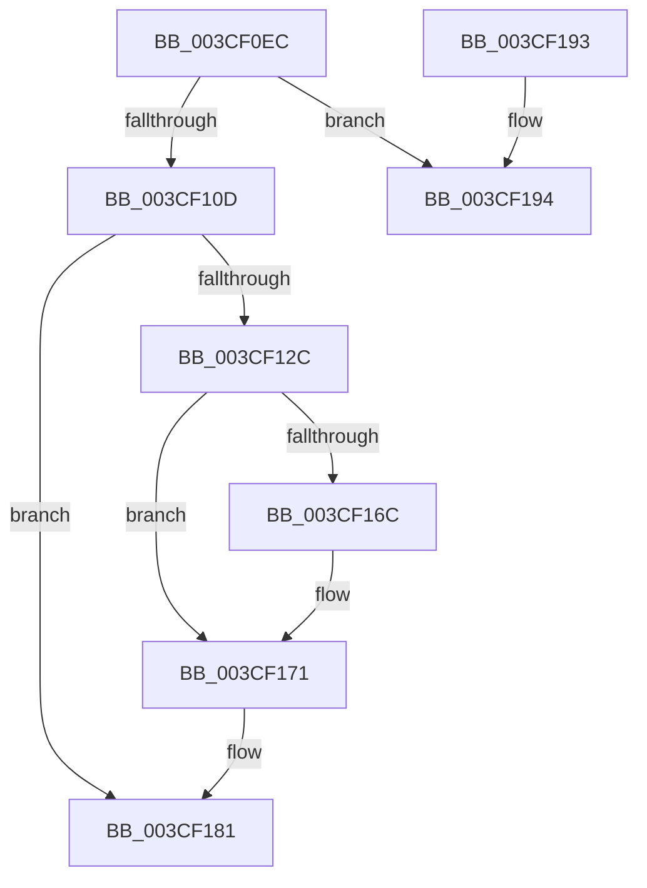

# CcInitializeQuickLWSThreadItem

- RVA: `0x003CF0EC`–`0x003CF1B2` (길이 `198` bytes)
- VA: `0x00000001403CF0EC`
- 실행 섹션: `.text`
- PDB 이름 있음: `예`; PDB Function 태그: `아니요`
- unwind 정보 RVA: `0x0008FB4C`
- 디코드: `53`개 명령, `198/198` bytes 표시
- 미해석 바이트: `0` (있으면 어셈블리에 `.byte`로 보존)

> 이 문서는 커널 이미지의 기계어와 PDB 기호를 분석해 생성했습니다. 4번과 5번은 함수 원형과 자료형을 바이너리 사용 방식에서 추정한 C 해석이며 원본 소스 복구 결과는 아닙니다.

## 1. Dependencies

- 직접 호출 지점: **2**; 고유 호출 대상: **2**
- 직접 호출자로 확인된 함수: **1**
- RIP 상대 이미지 참조: **1**

### Outgoing calls
- `0x003CF11F` → [ExAllocatePoolWithTagFromNode](../35/ExAllocatePoolWithTagFromNode_function_0035A944.md) (function, `0x0035A944`)
- `0x003CF1AC` → [KeBugCheckEx](../4F/KeBugCheckEx_function_004FD660.md) (function, `0x004FD660`)

### Direct callers
- [CcInitializePrivateVolumeCacheMap](CcInitializePrivateVolumeCacheMap_function_003CE088.md) at `0x003CE5E7`

### Static image references
- `0x003CF13F` → RVA `0x004BFEE0` (`CcQuickLazyWriteScanForVolume`; read)

## 2. Other-region calls and transfers

- 다른 실행 섹션으로 향하는 call: **0**
- 별도 외부 분기/꼬리 이동을 확인하지 못했습니다.

## 3. Assembly (complete function range)

```asm
003CF0EC  48 89 5C 24 08                  mov qword ptr [rsp + 8], rbx
003CF0F1  48 89 74 24 10                  mov qword ptr [rsp + 0x10], rsi
003CF0F6  57                              push rdi
003CF0F7  48 83 EC 30                     sub rsp, 0x30
003CF0FB  48 8B 71 40                     mov rsi, qword ptr [rcx + 0x40]
003CF0FF  33 DB                           xor ebx, ebx
003CF101  48 8B F9                        mov rdi, rcx
003CF104  48 85 F6                        test rsi, rsi
003CF107  0F 84 87 00 00 00               je 0x1403cf194
003CF10D  44 8B 4E 18                     mov r9d, dword ptr [rsi + 0x18]
003CF111  8D 53 50                        lea edx, [rbx + 0x50]
003CF114  41 0F BA E9 1F                  bts r9d, 0x1f
003CF119  41 B8 43 63 57 71               mov r8d, 0x71576343
003CF11F  E8 20 B8 F8 FF                  call 0x14035a944
003CF124  48 8B D0                        mov rdx, rax
003CF127  48 85 C0                        test rax, rax
003CF12A  74 55                           je 0x1403cf181
003CF12C  C7 40 20 06 00 00 00            mov dword ptr [rax + 0x20], 6
003CF133  48 8B 47 20                     mov rax, qword ptr [rdi + 0x20]
003CF137  83 4A 24 FF                     or dword ptr [rdx + 0x24], 0xffffffff
003CF13B  48 89 42 38                     mov qword ptr [rdx + 0x38], rax
003CF13F  48 8D 05 9A 0D 0F 00            lea rax, [rip + 0xf0d9a]
003CF146  48 89 7A 40                     mov qword ptr [rdx + 0x40], rdi
003CF14A  48 89 72 48                     mov qword ptr [rdx + 0x48], rsi
003CF14E  89 5A 28                        mov dword ptr [rdx + 0x28], ebx
003CF151  48 89 42 10                     mov qword ptr [rdx + 0x10], rax
003CF155  48 8D 87 18 06 00 00            lea rax, [rdi + 0x618]
003CF15C  48 89 52 18                     mov qword ptr [rdx + 0x18], rdx
003CF160  48 89 1A                        mov qword ptr [rdx], rbx
003CF163  48 8B 48 08                     mov rcx, qword ptr [rax + 8]
003CF167  48 39 01                        cmp qword ptr [rcx], rax
003CF16A  74 05                           je 0x1403cf171
003CF16C  8D 4B 03                        lea ecx, [rbx + 3]
003CF16F  CD 29                           int 0x29
003CF171  48 89 02                        mov qword ptr [rdx], rax
003CF174  B3 01                           mov bl, 1
003CF176  48 89 4A 08                     mov qword ptr [rdx + 8], rcx
003CF17A  48 89 11                        mov qword ptr [rcx], rdx
003CF17D  48 89 50 08                     mov qword ptr [rax + 8], rdx
003CF181  48 8B 74 24 48                  mov rsi, qword ptr [rsp + 0x48]
003CF186  8A C3                           mov al, bl
003CF188  48 8B 5C 24 40                  mov rbx, qword ptr [rsp + 0x40]
003CF18D  48 83 C4 30                     add rsp, 0x30
003CF191  5F                              pop rdi
003CF192  C3                              ret
003CF193  CC                              int3
003CF194  45 33 C9                        xor r9d, r9d
003CF197  48 89 5C 24 20                  mov qword ptr [rsp + 0x20], rbx
003CF19C  BA 42 0E 00 00                  mov edx, 0xe42
003CF1A1  49 C7 C0 20 04 00 C0            mov r8, 0xffffffffc0000420
003CF1A8  41 8D 49 34                     lea ecx, [r9 + 0x34]
003CF1AC  E8 AF E4 12 00                  call 0x1404fd660
003CF1B1  CC                              int3
```

## 4. C-style interpretation (structured pseudocode)

```c
__int64 __fastcall CcInitializeQuickLWSThreadItem(__int64 a1)
{
    __int64 result;
    __int64 v_rbx;
    __int64 v_rsp;
    unsigned __int64 v_stack_p10;
    unsigned __int64 v_stack_p20;
    unsigned __int64 v_stack_p8;

    v_stack_p8 = v_rbx;
    v_stack_p10 = v_rsi;
    v_rsp = (v_rsp) - (48);
    v_rbx = 0;
    if (*(unsigned __int64 *)(a1 + 64) == 0) goto loc_003CF194;
    result = ExAllocatePoolWithTagFromNode(a1, v_rbx + 80, (unsigned int)(0x71576343ULL), (unsigned int)(*(unsigned int *)(*(unsigned __int64 *)(a1 + 64) + 24)));
    if (result == 0) goto loc_003CF181;
    *(unsigned int *)(result + 32) = 6;
    *(unsigned __int64 *)(result + 56) = *(unsigned __int64 *)(a1 + 32);
    *(unsigned __int64 *)(result + 64) = a1;
    *(unsigned __int64 *)(result + 72) = *(unsigned __int64 *)(a1 + 64);
    *(unsigned int *)(result + 40) = 0;
    *(unsigned __int64 *)(result + 16) = v_rip + 986522;
    *(unsigned __int64 *)(result + 24) = result;
    *(unsigned __int64 *)(result) = 0;
    if ((*(unsigned __int64 *)(*(unsigned __int64 *)(a1 + 1560 + 8))) != (a1 + 1560)) {
        a1 = v_rbx + 3;
    }
    *(unsigned __int64 *)(result) = a1 + 1560;
    *(unsigned __int64 *)(result + 8) = a1;
    *(unsigned __int64 *)(a1) = result;
    *(unsigned __int64 *)(a1 + 1560 + 8) = result;
loc_003CF181:
    v_rsp = (v_rsp) + (48);
    return 1;
loc_003CF194:
    a4 = 0;
    v_stack_p20 = v_stack_p8;
    result = KeBugCheckEx(a4 + 52, (unsigned int)(0xE42ULL), 0xFFFFFFFFC0000420ULL, a4);
    return result;
}
```

## 5. (Beta) C Style

```c
int64_t CcInitializeQuickLWSThreadItem(void *Arg1)
{
    uint8_t *arg1 = (uint8_t *)Arg1;

    int64_t result;
    int64_t local_rbx;
    int64_t local_rsp;
    uint64_t v_stack_p10;
    uint64_t v_stack_p20;
    uint64_t v_stack_p8;

    v_stack_p8 = local_rbx;
    v_stack_p10 = local_rsi;
    local_rsp = (local_rsp) - (48);
    local_rbx = 0;
    if (*(uint64_t *)(arg1 + 0x40) == 0) goto loc_003CF194;
    result = ExAllocatePoolWithTagFromNode(Arg1, local_rbx + 80, (uint32_t)(0x71576343ULL), (uint32_t)(*(uint32_t *)(*(uint64_t *)(arg1 + 0x40) + 0x18)));
    if (result == 0) goto loc_003CF181;
    *(uint32_t *)(result + 0x20) = 6;
    *(uint64_t *)(result + 0x38) = *(uint64_t *)(arg1 + 0x20);
    *(void **)(result + 0x40) = Arg1;
    *(uint64_t *)(result + 0x48) = *(uint64_t *)(arg1 + 0x40);
    *(uint32_t *)(result + 0x28) = 0;
    *(uint64_t *)(result + 0x10) = v_rip + 986522;
    *(uint64_t *)(result + 0x18) = result;
    *(uint64_t *)(result) = 0;
    if ((*(uint64_t *)(*(uint64_t *)(arg1 + 0x618 + 0x8))) != (Arg1 + 1560)) {
        Arg1 = local_rbx + 3;
    }
    *(void **)(result) = Arg1 + 1560;
    *(void **)(result + 0x8) = Arg1;
    *(uint64_t *)(arg1) = result;
    *(uint64_t *)(arg1 + 0x618 + 0x8) = result;
loc_003CF181:
    local_rsp = (local_rsp) + (48);
    return 1;
loc_003CF194:
    a4 = 0;
    v_stack_p20 = v_stack_p8;
    result = KeBugCheckEx(a4 + 52, (uint32_t)(0xE42ULL), 0xFFFFFFFFC0000420ULL, a4);
    return result;
}
```

### 관측된 메모리 오프셋

구조체 형식이 확인되지 않은 접근은 인자 기준의 오프셋으로만 기록했습니다.

| 기준 인자 | 오프셋 표현 | 폭 (bit) | 접근 |
|---|---:|---:|---|
| `Arg1` | `+ 0x8` | `64` | `R` |
| `Arg1` | `+ 0x8` | `64` | `W` |
| `Arg1` | `+ 0x20` | `64` | `R` |
| `Arg1` | `+ 0x40` | `64` | `R` |
| `Arg1` | `+ 0x618` | `64` | `R` |

## 6. Execution-region graph

[열기: 2D/3D 그래프와 함수 탐색 컨트롤 패널](../../../control-panel.html?section=text&rva=0x003CF0EC&view=graph)

- 2D 그래프는 위에서 아래로 흐르고, 3D 그래프는 빈 공간을 드래그해 회전합니다. Shift+드래그는 이동, 휠은 확대·축소, 함수 노드 선택은 대상 보고서 이동입니다.

### Static fallback


