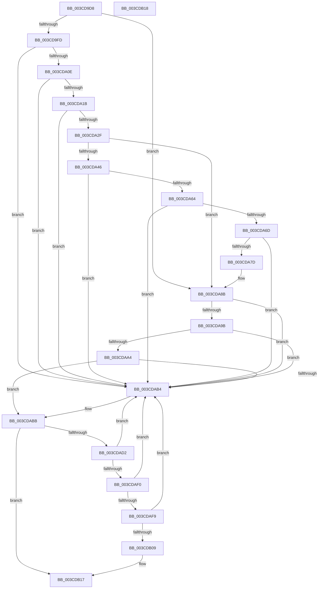

# CcInsertIntoDirtySharedCacheMapList

- RVA: `0x003CD9D8`–`0x003CDB19` (길이 `321` bytes)
- VA: `0x00000001403CD9D8`
- 실행 섹션: `.text`
- PDB 이름 있음: `예`; PDB Function 태그: `아니요`
- unwind 정보 RVA: `0x000DB714`
- 디코드: `81`개 명령, `321/321` bytes 표시
- 미해석 바이트: `0` (있으면 어셈블리에 `.byte`로 보존)

> 이 문서는 커널 이미지의 기계어와 PDB 기호를 분석해 생성했습니다. 4번과 5번은 함수 원형과 자료형을 바이너리 사용 방식에서 추정한 C 해석이며 원본 소스 복구 결과는 아닙니다.

## 1. Dependencies

- 직접 호출 지점: **0**; 고유 호출 대상: **0**
- 직접 호출자로 확인된 함수: **8**
- RIP 상대 이미지 참조: **1**

### Outgoing calls
- 직접 디코드된 call 명령이 없습니다.

### Direct callers
- [CcWriteBehindPostProcess](../35/CcWriteBehindPostProcess_function_00357BB4.md) at `0x00357EE0`
- [CcSetDirtyPinnedData](../35/CcSetDirtyPinnedData_function_0035A120.md) at `0x0035A356`
- [sub_0035A838](../35/Unknown_function_0035A838.md) at `0x0035A88A`
- [sub_0035A838](../35/Unknown_function_0035A838.md) at `0x0035A929`
- [CcDecrementOpenCount](../38/CcDecrementOpenCount_function_0038B75C.md) at `0x0038B7CE`
- [CcDecrementOpenCount](../38/CcDecrementOpenCount_function_0038B75C.md) at `0x0038B7FB`
- [CcSetDirtyInMask](CcSetDirtyInMask_function_003CB688.md) at `0x003CBA57`
- [CcUninitializeCacheMap](CcUninitializeCacheMap_function_003CD520.md) at `0x003CD770`
- [sub_006E2B2A](../6E/Unknown_function_006E2B2A.md) at `0x006E2B93`
- [sub_006E85B0](../6E/Unknown_function_006E85B0.md) at `0x006E85B3`

### Static image references
- `0x003CDA2F` → RVA `0x00E65B88` (`.data`; read)

## 2. Other-region calls and transfers

- 다른 실행 섹션으로 향하는 call: **0**
- 별도 외부 분기/꼬리 이동을 확인하지 못했습니다.

## 3. Assembly (complete function range)

```asm
003CD9D8  F7 81 98 00 00 00 00 00 00 03   test dword ptr [rcx + 0x98], 0x3000000
003CD9E2  48 8B 81 18 02 00 00            mov rax, qword ptr [rcx + 0x218]
003CD9E9  4C 8D 80 B8 02 00 00            lea r8, [rax + 0x2b8]
003CD9F0  48 8D 90 D0 02 00 00            lea rdx, [rax + 0x2d0]
003CD9F7  0F 84 8E 00 00 00               je 0x1403cda8b
003CD9FD  48 8D 41 78                     lea rax, [rcx + 0x78]
003CDA01  4C 8B 08                        mov r9, qword ptr [rax]
003CDA04  49 39 41 08                     cmp qword ptr [r9 + 8], rax
003CDA08  0F 85 A6 00 00 00               jne 0x1403cdab4
003CDA0E  4C 8B 50 08                     mov r10, qword ptr [rax + 8]
003CDA12  49 39 02                        cmp qword ptr [r10], rax
003CDA15  0F 85 99 00 00 00               jne 0x1403cdab4
003CDA1B  4D 89 0A                        mov qword ptr [r10], r9
003CDA1E  4D 89 51 08                     mov qword ptr [r9 + 8], r10
003CDA22  4C 8B 4A 08                     mov r9, qword ptr [rdx + 8]
003CDA26  49 39 11                        cmp qword ptr [r9], rdx
003CDA29  0F 85 85 00 00 00               jne 0x1403cdab4
003CDA2F  80 3D 52 81 A9 00 00            cmp byte ptr [rip + 0xa98152], 0
003CDA36  48 89 10                        mov qword ptr [rax], rdx
003CDA39  4C 89 48 08                     mov qword ptr [rax + 8], r9
003CDA3D  49 89 01                        mov qword ptr [r9], rax
003CDA40  48 89 42 08                     mov qword ptr [rdx + 8], rax
003CDA44  74 45                           je 0x1403cda8b
003CDA46  48 8B 91 58 02 00 00            mov rdx, qword ptr [rcx + 0x258]
003CDA4D  48 8D 81 48 02 00 00            lea rax, [rcx + 0x248]
003CDA54  4C 8B 10                        mov r10, qword ptr [rax]
003CDA57  48 81 C2 B0 02 00 00            add rdx, 0x2b0
003CDA5E  49 39 42 08                     cmp qword ptr [r10 + 8], rax
003CDA62  75 50                           jne 0x1403cdab4
003CDA64  4C 8B 48 08                     mov r9, qword ptr [rax + 8]
003CDA68  49 39 01                        cmp qword ptr [r9], rax
003CDA6B  75 47                           jne 0x1403cdab4
003CDA6D  4D 89 11                        mov qword ptr [r9], r10
003CDA70  4D 89 4A 08                     mov qword ptr [r10 + 8], r9
003CDA74  4C 8B 4A 08                     mov r9, qword ptr [rdx + 8]
003CDA78  49 39 11                        cmp qword ptr [r9], rdx
003CDA7B  75 37                           jne 0x1403cdab4
003CDA7D  48 89 10                        mov qword ptr [rax], rdx
003CDA80  4C 89 48 08                     mov qword ptr [rax + 8], r9
003CDA84  49 89 01                        mov qword ptr [r9], rax
003CDA87  48 89 42 08                     mov qword ptr [rdx + 8], rax
003CDA8B  48 8D 81 88 00 00 00            lea rax, [rcx + 0x88]
003CDA92  48 8B 10                        mov rdx, qword ptr [rax]
003CDA95  48 39 42 08                     cmp qword ptr [rdx + 8], rax
003CDA99  75 19                           jne 0x1403cdab4
003CDA9B  4C 8B 48 08                     mov r9, qword ptr [rax + 8]
003CDA9F  49 39 01                        cmp qword ptr [r9], rax
003CDAA2  75 10                           jne 0x1403cdab4
003CDAA4  49 89 11                        mov qword ptr [r9], rdx
003CDAA7  4C 89 4A 08                     mov qword ptr [rdx + 8], r9
003CDAAB  49 8B 50 08                     mov rdx, qword ptr [r8 + 8]
003CDAAF  4C 39 02                        cmp qword ptr [rdx], r8
003CDAB2  74 07                           je 0x1403cdabb
003CDAB4  B9 03 00 00 00                  mov ecx, 3
003CDAB9  CD 29                           int 0x29
003CDABB  80 3D C6 80 A9 00 00            cmp byte ptr [rip + 0xa980c6], 0
003CDAC2  4C 89 00                        mov qword ptr [rax], r8
003CDAC5  48 89 50 08                     mov qword ptr [rax + 8], rdx
003CDAC9  48 89 02                        mov qword ptr [rdx], rax
003CDACC  49 89 40 08                     mov qword ptr [r8 + 8], rax
003CDAD0  74 45                           je 0x1403cdb17
003CDAD2  48 8B 91 58 02 00 00            mov rdx, qword ptr [rcx + 0x258]
003CDAD9  48 8D 81 38 02 00 00            lea rax, [rcx + 0x238]
003CDAE0  4C 8B 00                        mov r8, qword ptr [rax]
003CDAE3  48 81 C2 98 02 00 00            add rdx, 0x298
003CDAEA  49 39 40 08                     cmp qword ptr [r8 + 8], rax
003CDAEE  75 C4                           jne 0x1403cdab4
003CDAF0  48 8B 48 08                     mov rcx, qword ptr [rax + 8]
003CDAF4  48 39 01                        cmp qword ptr [rcx], rax
003CDAF7  75 BB                           jne 0x1403cdab4
003CDAF9  4C 89 01                        mov qword ptr [rcx], r8
003CDAFC  49 89 48 08                     mov qword ptr [r8 + 8], rcx
003CDB00  48 8B 4A 08                     mov rcx, qword ptr [rdx + 8]
003CDB04  48 39 11                        cmp qword ptr [rcx], rdx
003CDB07  75 AB                           jne 0x1403cdab4
003CDB09  48 89 10                        mov qword ptr [rax], rdx
003CDB0C  48 89 48 08                     mov qword ptr [rax + 8], rcx
003CDB10  48 89 01                        mov qword ptr [rcx], rax
003CDB13  48 89 42 08                     mov qword ptr [rdx + 8], rax
003CDB17  C3                              ret
003CDB18  CC                              int3
```

## 4. C-style interpretation (structured pseudocode)

```c
__int64 __fastcall CcInsertIntoDirtySharedCacheMapList(__int64 a1)
{
    if (((*(unsigned int *)(a1 + 152)) & (0x3000000ULL)) == 0) goto loc_003CDA8B;
    if ((*(unsigned __int64 *)(*(unsigned __int64 *)(a1 + 120) + 8)) != (a1 + 120)) goto loc_003CDAB4;
    if ((*(unsigned __int64 *)(*(unsigned __int64 *)(a1 + 120 + 8))) != (a1 + 120)) goto loc_003CDAB4;
    *(unsigned __int64 *)(*(unsigned __int64 *)(a1 + 120 + 8)) = *(unsigned __int64 *)(a1 + 120);
    *(unsigned __int64 *)(*(unsigned __int64 *)(a1 + 120) + 8) = *(unsigned __int64 *)(a1 + 120 + 8);
    if ((*(unsigned __int64 *)(*(unsigned __int64 *)(*(unsigned __int64 *)(a1 + 536) + 720 + 8))) != (*(unsigned __int64 *)(a1 + 536) + 720)) goto loc_003CDAB4;
    *(unsigned __int64 *)(a1 + 120) = *(unsigned __int64 *)(a1 + 536) + 720;
    *(unsigned __int64 *)(a1 + 120 + 8) = *(unsigned __int64 *)(*(unsigned __int64 *)(a1 + 536) + 720 + 8);
    *(unsigned __int64 *)(*(unsigned __int64 *)(*(unsigned __int64 *)(a1 + 536) + 720 + 8)) = a1 + 120;
    *(unsigned __int64 *)(*(unsigned __int64 *)(a1 + 536) + 720 + 8) = a1 + 120;
    if ((*(unsigned __int8 *)(v_rip + 11108690)) == 0) goto loc_003CDA8B;
    a2 = (*(unsigned __int64 *)(a1 + 600)) + (688);
    if ((*(unsigned __int64 *)(*(unsigned __int64 *)(a1 + 584) + 8)) != (a1 + 584)) goto loc_003CDAB4;
    if ((*(unsigned __int64 *)(*(unsigned __int64 *)(a1 + 584 + 8))) != (a1 + 584)) goto loc_003CDAB4;
    *(unsigned __int64 *)(*(unsigned __int64 *)(a1 + 584 + 8)) = *(unsigned __int64 *)(a1 + 584);
    *(unsigned __int64 *)(*(unsigned __int64 *)(a1 + 584) + 8) = *(unsigned __int64 *)(a1 + 584 + 8);
    if ((*(unsigned __int64 *)(*(unsigned __int64 *)(a2 + 8))) != a2) goto loc_003CDAB4;
    *(unsigned __int64 *)(a1 + 584) = a2;
    *(unsigned __int64 *)(a1 + 584 + 8) = *(unsigned __int64 *)(a2 + 8);
    *(unsigned __int64 *)(*(unsigned __int64 *)(a2 + 8)) = a1 + 584;
    *(unsigned __int64 *)(a2 + 8) = a1 + 584;
loc_003CDA8B:
    if ((*(unsigned __int64 *)(*(unsigned __int64 *)(a1 + 136) + 8)) != (a1 + 136)) goto loc_003CDAB4;
    if ((*(unsigned __int64 *)(*(unsigned __int64 *)(a1 + 136 + 8))) != (a1 + 136)) goto loc_003CDAB4;
    *(unsigned __int64 *)(*(unsigned __int64 *)(a1 + 136 + 8)) = *(unsigned __int64 *)(a1 + 136);
    *(unsigned __int64 *)(*(unsigned __int64 *)(a1 + 136) + 8) = *(unsigned __int64 *)(a1 + 136 + 8);
    if ((*(unsigned __int64 *)(*(unsigned __int64 *)(*(unsigned __int64 *)(a1 + 536) + 696 + 8))) != (*(unsigned __int64 *)(a1 + 536) + 696)) {
        a1 = 3;
    }
    *(unsigned __int64 *)(a1 + 136) = *(unsigned __int64 *)(a1 + 536) + 696;
    *(unsigned __int64 *)(a1 + 136 + 8) = *(unsigned __int64 *)(*(unsigned __int64 *)(a1 + 536) + 696 + 8);
    *(unsigned __int64 *)(*(unsigned __int64 *)(*(unsigned __int64 *)(a1 + 536) + 696 + 8)) = a1 + 136;
    *(unsigned __int64 *)(*(unsigned __int64 *)(a1 + 536) + 696 + 8) = a1 + 136;
    if ((*(unsigned __int8 *)(v_rip + 11108550)) == 0) goto loc_003CDB17;
    a2 = (*(unsigned __int64 *)(a1 + 600)) + (664);
    if ((*(unsigned __int64 *)(*(unsigned __int64 *)(a1 + 568) + 8)) != (a1 + 568)) goto loc_003CDAB4;
    if ((*(unsigned __int64 *)(*(unsigned __int64 *)(a1 + 568 + 8))) != (a1 + 568)) goto loc_003CDAB4;
    *(unsigned __int64 *)(*(unsigned __int64 *)(a1 + 568 + 8)) = *(unsigned __int64 *)(a1 + 568);
    *(unsigned __int64 *)(*(unsigned __int64 *)(a1 + 568) + 8) = *(unsigned __int64 *)(a1 + 568 + 8);
    if ((*(unsigned __int64 *)(*(unsigned __int64 *)(a2 + 8))) != a2) goto loc_003CDAB4;
    *(unsigned __int64 *)(a1 + 568) = a2;
    *(unsigned __int64 *)(a1 + 568 + 8) = *(unsigned __int64 *)(a2 + 8);
    *(unsigned __int64 *)(*(unsigned __int64 *)(a2 + 8)) = a1 + 568;
    *(unsigned __int64 *)(a2 + 8) = a1 + 568;
loc_003CDB17:
    return a1 + 568;
}
```

## 5. (Beta) C Style

```c
void *CcInsertIntoDirtySharedCacheMapList(void *Arg1)
{
    uint8_t *arg1 = (uint8_t *)Arg1;

    if (((*(uint32_t *)(arg1 + 0x98)) & (0x3000000ULL)) == 0) goto loc_003CDA8B;
    if ((*(uint64_t *)(*(uint64_t *)(arg1 + 0x78) + 0x8)) != (Arg1 + 120)) goto loc_003CDAB4;
    if ((*(uint64_t *)(*(uint64_t *)(arg1 + 0x78 + 0x8))) != (Arg1 + 120)) goto loc_003CDAB4;
    *(uint64_t *)(*(uint64_t *)(arg1 + 0x78 + 0x8)) = *(uint64_t *)(arg1 + 0x78);
    *(uint64_t *)(*(uint64_t *)(arg1 + 0x78) + 0x8) = *(uint64_t *)(arg1 + 0x78 + 0x8);
    if ((*(uint64_t *)(*(uint64_t *)(*(uint64_t *)(arg1 + 0x218) + 0x2D0 + 0x8))) != (*(uint64_t *)(arg1 + 0x218) + 720)) goto loc_003CDAB4;
    *(uint64_t *)(arg1 + 0x78) = *(uint64_t *)(arg1 + 0x218) + 720;
    *(uint64_t *)(arg1 + 0x78 + 0x8) = *(uint64_t *)(*(uint64_t *)(arg1 + 0x218) + 0x2D0 + 0x8);
    *(void **)(*(uint64_t *)(*(uint64_t *)(arg1 + 0x218) + 0x2D0 + 0x8)) = Arg1 + 120;
    *(void **)(*(uint64_t *)(arg1 + 0x218) + 0x2D0 + 0x8) = Arg1 + 120;
    if ((*(uint8_t *)(v_rip + 0xA98152)) == 0) goto loc_003CDA8B;
    a2 = (*(uint64_t *)(arg1 + 0x258)) + (688);
    if ((*(uint64_t *)(*(uint64_t *)(arg1 + 0x248) + 0x8)) != (Arg1 + 584)) goto loc_003CDAB4;
    if ((*(uint64_t *)(*(uint64_t *)(arg1 + 0x248 + 0x8))) != (Arg1 + 584)) goto loc_003CDAB4;
    *(uint64_t *)(*(uint64_t *)(arg1 + 0x248 + 0x8)) = *(uint64_t *)(arg1 + 0x248);
    *(uint64_t *)(*(uint64_t *)(arg1 + 0x248) + 0x8) = *(uint64_t *)(arg1 + 0x248 + 0x8);
    if ((*(uint64_t *)(*(uint64_t *)(a2 + 0x8))) != a2) goto loc_003CDAB4;
    *(uint64_t *)(arg1 + 0x248) = a2;
    *(uint64_t *)(arg1 + 0x248 + 0x8) = *(uint64_t *)(a2 + 0x8);
    *(void **)(*(uint64_t *)(a2 + 0x8)) = Arg1 + 584;
    *(void **)(a2 + 0x8) = Arg1 + 584;
loc_003CDA8B:
    if ((*(uint64_t *)(*(uint64_t *)(arg1 + 0x88) + 0x8)) != (Arg1 + 136)) goto loc_003CDAB4;
    if ((*(uint64_t *)(*(uint64_t *)(arg1 + 0x88 + 0x8))) != (Arg1 + 136)) goto loc_003CDAB4;
    *(uint64_t *)(*(uint64_t *)(arg1 + 0x88 + 0x8)) = *(uint64_t *)(arg1 + 0x88);
    *(uint64_t *)(*(uint64_t *)(arg1 + 0x88) + 0x8) = *(uint64_t *)(arg1 + 0x88 + 0x8);
    if ((*(uint64_t *)(*(uint64_t *)(*(uint64_t *)(arg1 + 0x218) + 0x2B8 + 0x8))) != (*(uint64_t *)(arg1 + 0x218) + 696)) {
        Arg1 = 3;
    }
    *(uint64_t *)(arg1 + 0x88) = *(uint64_t *)(arg1 + 0x218) + 696;
    *(uint64_t *)(arg1 + 0x88 + 0x8) = *(uint64_t *)(*(uint64_t *)(arg1 + 0x218) + 0x2B8 + 0x8);
    *(void **)(*(uint64_t *)(*(uint64_t *)(arg1 + 0x218) + 0x2B8 + 0x8)) = Arg1 + 136;
    *(void **)(*(uint64_t *)(arg1 + 0x218) + 0x2B8 + 0x8) = Arg1 + 136;
    if ((*(uint8_t *)(v_rip + 0xA980C6)) == 0) goto loc_003CDB17;
    a2 = (*(uint64_t *)(arg1 + 0x258)) + (664);
    if ((*(uint64_t *)(*(uint64_t *)(arg1 + 0x238) + 0x8)) != (Arg1 + 568)) goto loc_003CDAB4;
    if ((*(uint64_t *)(*(uint64_t *)(arg1 + 0x238 + 0x8))) != (Arg1 + 568)) goto loc_003CDAB4;
    *(uint64_t *)(*(uint64_t *)(arg1 + 0x238 + 0x8)) = *(uint64_t *)(arg1 + 0x238);
    *(uint64_t *)(*(uint64_t *)(arg1 + 0x238) + 0x8) = *(uint64_t *)(arg1 + 0x238 + 0x8);
    if ((*(uint64_t *)(*(uint64_t *)(a2 + 0x8))) != a2) goto loc_003CDAB4;
    *(uint64_t *)(arg1 + 0x238) = a2;
    *(uint64_t *)(arg1 + 0x238 + 0x8) = *(uint64_t *)(a2 + 0x8);
    *(void **)(*(uint64_t *)(a2 + 0x8)) = Arg1 + 568;
    *(void **)(a2 + 0x8) = Arg1 + 568;
loc_003CDB17:
    return Arg1 + 568;
}
```

### 관측된 메모리 오프셋

구조체 형식이 확인되지 않은 접근은 인자 기준의 오프셋으로만 기록했습니다.

| 기준 인자 | 오프셋 표현 | 폭 (bit) | 접근 |
|---|---:|---:|---|
| `Arg1` | `+ 0x0` | `64` | `R` |
| `Arg1` | `+ 0x0` | `64` | `W` |
| `Arg1` | `+ 0x8` | `64` | `R` |
| `Arg1` | `+ 0x8` | `64` | `W` |
| `Arg1` | `+ 0x78` | `64` | `R` |
| `Arg1` | `+ 0x88` | `64` | `R` |
| `Arg1` | `+ 0x98` | `32` | `R` |
| `Arg1` | `+ 0x218` | `64` | `R` |
| `Arg1` | `+ 0x248` | `64` | `R` |
| `Arg1` | `+ 0x258` | `64` | `R` |

## 6. Execution-region graph

[열기: 2D/3D 그래프와 함수 탐색 컨트롤 패널](../../../control-panel.html?section=text&rva=0x003CD9D8&view=graph)

- 2D 그래프는 위에서 아래로 흐르고, 3D 그래프는 빈 공간을 드래그해 회전합니다. Shift+드래그는 이동, 휠은 확대·축소, 함수 노드 선택은 대상 보고서 이동입니다.

### Static fallback


