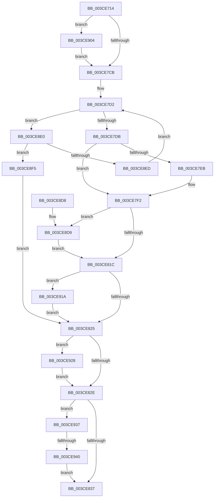

# CcInsertPrivateVolumeCacheMap

- RVA: `0x003CE714`–`0x003CE94A` (길이 `566` bytes)
- VA: `0x00000001403CE714`
- 실행 섹션: `.text`
- PDB 이름 있음: `예`; PDB Function 태그: `예`
- unwind 정보 RVA: `0x0008FAC4`
- 디코드: `128`개 명령, `566/566` bytes 표시
- 미해석 바이트: `0` (있으면 어셈블리에 `.byte`로 보존)

> 이 문서는 커널 이미지의 기계어와 PDB 기호를 분석해 생성했습니다. 4번과 5번은 함수 원형과 자료형을 바이너리 사용 방식에서 추정한 C 해석이며 원본 소스 복구 결과는 아닙니다.

## 1. Dependencies

- 직접 호출 지점: **5**; 고유 호출 대상: **4**
- 직접 호출자로 확인된 함수: **2**
- RIP 상대 이미지 참조: **4**

### Outgoing calls
- `0x003CE7BD` → [DbgPrintEx](../35/DbgPrintEx_function_00359290.md) (function, `0x00359290`)
- `0x003CE8AE` → [DbgPrintEx](../35/DbgPrintEx_function_00359290.md) (function, `0x00359290`)
- `0x003CE910` → [KeAcquireInStackQueuedSpinLock](../27/KeAcquireInStackQueuedSpinLock_function_002757A0.md) (function, `0x002757A0`)
- `0x003CE91E` → [KeResetEvent](../24/KeResetEvent_function_00248350.md) (function, `0x00248350`)
- `0x003CE92D` → [KeReleaseInStackQueuedSpinLock](../34/KeReleaseInStackQueuedSpinLock_function_00342CE0.md) (function, `0x00342CE0`)

### Direct callers
- [CcCreatePrivateVolumeCacheMap](CcCreatePrivateVolumeCacheMap_function_003CDB20.md) at `0x003CDC00`
- [sub_006E8934](../6E/Unknown_function_006E8934.md) at `0x006E8973`

### Static image references
- `0x003CE772` → RVA `0x006C8A00` (` ?? ::FNODOBFM::`string'`; read)
- `0x003CE840` → RVA `0x006C8920` (` ?? ::FNODOBFM::`string'`; read)
- `0x003CE850` → RVA `0x006C89A0` (` ?? ::FNODOBFM::`string'`; read)
- `0x003CE8A7` → RVA `0x006C8BD0` (` ?? ::FNODOBFM::`string'`; read)

## 2. Other-region calls and transfers

- 다른 실행 섹션으로 향하는 call: **0**
- call이 아닌 외부 분기/꼬리 이동: **1**
  - `0x003CE93A` → [sub_006E8986](../6E/Unknown_function_006E8986.md) (`tail-transfer`)

## 3. Assembly (complete function range)

```asm
003CE714  4C 8B DC                        mov r11, rsp
003CE717  49 89 5B 08                     mov qword ptr [r11 + 8], rbx
003CE71B  49 89 6B 10                     mov qword ptr [r11 + 0x10], rbp
003CE71F  49 89 73 18                     mov qword ptr [r11 + 0x18], rsi
003CE723  49 89 7B 20                     mov qword ptr [r11 + 0x20], rdi
003CE727  41 54                           push r12
003CE729  41 56                           push r14
003CE72B  41 57                           push r15
003CE72D  48 81 EC 90 00 00 00            sub rsp, 0x90
003CE734  4C 8B 7A 10                     mov r15, qword ptr [rdx + 0x10]
003CE738  33 C0                           xor eax, eax
003CE73A  49 21 00                        and qword ptr [r8], rax
003CE73D  48 8B F1                        mov rsi, rcx
003CE740  4C 8B A4 24 D8 00 00 00         mov r12, qword ptr [rsp + 0xd8]
003CE748  45 8A F1                        mov r14b, r9b
003CE74B  0F 57 C0                        xorps xmm0, xmm0
003CE74E  0F 57 C9                        xorps xmm1, xmm1
003CE751  0F 11 44 24 60                  movups xmmword ptr [rsp + 0x60], xmm0
003CE756  49 89 43 C8                     mov qword ptr [r11 - 0x38], rax
003CE75A  48 8B FA                        mov rdi, rdx
003CE75D  0F 11 4C 24 78                  movups xmmword ptr [rsp + 0x78], xmm1
003CE762  49 89 43 E0                     mov qword ptr [r11 - 0x20], rax
003CE766  49 8B D8                        mov rbx, r8
003CE769  65 48 8B 0C 25 88 01 00 00      mov rcx, qword ptr gs:[0x188]
003CE772  4C 8D 05 87 A2 2F 00            lea r8, [rip + 0x2fa287]
003CE779  65 4C 8B 0C 25 88 01 00 00      mov r9, qword ptr gs:[0x188]
003CE782  40 32 ED                        xor bpl, bpl
003CE785  41 88 04 24                     mov byte ptr [r12], al
003CE789  8B 42 18                        mov eax, dword ptr [rdx + 0x18]
003CE78C  89 44 24 48                     mov dword ptr [rsp + 0x48], eax
003CE790  45 8B 89 08 05 00 00            mov r9d, dword ptr [r9 + 0x508]
003CE797  49 89 53 98                     mov qword ptr [r11 - 0x68], rdx
003CE79B  4D 89 7B 90                     mov qword ptr [r11 - 0x70], r15
003CE79F  89 44 24 30                     mov dword ptr [rsp + 0x30], eax
003CE7A3  48 8B 42 28                     mov rax, qword ptr [rdx + 0x28]
003CE7A7  BA 02 00 00 00                  mov edx, 2
003CE7AC  49 89 43 80                     mov qword ptr [r11 - 0x80], rax
003CE7B0  8B 81 10 05 00 00               mov eax, dword ptr [rcx + 0x510]
003CE7B6  89 44 24 20                     mov dword ptr [rsp + 0x20], eax
003CE7BA  8D 4A 7D                        lea ecx, [rdx + 0x7d]
003CE7BD  E8 CE AA F8 FF                  call 0x140359290
003CE7C2  45 84 F6                        test r14b, r14b
003CE7C5  0F 84 39 01 00 00               je 0x1403ce904
003CE7CB  48 8D 46 20                     lea rax, [rsi + 0x20]
003CE7CF  48 8B 10                        mov rdx, qword ptr [rax]
003CE7D2  48 3B D0                        cmp rdx, rax
003CE7D5  0F 85 05 01 00 00               jne 0x1403ce8e0
003CE7DB  48 8B 50 08                     mov rdx, qword ptr [rax + 8]
003CE7DF  48 8D 8F 40 02 00 00            lea rcx, [rdi + 0x240]
003CE7E6  48 39 02                        cmp qword ptr [rdx], rax
003CE7E9  74 07                           je 0x1403ce7f2
003CE7EB  B9 03 00 00 00                  mov ecx, 3
003CE7F0  CD 29                           int 0x29
003CE7F2  80 BC 24 D0 00 00 00 00         cmp byte ptr [rsp + 0xd0], 0
003CE7FA  48 8D 5E 30                     lea rbx, [rsi + 0x30]
003CE7FE  48 89 01                        mov qword ptr [rcx], rax
003CE801  40 B5 01                        mov bpl, 1
003CE804  48 89 51 08                     mov qword ptr [rcx + 8], rdx
003CE808  48 89 0A                        mov qword ptr [rdx], rcx
003CE80B  48 89 48 08                     mov qword ptr [rax + 8], rcx
003CE80F  40 88 AF 95 04 00 00            mov byte ptr [rdi + 0x495], bpl
003CE816  0F 84 BD 00 00 00               je 0x1403ce8d9
003CE81C  83 3B 01                        cmp dword ptr [rbx], 1
003CE81F  0F 84 F5 00 00 00               je 0x1403ce91a
003CE825  45 84 F6                        test r14b, r14b
003CE828  0F 84 FA 00 00 00               je 0x1403ce928
003CE82E  40 84 ED                        test bpl, bpl
003CE831  0F 85 00 01 00 00               jne 0x1403ce937
003CE837  65 4C 8B 14 25 88 01 00 00      mov r10, qword ptr gs:[0x188]
003CE840  48 8D 0D D9 A0 2F 00            lea rcx, [rip + 0x2fa0d9]
003CE847  65 4C 8B 0C 25 88 01 00 00      mov r9, qword ptr gs:[0x188]
003CE850  48 8D 05 49 A1 2F 00            lea rax, [rip + 0x2fa149]
003CE857  44 8B 03                        mov r8d, dword ptr [rbx]
003CE85A  40 84 ED                        test bpl, bpl
003CE85D  44 8B 5F 18                     mov r11d, dword ptr [rdi + 0x18]
003CE861  BA 02 00 00 00                  mov edx, 2
003CE866  48 0F 44 C1                     cmove rax, rcx
003CE86A  45 8B 89 08 05 00 00            mov r9d, dword ptr [r9 + 0x508]
003CE871  48 89 44 24 58                  mov qword ptr [rsp + 0x58], rax
003CE876  44 89 44 24 50                  mov dword ptr [rsp + 0x50], r8d
003CE87B  8D 4A 7D                        lea ecx, [rdx + 0x7d]
003CE87E  4C 8B 47 28                     mov r8, qword ptr [rdi + 0x28]
003CE882  44 89 5C 24 48                  mov dword ptr [rsp + 0x48], r11d
003CE887  48 89 7C 24 40                  mov qword ptr [rsp + 0x40], rdi
003CE88C  4C 89 7C 24 38                  mov qword ptr [rsp + 0x38], r15
003CE891  44 89 5C 24 30                  mov dword ptr [rsp + 0x30], r11d
003CE896  4C 89 44 24 28                  mov qword ptr [rsp + 0x28], r8
003CE89B  45 8B 82 10 05 00 00            mov r8d, dword ptr [r10 + 0x510]
003CE8A2  44 89 44 24 20                  mov dword ptr [rsp + 0x20], r8d
003CE8A7  4C 8D 05 22 A3 2F 00            lea r8, [rip + 0x2fa322]
003CE8AE  E8 DD A9 F8 FF                  call 0x140359290
003CE8B3  4C 8D 9C 24 90 00 00 00         lea r11, [rsp + 0x90]
003CE8BB  40 8A C5                        mov al, bpl
003CE8BE  49 8B 5B 20                     mov rbx, qword ptr [r11 + 0x20]
003CE8C2  49 8B 6B 28                     mov rbp, qword ptr [r11 + 0x28]
003CE8C6  49 8B 73 30                     mov rsi, qword ptr [r11 + 0x30]
003CE8CA  49 8B 7B 38                     mov rdi, qword ptr [r11 + 0x38]
003CE8CE  49 8B E3                        mov rsp, r11
003CE8D1  41 5F                           pop r15
003CE8D3  41 5E                           pop r14
003CE8D5  41 5C                           pop r12
003CE8D7  C3                              ret
003CE8D8  CC                              int3
003CE8D9  FF 03                           inc dword ptr [rbx]
003CE8DB  E9 3C FF FF FF                  jmp 0x1403ce81c
003CE8E0  48 8D 8A C0 FD FF FF            lea rcx, [rdx - 0x240]
003CE8E7  4C 39 79 10                     cmp qword ptr [rcx + 0x10], r15
003CE8EB  74 08                           je 0x1403ce8f5
003CE8ED  48 8B 12                        mov rdx, qword ptr [rdx]
003CE8F0  E9 DD FE FF FF                  jmp 0x1403ce7d2
003CE8F5  FF 41 04                        inc dword ptr [rcx + 4]
003CE8F8  48 89 0B                        mov qword ptr [rbx], rcx
003CE8FB  48 8D 5E 30                     lea rbx, [rsi + 0x30]
003CE8FF  E9 21 FF FF FF                  jmp 0x1403ce825
003CE904  48 8D 8E 00 03 00 00            lea rcx, [rsi + 0x300]
003CE90B  48 8D 54 24 60                  lea rdx, [rsp + 0x60]
003CE910  E8 8B 6E EA FF                  call 0x1402757a0
003CE915  E9 B1 FE FF FF                  jmp 0x1403ce7cb
003CE91A  48 8D 4E 38                     lea rcx, [rsi + 0x38]
003CE91E  E8 2D 9A E7 FF                  call 0x140248350
003CE923  E9 FD FE FF FF                  jmp 0x1403ce825
003CE928  48 8D 4C 24 60                  lea rcx, [rsp + 0x60]
003CE92D  E8 AE 43 F7 FF                  call 0x140342ce0
003CE932  E9 F7 FE FF FF                  jmp 0x1403ce82e
003CE937  45 84 F6                        test r14b, r14b
003CE93A  0F 84 46 A0 31 00               je 0x1406e8986
003CE940  41 C6 04 24 01                  mov byte ptr [r12], 1
003CE945  E9 ED FE FF FF                  jmp 0x1403ce837
```

## 4. C-style interpretation (structured pseudocode)

```c
__int64 __fastcall CcInsertPrivateVolumeCacheMap(__int64 a1, __int64 a2, __int64 a3, unsigned __int8 a4, unsigned __int8 a5, __int64 a6)
{
    __int64 result;
    __int64 v_rbp;
    __int64 v_rsp;
    unsigned __int64 v_stack_m18;
    unsigned __int64 v_stack_m30;
    unsigned __int64 v_stack_m48;
    unsigned __int64 v_stack_m50;
    unsigned int v_stack_m58;
    unsigned int v_stack_m60;
    unsigned __int64 v_stack_m68;
    unsigned __int64 v_stack_m70;
    unsigned int v_stack_m78;
    unsigned __int64 v_stack_m80;
    unsigned int v_stack_m88;

    *(unsigned __int64 *)(v_rsp + 8) = v_rbx;
    *(unsigned __int64 *)(v_rsp + 16) = v_rbp;
    *(unsigned __int64 *)(v_rsp + 24) = v_rsi;
    *(unsigned __int64 *)(v_rsp + 32) = v_rdi;
    v_rsp = (v_rsp) - (144);
    result = 0;
    v_stack_m48 = v_xmm0;
    *(unsigned __int64 *)(v_rsp - 56) = 0;
    v_stack_m30 = v_xmm1;
    *(unsigned __int64 *)(v_rsp - 32) = 0;
    v_rbp = 0;
    *(unsigned __int8 *)(a6) = 0;
    v_stack_m60 = (unsigned int)((unsigned int)(*(unsigned int *)(a2 + 24)));
    *(unsigned __int64 *)(v_rsp - 104) = a2;
    *(unsigned __int64 *)(v_rsp - 112) = *(unsigned __int64 *)(a2 + 16);
    v_stack_m78 = (unsigned int)((unsigned int)(*(unsigned int *)(a2 + 24)));
    *(unsigned __int64 *)(v_rsp - 128) = *(unsigned __int64 *)(a2 + 40);
    v_stack_m88 = (unsigned int)((unsigned int)(*(unsigned int *)(*(unsigned __int64 *)(gs_base + (0 + 392)) + 1296)));
    result = DbgPrintEx(2 + 125, 2, v_rip + 3121799, (unsigned int)(*(unsigned int *)(*(unsigned __int64 *)(gs_base + (0 + 392)) + 1288)));
    if (a4 == 0) goto loc_003CE904;
loc_003CE7CB:
loc_003CE7D2:
    if ((*(unsigned __int64 *)(a1 + 32)) != (a1 + 32)) goto loc_003CE8E0;
    if ((*(unsigned __int64 *)(*(unsigned __int64 *)(a1 + 32 + 8))) != (a1 + 32)) {
        a1 = 3;
    }
    *(unsigned __int64 *)(a1) = a1 + 32;
    *(unsigned __int64 *)(a1 + 8) = *(unsigned __int64 *)(a1 + 32 + 8);
    *(unsigned __int64 *)(*(unsigned __int64 *)(a1 + 32 + 8)) = a1;
    *(unsigned __int64 *)(a1 + 32 + 8) = a1;
    *(unsigned __int8 *)(a2 + 1173) = 1;
    if (a5 == 0) goto loc_003CE8D9;
loc_003CE81C:
    if ((*(unsigned int *)(a1 + 48)) == 1) goto loc_003CE91A;
loc_003CE825:
    if (a4 == 0) goto loc_003CE928;
loc_003CE82E:
    if (1 != 0) goto loc_003CE937;
loc_003CE837:
    result = v_rip + 3121481;
    if (1 == 0) { result = v_rip + 3121369; }
    v_stack_m50 = result;
    v_stack_m58 = (unsigned int)((unsigned int)(*(unsigned int *)(a1 + 48)));
    v_stack_m60 = (unsigned int)((unsigned int)(*(unsigned int *)(a2 + 24)));
    v_stack_m68 = a2;
    v_stack_m70 = *(unsigned __int64 *)(a2 + 16);
    v_stack_m78 = (unsigned int)((unsigned int)(*(unsigned int *)(a2 + 24)));
    v_stack_m80 = *(unsigned __int64 *)(a2 + 40);
    v_stack_m88 = (unsigned int)((unsigned int)(*(unsigned int *)(*(unsigned __int64 *)(gs_base + (0 + 392)) + 1296)));
    result = DbgPrintEx(2 + 125, 2, v_rip + 3121954, (unsigned int)(*(unsigned int *)(*(unsigned __int64 *)(gs_base + (0 + 392)) + 1288)));
    return 1;
loc_003CE8D9:
    goto loc_003CE81C;
loc_003CE8E0:
    if ((*(unsigned __int64 *)(2 - 576 + 16)) == (*(unsigned __int64 *)(a2 + 16))) goto loc_003CE8F5;
    goto loc_003CE7D2;
loc_003CE8F5:
    *(unsigned __int64 *)(*(unsigned __int64 *)(v_stack_m18 + 32)) = 2 - 576;
    goto loc_003CE825;
loc_003CE904:
    result = KeAcquireInStackQueuedSpinLock(*(unsigned __int64 *)(v_stack_m18 + 48) + 768, v_stack_m30, v_rip + 3121954, (unsigned int)(*(unsigned int *)(*(unsigned __int64 *)(gs_base + (0 + 392)) + 1288)));
    goto loc_003CE7CB;
loc_003CE91A:
    result = KeResetEvent(*(unsigned __int64 *)(v_stack_m18 + 48) + 56, v_stack_m30, v_rip + 3121954, (unsigned int)(*(unsigned int *)(*(unsigned __int64 *)(gs_base + (0 + 392)) + 1288)));
    goto loc_003CE825;
loc_003CE928:
    result = KeReleaseInStackQueuedSpinLock(v_stack_m30, v_stack_m30, v_rip + 3121954, (unsigned int)(*(unsigned int *)(*(unsigned __int64 *)(gs_base + (0 + 392)) + 1288)));
    goto loc_003CE82E;
loc_003CE937:
    *(unsigned __int8 *)(a6) = 1;
    goto loc_003CE837;
}
```

## 5. (Beta) C Style

```c
int64_t CcInsertPrivateVolumeCacheMap(void *Arg1, void *Arg2, void *Arg3, uint8_t Arg4, uint8_t Arg5, void *Arg6)
{
    uint8_t *arg1 = (uint8_t *)Arg1;
    uint8_t *arg2 = (uint8_t *)Arg2;
    uint8_t *arg3 = (uint8_t *)Arg3;
    uint8_t *arg6 = (uint8_t *)Arg6;

    int64_t result;
    int64_t local_rbp;
    int64_t local_rsp;
    uint64_t v_stack_m18;
    uint64_t v_stack_m30;
    uint64_t v_stack_m48;
    uint64_t v_stack_m50;
    uint32_t v_stack_m58;
    uint32_t v_stack_m60;
    uint64_t v_stack_m68;
    uint64_t v_stack_m70;
    uint32_t v_stack_m78;
    uint64_t v_stack_m80;
    uint32_t v_stack_m88;

    *(uint64_t *)(local_rsp + 0x8) = local_rbx;
    *(uint64_t *)(local_rsp + 0x10) = local_rbp;
    *(uint64_t *)(local_rsp + 0x18) = local_rsi;
    *(uint64_t *)(local_rsp + 0x20) = local_rdi;
    local_rsp = (local_rsp) - (144);
    result = 0;
    v_stack_m48 = v_xmm0;
    *(uint64_t *)(local_rsp - 0x38) = 0;
    v_stack_m30 = v_xmm1;
    *(uint64_t *)(local_rsp - 0x20) = 0;
    local_rbp = 0;
    *(uint8_t *)(arg6) = 0;
    v_stack_m60 = (uint32_t)((uint32_t)(*(uint32_t *)(arg2 + 0x18)));
    *(void **)(local_rsp - 0x68) = Arg2;
    *(uint64_t *)(local_rsp - 0x70) = *(uint64_t *)(arg2 + 0x10);
    v_stack_m78 = (uint32_t)((uint32_t)(*(uint32_t *)(arg2 + 0x18)));
    *(uint64_t *)(local_rsp - 0x80) = *(uint64_t *)(arg2 + 0x28);
    v_stack_m88 = (uint32_t)((uint32_t)(*(uint32_t *)(*(uint64_t *)(gs_base + (0 + 0x188)) + 0x510)));
    result = DbgPrintEx(2 + 125, 2, v_rip + 3121799, (uint32_t)(*(uint32_t *)(*(uint64_t *)(gs_base + (0 + 0x188)) + 0x508)));
    if (Arg4 == 0) goto loc_003CE904;
loc_003CE7CB:
loc_003CE7D2:
    if ((*(uint64_t *)(arg1 + 0x20)) != (Arg1 + 32)) goto loc_003CE8E0;
    if ((*(uint64_t *)(*(uint64_t *)(arg1 + 0x20 + 0x8))) != (Arg1 + 32)) {
        Arg1 = 3;
    }
    *(void **)(arg1) = Arg1 + 32;
    *(uint64_t *)(arg1 + 0x8) = *(uint64_t *)(arg1 + 0x20 + 0x8);
    *(void **)(*(uint64_t *)(arg1 + 0x20 + 0x8)) = Arg1;
    *(void **)(arg1 + 0x20 + 0x8) = Arg1;
    *(uint8_t *)(arg2 + 0x495) = 1;
    if (Arg5 == 0) goto loc_003CE8D9;
loc_003CE81C:
    if ((*(uint32_t *)(arg1 + 0x30)) == 1) goto loc_003CE91A;
loc_003CE825:
    if (Arg4 == 0) goto loc_003CE928;
loc_003CE82E:
    if (1 != 0) goto loc_003CE937;
loc_003CE837:
    result = v_rip + 3121481;
    if (1 == 0) { result = v_rip + 3121369; }
    v_stack_m50 = result;
    v_stack_m58 = (uint32_t)((uint32_t)(*(uint32_t *)(arg1 + 0x30)));
    v_stack_m60 = (uint32_t)((uint32_t)(*(uint32_t *)(arg2 + 0x18)));
    v_stack_m68 = Arg2;
    v_stack_m70 = *(uint64_t *)(arg2 + 0x10);
    v_stack_m78 = (uint32_t)((uint32_t)(*(uint32_t *)(arg2 + 0x18)));
    v_stack_m80 = *(uint64_t *)(arg2 + 0x28);
    v_stack_m88 = (uint32_t)((uint32_t)(*(uint32_t *)(*(uint64_t *)(gs_base + (0 + 0x188)) + 0x510)));
    result = DbgPrintEx(2 + 125, 2, v_rip + 3121954, (uint32_t)(*(uint32_t *)(*(uint64_t *)(gs_base + (0 + 0x188)) + 0x508)));
    return 1;
loc_003CE8D9:
    goto loc_003CE81C;
loc_003CE8E0:
    if ((*(uint64_t *)(2 - 0x240 + 0x10)) == (*(uint64_t *)(arg2 + 0x10))) goto loc_003CE8F5;
    goto loc_003CE7D2;
loc_003CE8F5:
    *(uint64_t *)(*(uint64_t *)(v_stack_m18 + 0x20)) = 2 - 576;
    goto loc_003CE825;
loc_003CE904:
    result = KeAcquireInStackQueuedSpinLock(*(uint64_t *)(v_stack_m18 + 0x30) + 768, v_stack_m30, v_rip + 3121954, (uint32_t)(*(uint32_t *)(*(uint64_t *)(gs_base + (0 + 0x188)) + 0x508)));
    goto loc_003CE7CB;
loc_003CE91A:
    result = KeResetEvent(*(uint64_t *)(v_stack_m18 + 0x30) + 56, v_stack_m30, v_rip + 3121954, (uint32_t)(*(uint32_t *)(*(uint64_t *)(gs_base + (0 + 0x188)) + 0x508)));
    goto loc_003CE825;
loc_003CE928:
    result = KeReleaseInStackQueuedSpinLock(v_stack_m30, v_stack_m30, v_rip + 3121954, (uint32_t)(*(uint32_t *)(*(uint64_t *)(gs_base + (0 + 0x188)) + 0x508)));
    goto loc_003CE82E;
loc_003CE937:
    *(uint8_t *)(arg6) = 1;
    goto loc_003CE837;
}
```

### 관측된 메모리 오프셋

구조체 형식이 확인되지 않은 접근은 인자 기준의 오프셋으로만 기록했습니다.

| 기준 인자 | 오프셋 표현 | 폭 (bit) | 접근 |
|---|---:|---:|---|
| `Arg1` | `+ 0x0` | `32` | `R` |
| `Arg1` | `+ 0x0` | `32` | `R/W` |
| `Arg1` | `+ 0x0` | `64` | `R` |
| `Arg1` | `+ 0x8` | `64` | `R` |
| `Arg1` | `+ 0x8` | `64` | `W` |
| `Arg1` | `+ 0x20` | `64` | `R` |
| `Arg1` | `+ 0x30` | `64` | `R` |
| `Arg1` | `+ 0x38` | `64` | `R` |
| `Arg1` | `+ 0x300` | `64` | `R` |
| `Arg2` | `+ 0x10` | `64` | `R` |
| `Arg2` | `+ 0x18` | `32` | `R` |
| `Arg2` | `+ 0x28` | `64` | `R` |
| `Arg2` | `+ 0x240` | `64` | `R` |
| `Arg2` | `+ 0x495` | `8` | `W` |
| `Arg3` | `+ 0x0` | `64` | `R/W` |
| `Arg3` | `+ 0x0` | `64` | `W` |
| `Arg6` | `+ 0x0` | `8` | `W` |

## 6. Execution-region graph

[열기: 2D/3D 그래프와 함수 탐색 컨트롤 패널](../../../control-panel.html?section=text&rva=0x003CE714&view=graph)

- 2D 그래프는 위에서 아래로 흐르고, 3D 그래프는 빈 공간을 드래그해 회전합니다. Shift+드래그는 이동, 휠은 확대·축소, 함수 노드 선택은 대상 보고서 이동입니다.

### Static fallback


