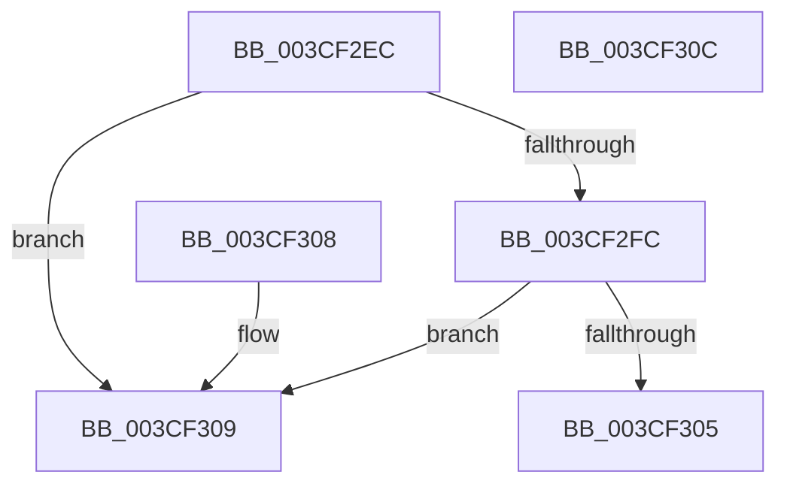

# CcIsDirtyCachemapListEmptyForVolume

- RVA: `0x003CF2EC`–`0x003CF30D` (길이 `33` bytes)
- VA: `0x00000001403CF2EC`
- 실행 섹션: `.text`
- PDB 이름 있음: `예`; PDB Function 태그: `아니요`
- unwind 정보 RVA: `0x000DB714`
- 디코드: `11`개 명령, `33/33` bytes 표시
- 미해석 바이트: `0` (있으면 어셈블리에 `.byte`로 보존)

> 이 문서는 커널 이미지의 기계어와 PDB 기호를 분석해 생성했습니다. 4번과 5번은 함수 원형과 자료형을 바이너리 사용 방식에서 추정한 C 해석이며 원본 소스 복구 결과는 아닙니다.

## 1. Dependencies

- 직접 호출 지점: **0**; 고유 호출 대상: **0**
- 직접 호출자로 확인된 함수: **2**
- RIP 상대 이미지 참조: **0**

### Outgoing calls
- 직접 디코드된 call 명령이 없습니다.

### Direct callers
- [CcLazyWriteScanVolume](../38/CcLazyWriteScanVolume_function_00388DC0.md) at `0x00389337`
- [CcReapPrivateVolumeCachemap](CcReapPrivateVolumeCachemap_function_003CF1B8.md) at `0x003CF256`

### Static image references
- 디코드된 RIP-relative 메모리 참조가 없습니다.

## 2. Other-region calls and transfers

- 다른 실행 섹션으로 향하는 call: **0**
- 별도 외부 분기/꼬리 이동을 확인하지 못했습니다.

## 3. Assembly (complete function range)

```asm
003CF2EC  48 8D 81 98 02 00 00            lea rax, [rcx + 0x298]
003CF2F3  48 39 81 80 02 00 00            cmp qword ptr [rcx + 0x280], rax
003CF2FA  75 0D                           jne 0x1403cf309
003CF2FC  48 39 81 88 02 00 00            cmp qword ptr [rcx + 0x288], rax
003CF303  75 04                           jne 0x1403cf309
003CF305  B0 01                           mov al, 1
003CF307  C3                              ret
003CF308  CC                              int3
003CF309  32 C0                           xor al, al
003CF30B  C3                              ret
003CF30C  CC                              int3
```

## 4. C-style interpretation (structured pseudocode)

```c
__int64 __fastcall CcIsDirtyCachemapListEmptyForVolume(__int64 a1)
{
    __int64 result;

    if ((*(unsigned __int64 *)(a1 + 640)) != (a1 + 664)) goto loc_003CF309;
    if ((*(unsigned __int64 *)(a1 + 648)) != (a1 + 664)) goto loc_003CF309;
    return 1;
loc_003CF309:
    result = 0;
    return result;
}
```

## 5. (Beta) C Style

```c
int64_t CcIsDirtyCachemapListEmptyForVolume(void *Arg1)
{
    uint8_t *arg1 = (uint8_t *)Arg1;

    int64_t result;

    if ((*(uint64_t *)(arg1 + 0x280)) != (Arg1 + 664)) goto loc_003CF309;
    if ((*(uint64_t *)(arg1 + 0x288)) != (Arg1 + 664)) goto loc_003CF309;
    return 1;
loc_003CF309:
    result = 0;
    return result;
}
```

### 관측된 메모리 오프셋

구조체 형식이 확인되지 않은 접근은 인자 기준의 오프셋으로만 기록했습니다.

| 기준 인자 | 오프셋 표현 | 폭 (bit) | 접근 |
|---|---:|---:|---|
| `Arg1` | `+ 0x280` | `64` | `R` |
| `Arg1` | `+ 0x288` | `64` | `R` |
| `Arg1` | `+ 0x298` | `64` | `R` |

## 6. Execution-region graph

[열기: 2D/3D 그래프와 함수 탐색 컨트롤 패널](../../../control-panel.html?section=text&rva=0x003CF2EC&view=graph)

- 2D 그래프는 위에서 아래로 흐르고, 3D 그래프는 빈 공간을 드래그해 회전합니다. Shift+드래그는 이동, 휠은 확대·축소, 함수 노드 선택은 대상 보고서 이동입니다.

### Static fallback


