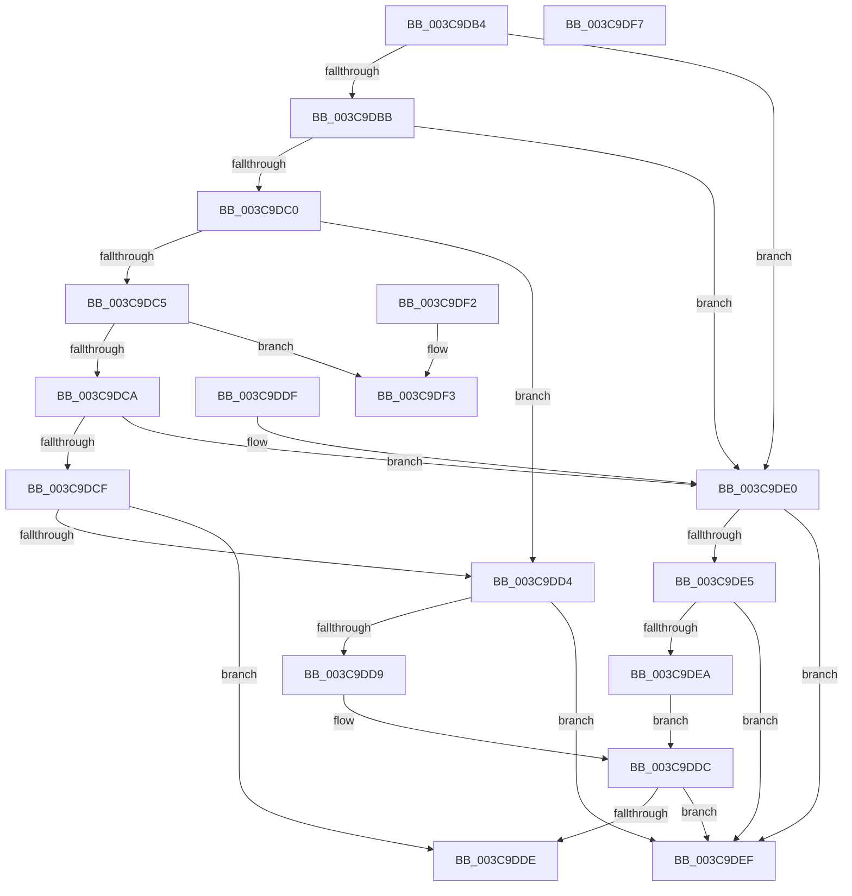

# CcIsLazyWriteScanQueuedInternal

- RVA: `0x003C9DB4`–`0x003C9DF8` (길이 `68` bytes)
- VA: `0x00000001403C9DB4`
- 실행 섹션: `.text`
- PDB 이름 있음: `예`; PDB Function 태그: `아니요`
- unwind 정보 RVA: `0x000DB714`
- 디코드: `31`개 명령, `68/68` bytes 표시
- 미해석 바이트: `0` (있으면 어셈블리에 `.byte`로 보존)

> 이 문서는 커널 이미지의 기계어와 PDB 기호를 분석해 생성했습니다. 4번과 5번은 함수 원형과 자료형을 바이너리 사용 방식에서 추정한 C 해석이며 원본 소스 복구 결과는 아닙니다.

## 1. Dependencies

- 직접 호출 지점: **0**; 고유 호출 대상: **0**
- 직접 호출자로 확인된 함수: **2**
- RIP 상대 이미지 참조: **0**

### Outgoing calls
- 직접 디코드된 call 명령이 없습니다.

### Direct callers
- [CcQueueLazyWriteScanThreadForVolume](CcQueueLazyWriteScanThreadForVolume_function_003C9AF0.md) at `0x003C9C5D`
- [CcQueueLazyWriteScanThread](../57/CcQueueLazyWriteScanThread_function_0057BBD0.md) at `0x0057BD87`

### Static image references
- 디코드된 RIP-relative 메모리 참조가 없습니다.

## 2. Other-region calls and transfers

- 다른 실행 섹션으로 향하는 call: **0**
- 별도 외부 분기/꼬리 이동을 확인하지 못했습니다.

## 3. Assembly (complete function range)

```asm
003C9DB4  32 C0                           xor al, al
003C9DB6  83 EA 01                        sub edx, 1
003C9DB9  74 25                           je 0x1403c9de0
003C9DBB  83 EA 01                        sub edx, 1
003C9DBE  74 20                           je 0x1403c9de0
003C9DC0  83 EA 02                        sub edx, 2
003C9DC3  74 0F                           je 0x1403c9dd4
003C9DC5  83 EA 04                        sub edx, 4
003C9DC8  74 29                           je 0x1403c9df3
003C9DCA  83 EA 08                        sub edx, 8
003C9DCD  74 11                           je 0x1403c9de0
003C9DCF  83 FA 10                        cmp edx, 0x10
003C9DD2  75 0A                           jne 0x1403c9dde
003C9DD4  38 41 44                        cmp byte ptr [rcx + 0x44], al
003C9DD7  75 16                           jne 0x1403c9def
003C9DD9  38 41 43                        cmp byte ptr [rcx + 0x43], al
003C9DDC  75 11                           jne 0x1403c9def
003C9DDE  C3                              ret
003C9DDF  CC                              int3
003C9DE0  38 41 45                        cmp byte ptr [rcx + 0x45], al
003C9DE3  75 0A                           jne 0x1403c9def
003C9DE5  38 41 46                        cmp byte ptr [rcx + 0x46], al
003C9DE8  75 05                           jne 0x1403c9def
003C9DEA  38 41 47                        cmp byte ptr [rcx + 0x47], al
003C9DED  EB ED                           jmp 0x1403c9ddc
003C9DEF  B0 01                           mov al, 1
003C9DF1  C3                              ret
003C9DF2  CC                              int3
003C9DF3  8A 41 43                        mov al, byte ptr [rcx + 0x43]
003C9DF6  C3                              ret
003C9DF7  CC                              int3
```

## 4. C-style interpretation (structured pseudocode)

```c
__int64 __fastcall CcIsLazyWriteScanQueuedInternal(__int64 a1, int a2)
{
    __int64 result;

    result = 0;
    a2 = (unsigned int)((a2) - (1));
    if (condition_is_equal) goto loc_003C9DE0;
    a2 = (unsigned int)((a2) - (1));
    if (condition_is_equal) goto loc_003C9DE0;
    a2 = (unsigned int)((a2) - (2));
    if (condition_is_equal) goto loc_003C9DD4;
    a2 = (unsigned int)((a2) - (4));
    if (condition_is_equal) goto loc_003C9DF3;
    a2 = (unsigned int)((a2) - (8));
    if (condition_is_equal) goto loc_003C9DE0;
    if (a2 != 16) goto loc_003C9DDE;
loc_003C9DD4:
    if ((*(unsigned __int8 *)(a1 + 68)) != 0) goto loc_003C9DEF;
loc_003C9DDC:
    if ((*(unsigned __int8 *)(a1 + 67)) != 0) goto loc_003C9DEF;
loc_003C9DDE:
    return result;
loc_003C9DE0:
    if ((*(unsigned __int8 *)(a1 + 69)) != 0) goto loc_003C9DEF;
    if ((*(unsigned __int8 *)(a1 + 70)) != 0) goto loc_003C9DEF;
    goto loc_003C9DDC;
loc_003C9DEF:
    return 1;
loc_003C9DF3:
    return *(unsigned __int8 *)(a1 + 67);
}
```

## 5. (Beta) C Style

```c
int64_t CcIsLazyWriteScanQueuedInternal(void *Arg1, int32_t Arg2)
{
    uint8_t *arg1 = (uint8_t *)Arg1;

    int64_t result;

    result = 0;
    Arg2 = (uint32_t)((Arg2) - (1));
    if (condition_is_equal) goto loc_003C9DE0;
    Arg2 = (uint32_t)((Arg2) - (1));
    if (condition_is_equal) goto loc_003C9DE0;
    Arg2 = (uint32_t)((Arg2) - (2));
    if (condition_is_equal) goto loc_003C9DD4;
    Arg2 = (uint32_t)((Arg2) - (4));
    if (condition_is_equal) goto loc_003C9DF3;
    Arg2 = (uint32_t)((Arg2) - (8));
    if (condition_is_equal) goto loc_003C9DE0;
    if (Arg2 != 16) goto loc_003C9DDE;
loc_003C9DD4:
    if ((*(uint8_t *)(arg1 + 0x44)) != 0) goto loc_003C9DEF;
loc_003C9DDC:
    if ((*(uint8_t *)(arg1 + 0x43)) != 0) goto loc_003C9DEF;
loc_003C9DDE:
    return result;
loc_003C9DE0:
    if ((*(uint8_t *)(arg1 + 0x45)) != 0) goto loc_003C9DEF;
    if ((*(uint8_t *)(arg1 + 0x46)) != 0) goto loc_003C9DEF;
    goto loc_003C9DDC;
loc_003C9DEF:
    return 1;
loc_003C9DF3:
    return *(uint8_t *)(arg1 + 0x43);
}
```

### 관측된 메모리 오프셋

구조체 형식이 확인되지 않은 접근은 인자 기준의 오프셋으로만 기록했습니다.

| 기준 인자 | 오프셋 표현 | 폭 (bit) | 접근 |
|---|---:|---:|---|
| `Arg1` | `+ 0x43` | `8` | `R` |
| `Arg1` | `+ 0x44` | `8` | `R` |
| `Arg1` | `+ 0x45` | `8` | `R` |
| `Arg1` | `+ 0x46` | `8` | `R` |
| `Arg1` | `+ 0x47` | `8` | `R` |

## 6. Execution-region graph

[열기: 2D/3D 그래프와 함수 탐색 컨트롤 패널](../../../control-panel.html?section=text&rva=0x003C9DB4&view=graph)

- 2D 그래프는 위에서 아래로 흐르고, 3D 그래프는 빈 공간을 드래그해 회전합니다. Shift+드래그는 이동, 휠은 확대·축소, 함수 노드 선택은 대상 보고서 이동입니다.

### Static fallback


