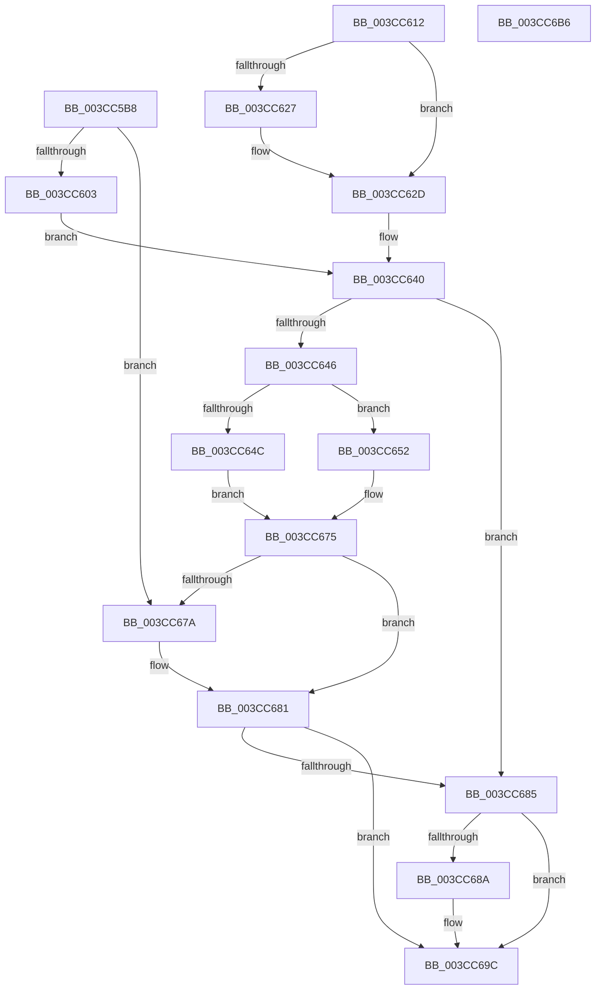

# CcLockSystemCacheBuffer

- RVA: `0x003CC5B8`–`0x003CC6B7` (길이 `255` bytes)
- VA: `0x00000001403CC5B8`
- 실행 섹션: `.text`
- PDB 이름 있음: `예`; PDB Function 태그: `아니요`
- unwind 정보 RVA: `0x0008F928`
- 디코드: `79`개 명령, `255/255` bytes 표시
- 미해석 바이트: `0` (있으면 어셈블리에 `.byte`로 보존)

> 이 문서는 커널 이미지의 기계어와 PDB 기호를 분석해 생성했습니다. 4번과 5번은 함수 원형과 자료형을 바이너리 사용 방식에서 추정한 C 해석이며 원본 소스 복구 결과는 아닙니다.

## 1. Dependencies

- 직접 호출 지점: **7**; 고유 호출 대상: **6**
- 직접 호출자로 확인된 함수: **2**
- RIP 상대 이미지 참조: **0**

### Outgoing calls
- `0x003CC5F1` → [IoAllocateMdl](../29/IoAllocateMdl_function_0029EBF0.md) (function, `0x0029EBF0`)
- `0x003CC60B` → [MmProbeAndLockPages](../23/MmProbeAndLockPages_function_0023B990.md) (function, `0x0023B990`)
- `0x003CC61E` → [FsRtlIsNtstatusExpected](../26/FsRtlIsNtstatusExpected_function_0026D390.md) (function, `0x0026D390`)
- `0x003CC632` → [IoFreeMdl](../29/IoFreeMdl_function_0029EA80.md) (function, `0x0029EA80`)
- `0x003CC66B` → [MmMapLockedPagesSpecifyCache](../31/MmMapLockedPagesSpecifyCache_function_00318800.md) (function, `0x00318800`)
- `0x003CC68D` → [MmUnlockPages](../29/MmUnlockPages_function_0029EEE0.md) (function, `0x0029EEE0`)
- `0x003CC695` → [IoFreeMdl](../29/IoFreeMdl_function_0029EA80.md) (function, `0x0029EA80`)

### Direct callers
- [CcMapAndCopyInToCache](CcMapAndCopyInToCache_function_003CA7F0.md) at `0x003CB097`
- [CcCopyBytesToUserBuffer](CcCopyBytesToUserBuffer_function_003CC3D0.md) at `0x003CC4F0`

### Static image references
- 디코드된 RIP-relative 메모리 참조가 없습니다.

## 2. Other-region calls and transfers

- 다른 실행 섹션으로 향하는 call: **0**
- 별도 외부 분기/꼬리 이동을 확인하지 못했습니다.

## 3. Assembly (complete function range)

```asm
003CC5B8  4C 8B DC                        mov r11, rsp
003CC5BB  49 89 5B 08                     mov qword ptr [r11 + 8], rbx
003CC5BF  49 89 73 18                     mov qword ptr [r11 + 0x18], rsi
003CC5C3  49 89 53 10                     mov qword ptr [r11 + 0x10], rdx
003CC5C7  57                              push rdi
003CC5C8  41 56                           push r14
003CC5CA  41 57                           push r15
003CC5CC  48 83 EC 40                     sub rsp, 0x40
003CC5D0  45 8B F9                        mov r15d, r9d
003CC5D3  41 8B C0                        mov eax, r8d
003CC5D6  4C 8B F2                        mov r14, rdx
003CC5D9  33 F6                           xor esi, esi
003CC5DB  48 8B BC 24 80 00 00 00         mov rdi, qword ptr [rsp + 0x80]
003CC5E3  21 37                           and dword ptr [rdi], esi
003CC5E5  49 21 73 C8                     and qword ptr [r11 - 0x38], rsi
003CC5E9  45 33 C9                        xor r9d, r9d
003CC5EC  45 33 C0                        xor r8d, r8d
003CC5EF  8B D0                           mov edx, eax
003CC5F1  E8 FA 25 ED FF                  call 0x14029ebf0
003CC5F6  48 8B D8                        mov rbx, rax
003CC5F9  48 89 44 24 30                  mov qword ptr [rsp + 0x30], rax
003CC5FE  48 85 C0                        test rax, rax
003CC601  74 77                           je 0x1403cc67a
003CC603  45 8B C7                        mov r8d, r15d
003CC606  33 D2                           xor edx, edx
003CC608  48 8B C8                        mov rcx, rax
003CC60B  E8 80 F3 E6 FF                  call 0x14023b990
003CC610  EB 2E                           jmp 0x1403cc640
003CC612  48 8B BC 24 80 00 00 00         mov rdi, qword ptr [rsp + 0x80]
003CC61A  89 07                           mov dword ptr [rdi], eax
003CC61C  8B C8                           mov ecx, eax
003CC61E  E8 6D 0D EA FF                  call 0x14026d390
003CC623  84 C0                           test al, al
003CC625  75 06                           jne 0x1403cc62d
003CC627  C7 07 E8 00 00 C0               mov dword ptr [rdi], 0xc00000e8
003CC62D  48 8B 4C 24 30                  mov rcx, qword ptr [rsp + 0x30]
003CC632  E8 49 24 ED FF                  call 0x14029ea80
003CC637  33 DB                           xor ebx, ebx
003CC639  4C 8B 74 24 68                  mov r14, qword ptr [rsp + 0x68]
003CC63E  8B F3                           mov esi, ebx
003CC640  8B 0F                           mov ecx, dword ptr [rdi]
003CC642  85 C9                           test ecx, ecx
003CC644  78 3F                           js 0x1403cc685
003CC646  F6 43 0A 05                     test byte ptr [rbx + 0xa], 5
003CC64A  74 06                           je 0x1403cc652
003CC64C  48 8B 73 18                     mov rsi, qword ptr [rbx + 0x18]
003CC650  EB 23                           jmp 0x1403cc675
003CC652  C7 44 24 28 00 00 00 40         mov dword ptr [rsp + 0x28], 0x40000000
003CC65A  83 64 24 20 00                  and dword ptr [rsp + 0x20], 0
003CC65F  45 33 C9                        xor r9d, r9d
003CC662  33 D2                           xor edx, edx
003CC664  45 8D 41 01                     lea r8d, [r9 + 1]
003CC668  48 8B CB                        mov rcx, rbx
003CC66B  E8 90 C1 F4 FF                  call 0x140318800
003CC670  48 8B F0                        mov rsi, rax
003CC673  8B 0F                           mov ecx, dword ptr [rdi]
003CC675  48 85 F6                        test rsi, rsi
003CC678  75 07                           jne 0x1403cc681
003CC67A  B9 9A 00 00 C0                  mov ecx, 0xc000009a
003CC67F  89 0F                           mov dword ptr [rdi], ecx
003CC681  85 C9                           test ecx, ecx
003CC683  79 17                           jns 0x1403cc69c
003CC685  48 85 DB                        test rbx, rbx
003CC688  74 12                           je 0x1403cc69c
003CC68A  48 8B CB                        mov rcx, rbx
003CC68D  E8 4E 28 ED FF                  call 0x14029eee0
003CC692  48 8B CB                        mov rcx, rbx
003CC695  E8 E6 23 ED FF                  call 0x14029ea80
003CC69A  33 DB                           xor ebx, ebx
003CC69C  49 89 1E                        mov qword ptr [r14], rbx
003CC69F  48 8B C6                        mov rax, rsi
003CC6A2  48 8B 5C 24 60                  mov rbx, qword ptr [rsp + 0x60]
003CC6A7  48 8B 74 24 70                  mov rsi, qword ptr [rsp + 0x70]
003CC6AC  48 83 C4 40                     add rsp, 0x40
003CC6B0  41 5F                           pop r15
003CC6B2  41 5E                           pop r14
003CC6B4  5F                              pop rdi
003CC6B5  C3                              ret
003CC6B6  CC                              int3
```

## 4. C-style interpretation (structured pseudocode)

```c
__int64 __fastcall CcLockSystemCacheBuffer(__int64 a1, __int64 a2, int a3, int a4, __int64 a5)
{
    __int64 result;
    __int64 v_rbx;
    __int64 v_rsi;
    __int64 v_rsp;
    unsigned __int64 v_stack_m28;
    unsigned int v_stack_m30;
    unsigned int v_stack_m38;
    unsigned __int64 v_stack_p10;
    unsigned __int64 v_stack_p18;
    unsigned __int64 v_stack_p28;
    unsigned __int64 v_stack_p8;

    *(unsigned __int64 *)(v_rsp + 8) = v_rbx;
    *(unsigned __int64 *)(v_rsp + 24) = v_rsi;
    *(unsigned __int64 *)(v_rsp + 16) = a2;
    v_rsp = (v_rsp) - (64);
    v_rsi = 0;
    a4 = 0;
    a3 = 0;
    result = IoAllocateMdl(a1, (unsigned int)((unsigned int)((unsigned int)(a3))), a3, a4);
    v_stack_m28 = result;
    if (result == 0) goto loc_003CC67A;
    a2 = 0;
    result = MmProbeAndLockPages(result, a2, (unsigned int)((unsigned int)((unsigned int)(a4))), a4);
    goto loc_003CC640;
loc_003CC640:
    if (sign_flag) goto loc_003CC685;
    if (((*(unsigned __int8 *)(result + 10)) & (5)) == 0) goto loc_003CC652;
    goto loc_003CC675;
loc_003CC652:
    v_stack_m30 = 0x40000000ULL;
    a4 = 0;
    a2 = 0;
    result = MmMapLockedPagesSpecifyCache(result, a2, a4 + 1, a4);
loc_003CC675:
    if (result == 0) {
        a1 = 0xC000009AULL;
        *(unsigned int *)(a5) = (unsigned int)(a1);
    }
    if (!sign_flag) goto loc_003CC69C;
loc_003CC685:
    v_rbx = result;
    if (result != 0) {
        a1 = result;
        result = MmUnlockPages(a1, a2, a4 + 1, a4);
        a1 = result;
        result = IoFreeMdl(a1, a2, a4 + 1, a4);
        v_rbx = 0;
    }
    *(unsigned __int64 *)(a2) = 0;
    v_rsp = (v_rsp) + (64);
    return result;
}
```

## 5. (Beta) C Style

```c
int64_t CcLockSystemCacheBuffer(int64_t Arg1, void *Arg2, int32_t Arg3, int32_t Arg4, void *Arg5)
{
    uint8_t *arg2 = (uint8_t *)Arg2;
    uint8_t *arg5 = (uint8_t *)Arg5;

    int64_t result;
    int64_t local_rbx;
    int64_t local_rsi;
    int64_t local_rsp;
    uint64_t v_stack_m28;
    uint32_t v_stack_m30;
    uint32_t v_stack_m38;
    uint64_t v_stack_p10;
    uint64_t v_stack_p18;
    uint64_t v_stack_p28;
    uint64_t v_stack_p8;

    *(uint64_t *)(local_rsp + 0x8) = local_rbx;
    *(uint64_t *)(local_rsp + 0x18) = local_rsi;
    *(void **)(local_rsp + 0x10) = Arg2;
    local_rsp = (local_rsp) - (64);
    local_rsi = 0;
    Arg4 = 0;
    Arg3 = 0;
    result = IoAllocateMdl(Arg1, (uint32_t)((uint32_t)((uint32_t)(Arg3))), Arg3, Arg4);
    v_stack_m28 = result;
    if (result == 0) goto loc_003CC67A;
    Arg2 = 0;
    result = MmProbeAndLockPages(result, Arg2, (uint32_t)((uint32_t)((uint32_t)(Arg4))), Arg4);
    goto loc_003CC640;
loc_003CC640:
    if (sign_flag) goto loc_003CC685;
    if (((*(uint8_t *)(result + 0xA)) & (5)) == 0) goto loc_003CC652;
    goto loc_003CC675;
loc_003CC652:
    v_stack_m30 = 0x40000000ULL;
    Arg4 = 0;
    Arg2 = 0;
    result = MmMapLockedPagesSpecifyCache(result, Arg2, Arg4 + 1, Arg4);
loc_003CC675:
    if (result == 0) {
        Arg1 = 0xC000009AULL;
        *(uint32_t *)(arg5) = (uint32_t)(Arg1);
    }
    if (!sign_flag) goto loc_003CC69C;
loc_003CC685:
    local_rbx = result;
    if (result != 0) {
        Arg1 = result;
        result = MmUnlockPages(Arg1, Arg2, Arg4 + 1, Arg4);
        Arg1 = result;
        result = IoFreeMdl(Arg1, Arg2, Arg4 + 1, Arg4);
        local_rbx = 0;
    }
    *(uint64_t *)(arg2) = 0;
    local_rsp = (local_rsp) + (64);
    return result;
}
```

### 관측된 메모리 오프셋

구조체 형식이 확인되지 않은 접근은 인자 기준의 오프셋으로만 기록했습니다.

| 기준 인자 | 오프셋 표현 | 폭 (bit) | 접근 |
|---|---:|---:|---|
| `Arg2` | `+ 0x0` | `64` | `W` |
| `Arg5` | `+ 0x0` | `32` | `R` |
| `Arg5` | `+ 0x0` | `32` | `R/W` |
| `Arg5` | `+ 0x0` | `32` | `W` |

## 6. Execution-region graph

[열기: 2D/3D 그래프와 함수 탐색 컨트롤 패널](../../../control-panel.html?section=text&rva=0x003CC5B8&view=graph)

- 2D 그래프는 위에서 아래로 흐르고, 3D 그래프는 빈 공간을 드래그해 회전합니다. Shift+드래그는 이동, 휠은 확대·축소, 함수 노드 선택은 대상 보고서 이동입니다.

### Static fallback


