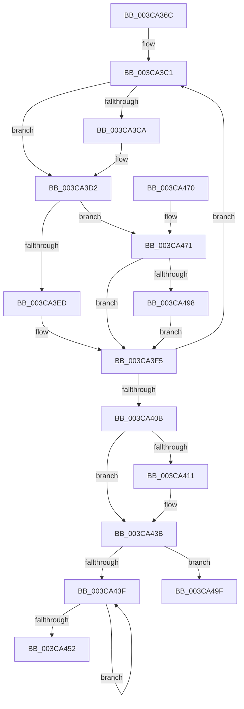

# CcMdlWriteComplete2

- RVA: `0x003CA36C`–`0x003CA4B6` (길이 `330` bytes)
- VA: `0x00000001403CA36C`
- 실행 섹션: `.text`
- PDB 이름 있음: `예`; PDB Function 태그: `아니요`
- unwind 정보 RVA: `0x0008F678`
- 디코드: `92`개 명령, `330/330` bytes 표시
- 미해석 바이트: `0` (있으면 어셈블리에 `.byte`로 보존)

> 이 문서는 커널 이미지의 기계어와 PDB 기호를 분석해 생성했습니다. 4번과 5번은 함수 원형과 자료형을 바이너리 사용 방식에서 추정한 C 해석이며 원본 소스 복구 결과는 아닙니다.

## 1. Dependencies

- 직접 호출 지점: **9**; 고유 호출 대상: **9**
- 직접 호출자로 확인된 함수: **2**
- RIP 상대 이미지 참조: **0**

### Outgoing calls
- `0x003CA3CD` → [MmUnlockPages](../29/MmUnlockPages_function_0029EEE0.md) (function, `0x0029EEE0`)
- `0x003CA3F0` → [CcSetDirtyInMask](CcSetDirtyInMask_function_003CB688.md) (function, `0x003CB688`)
- `0x003CA424` → [KeAcquireInStackQueuedSpinLock](../27/KeAcquireInStackQueuedSpinLock_function_002757A0.md) (function, `0x002757A0`)
- `0x003CA42C` → [CcDecrementOpenCount](../38/CcDecrementOpenCount_function_0038B75C.md) (function, `0x0038B75C`)
- `0x003CA436` → [KeReleaseInStackQueuedSpinLock](../34/KeReleaseInStackQueuedSpinLock_function_00342CE0.md) (function, `0x00342CE0`)
- `0x003CA445` → [IoFreeMdl](../29/IoFreeMdl_function_0029EA80.md) (function, `0x0029EA80`)
- `0x003CA487` → [MmFlushSection](../23/MmFlushSection_function_002375E4.md) (function, `0x002375E4`)
- `0x003CA4A1` → [FsRtlIsNtstatusExpected](../26/FsRtlIsNtstatusExpected_function_0026D390.md) (function, `0x0026D390`)
- `0x003CA4B0` → [RtlRaiseStatus](../2F/RtlRaiseStatus_function_002F6A50.md) (function, `0x002F6A50`)

### Direct callers
- [CcMdlWriteComplete](../../page/A8/CcMdlWriteComplete_function_00A83BA0.md) at `0x00A83C11`
- [FsRtlMdlWriteCompleteDev](../../page/A9/FsRtlMdlWriteCompleteDev_function_00A979C0.md) at `0x00A979D3`

### Static image references
- 디코드된 RIP-relative 메모리 참조가 없습니다.

## 2. Other-region calls and transfers

- 다른 실행 섹션으로 향하는 call: **0**
- 별도 외부 분기/꼬리 이동을 확인하지 못했습니다.

## 3. Assembly (complete function range)

```asm
003CA36C  4C 8B DC                        mov r11, rsp
003CA36F  49 89 5B 10                     mov qword ptr [r11 + 0x10], rbx
003CA373  49 89 6B 18                     mov qword ptr [r11 + 0x18], rbp
003CA377  49 89 73 20                     mov qword ptr [r11 + 0x20], rsi
003CA37B  57                              push rdi
003CA37C  41 54                           push r12
003CA37E  41 55                           push r13
003CA380  41 56                           push r14
003CA382  41 57                           push r15
003CA384  48 83 EC 60                     sub rsp, 0x60
003CA388  48 8B 1A                        mov rbx, qword ptr [rdx]
003CA38B  33 C0                           xor eax, eax
003CA38D  45 0F B7 78 0A                  movzx r15d, word ptr [r8 + 0xa]
003CA392  4C 8B E9                        mov r13, rcx
003CA395  0F 57 C0                        xorps xmm0, xmm0
003CA398  49 89 5B 08                     mov qword ptr [r11 + 8], rbx
003CA39C  0F 11 44 24 40                  movups xmmword ptr [rsp + 0x40], xmm0
003CA3A1  49 89 43 C8                     mov qword ptr [r11 - 0x38], rax
003CA3A5  33 C9                           xor ecx, ecx
003CA3A7  49 8B 45 28                     mov rax, qword ptr [r13 + 0x28]
003CA3AB  4D 8B F0                        mov r14, r8
003CA3AE  0F 11 44 24 30                  movups xmmword ptr [rsp + 0x30], xmm0
003CA3B3  8B F1                           mov esi, ecx
003CA3B5  49 8B F8                        mov rdi, r8
003CA3B8  66 41 83 E7 02                  and r15w, 2
003CA3BD  48 8B 68 08                     mov rbp, qword ptr [rax + 8]
003CA3C1  4C 8B 27                        mov r12, qword ptr [rdi]
003CA3C4  66 45 85 FF                     test r15w, r15w
003CA3C8  74 08                           je 0x1403ca3d2
003CA3CA  48 8B CF                        mov rcx, rdi
003CA3CD  E8 0E 4B ED FF                  call 0x14029eee0
003CA3D2  41 8B 45 50                     mov eax, dword ptr [r13 + 0x50]
003CA3D6  48 8D 94 24 90 00 00 00         lea rdx, [rsp + 0x90]
003CA3DE  44 8B 47 28                     mov r8d, dword ptr [rdi + 0x28]
003CA3E2  45 33 C9                        xor r9d, r9d
003CA3E5  A8 10                           test al, 0x10
003CA3E7  0F 85 84 00 00 00               jne 0x1403ca471
003CA3ED  48 8B CD                        mov rcx, rbp
003CA3F0  E8 93 12 00 00                  call 0x1403cb688
003CA3F5  8B 47 28                        mov eax, dword ptr [rdi + 0x28]
003CA3F8  49 8B FC                        mov rdi, r12
003CA3FB  48 03 D8                        add rbx, rax
003CA3FE  48 89 9C 24 90 00 00 00         mov qword ptr [rsp + 0x90], rbx
003CA406  4D 85 E4                        test r12, r12
003CA409  75 B6                           jne 0x1403ca3c1
003CA40B  66 45 85 FF                     test r15w, r15w
003CA40F  74 2A                           je 0x1403ca43b
003CA411  48 8B 8D 18 02 00 00            mov rcx, qword ptr [rbp + 0x218]
003CA418  48 8D 54 24 40                  lea rdx, [rsp + 0x40]
003CA41D  48 81 C1 00 03 00 00            add rcx, 0x300
003CA424  E8 77 B3 EA FF                  call 0x1402757a0
003CA429  48 8B CD                        mov rcx, rbp
003CA42C  E8 2B 13 FC FF                  call 0x14038b75c
003CA431  48 8D 4C 24 40                  lea rcx, [rsp + 0x40]
003CA436  E8 A5 88 F7 FF                  call 0x140342ce0
003CA43B  85 F6                           test esi, esi
003CA43D  78 60                           js 0x1403ca49f
003CA43F  49 8B 1E                        mov rbx, qword ptr [r14]
003CA442  49 8B CE                        mov rcx, r14
003CA445  E8 36 46 ED FF                  call 0x14029ea80
003CA44A  4C 8B F3                        mov r14, rbx
003CA44D  48 85 DB                        test rbx, rbx
003CA450  75 ED                           jne 0x1403ca43f
003CA452  4C 8D 5C 24 60                  lea r11, [rsp + 0x60]
003CA457  49 8B 5B 38                     mov rbx, qword ptr [r11 + 0x38]
003CA45B  49 8B 6B 40                     mov rbp, qword ptr [r11 + 0x40]
003CA45F  49 8B 73 48                     mov rsi, qword ptr [r11 + 0x48]
003CA463  49 8B E3                        mov rsp, r11
003CA466  41 5F                           pop r15
003CA468  41 5E                           pop r14
003CA46A  41 5D                           pop r13
003CA46C  41 5C                           pop r12
003CA46E  5F                              pop rdi
003CA46F  C3                              ret
003CA470  CC                              int3
003CA471  49 8B 4D 28                     mov rcx, qword ptr [r13 + 0x28]
003CA475  48 8D 44 24 30                  lea rax, [rsp + 0x30]
003CA47A  C7 44 24 28 01 00 00 00         mov dword ptr [rsp + 0x28], 1
003CA482  48 89 44 24 20                  mov qword ptr [rsp + 0x20], rax
003CA487  E8 58 D1 E6 FF                  call 0x1402375e4
003CA48C  8B 44 24 30                     mov eax, dword ptr [rsp + 0x30]
003CA490  85 C0                           test eax, eax
003CA492  0F 89 5D FF FF FF               jns 0x1403ca3f5
003CA498  8B F0                           mov esi, eax
003CA49A  E9 56 FF FF FF                  jmp 0x1403ca3f5
003CA49F  8B CE                           mov ecx, esi
003CA4A1  E8 EA 2E EA FF                  call 0x14026d390
003CA4A6  84 C0                           test al, al
003CA4A8  B9 E9 00 00 C0                  mov ecx, 0xc00000e9
003CA4AD  0F 45 CE                        cmovne ecx, esi
003CA4B0  E8 9B C5 F2 FF                  call 0x1402f6a50
003CA4B5  CC                              int3
```

## 4. C-style interpretation (structured pseudocode)

```c
__int64 __fastcall CcMdlWriteComplete2(__int64 a1, __int64 a2, __int64 a3, int a4)
{
    __int64 result;
    __int64 v_r15;
    __int64 v_rbx;
    __int64 v_rsp;
    unsigned __int64 v_stack_m28;
    unsigned __int64 v_stack_m30;
    unsigned int v_stack_m38;
    unsigned __int64 v_stack_m40;
    unsigned __int64 v_stack_m48;
    unsigned __int64 v_stack_m58;
    unsigned __int64 v_stack_p8;

    *(unsigned __int64 *)(v_rsp + 16) = v_rbx;
    *(unsigned __int64 *)(v_rsp + 24) = v_rbp;
    *(unsigned __int64 *)(v_rsp + 32) = v_rsi;
    v_rsp = (v_rsp) - (96);
    result = 0;
    *(unsigned __int64 *)(v_rsp + 8) = *(unsigned __int64 *)(a2);
    v_stack_m48 = v_xmm0;
    *(unsigned __int64 *)(v_rsp - 56) = 0;
    a1 = 0;
    v_stack_m58 = v_xmm0;
    v_r15 = (unsigned __int16)((*(unsigned __int16 *)(a3 + 10)) & (2));
loc_003CA3C1:
    result = *(unsigned __int64 *)(a1 + 40);
    if ((unsigned __int16)(v_r15) != 0) {
        a1 = a3;
        result = MmUnlockPages(a1, a2, a3, a4);
    }
    a4 = 0;
    if ((((unsigned __int8)((unsigned int)(*(unsigned int *)(a1 + 80)))) & (16)) != 0) goto loc_003CA471;
    result = CcSetDirtyInMask(*(unsigned __int64 *)(*(unsigned __int64 *)(a1 + 40) + 8), v_stack_p8, (unsigned int)(*(unsigned int *)(a3 + 40)), a4);
loc_003CA3F5:
    v_rbx = (*(unsigned __int64 *)(a2)) + ((unsigned int)(*(unsigned int *)(a3 + 40)));
    v_stack_p8 = v_rbx;
    if (*(unsigned __int64 *)(a3) != 0) goto loc_003CA3C1;
    result = (unsigned int)(*(unsigned int *)(a3 + 40));
    if ((unsigned __int16)(v_r15) != 0) {
        a1 = *(unsigned __int64 *)(*(unsigned __int64 *)(*(unsigned __int64 *)(a1 + 40) + 8) + 536);
        a2 = v_stack_m48;
        a1 = (a1) + (768);
        result = KeAcquireInStackQueuedSpinLock(a1, a2, (unsigned int)(*(unsigned int *)(a3 + 40)), a4);
        a1 = *(unsigned __int64 *)(*(unsigned __int64 *)(a1 + 40) + 8);
        result = CcDecrementOpenCount(a1, a2, (unsigned int)(*(unsigned int *)(a3 + 40)), a4);
        a1 = v_stack_m48;
        result = KeReleaseInStackQueuedSpinLock(a1, a2, (unsigned int)(*(unsigned int *)(a3 + 40)), a4);
    }
    if (sign_flag) goto loc_003CA49F;
loc_003CA43F:
    result = IoFreeMdl(a3, a2, (unsigned int)(*(unsigned int *)(a3 + 40)), a4);
    if (*(unsigned __int64 *)(a3) != 0) goto loc_003CA43F;
    return result;
loc_003CA471:
    v_stack_m38 = 1;
    v_stack_m40 = v_stack_m30;
    result = MmFlushSection(*(unsigned __int64 *)(a1 + 40), a2, (unsigned int)(*(unsigned int *)(a3 + 40)), a4);
    if (!sign_flag) goto loc_003CA3F5;
    goto loc_003CA3F5;
loc_003CA49F:
    result = FsRtlIsNtstatusExpected((unsigned int)((unsigned int)((unsigned int)((unsigned int)((unsigned int)(v_stack_m30))))), a2, (unsigned int)(*(unsigned int *)(a3 + 40)), a4);
    a1 = (unsigned int)(0xC00000E9ULL);
    if ((unsigned __int8)(result) != 0) { a1 = (unsigned int)((unsigned int)((unsigned int)((unsigned int)(v_stack_m30)))); }
    result = RtlRaiseStatus(a1, a2, (unsigned int)(*(unsigned int *)(a3 + 40)), a4);
    return result;
}
```

## 5. (Beta) C Style

```c
int64_t CcMdlWriteComplete2(void *Arg1, void *Arg2, void *Arg3, int32_t Arg4)
{
    uint8_t *arg1 = (uint8_t *)Arg1;
    uint8_t *arg2 = (uint8_t *)Arg2;
    uint8_t *arg3 = (uint8_t *)Arg3;

    int64_t result;
    int64_t local_r15;
    int64_t local_rbx;
    int64_t local_rsp;
    uint64_t v_stack_m28;
    uint64_t v_stack_m30;
    uint32_t v_stack_m38;
    uint64_t v_stack_m40;
    uint64_t v_stack_m48;
    uint64_t v_stack_m58;
    uint64_t v_stack_p8;

    *(uint64_t *)(local_rsp + 0x10) = local_rbx;
    *(uint64_t *)(local_rsp + 0x18) = local_rbp;
    *(uint64_t *)(local_rsp + 0x20) = local_rsi;
    local_rsp = (local_rsp) - (96);
    result = 0;
    *(uint64_t *)(local_rsp + 0x8) = *(uint64_t *)(arg2);
    v_stack_m48 = v_xmm0;
    *(uint64_t *)(local_rsp - 0x38) = 0;
    Arg1 = 0;
    v_stack_m58 = v_xmm0;
    local_r15 = (uint16_t)((*(uint16_t *)(arg3 + 0xA)) & (2));
loc_003CA3C1:
    result = *(uint64_t *)(arg1 + 0x28);
    if ((uint16_t)(local_r15) != 0) {
        Arg1 = Arg3;
        result = MmUnlockPages(Arg1, Arg2, Arg3, Arg4);
    }
    Arg4 = 0;
    if ((((uint8_t)((uint32_t)(*(uint32_t *)(arg1 + 0x50)))) & (16)) != 0) goto loc_003CA471;
    result = CcSetDirtyInMask(*(uint64_t *)(*(uint64_t *)(arg1 + 0x28) + 0x8), v_stack_p8, (uint32_t)(*(uint32_t *)(arg3 + 0x28)), Arg4);
loc_003CA3F5:
    local_rbx = (*(uint64_t *)(arg2)) + ((uint32_t)(*(uint32_t *)(arg3 + 0x28)));
    v_stack_p8 = local_rbx;
    if (*(uint64_t *)(arg3) != 0) goto loc_003CA3C1;
    result = (uint32_t)(*(uint32_t *)(arg3 + 0x28));
    if ((uint16_t)(local_r15) != 0) {
        Arg1 = *(uint64_t *)(*(uint64_t *)(*(uint64_t *)(arg1 + 0x28) + 0x8) + 0x218);
        Arg2 = v_stack_m48;
        Arg1 = (Arg1) + (768);
        result = KeAcquireInStackQueuedSpinLock(Arg1, Arg2, (uint32_t)(*(uint32_t *)(arg3 + 0x28)), Arg4);
        Arg1 = *(uint64_t *)(*(uint64_t *)(arg1 + 0x28) + 0x8);
        result = CcDecrementOpenCount(Arg1, Arg2, (uint32_t)(*(uint32_t *)(arg3 + 0x28)), Arg4);
        Arg1 = v_stack_m48;
        result = KeReleaseInStackQueuedSpinLock(Arg1, Arg2, (uint32_t)(*(uint32_t *)(arg3 + 0x28)), Arg4);
    }
    if (sign_flag) goto loc_003CA49F;
loc_003CA43F:
    result = IoFreeMdl(Arg3, Arg2, (uint32_t)(*(uint32_t *)(arg3 + 0x28)), Arg4);
    if (*(uint64_t *)(arg3) != 0) goto loc_003CA43F;
    return result;
loc_003CA471:
    v_stack_m38 = 1;
    v_stack_m40 = v_stack_m30;
    result = MmFlushSection(*(uint64_t *)(arg1 + 0x28), Arg2, (uint32_t)(*(uint32_t *)(arg3 + 0x28)), Arg4);
    if (!sign_flag) goto loc_003CA3F5;
    goto loc_003CA3F5;
loc_003CA49F:
    result = FsRtlIsNtstatusExpected((uint32_t)((uint32_t)((uint32_t)((uint32_t)((uint32_t)(v_stack_m30))))), Arg2, (uint32_t)(*(uint32_t *)(arg3 + 0x28)), Arg4);
    Arg1 = (uint32_t)(0xC00000E9ULL);
    if ((uint8_t)(result) != 0) { Arg1 = (uint32_t)((uint32_t)((uint32_t)((uint32_t)(v_stack_m30)))); }
    result = RtlRaiseStatus(Arg1, Arg2, (uint32_t)(*(uint32_t *)(arg3 + 0x28)), Arg4);
    return result;
}
```

### 관측된 메모리 오프셋

구조체 형식이 확인되지 않은 접근은 인자 기준의 오프셋으로만 기록했습니다.

| 기준 인자 | 오프셋 표현 | 폭 (bit) | 접근 |
|---|---:|---:|---|
| `Arg1` | `+ 0x28` | `64` | `R` |
| `Arg1` | `+ 0x50` | `32` | `R` |
| `Arg2` | `+ 0x0` | `64` | `R` |
| `Arg3` | `+ 0xA` | `16` | `R` |

## 6. Execution-region graph

[열기: 2D/3D 그래프와 함수 탐색 컨트롤 패널](../../../control-panel.html?section=text&rva=0x003CA36C&view=graph)

- 2D 그래프는 위에서 아래로 흐르고, 3D 그래프는 빈 공간을 드래그해 회전합니다. Shift+드래그는 이동, 휠은 확대·축소, 함수 노드 선택은 대상 보고서 이동입니다.

### Static fallback


