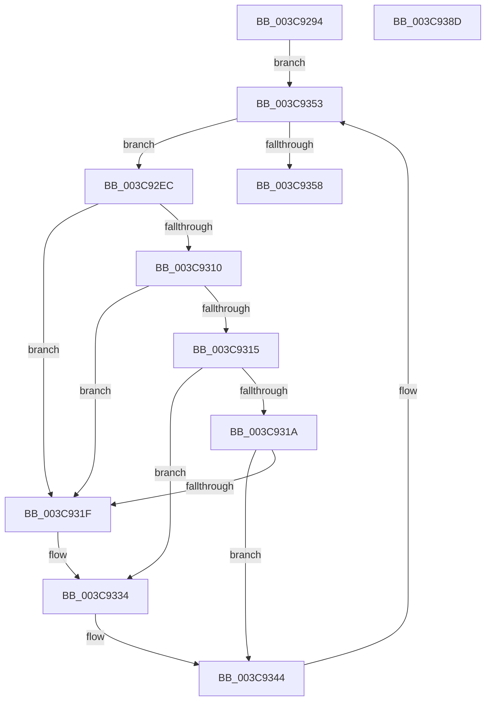

# CcNotifyEnhancedExternalCaches

- RVA: `0x003C9294`–`0x003C938E` (길이 `250` bytes)
- VA: `0x00000001403C9294`
- 실행 섹션: `.text`
- PDB 이름 있음: `예`; PDB Function 태그: `아니요`
- unwind 정보 RVA: `0x0008F5EC`
- 디코드: `65`개 명령, `250/250` bytes 표시
- 미해석 바이트: `0` (있으면 어셈블리에 `.byte`로 보존)

> 이 문서는 커널 이미지의 기계어와 PDB 기호를 분석해 생성했습니다. 4번과 5번은 함수 원형과 자료형을 바이너리 사용 방식에서 추정한 C 해석이며 원본 소스 복구 결과는 아닙니다.

## 1. Dependencies

- 직접 호출 지점: **5**; 고유 호출 대상: **5**
- 직접 호출자로 확인된 함수: **1**
- RIP 상대 이미지 참조: **2**

### Outgoing calls
- `0x003C92CC` → [memset](../6C/memset_function_006C6C40.md) (function, `0x006C6C40`)
- `0x003C92D8` → [KeAcquireSpinLockRaiseToDpc](../20/KeAcquireSpinLockRaiseToDpc_function_00208470.md) (function, `0x00208470`)
- `0x003C934B` → [guard_dispatch_icall](../6B/guard_dispatch_icall_function_006BAAD0.md) (function, `0x006BAAD0`)
- `0x003C9362` → [KeReleaseSpinLock](../39/KeReleaseSpinLock_function_00392BA0.md) (function, `0x00392BA0`)
- `0x003C936E` → [_security_check_cookie](../6A/_security_check_cookie_function_006AC640.md) (function, `0x006AC640`)

### Direct callers
- [CcNotifyExternalCachesInternal](CcNotifyExternalCachesInternal_function_003C9E00.md) at `0x003C9E3E`

### Static image references
- `0x003C92AF` → RVA `0x00E0A740` (`.data`; read)
- `0x003C92D1` → RVA `0x00F8F5D0` (`.data`; read)

## 2. Other-region calls and transfers

- 다른 실행 섹션으로 향하는 call: **0**
- 별도 외부 분기/꼬리 이동을 확인하지 못했습니다.

## 3. Assembly (complete function range)

```asm
003C9294  48 89 5C 24 08                  mov qword ptr [rsp + 8], rbx
003C9299  48 89 74 24 10                  mov qword ptr [rsp + 0x10], rsi
003C929E  48 89 7C 24 20                  mov qword ptr [rsp + 0x20], rdi
003C92A3  55                              push rbp
003C92A4  41 56                           push r14
003C92A6  41 57                           push r15
003C92A8  48 8B EC                        mov rbp, rsp
003C92AB  48 83 EC 70                     sub rsp, 0x70
003C92AF  48 8B 05 8A 14 A4 00            mov rax, qword ptr [rip + 0xa4148a]
003C92B6  48 33 C4                        xor rax, rsp
003C92B9  48 89 45 F0                     mov qword ptr [rbp - 0x10], rax
003C92BD  33 D2                           xor edx, edx
003C92BF  49 8B F0                        mov rsi, r8
003C92C2  8B D9                           mov ebx, ecx
003C92C4  48 8D 4D B0                     lea rcx, [rbp - 0x50]
003C92C8  44 8D 42 40                     lea r8d, [rdx + 0x40]
003C92CC  E8 6F D9 2F 00                  call 0x1406c6c40
003C92D1  48 8D 0D F8 62 BC 00            lea rcx, [rip + 0xbc62f8]
003C92D8  E8 93 F1 E3 FF                  call 0x140208470
003C92DD  4C 8D BE F0 04 00 00            lea r15, [rsi + 0x4f0]
003C92E4  44 8A F0                        mov r14b, al
003C92E7  49 8B 3F                        mov rdi, qword ptr [r15]
003C92EA  EB 67                           jmp 0x1403c9353
003C92EC  48 83 65 B8 00                  and qword ptr [rbp - 0x48], 0
003C92F1  48 8D 4F E0                     lea rcx, [rdi - 0x20]
003C92F5  48 83 65 C0 00                  and qword ptr [rbp - 0x40], 0
003C92FA  48 83 65 D0 00                  and qword ptr [rbp - 0x30], 0
003C92FF  48 83 65 C8 00                  and qword ptr [rbp - 0x38], 0
003C9304  C7 45 B0 01 00 00 00            mov dword ptr [rbp - 0x50], 1
003C930B  83 FB 04                        cmp ebx, 4
003C930E  74 0F                           je 0x1403c931f
003C9310  83 FB 08                        cmp ebx, 8
003C9313  74 0A                           je 0x1403c931f
003C9315  83 FB 10                        cmp ebx, 0x10
003C9318  74 1A                           je 0x1403c9334
003C931A  83 FB 20                        cmp ebx, 0x20
003C931D  75 25                           jne 0x1403c9344
003C931F  48 8B 86 F8 03 00 00            mov rax, qword ptr [rsi + 0x3f8]
003C9326  48 89 45 B8                     mov qword ptr [rbp - 0x48], rax
003C932A  8B 86 10 04 00 00               mov eax, dword ptr [rsi + 0x410]
003C9330  48 89 45 C0                     mov qword ptr [rbp - 0x40], rax
003C9334  48 C7 45 C8 00 00 08 00         mov qword ptr [rbp - 0x38], 0x80000
003C933C  48 C7 45 D0 00 00 04 00         mov qword ptr [rbp - 0x30], 0x40000
003C9344  48 8B 01                        mov rax, qword ptr [rcx]
003C9347  48 8D 55 B0                     lea rdx, [rbp - 0x50]
003C934B  E8 80 17 2F 00                  call 0x1406baad0
003C9350  48 8B 3F                        mov rdi, qword ptr [rdi]
003C9353  49 3B FF                        cmp rdi, r15
003C9356  75 94                           jne 0x1403c92ec
003C9358  41 8A D6                        mov dl, r14b
003C935B  48 8D 0D 6E 62 BC 00            lea rcx, [rip + 0xbc626e]
003C9362  E8 39 98 FC FF                  call 0x140392ba0
003C9367  48 8B 4D F0                     mov rcx, qword ptr [rbp - 0x10]
003C936B  48 33 CC                        xor rcx, rsp
003C936E  E8 CD 32 2E 00                  call 0x1406ac640
003C9373  4C 8D 5C 24 70                  lea r11, [rsp + 0x70]
003C9378  49 8B 5B 20                     mov rbx, qword ptr [r11 + 0x20]
003C937C  49 8B 73 28                     mov rsi, qword ptr [r11 + 0x28]
003C9380  49 8B 7B 38                     mov rdi, qword ptr [r11 + 0x38]
003C9384  49 8B E3                        mov rsp, r11
003C9387  41 5F                           pop r15
003C9389  41 5E                           pop r14
003C938B  5D                              pop rbp
003C938C  C3                              ret
003C938D  CC                              int3
```

## 4. C-style interpretation (structured pseudocode)

```c
__int64 __fastcall CcNotifyEnhancedExternalCaches(int a1, int a2, __int64 a3)
{
    __int64 result;
    __int64 v_rsp;
    unsigned __int64 v_stack_m18;
    unsigned __int64 v_stack_m28;
    unsigned __int64 v_stack_m48;
    unsigned __int64 v_stack_m50;
    unsigned __int64 v_stack_m58;
    unsigned __int64 v_stack_m60;
    unsigned __int64 v_stack_m68;
    unsigned __int64 v_stack_p10;
    unsigned __int64 v_stack_p20;
    unsigned __int64 v_stack_p8;

    v_stack_p8 = v_rbx;
    v_stack_p10 = v_rsi;
    v_stack_p20 = v_rdi;
    v_rsp = (v_rsp) - (112);
    result = (*(unsigned __int64 *)(v_rip + 10753162)) ^ (v_rsp);
    v_stack_m28 = result;
    a2 = 0;
    result = memset(v_stack_m68, a2, a2 + 64, a4);
    result = KeAcquireSpinLockRaiseToDpc(v_rip + 12346104, a2, a2 + 64, a4);
    goto loc_003C9353;
loc_003C92EC:
    v_stack_m68 = 1;
    if (((unsigned int)((unsigned int)(a1))) == 4) goto loc_003C931F;
    if (((unsigned int)((unsigned int)(a1))) == 8) goto loc_003C931F;
    if (((unsigned int)((unsigned int)(a1))) == 16) goto loc_003C9334;
    if (((unsigned int)((unsigned int)(a1))) != 32) goto loc_003C9344;
loc_003C931F:
    v_stack_m60 = *(unsigned __int64 *)(a3 + 1016);
    v_stack_m58 = (unsigned int)(*(unsigned int *)(a3 + 1040));
loc_003C9334:
    v_stack_m50 = 0x80000ULL;
    v_stack_m48 = 0x40000ULL;
loc_003C9344:
    result = guard_dispatch_icall(*(unsigned __int64 *)(a3 + 1264) - 32, v_stack_m68, a2 + 64, a4);
loc_003C9353:
    if ((*(unsigned __int64 *)(*(unsigned __int64 *)(a3 + 1264))) != (a3 + 1264)) goto loc_003C92EC;
    result = KeReleaseSpinLock(v_rip + 12345966, (unsigned __int8)((unsigned __int8)(result)), a2 + 64, a4);
    a1 = (v_stack_m28) ^ (v_rsp);
    result = _security_check_cookie(a1, (unsigned __int8)((unsigned __int8)(result)), a2 + 64, a4);
    return result;
}
```

## 5. (Beta) C Style

```c
int64_t CcNotifyEnhancedExternalCaches(int32_t Arg1, int32_t Arg2, void *Arg3)
{
    uint8_t *arg3 = (uint8_t *)Arg3;

    int64_t result;
    int64_t local_rsp;
    uint64_t v_stack_m18;
    uint64_t v_stack_m28;
    uint64_t v_stack_m48;
    uint64_t v_stack_m50;
    uint64_t v_stack_m58;
    uint64_t v_stack_m60;
    uint64_t v_stack_m68;
    uint64_t v_stack_p10;
    uint64_t v_stack_p20;
    uint64_t v_stack_p8;

    v_stack_p8 = local_rbx;
    v_stack_p10 = local_rsi;
    v_stack_p20 = local_rdi;
    local_rsp = (local_rsp) - (112);
    result = (*(uint64_t *)(v_rip + 0xA4148A)) ^ (local_rsp);
    v_stack_m28 = result;
    Arg2 = 0;
    result = memset(v_stack_m68, Arg2, Arg2 + 64, a4);
    result = KeAcquireSpinLockRaiseToDpc(v_rip + 12346104, Arg2, Arg2 + 64, a4);
    goto loc_003C9353;
loc_003C92EC:
    v_stack_m68 = 1;
    if (((uint32_t)((uint32_t)(Arg1))) == 4) goto loc_003C931F;
    if (((uint32_t)((uint32_t)(Arg1))) == 8) goto loc_003C931F;
    if (((uint32_t)((uint32_t)(Arg1))) == 16) goto loc_003C9334;
    if (((uint32_t)((uint32_t)(Arg1))) != 32) goto loc_003C9344;
loc_003C931F:
    v_stack_m60 = *(uint64_t *)(arg3 + 0x3F8);
    v_stack_m58 = (uint32_t)(*(uint32_t *)(arg3 + 0x410));
loc_003C9334:
    v_stack_m50 = 0x80000ULL;
    v_stack_m48 = 0x40000ULL;
loc_003C9344:
    result = guard_dispatch_icall(*(uint64_t *)(arg3 + 0x4F0) - 32, v_stack_m68, Arg2 + 64, a4);
loc_003C9353:
    if ((*(uint64_t *)(*(uint64_t *)(arg3 + 0x4F0))) != (Arg3 + 1264)) goto loc_003C92EC;
    result = KeReleaseSpinLock(v_rip + 12345966, (uint8_t)((uint8_t)(result)), Arg2 + 64, a4);
    Arg1 = (v_stack_m28) ^ (local_rsp);
    result = _security_check_cookie(Arg1, (uint8_t)((uint8_t)(result)), Arg2 + 64, a4);
    return result;
}
```

### 관측된 메모리 오프셋

구조체 형식이 확인되지 않은 접근은 인자 기준의 오프셋으로만 기록했습니다.

| 기준 인자 | 오프셋 표현 | 폭 (bit) | 접근 |
|---|---:|---:|---|
| `Arg3` | `+ 0x0` | `64` | `R` |
| `Arg3` | `+ 0x3F8` | `64` | `R` |
| `Arg3` | `+ 0x410` | `32` | `R` |
| `Arg3` | `+ 0x4F0` | `64` | `R` |

## 6. Execution-region graph

[열기: 2D/3D 그래프와 함수 탐색 컨트롤 패널](../../../control-panel.html?section=text&rva=0x003C9294&view=graph)

- 2D 그래프는 위에서 아래로 흐르고, 3D 그래프는 빈 공간을 드래그해 회전합니다. Shift+드래그는 이동, 휠은 확대·축소, 함수 노드 선택은 대상 보고서 이동입니다.

### Static fallback


