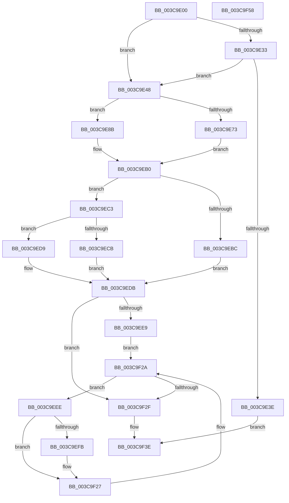

# CcNotifyExternalCachesInternal

- RVA: `0x003C9E00`–`0x003C9F59` (길이 `345` bytes)
- VA: `0x00000001403C9E00`
- 실행 섹션: `.text`
- PDB 이름 있음: `예`; PDB Function 태그: `아니요`
- unwind 정보 RVA: `0x0007EE78`
- 디코드: `95`개 명령, `345/345` bytes 표시
- 미해석 바이트: `0` (있으면 어셈블리에 `.byte`로 보존)

> 이 문서는 커널 이미지의 기계어와 PDB 기호를 분석해 생성했습니다. 4번과 5번은 함수 원형과 자료형을 바이너리 사용 방식에서 추정한 C 해석이며 원본 소스 복구 결과는 아닙니다.

## 1. Dependencies

- 직접 호출 지점: **8**; 고유 호출 대상: **8**
- 직접 호출자로 확인된 함수: **2**
- RIP 상대 이미지 참조: **3**

### Outgoing calls
- `0x003C9E3E` → [CcNotifyEnhancedExternalCaches](CcNotifyEnhancedExternalCaches_function_003C9294.md) (function, `0x003C9294`)
- `0x003C9E4F` → [KeAcquireSpinLockRaiseToDpc](../20/KeAcquireSpinLockRaiseToDpc_function_00208470.md) (function, `0x00208470`)
- `0x003C9E63` → [KeAcquireInStackQueuedSpinLockAtDpcLevel](../27/KeAcquireInStackQueuedSpinLockAtDpcLevel_function_00275740.md) (function, `0x00275740`)
- `0x003C9E84` → [CcCalculatePagesToWriteForVolume](../47/CcCalculatePagesToWriteForVolume_function_0047CEF4.md) (function, `0x0047CEF4`)
- `0x003C9EAB` → [CcCalculatePagesToWrite](../38/CcCalculatePagesToWrite_function_003895AC.md) (function, `0x003895AC`)
- `0x003C9EE0` → [KeReleaseInStackQueuedSpinLockFromDpcLevel](../21/KeReleaseInStackQueuedSpinLockFromDpcLevel_function_002171B0.md) (function, `0x002171B0`)
- `0x003C9F22` → [guard_dispatch_icall](../6B/guard_dispatch_icall_function_006BAAD0.md) (function, `0x006BAAD0`)
- `0x003C9F39` → [KeReleaseSpinLock](../39/KeReleaseSpinLock_function_00392BA0.md) (function, `0x00392BA0`)

### Direct callers
- [CcQueueLazyWriteScanThreadForVolume](CcQueueLazyWriteScanThreadForVolume_function_003C9AF0.md) at `0x003C9D27`
- [CcQueueLazyWriteScanThread](../57/CcQueueLazyWriteScanThread_function_0057BBD0.md) at `0x0057BD5E`

### Static image references
- `0x003C9E48` → RVA `0x00F8F5D0` (`.data`; read)
- `0x003C9E68` → RVA `0x00E65B88` (`.data`; read)
- `0x003C9EA4` → RVA `0x00F8F5E0` (`.data`; read)

## 2. Other-region calls and transfers

- 다른 실행 섹션으로 향하는 call: **0**
- 별도 외부 분기/꼬리 이동을 확인하지 못했습니다.

## 3. Assembly (complete function range)

```asm
003C9E00  4C 8B DC                        mov r11, rsp
003C9E03  49 89 5B 08                     mov qword ptr [r11 + 8], rbx
003C9E07  49 89 6B 10                     mov qword ptr [r11 + 0x10], rbp
003C9E0B  49 89 73 18                     mov qword ptr [r11 + 0x18], rsi
003C9E0F  57                              push rdi
003C9E10  41 56                           push r14
003C9E12  41 57                           push r15
003C9E14  48 83 EC 50                     sub rsp, 0x50
003C9E18  33 C0                           xor eax, eax
003C9E1A  0F 57 C0                        xorps xmm0, xmm0
003C9E1D  49 8B D8                        mov rbx, r8
003C9E20  48 8B F2                        mov rsi, rdx
003C9E23  8B E9                           mov ebp, ecx
003C9E25  0F 11 44 24 30                  movups xmmword ptr [rsp + 0x30], xmm0
003C9E2A  49 89 43 D8                     mov qword ptr [r11 - 0x28], rax
003C9E2E  4D 85 C0                        test r8, r8
003C9E31  74 15                           je 0x1403c9e48
003C9E33  41 8B 80 50 06 00 00            mov eax, dword ptr [r8 + 0x650]
003C9E3A  A8 10                           test al, 0x10
003C9E3C  74 0A                           je 0x1403c9e48
003C9E3E  E8 51 F4 FF FF                  call 0x1403c9294
003C9E43  E9 F6 00 00 00                  jmp 0x1403c9f3e
003C9E48  48 8D 0D 81 57 BC 00            lea rcx, [rip + 0xbc5781]
003C9E4F  E8 1C E6 E3 FF                  call 0x140208470
003C9E54  48 8D 8E 00 03 00 00            lea rcx, [rsi + 0x300]
003C9E5B  44 8A F8                        mov r15b, al
003C9E5E  48 8D 54 24 30                  lea rdx, [rsp + 0x30]
003C9E63  E8 D8 B8 EA FF                  call 0x140275740
003C9E68  80 3D 19 BD A9 00 00            cmp byte ptr [rip + 0xa9bd19], 0
003C9E6F  8B D5                           mov edx, ebp
003C9E71  74 18                           je 0x1403c9e8b
003C9E73  48 8B CB                        mov rcx, rbx
003C9E76  4C 8D B3 E0 03 00 00            lea r14, [rbx + 0x3e0]
003C9E7D  48 8D BB E0 04 00 00            lea rdi, [rbx + 0x4e0]
003C9E84  E8 6B 30 0B 00                  call 0x14047cef4
003C9E89  EB 25                           jmp 0x1403c9eb0
003C9E8B  83 64 24 20 00                  and dword ptr [rsp + 0x20], 0
003C9E90  4C 8D B6 20 04 00 00            lea r14, [rsi + 0x420]
003C9E97  4D 8B C6                        mov r8, r14
003C9E9A  4C 8D 8E 38 04 00 00            lea r9, [rsi + 0x438]
003C9EA1  48 8B CE                        mov rcx, rsi
003C9EA4  48 8D 3D 35 57 BC 00            lea rdi, [rip + 0xbc5735]
003C9EAB  E8 FC F6 FB FF                  call 0x1403895ac
003C9EB0  8B C0                           mov eax, eax
003C9EB2  B9 FF FF FF FF                  mov ecx, 0xffffffff
003C9EB7  48 3B C1                        cmp rax, rcx
003C9EBA  75 07                           jne 0x1403c9ec3
003C9EBC  BE 64 00 00 00                  mov esi, 0x64
003C9EC1  EB 18                           jmp 0x1403c9edb
003C9EC3  49 8B 0E                        mov rcx, qword ptr [r14]
003C9EC6  48 85 C9                        test rcx, rcx
003C9EC9  74 0E                           je 0x1403c9ed9
003C9ECB  48 6B C0 64                     imul rax, rax, 0x64
003C9ECF  33 D2                           xor edx, edx
003C9ED1  48 F7 F1                        div rcx
003C9ED4  48 8B F0                        mov rsi, rax
003C9ED7  EB 02                           jmp 0x1403c9edb
003C9ED9  33 F6                           xor esi, esi
003C9EDB  48 8D 4C 24 30                  lea rcx, [rsp + 0x30]
003C9EE0  E8 CB D2 E4 FF                  call 0x1402171b0
003C9EE5  85 F6                           test esi, esi
003C9EE7  74 46                           je 0x1403c9f2f
003C9EE9  48 8B 1F                        mov rbx, qword ptr [rdi]
003C9EEC  EB 3C                           jmp 0x1403c9f2a
003C9EEE  48 8D 4B E0                     lea rcx, [rbx - 0x20]
003C9EF2  48 8B 41 08                     mov rax, qword ptr [rcx + 8]
003C9EF6  48 85 C0                        test rax, rax
003C9EF9  74 2C                           je 0x1403c9f27
003C9EFB  44 8B CE                        mov r9d, esi
003C9EFE  44 8B C5                        mov r8d, ebp
003C9F01  4C 0F AF C8                     imul r9, rax
003C9F05  48 B8 15 AE 47 E1 7A 14 AE 47   movabs rax, 0x47ae147ae147ae15
003C9F0F  49 F7 E1                        mul r9
003C9F12  48 8B 01                        mov rax, qword ptr [rcx]
003C9F15  4C 2B CA                        sub r9, rdx
003C9F18  49 D1 E9                        shr r9, 1
003C9F1B  49 03 D1                        add rdx, r9
003C9F1E  48 C1 EA 06                     shr rdx, 6
003C9F22  E8 A9 0B 2F 00                  call 0x1406baad0
003C9F27  48 8B 1B                        mov rbx, qword ptr [rbx]
003C9F2A  48 3B DF                        cmp rbx, rdi
003C9F2D  75 BF                           jne 0x1403c9eee
003C9F2F  41 8A D7                        mov dl, r15b
003C9F32  48 8D 0D 97 56 BC 00            lea rcx, [rip + 0xbc5697]
003C9F39  E8 62 8C FC FF                  call 0x140392ba0
003C9F3E  4C 8D 5C 24 50                  lea r11, [rsp + 0x50]
003C9F43  49 8B 5B 20                     mov rbx, qword ptr [r11 + 0x20]
003C9F47  49 8B 6B 28                     mov rbp, qword ptr [r11 + 0x28]
003C9F4B  49 8B 73 30                     mov rsi, qword ptr [r11 + 0x30]
003C9F4F  49 8B E3                        mov rsp, r11
003C9F52  41 5F                           pop r15
003C9F54  41 5E                           pop r14
003C9F56  5F                              pop rdi
003C9F57  C3                              ret
003C9F58  CC                              int3
```

## 4. C-style interpretation (structured pseudocode)

```c
__int64 __fastcall CcNotifyExternalCachesInternal(int a1, __int64 a2, __int64 a3)
{
    __int64 result;
    __int64 v_rsi;
    __int64 v_rsp;
    unsigned __int64 v_stack_m18;
    unsigned __int64 v_stack_m38;
    unsigned int v_stack_m48;

    *(unsigned __int64 *)(v_rsp + 8) = v_rbx;
    *(unsigned __int64 *)(v_rsp + 16) = v_rbp;
    *(unsigned __int64 *)(v_rsp + 24) = v_rsi;
    v_rsp = (v_rsp) - (80);
    result = 0;
    v_stack_m38 = v_xmm0;
    *(unsigned __int64 *)(v_rsp - 40) = 0;
    if (a3 == 0) goto loc_003C9E48;
    if ((((unsigned __int8)((unsigned int)(*(unsigned int *)(a3 + 1616)))) & (16)) == 0) goto loc_003C9E48;
    result = CcNotifyEnhancedExternalCaches(a1, a2, a3, a4);
    goto loc_003C9F3E;
loc_003C9E48:
    result = KeAcquireSpinLockRaiseToDpc(v_rip + 12343169, a2, a3, a4);
    result = KeAcquireInStackQueuedSpinLockAtDpcLevel(a2 + 768, v_stack_m38, a3, a4);
    if ((*(unsigned __int8 *)(v_rip + 11123993)) == 0) goto loc_003C9E8B;
    result = CcCalculatePagesToWriteForVolume(a3, (unsigned int)((unsigned int)((unsigned int)(a1))), a3, a4);
    goto loc_003C9EB0;
loc_003C9E8B:
    result = CcCalculatePagesToWrite(a2, (unsigned int)((unsigned int)((unsigned int)(a1))), a2 + 1056, a2 + 1080);
loc_003C9EB0:
    if (((unsigned int)((unsigned int)(result))) != ((unsigned int)(0xFFFFFFFFULL))) goto loc_003C9EC3;
    goto loc_003C9EDB;
loc_003C9EC3:
    if (*(unsigned __int64 *)(a2 + 1056) == 0) goto loc_003C9ED9;
    result = ((unsigned int)((unsigned int)(result))) * ((unsigned int)((unsigned int)(result)));
    a2 = 0;
    goto loc_003C9EDB;
loc_003C9ED9:
    v_rsi = 0;
loc_003C9EDB:
    result = KeReleaseInStackQueuedSpinLockFromDpcLevel(v_stack_m38, a2, a2 + 1056, a2 + 1080);
    if (0 == 0) goto loc_003C9F2F;
    goto loc_003C9F2A;
loc_003C9EEE:
    result = *(unsigned __int64 *)(*(unsigned __int64 *)(v_rip + 12343093) - 32 + 8);
    if (*(unsigned __int64 *)(*(unsigned __int64 *)(v_rip + 12343093) - 32 + 8) != 0) {
        a4 = 0;
        a3 = (unsigned int)((unsigned int)(a1));
        a4 = (a4) * (*(unsigned __int64 *)(*(unsigned __int64 *)(v_rip + 12343093) - 32 + 8));
        result = *(unsigned __int64 *)(*(unsigned __int64 *)(v_rip + 12343093) - 32);
        a4 = (a4) - (0);
        a4 = (a4) >> (1);
        a2 = (a2) + (a4);
        a2 = (a2) >> (6);
        result = guard_dispatch_icall(*(unsigned __int64 *)(v_rip + 12343093) - 32, a2, a3, a4);
    }
loc_003C9F2A:
    if ((*(unsigned __int64 *)(*(unsigned __int64 *)(v_rip + 12343093))) != (v_rip + 12343093)) goto loc_003C9EEE;
loc_003C9F2F:
    result = KeReleaseSpinLock(v_rip + 12342935, (unsigned __int8)((unsigned __int8)(result)), a3, a4);
loc_003C9F3E:
    return result;
}
```

## 5. (Beta) C Style

```c
int64_t CcNotifyExternalCachesInternal(int32_t Arg1, void *Arg2, void *Arg3)
{
    uint8_t *arg2 = (uint8_t *)Arg2;
    uint8_t *arg3 = (uint8_t *)Arg3;

    int64_t result;
    int64_t local_rsi;
    int64_t local_rsp;
    uint64_t v_stack_m18;
    uint64_t v_stack_m38;
    uint32_t v_stack_m48;

    *(uint64_t *)(local_rsp + 0x8) = local_rbx;
    *(uint64_t *)(local_rsp + 0x10) = local_rbp;
    *(uint64_t *)(local_rsp + 0x18) = local_rsi;
    local_rsp = (local_rsp) - (80);
    result = 0;
    v_stack_m38 = v_xmm0;
    *(uint64_t *)(local_rsp - 0x28) = 0;
    if (Arg3 == NULL) goto loc_003C9E48;
    if ((((uint8_t)((uint32_t)(*(uint32_t *)(arg3 + 0x650)))) & (16)) == 0) goto loc_003C9E48;
    result = CcNotifyEnhancedExternalCaches(Arg1, Arg2, Arg3, a4);
    goto loc_003C9F3E;
loc_003C9E48:
    result = KeAcquireSpinLockRaiseToDpc(v_rip + 12343169, Arg2, Arg3, a4);
    result = KeAcquireInStackQueuedSpinLockAtDpcLevel(Arg2 + 768, v_stack_m38, Arg3, a4);
    if ((*(uint8_t *)(v_rip + 0xA9BD19)) == 0) goto loc_003C9E8B;
    result = CcCalculatePagesToWriteForVolume(Arg3, (uint32_t)((uint32_t)((uint32_t)(Arg1))), Arg3, a4);
    goto loc_003C9EB0;
loc_003C9E8B:
    result = CcCalculatePagesToWrite(Arg2, (uint32_t)((uint32_t)((uint32_t)(Arg1))), Arg2 + 1056, Arg2 + 1080);
loc_003C9EB0:
    if (((uint32_t)((uint32_t)(result))) != ((uint32_t)(0xFFFFFFFFULL))) goto loc_003C9EC3;
    goto loc_003C9EDB;
loc_003C9EC3:
    if (*(uint64_t *)(arg2 + 0x420) == 0) goto loc_003C9ED9;
    result = ((uint32_t)((uint32_t)(result))) * ((uint32_t)((uint32_t)(result)));
    Arg2 = 0;
    goto loc_003C9EDB;
loc_003C9ED9:
    local_rsi = 0;
loc_003C9EDB:
    result = KeReleaseInStackQueuedSpinLockFromDpcLevel(v_stack_m38, Arg2, Arg2 + 1056, Arg2 + 1080);
    if (0 == 0) goto loc_003C9F2F;
    goto loc_003C9F2A;
loc_003C9EEE:
    result = *(uint64_t *)(*(uint64_t *)(v_rip + 0xBC5735) - 0x20 + 0x8);
    if (*(uint64_t *)(*(uint64_t *)(v_rip + 0xBC5735) - 0x20 + 0x8) != 0) {
        a4 = 0;
        Arg3 = (uint32_t)((uint32_t)(Arg1));
        a4 = (a4) * (*(uint64_t *)(*(uint64_t *)(v_rip + 0xBC5735) - 0x20 + 0x8));
        result = *(uint64_t *)(*(uint64_t *)(v_rip + 0xBC5735) - 0x20);
        a4 = (a4) - (0);
        a4 = (a4) >> (1);
        Arg2 = (Arg2) + (a4);
        Arg2 = (Arg2) >> (6);
        result = guard_dispatch_icall(*(uint64_t *)(v_rip + 0xBC5735) - 32, Arg2, Arg3, a4);
    }
loc_003C9F2A:
    if ((*(uint64_t *)(*(uint64_t *)(v_rip + 0xBC5735))) != (v_rip + 12343093)) goto loc_003C9EEE;
loc_003C9F2F:
    result = KeReleaseSpinLock(v_rip + 12342935, (uint8_t)((uint8_t)(result)), Arg3, a4);
loc_003C9F3E:
    return result;
}
```

### 관측된 메모리 오프셋

구조체 형식이 확인되지 않은 접근은 인자 기준의 오프셋으로만 기록했습니다.

| 기준 인자 | 오프셋 표현 | 폭 (bit) | 접근 |
|---|---:|---:|---|
| `Arg2` | `+ 0x300` | `64` | `R` |
| `Arg2` | `+ 0x420` | `64` | `R` |
| `Arg2` | `+ 0x438` | `64` | `R` |
| `Arg3` | `+ 0x3E0` | `64` | `R` |
| `Arg3` | `+ 0x4E0` | `64` | `R` |

## 6. Execution-region graph

[열기: 2D/3D 그래프와 함수 탐색 컨트롤 패널](../../../control-panel.html?section=text&rva=0x003C9E00&view=graph)

- 2D 그래프는 위에서 아래로 흐르고, 3D 그래프는 빈 공간을 드래그해 회전합니다. Shift+드래그는 이동, 휠은 확대·축소, 함수 노드 선택은 대상 보고서 이동입니다.

### Static fallback


