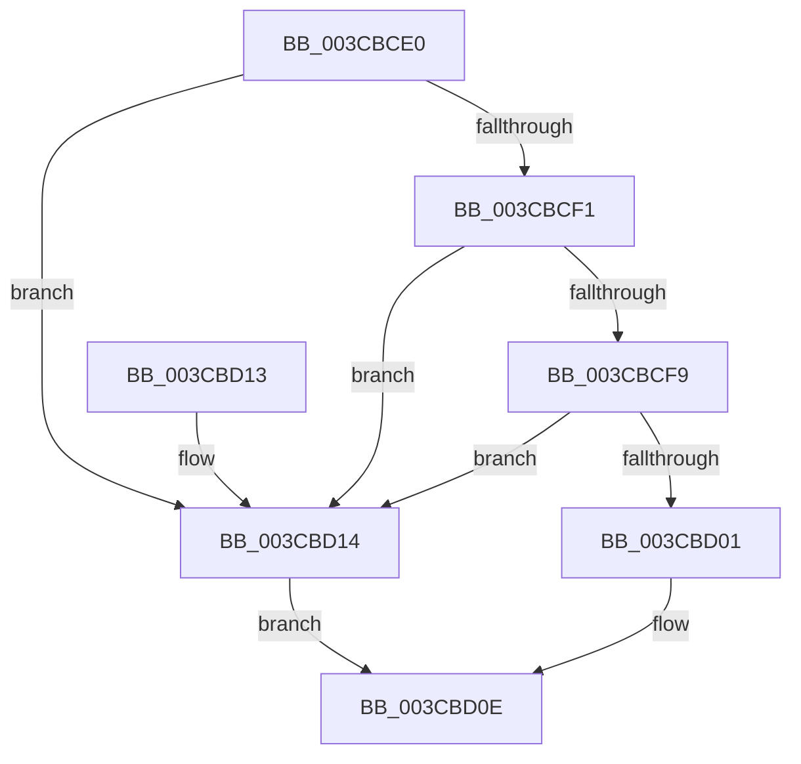

# CcNotifyWriteBehindAllVolumesHelper

- RVA: `0x003CBCE0`–`0x003CBD18` (길이 `56` bytes)
- VA: `0x00000001403CBCE0`
- 실행 섹션: `.text`
- PDB 이름 있음: `예`; PDB Function 태그: `아니요`
- unwind 정보 RVA: `0x00069B1C`
- 디코드: `18`개 명령, `56/56` bytes 표시
- 미해석 바이트: `0` (있으면 어셈블리에 `.byte`로 보존)

> 이 문서는 커널 이미지의 기계어와 PDB 기호를 분석해 생성했습니다. 4번과 5번은 함수 원형과 자료형을 바이너리 사용 방식에서 추정한 C 해석이며 원본 소스 복구 결과는 아닙니다.

## 1. Dependencies

- 직접 호출 지점: **1**; 고유 호출 대상: **1**
- 직접 호출자로 확인된 함수: **0**
- RIP 상대 이미지 참조: **1**

### Outgoing calls
- `0x003CBD07` → [CcNotifyWriteBehindVolume](CcNotifyWriteBehindVolume_function_003CC134.md) (function, `0x003CC134`)

### Direct callers
- 이 함수 시작 RVA로 연결되는 직접 call은 확인되지 않았습니다. 간접 호출은 완전히 역산할 수 없습니다.

### Static image references
- `0x003CBCE9` → RVA `0x00E65B50` (`.data`; read)

## 2. Other-region calls and transfers

- 다른 실행 섹션으로 향하는 call: **0**
- 별도 외부 분기/꼬리 이동을 확인하지 못했습니다.

## 3. Assembly (complete function range)

```asm
003CBCE0  48 83 EC 28                     sub rsp, 0x28
003CBCE4  48 8B C2                        mov rax, rdx
003CBCE7  33 D2                           xor edx, edx
003CBCE9  39 15 61 9E A9 00               cmp dword ptr [rip + 0xa99e61], edx
003CBCEF  74 23                           je 0x1403cbd14
003CBCF1  38 91 54 05 00 00               cmp byte ptr [rcx + 0x554], dl
003CBCF7  74 1B                           je 0x1403cbd14
003CBCF9  38 90 D4 04 00 00               cmp byte ptr [rax + 0x4d4], dl
003CBCFF  74 13                           je 0x1403cbd14
003CBD01  41 8B 10                        mov edx, dword ptr [r8]
003CBD04  48 8B C8                        mov rcx, rax
003CBD07  E8 28 04 00 00                  call 0x1403cc134
003CBD0C  B0 01                           mov al, 1
003CBD0E  48 83 C4 28                     add rsp, 0x28
003CBD12  C3                              ret
003CBD13  CC                              int3
003CBD14  32 C0                           xor al, al
003CBD16  EB F6                           jmp 0x1403cbd0e
```

## 4. C-style interpretation (structured pseudocode)

```c
__int64 __fastcall CcNotifyWriteBehindAllVolumesHelper(__int64 a1, __int64 a2, __int64 a3)
{
    __int64 result;
    __int64 v_rsp;

    v_rsp = (v_rsp) - (40);
    a2 = 0;
    if ((*(unsigned int *)(v_rip + 11116129)) == 0) goto loc_003CBD14;
    if ((*(unsigned __int8 *)(a1 + 1364)) == 0) goto loc_003CBD14;
    if ((*(unsigned __int8 *)(a2 + 1236)) == 0) goto loc_003CBD14;
    result = CcNotifyWriteBehindVolume(0, (unsigned int)(*(unsigned int *)(a3)), a3, a4);
loc_003CBD0E:
    v_rsp = (v_rsp) + (40);
    return 1;
loc_003CBD14:
    result = 0;
    goto loc_003CBD0E;
}
```

## 5. (Beta) C Style

```c
int64_t CcNotifyWriteBehindAllVolumesHelper(void *Arg1, void *Arg2, void *Arg3)
{
    uint8_t *arg1 = (uint8_t *)Arg1;
    uint8_t *arg2 = (uint8_t *)Arg2;
    uint8_t *arg3 = (uint8_t *)Arg3;

    int64_t result;
    int64_t local_rsp;

    local_rsp = (local_rsp) - (40);
    Arg2 = 0;
    if ((*(uint32_t *)(v_rip + 0xA99E61)) == 0) goto loc_003CBD14;
    if ((*(uint8_t *)(arg1 + 0x554)) == 0) goto loc_003CBD14;
    if ((*(uint8_t *)(arg2 + 0x4D4)) == 0) goto loc_003CBD14;
    result = CcNotifyWriteBehindVolume(0, (uint32_t)(*(uint32_t *)(arg3)), Arg3, a4);
loc_003CBD0E:
    local_rsp = (local_rsp) + (40);
    return 1;
loc_003CBD14:
    result = 0;
    goto loc_003CBD0E;
}
```

### 관측된 메모리 오프셋

구조체 형식이 확인되지 않은 접근은 인자 기준의 오프셋으로만 기록했습니다.

| 기준 인자 | 오프셋 표현 | 폭 (bit) | 접근 |
|---|---:|---:|---|
| `Arg1` | `+ 0x554` | `8` | `R` |
| `Arg2` | `+ 0x4D4` | `8` | `R` |
| `Arg3` | `+ 0x0` | `32` | `R` |

## 6. Execution-region graph

[열기: 2D/3D 그래프와 함수 탐색 컨트롤 패널](../../../control-panel.html?section=text&rva=0x003CBCE0&view=graph)

- 2D 그래프는 위에서 아래로 흐르고, 3D 그래프는 빈 공간을 드래그해 회전합니다. Shift+드래그는 이동, 휠은 확대·축소, 함수 노드 선택은 대상 보고서 이동입니다.

### Static fallback


