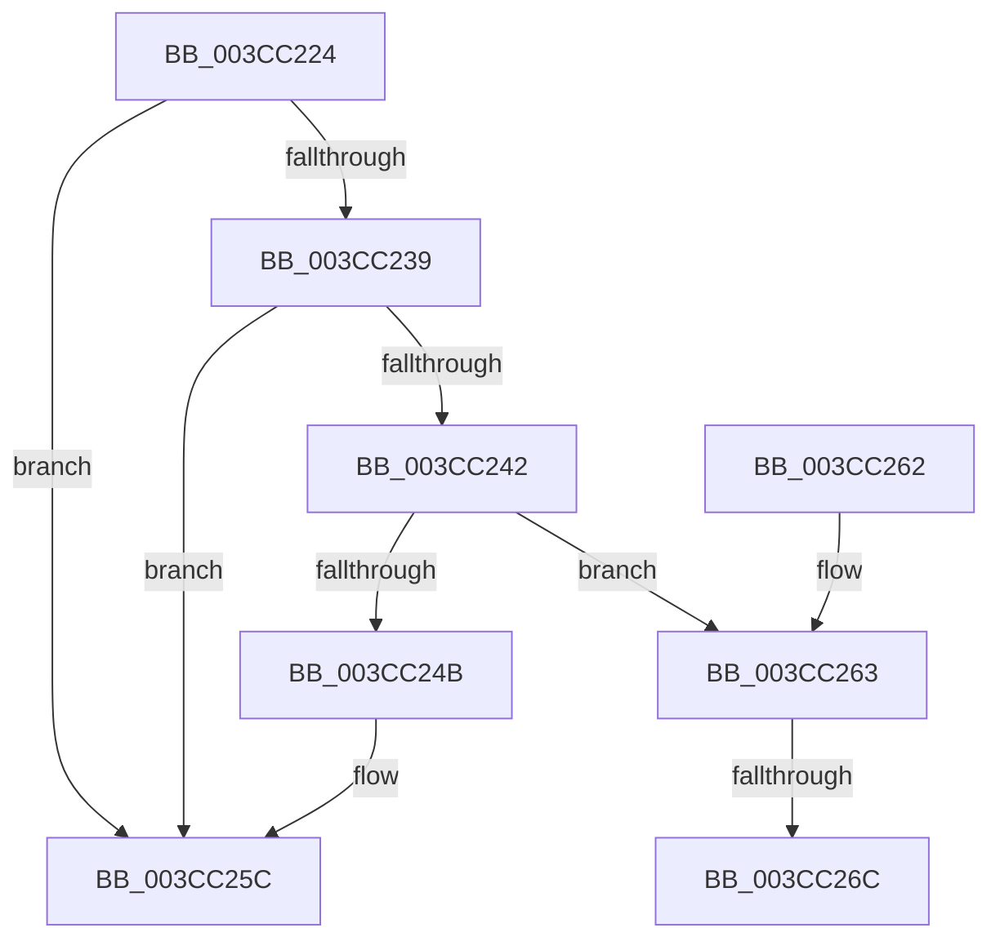

# CcNotifyWriteBehindInternal

- RVA: `0x003CC224`–`0x003CC286` (길이 `98` bytes)
- VA: `0x00000001403CC224`
- 실행 섹션: `.text`
- PDB 이름 있음: `예`; PDB Function 태그: `예`
- unwind 정보 RVA: `0x0008F898`
- 디코드: `25`개 명령, `98/98` bytes 표시
- 미해석 바이트: `0` (있으면 어셈블리에 `.byte`로 보존)

> 이 문서는 커널 이미지의 기계어와 PDB 기호를 분석해 생성했습니다. 4번과 5번은 함수 원형과 자료형을 바이너리 사용 방식에서 추정한 C 해석이며 원본 소스 복구 결과는 아닙니다.

## 1. Dependencies

- 직접 호출 지점: **2**; 고유 호출 대상: **2**
- 직접 호출자로 확인된 함수: **10**
- RIP 상대 이미지 참조: **3**

### Outgoing calls
- `0x003CC257` → [CcForEachPrivateVolumeCacheMap](../38/CcForEachPrivateVolumeCacheMap_function_0038967C.md) (function, `0x0038967C`)
- `0x003CC278` → [KeSetEvent](../33/KeSetEvent_function_0033F310.md) (function, `0x0033F310`)

### Direct callers
- [CcCanIWrite](../38/CcCanIWrite_function_00388250.md) at `0x003886AA`
- [CcNotifyWriteBehindEx](../3B/CcNotifyWriteBehindEx_function_003BCBA8.md) at `0x003BCBBF`
- [CcCoalescingCallBackHelper](CcCoalescingCallBackHelper_function_003CA200.md) at `0x003CA348`
- [CcScheduleLazyWriteScan](CcScheduleLazyWriteScan_function_003CBD20.md) at `0x003CBDF7`
- [CcChargeDirtyPages](CcChargeDirtyPages_function_003CBEA0.md) at `0x003CC0A9`
- [CcInitializeCacheMapInternal](CcInitializeCacheMapInternal_function_003CC720.md) at `0x003CD062`
- [CcUninitializeCacheMap](CcUninitializeCacheMap_function_003CD520.md) at `0x003CD898`
- [CcChargeDirtyPagesInternal](CcChargeDirtyPagesInternal_function_003CDE10.md) at `0x003CE010`
- [CcNotifyWriteBehindHelper](../57/CcNotifyWriteBehindHelper_function_0057BA80.md) at `0x0057BA8F`
- [CcExitPartition](../57/CcExitPartition_function_0057E340.md) at `0x0057E386`

### Static image references
- `0x003CC22D` → RVA `0x00E65B50` (`.data`; read)
- `0x003CC242` → RVA `0x00E65B88` (`.data`; read)
- `0x003CC250` → RVA `0x003CBCE0` (`CcNotifyWriteBehindAllVolumesHelper`; read)

## 2. Other-region calls and transfers

- 다른 실행 섹션으로 향하는 call: **0**
- call이 아닌 외부 분기/꼬리 이동: **2**
  - `0x003CC266` → [sub_006E8616](../6E/Unknown_function_006E8616.md) (`tail-transfer`)
  - `0x003CC281` → [sub_006E8616](../6E/Unknown_function_006E8616.md) (`tail-transfer`)

## 3. Assembly (complete function range)

```asm
003CC224  89 54 24 10                     mov dword ptr [rsp + 0x10], edx
003CC228  57                              push rdi
003CC229  48 83 EC 30                     sub rsp, 0x30
003CC22D  83 3D 1C 99 A9 00 00            cmp dword ptr [rip + 0xa9991c], 0
003CC234  48 8B F9                        mov rdi, rcx
003CC237  74 23                           je 0x1403cc25c
003CC239  80 B9 54 05 00 00 00            cmp byte ptr [rcx + 0x554], 0
003CC240  74 1A                           je 0x1403cc25c
003CC242  80 3D 3F 99 A9 00 00            cmp byte ptr [rip + 0xa9993f], 0
003CC249  74 18                           je 0x1403cc263
003CC24B  4C 8D 44 24 48                  lea r8, [rsp + 0x48]
003CC250  48 8D 15 89 FA FF FF            lea rdx, [rip - 0x577]
003CC257  E8 20 D4 FB FF                  call 0x14038967c
003CC25C  48 83 C4 30                     add rsp, 0x30
003CC260  5F                              pop rdi
003CC261  C3                              ret
003CC262  CC                              int3
003CC263  F6 C2 01                        test dl, 1
003CC266  0F 84 AA C3 31 00               je 0x1406e8616
003CC26C  48 81 C1 70 03 00 00            add rcx, 0x370
003CC273  45 33 C0                        xor r8d, r8d
003CC276  33 D2                           xor edx, edx
003CC278  E8 93 30 F7 FF                  call 0x14033f310
003CC27D  8B 54 24 48                     mov edx, dword ptr [rsp + 0x48]
003CC281  E9 90 C3 31 00                  jmp 0x1406e8616
```

## 4. C-style interpretation (structured pseudocode)

```c
__int64 __fastcall CcNotifyWriteBehindInternal(__int64 a1, int a2)
{
    __int64 result;
    __int64 v_rsp;
    unsigned int v_stack_p10;
    unsigned int v_stack_p48;

    v_stack_p10 = a2;
    v_rsp = (v_rsp) - (48);
    if ((*(unsigned int *)(v_rip + 11114780)) == 0) goto loc_003CC25C;
    if ((*(unsigned __int8 *)(a1 + 1364)) == 0) goto loc_003CC25C;
    if ((*(unsigned __int8 *)(v_rip + 11114815)) == 0) goto loc_003CC263;
    result = CcForEachPrivateVolumeCacheMap(a1, v_rip - 1399, v_stack_p10, a4);
loc_003CC25C:
    v_rsp = (v_rsp) + (48);
    return result;
loc_003CC263:
    a1 = (a1) + (880);
    a3 = 0;
    a2 = 0;
    result = KeSetEvent(a1, a2, a3, a4);
}
```

## 5. (Beta) C Style

```c
int64_t CcNotifyWriteBehindInternal(void *Arg1, int32_t Arg2)
{
    uint8_t *arg1 = (uint8_t *)Arg1;

    int64_t result;
    int64_t local_rsp;
    uint32_t v_stack_p10;
    uint32_t v_stack_p48;

    v_stack_p10 = Arg2;
    local_rsp = (local_rsp) - (48);
    if ((*(uint32_t *)(v_rip + 0xA9991C)) == 0) goto loc_003CC25C;
    if ((*(uint8_t *)(arg1 + 0x554)) == 0) goto loc_003CC25C;
    if ((*(uint8_t *)(v_rip + 0xA9993F)) == 0) goto loc_003CC263;
    result = CcForEachPrivateVolumeCacheMap(Arg1, v_rip - 1399, v_stack_p10, a4);
loc_003CC25C:
    local_rsp = (local_rsp) + (48);
    return result;
loc_003CC263:
    Arg1 = (Arg1) + (880);
    a3 = 0;
    Arg2 = 0;
    result = KeSetEvent(Arg1, Arg2, a3, a4);
}
```

### 관측된 메모리 오프셋

구조체 형식이 확인되지 않은 접근은 인자 기준의 오프셋으로만 기록했습니다.

| 기준 인자 | 오프셋 표현 | 폭 (bit) | 접근 |
|---|---:|---:|---|
| `Arg1` | `+ 0x554` | `8` | `R` |

## 6. Execution-region graph

[열기: 2D/3D 그래프와 함수 탐색 컨트롤 패널](../../../control-panel.html?section=text&rva=0x003CC224&view=graph)

- 2D 그래프는 위에서 아래로 흐르고, 3D 그래프는 빈 공간을 드래그해 회전합니다. Shift+드래그는 이동, 휠은 확대·축소, 함수 노드 선택은 대상 보고서 이동입니다.

### Static fallback


