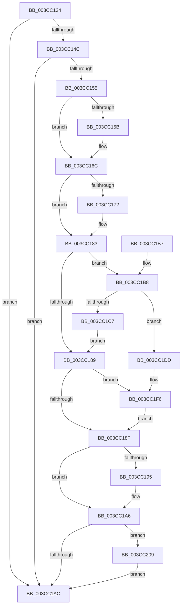

# CcNotifyWriteBehindVolume

- RVA: `0x003CC134`–`0x003CC21C` (길이 `232` bytes)
- VA: `0x00000001403CC134`
- 실행 섹션: `.text`
- PDB 이름 있음: `예`; PDB Function 태그: `아니요`
- unwind 정보 RVA: `0x0008F888`
- 디코드: `63`개 명령, `232/232` bytes 표시
- 미해석 바이트: `0` (있으면 어셈블리에 `.byte`로 보존)

> 이 문서는 커널 이미지의 기계어와 PDB 기호를 분석해 생성했습니다. 4번과 5번은 함수 원형과 자료형을 바이너리 사용 방식에서 추정한 C 해석이며 원본 소스 복구 결과는 아닙니다.

## 1. Dependencies

- 직접 호출 지점: **7**; 고유 호출 대상: **3**
- 직접 호출자로 확인된 함수: **11**
- RIP 상대 이미지 참조: **0**

### Outgoing calls
- `0x003CC167` → [KeSetEvent](../33/KeSetEvent_function_0033F310.md) (function, `0x0033F310`)
- `0x003CC17E` → [KeSetEvent](../33/KeSetEvent_function_0033F310.md) (function, `0x0033F310`)
- `0x003CC1A1` → [KeSetEvent](../33/KeSetEvent_function_0033F310.md) (function, `0x0033F310`)
- `0x003CC1D6` → [KiSetTimerEx](../23/KiSetTimerEx_function_00232CB0.md) (function, `0x00232CB0`)
- `0x003CC1F0` → [KeBugCheckEx](../4F/KeBugCheckEx_function_004FD660.md) (function, `0x004FD660`)
- `0x003CC202` → [KeSetEvent](../33/KeSetEvent_function_0033F310.md) (function, `0x0033F310`)
- `0x003CC215` → [KeSetEvent](../33/KeSetEvent_function_0033F310.md) (function, `0x0033F310`)

### Direct callers
- [CcCanIWrite](../38/CcCanIWrite_function_00388250.md) at `0x0038860F`
- [CcCoalescingCallBackHelper](CcCoalescingCallBackHelper_function_003CA200.md) at `0x003CA297`
- [CcNotifyWriteBehindAllVolumesHelper](CcNotifyWriteBehindAllVolumesHelper_function_003CBCE0.md) at `0x003CBD07`
- [CcScheduleLazyWriteScan](CcScheduleLazyWriteScan_function_003CBD20.md) at `0x003CBD89`
- [CcChargeDirtyPages](CcChargeDirtyPages_function_003CBEA0.md) at `0x003CC078`
- [CcInitializeCacheMapInternal](CcInitializeCacheMapInternal_function_003CC720.md) at `0x003CCEA7`
- [CcUninitializeCacheMap](CcUninitializeCacheMap_function_003CD520.md) at `0x003CD7B4`
- [CcChargeDirtyPagesInternal](CcChargeDirtyPagesInternal_function_003CDE10.md) at `0x003CDFDF`
- [CcWorkerThread](../48/CcWorkerThread_function_0048F0F0.md) at `0x0048F57B`
- [CcAsyncLazywriteWorkerThread](../4B/CcAsyncLazywriteWorkerThread_function_004B2130.md) at `0x004B2282`
- [CcNotifyWriteBehindHelper](../57/CcNotifyWriteBehindHelper_function_0057BA80.md) at `0x0057BA99`

### Static image references
- 디코드된 RIP-relative 메모리 참조가 없습니다.

## 2. Other-region calls and transfers

- 다른 실행 섹션으로 향하는 call: **0**
- 별도 외부 분기/꼬리 이동을 확인하지 못했습니다.

## 3. Assembly (complete function range)

```asm
003CC134  48 89 74 24 08                  mov qword ptr [rsp + 8], rsi
003CC139  57                              push rdi
003CC13A  48 83 EC 30                     sub rsp, 0x30
003CC13E  80 B9 95 04 00 00 00            cmp byte ptr [rcx + 0x495], 0
003CC145  8B F2                           mov esi, edx
003CC147  48 8B F9                        mov rdi, rcx
003CC14A  74 60                           je 0x1403cc1ac
003CC14C  80 B9 D4 04 00 00 00            cmp byte ptr [rcx + 0x4d4], 0
003CC153  74 57                           je 0x1403cc1ac
003CC155  40 F6 C6 01                     test sil, 1
003CC159  74 11                           je 0x1403cc16c
003CC15B  48 81 C1 30 03 00 00            add rcx, 0x330
003CC162  45 33 C0                        xor r8d, r8d
003CC165  33 D2                           xor edx, edx
003CC167  E8 A4 31 F7 FF                  call 0x14033f310
003CC16C  40 F6 C6 02                     test sil, 2
003CC170  74 11                           je 0x1403cc183
003CC172  48 8D 8F 48 03 00 00            lea rcx, [rdi + 0x348]
003CC179  45 33 C0                        xor r8d, r8d
003CC17C  33 D2                           xor edx, edx
003CC17E  E8 8D 31 F7 FF                  call 0x14033f310
003CC183  40 F6 C6 04                     test sil, 4
003CC187  75 2F                           jne 0x1403cc1b8
003CC189  40 F6 C6 08                     test sil, 8
003CC18D  75 67                           jne 0x1403cc1f6
003CC18F  40 F6 C6 10                     test sil, 0x10
003CC193  74 11                           je 0x1403cc1a6
003CC195  48 8D 8F 78 03 00 00            lea rcx, [rdi + 0x378]
003CC19C  45 33 C0                        xor r8d, r8d
003CC19F  33 D2                           xor edx, edx
003CC1A1  E8 6A 31 F7 FF                  call 0x14033f310
003CC1A6  40 F6 C6 20                     test sil, 0x20
003CC1AA  75 5D                           jne 0x1403cc209
003CC1AC  48 8B 74 24 40                  mov rsi, qword ptr [rsp + 0x40]
003CC1B1  48 83 C4 30                     add rsp, 0x30
003CC1B5  5F                              pop rdi
003CC1B6  C3                              ret
003CC1B7  CC                              int3
003CC1B8  48 83 64 24 20 00               and qword ptr [rsp + 0x20], 0
003CC1BE  80 BF D8 03 00 00 00            cmp byte ptr [rdi + 0x3d8], 0
003CC1C5  74 16                           je 0x1403cc1dd
003CC1C7  48 8D 8F 98 03 00 00            lea rcx, [rdi + 0x398]
003CC1CE  45 33 C9                        xor r9d, r9d
003CC1D1  45 33 C0                        xor r8d, r8d
003CC1D4  33 D2                           xor edx, edx
003CC1D6  E8 D5 6A E6 FF                  call 0x140232cb0
003CC1DB  EB AC                           jmp 0x1403cc189
003CC1DD  45 33 C9                        xor r9d, r9d
003CC1E0  BA 56 07 00 00                  mov edx, 0x756
003CC1E5  49 C7 C0 20 04 00 C0            mov r8, 0xffffffffc0000420
003CC1EC  41 8D 49 34                     lea ecx, [r9 + 0x34]
003CC1F0  E8 6B 14 13 00                  call 0x1404fd660
003CC1F5  CC                              int3
003CC1F6  48 8D 8F 60 03 00 00            lea rcx, [rdi + 0x360]
003CC1FD  45 33 C0                        xor r8d, r8d
003CC200  33 D2                           xor edx, edx
003CC202  E8 09 31 F7 FF                  call 0x14033f310
003CC207  EB 86                           jmp 0x1403cc18f
003CC209  48 8D 8F 28 06 00 00            lea rcx, [rdi + 0x628]
003CC210  45 33 C0                        xor r8d, r8d
003CC213  33 D2                           xor edx, edx
003CC215  E8 F6 30 F7 FF                  call 0x14033f310
003CC21A  EB 90                           jmp 0x1403cc1ac
```

## 4. C-style interpretation (structured pseudocode)

```c
__int64 __fastcall CcNotifyWriteBehindVolume(__int64 a1, int a2, int a3, int a4)
{
    __int64 result;
    __int64 v_rsp;
    unsigned __int64 v_stack_p20;
    unsigned __int64 v_stack_p8;

    v_stack_p8 = v_rsi;
    v_rsp = (v_rsp) - (48);
    if ((*(unsigned __int8 *)(a1 + 1173)) == 0) goto loc_003CC1AC;
    if ((*(unsigned __int8 *)(a1 + 1236)) == 0) goto loc_003CC1AC;
    if ((((unsigned __int8)((unsigned int)(a2))) & (1)) != 0) {
        a1 = (a1) + (816);
        a3 = 0;
        a2 = 0;
        result = KeSetEvent(a1, a2, a3, a4);
    }
    if ((((unsigned __int8)((unsigned int)(a2))) & (2)) != 0) {
        a1 = a1 + 840;
        a3 = 0;
        a2 = 0;
        result = KeSetEvent(a1, a2, a3, a4);
    }
    if ((((unsigned __int8)((unsigned int)(a2))) & (4)) != 0) goto loc_003CC1B8;
loc_003CC189:
    if ((((unsigned __int8)((unsigned int)(a2))) & (8)) != 0) goto loc_003CC1F6;
loc_003CC18F:
    if ((((unsigned __int8)((unsigned int)(a2))) & (16)) != 0) {
        a1 = a1 + 888;
        a3 = 0;
        a2 = 0;
        result = KeSetEvent(a1, a2, a3, a4);
    }
    if ((((unsigned __int8)((unsigned int)(a2))) & (32)) != 0) goto loc_003CC209;
loc_003CC1AC:
    v_rsp = (v_rsp) + (48);
    return result;
loc_003CC1B8:
    if ((*(unsigned __int8 *)(a1 + 984)) == 0) goto loc_003CC1DD;
    a4 = 0;
    a3 = 0;
    a2 = 0;
    result = KiSetTimerEx(a1 + 920, a2, a3, a4);
    goto loc_003CC189;
loc_003CC1DD:
    a4 = 0;
    result = KeBugCheckEx(a4 + 52, (unsigned int)(0x756ULL), 0xFFFFFFFFC0000420ULL, a4);
loc_003CC1F6:
    a3 = 0;
    a2 = 0;
    result = KeSetEvent(a1 + 864, a2, a3, a4);
    goto loc_003CC18F;
loc_003CC209:
    a3 = 0;
    a2 = 0;
    result = KeSetEvent(a1 + 1576, a2, a3, a4);
    goto loc_003CC1AC;
}
```

## 5. (Beta) C Style

```c
int64_t CcNotifyWriteBehindVolume(void *Arg1, int32_t Arg2, int32_t Arg3, int32_t Arg4)
{
    uint8_t *arg1 = (uint8_t *)Arg1;

    int64_t result;
    int64_t local_rsp;
    uint64_t v_stack_p20;
    uint64_t v_stack_p8;

    v_stack_p8 = local_rsi;
    local_rsp = (local_rsp) - (48);
    if ((*(uint8_t *)(arg1 + 0x495)) == 0) goto loc_003CC1AC;
    if ((*(uint8_t *)(arg1 + 0x4D4)) == 0) goto loc_003CC1AC;
    if ((((uint8_t)((uint32_t)(Arg2))) & (1)) != 0) {
        Arg1 = (Arg1) + (816);
        Arg3 = 0;
        Arg2 = 0;
        result = KeSetEvent(Arg1, Arg2, Arg3, Arg4);
    }
    if ((((uint8_t)((uint32_t)(Arg2))) & (2)) != 0) {
        Arg1 = Arg1 + 840;
        Arg3 = 0;
        Arg2 = 0;
        result = KeSetEvent(Arg1, Arg2, Arg3, Arg4);
    }
    if ((((uint8_t)((uint32_t)(Arg2))) & (4)) != 0) goto loc_003CC1B8;
loc_003CC189:
    if ((((uint8_t)((uint32_t)(Arg2))) & (8)) != 0) goto loc_003CC1F6;
loc_003CC18F:
    if ((((uint8_t)((uint32_t)(Arg2))) & (16)) != 0) {
        Arg1 = Arg1 + 888;
        Arg3 = 0;
        Arg2 = 0;
        result = KeSetEvent(Arg1, Arg2, Arg3, Arg4);
    }
    if ((((uint8_t)((uint32_t)(Arg2))) & (32)) != 0) goto loc_003CC209;
loc_003CC1AC:
    local_rsp = (local_rsp) + (48);
    return result;
loc_003CC1B8:
    if ((*(uint8_t *)(arg1 + 0x3D8)) == 0) goto loc_003CC1DD;
    Arg4 = 0;
    Arg3 = 0;
    Arg2 = 0;
    result = KiSetTimerEx(Arg1 + 920, Arg2, Arg3, Arg4);
    goto loc_003CC189;
loc_003CC1DD:
    Arg4 = 0;
    result = KeBugCheckEx(Arg4 + 52, (uint32_t)(0x756ULL), 0xFFFFFFFFC0000420ULL, Arg4);
loc_003CC1F6:
    Arg3 = 0;
    Arg2 = 0;
    result = KeSetEvent(Arg1 + 864, Arg2, Arg3, Arg4);
    goto loc_003CC18F;
loc_003CC209:
    Arg3 = 0;
    Arg2 = 0;
    result = KeSetEvent(Arg1 + 1576, Arg2, Arg3, Arg4);
    goto loc_003CC1AC;
}
```

### 관측된 메모리 오프셋

구조체 형식이 확인되지 않은 접근은 인자 기준의 오프셋으로만 기록했습니다.

| 기준 인자 | 오프셋 표현 | 폭 (bit) | 접근 |
|---|---:|---:|---|
| `Arg1` | `+ 0x348` | `64` | `R` |
| `Arg1` | `+ 0x360` | `64` | `R` |
| `Arg1` | `+ 0x378` | `64` | `R` |
| `Arg1` | `+ 0x398` | `64` | `R` |
| `Arg1` | `+ 0x3D8` | `8` | `R` |
| `Arg1` | `+ 0x495` | `8` | `R` |
| `Arg1` | `+ 0x4D4` | `8` | `R` |
| `Arg1` | `+ 0x628` | `64` | `R` |

## 6. Execution-region graph

[열기: 2D/3D 그래프와 함수 탐색 컨트롤 패널](../../../control-panel.html?section=text&rva=0x003CC134&view=graph)

- 2D 그래프는 위에서 아래로 흐르고, 3D 그래프는 빈 공간을 드래그해 회전합니다. Shift+드래그는 이동, 휠은 확대·축소, 함수 노드 선택은 대상 보고서 이동입니다.

### Static fallback


