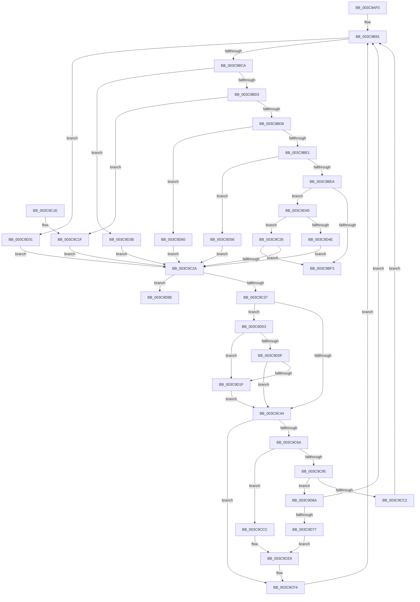

# CcQueueLazyWriteScanThreadForVolume

- RVA: `0x003C9AF0`–`0x003C9DAD` (길이 `701` bytes)
- VA: `0x00000001403C9AF0`
- 실행 섹션: `.text`
- PDB 이름 있음: `예`; PDB Function 태그: `아니요`
- unwind 정보 RVA: `0x0008F630`
- 디코드: `162`개 명령, `701/701` bytes 표시
- 미해석 바이트: `0` (있으면 어셈블리에 `.byte`로 보존)

> 이 문서는 커널 이미지의 기계어와 PDB 기호를 분석해 생성했습니다. 4번과 5번은 함수 원형과 자료형을 바이너리 사용 방식에서 추정한 C 해석이며 원본 소스 복구 결과는 아닙니다.

## 1. Dependencies

- 직접 호출 지점: **15**; 고유 호출 대상: **11**
- 직접 호출자로 확인된 함수: **0**
- RIP 상대 이미지 참조: **3**

### Outgoing calls
- `0x003C9BBD` → [KeWaitForMultipleObjects](../20/KeWaitForMultipleObjects_function_0020D110.md) (function, `0x0020D110`)
- `0x003C9BFD` → [_security_check_cookie](../6A/_security_check_cookie_function_006AC640.md) (function, `0x006AC640`)
- `0x003C9C53` → [KeAcquireInStackQueuedSpinLock](../27/KeAcquireInStackQueuedSpinLock_function_002757A0.md) (function, `0x002757A0`)
- `0x003C9C5D` → [CcIsLazyWriteScanQueuedInternal](CcIsLazyWriteScanQueuedInternal_function_003C9DB4.md) (function, `0x003C9DB4`)
- `0x003C9C6F` → [CcSetLazyWriteScanQueuedInternal](CcSetLazyWriteScanQueuedInternal_function_003C9F60.md) (function, `0x003C9F60`)
- `0x003C9C79` → [KeReleaseInStackQueuedSpinLock](../34/KeReleaseInStackQueuedSpinLock_function_00342CE0.md) (function, `0x00342CE0`)
- `0x003C9C8C` → [CcAllocateWorkQueueEntry](../35/CcAllocateWorkQueueEntry_function_0035710C.md) (function, `0x0035710C`)
- `0x003C9CC2` → [CcPostWorkQueue](../35/CcPostWorkQueue_function_00356808.md) (function, `0x00356808`)
- `0x003C9CDA` → [KeAcquireInStackQueuedSpinLock](../27/KeAcquireInStackQueuedSpinLock_function_002757A0.md) (function, `0x002757A0`)
- `0x003C9CEF` → [CcSetLazyWriteScanQueuedInternal](CcSetLazyWriteScanQueuedInternal_function_003C9F60.md) (function, `0x003C9F60`)
- `0x003C9CF9` → [KeReleaseInStackQueuedSpinLock](../34/KeReleaseInStackQueuedSpinLock_function_00342CE0.md) (function, `0x00342CE0`)
- `0x003C9D27` → [CcNotifyExternalCachesInternal](CcNotifyExternalCachesInternal_function_003C9E00.md) (function, `0x003C9E00`)
- `0x003C9D6A` → [CcPostWorkQueueSpecial](../4C/CcPostWorkQueueSpecial_function_004C046C.md) (function, `0x004C046C`)
- `0x003C9D7F` → [KeAcquireInStackQueuedSpinLock](../27/KeAcquireInStackQueuedSpinLock_function_002757A0.md) (function, `0x002757A0`)
- `0x003C9DA7` → [KeBugCheckEx](../4F/KeBugCheckEx_function_004FD660.md) (function, `0x004FD660`)

### Direct callers
- 이 함수 시작 RVA로 연결되는 직접 call은 확인되지 않았습니다. 간접 호출은 완전히 역산할 수 없습니다.

### Static image references
- `0x003C9B11` → RVA `0x00E0A740` (`.data`; read)
- `0x003C9C37` → RVA `0x00F8F500` (`.data`; read)
- `0x003C9CCC` → RVA `0x00F8F5F4` (`.data`; read/write)

## 2. Other-region calls and transfers

- 다른 실행 섹션으로 향하는 call: **0**
- 별도 외부 분기/꼬리 이동을 확인하지 못했습니다.

## 3. Assembly (complete function range)

```asm
003C9AF0  48 89 5C 24 10                  mov qword ptr [rsp + 0x10], rbx
003C9AF5  48 89 74 24 18                  mov qword ptr [rsp + 0x18], rsi
003C9AFA  55                              push rbp
003C9AFB  57                              push rdi
003C9AFC  41 55                           push r13
003C9AFE  41 56                           push r14
003C9B00  41 57                           push r15
003C9B02  48 8D AC 24 00 FF FF FF         lea rbp, [rsp - 0x100]
003C9B0A  48 81 EC 00 02 00 00            sub rsp, 0x200
003C9B11  48 8B 05 28 0C A4 00            mov rax, qword ptr [rip + 0xa40c28]
003C9B18  48 33 C4                        xor rax, rsp
003C9B1B  48 89 85 F0 00 00 00            mov qword ptr [rbp + 0xf0], rax
003C9B22  48 83 64 24 40 00               and qword ptr [rsp + 0x40], 0
003C9B28  4C 8D B9 98 03 00 00            lea r15, [rcx + 0x398]
003C9B2F  4C 8B 69 20                     mov r13, qword ptr [rcx + 0x20]
003C9B33  33 DB                           xor ebx, ebx
003C9B35  33 C0                           xor eax, eax
003C9B37  4C 89 7C 24 70                  mov qword ptr [rsp + 0x70], r15
003C9B3C  48 89 44 24 58                  mov qword ptr [rsp + 0x58], rax
003C9B41  0F 57 C0                        xorps xmm0, xmm0
003C9B44  48 8D 81 30 03 00 00            lea rax, [rcx + 0x330]
003C9B4B  48 8B F9                        mov rdi, rcx
003C9B4E  48 89 44 24 60                  mov qword ptr [rsp + 0x60], rax
003C9B53  48 8D 81 48 03 00 00            lea rax, [rcx + 0x348]
003C9B5A  48 89 44 24 68                  mov qword ptr [rsp + 0x68], rax
003C9B5F  48 8D 81 60 03 00 00            lea rax, [rcx + 0x360]
003C9B66  48 89 44 24 78                  mov qword ptr [rsp + 0x78], rax
003C9B6B  48 8D 81 78 03 00 00            lea rax, [rcx + 0x378]
003C9B72  48 89 45 80                     mov qword ptr [rbp - 0x80], rax
003C9B76  48 8D 81 B0 04 00 00            lea rax, [rcx + 0x4b0]
003C9B7D  48 89 45 88                     mov qword ptr [rbp - 0x78], rax
003C9B81  48 8D 81 28 06 00 00            lea rax, [rcx + 0x628]
003C9B88  48 89 45 90                     mov qword ptr [rbp - 0x70], rax
003C9B8C  0F 11 44 24 48                  movups xmmword ptr [rsp + 0x48], xmm0
003C9B91  41 B9 08 00 00 00               mov r9d, 8
003C9B97  48 8D 45 A0                     lea rax, [rbp - 0x60]
003C9B9B  48 89 44 24 38                  mov qword ptr [rsp + 0x38], rax
003C9BA0  48 8D 54 24 60                  lea rdx, [rsp + 0x60]
003C9BA5  48 83 64 24 30 00               and qword ptr [rsp + 0x30], 0
003C9BAB  C6 44 24 28 00                  mov byte ptr [rsp + 0x28], 0
003C9BB0  45 8D 41 F9                     lea r8d, [r9 - 7]
003C9BB4  C6 44 24 20 00                  mov byte ptr [rsp + 0x20], 0
003C9BB9  41 8D 49 FF                     lea ecx, [r9 - 1]
003C9BBD  E8 4E 35 E4 FF                  call 0x14020d110
003C9BC2  85 C0                           test eax, eax
003C9BC4  0F 84 67 01 00 00               je 0x1403c9d31
003C9BCA  83 E8 01                        sub eax, 1
003C9BCD  0F 84 68 01 00 00               je 0x1403c9d3b
003C9BD3  83 E8 01                        sub eax, 1
003C9BD6  74 47                           je 0x1403c9c1f
003C9BD8  83 E8 01                        sub eax, 1
003C9BDB  0F 84 7F 01 00 00               je 0x1403c9d60
003C9BE1  83 E8 01                        sub eax, 1
003C9BE4  0F 84 6C 01 00 00               je 0x1403c9d56
003C9BEA  83 E8 01                        sub eax, 1
003C9BED  0F 85 52 01 00 00               jne 0x1403c9d45
003C9BF3  48 8B 8D F0 00 00 00            mov rcx, qword ptr [rbp + 0xf0]
003C9BFA  48 33 CC                        xor rcx, rsp
003C9BFD  E8 3E 2A 2E 00                  call 0x1406ac640
003C9C02  4C 8D 9C 24 00 02 00 00         lea r11, [rsp + 0x200]
003C9C0A  49 8B 5B 38                     mov rbx, qword ptr [r11 + 0x38]
003C9C0E  49 8B 73 40                     mov rsi, qword ptr [r11 + 0x40]
003C9C12  49 8B E3                        mov rsp, r11
003C9C15  41 5F                           pop r15
003C9C17  41 5E                           pop r14
003C9C19  41 5D                           pop r13
003C9C1B  5F                              pop rdi
003C9C1C  5D                              pop rbp
003C9C1D  C3                              ret
003C9C1E  CC                              int3
003C9C1F  BB 04 00 00 00                  mov ebx, 4
003C9C24  EB 04                           jmp 0x1403c9c2a
003C9C26  85 DB                           test ebx, ebx
003C9C28  74 C9                           je 0x1403c9bf3
003C9C2A  48 8B 77 40                     mov rsi, qword ptr [rdi + 0x40]
003C9C2E  48 85 F6                        test rsi, rsi
003C9C31  0F 84 57 01 00 00               je 0x1403c9d8e
003C9C37  83 3D C2 58 BC 00 00            cmp dword ptr [rip + 0xbc58c2], 0
003C9C3E  0F 87 BF 00 00 00               ja 0x1403c9d03
003C9C44  4D 8D B5 00 03 00 00            lea r14, [r13 + 0x300]
003C9C4B  49 8B CE                        mov rcx, r14
003C9C4E  48 8D 54 24 48                  lea rdx, [rsp + 0x48]
003C9C53  E8 48 BB EA FF                  call 0x1402757a0
003C9C58  8B D3                           mov edx, ebx
003C9C5A  49 8B CF                        mov rcx, r15
003C9C5D  E8 52 01 00 00                  call 0x1403c9db4
003C9C62  84 C0                           test al, al
003C9C64  0F 85 8A 00 00 00               jne 0x1403c9cf4
003C9C6A  41 B0 01                        mov r8b, 1
003C9C6D  8B D3                           mov edx, ebx
003C9C6F  E8 EC 02 00 00                  call 0x1403c9f60
003C9C74  48 8D 4C 24 48                  lea rcx, [rsp + 0x48]
003C9C79  E8 62 90 F7 FF                  call 0x140342ce0
003C9C7E  4C 8D 4C 24 40                  lea r9, [rsp + 0x40]
003C9C83  4C 8B C6                        mov r8, rsi
003C9C86  48 8B D7                        mov rdx, rdi
003C9C89  49 8B CD                        mov rcx, r13
003C9C8C  E8 7B D4 F8 FF                  call 0x14035710c
003C9C91  85 C0                           test eax, eax
003C9C93  78 37                           js 0x1403c9ccc
003C9C95  48 8B 4C 24 40                  mov rcx, qword ptr [rsp + 0x40]
003C9C9A  B8 48 00 00 00                  mov eax, 0x48
003C9C9F  83 FB 08                        cmp ebx, 8
003C9CA2  8D 50 20                        lea edx, [rax + 0x20]
003C9CA5  C7 81 80 00 00 00 03 00 00 00   mov dword ptr [rcx + 0x80], 3
003C9CAF  0F 45 C2                        cmovne eax, edx
003C9CB2  89 59 10                        mov dword ptr [rcx + 0x10], ebx
003C9CB5  48 8D 14 30                     lea rdx, [rax + rsi]
003C9CB9  83 FB 20                        cmp ebx, 0x20
003C9CBC  0F 84 A8 00 00 00               je 0x1403c9d6a
003C9CC2  E8 41 CB F8 FF                  call 0x140356808
003C9CC7  E9 C5 FE FF FF                  jmp 0x1403c9b91
003C9CCC  FF 05 22 59 BC 00               inc dword ptr [rip + 0xbc5922]
003C9CD2  48 8D 54 24 48                  lea rdx, [rsp + 0x48]
003C9CD7  49 8B CE                        mov rcx, r14
003C9CDA  E8 C1 BA EA FF                  call 0x1402757a0
003C9CDF  8B D3                           mov edx, ebx
003C9CE1  41 C6 85 19 04 00 00 00         mov byte ptr [r13 + 0x419], 0
003C9CE9  45 33 C0                        xor r8d, r8d
003C9CEC  49 8B CF                        mov rcx, r15
003C9CEF  E8 6C 02 00 00                  call 0x1403c9f60
003C9CF4  48 8D 4C 24 48                  lea rcx, [rsp + 0x48]
003C9CF9  E8 E2 8F F7 FF                  call 0x140342ce0
003C9CFE  E9 8E FE FF FF                  jmp 0x1403c9b91
003C9D03  48 8D 87 E0 04 00 00            lea rax, [rdi + 0x4e0]
003C9D0A  48 39 00                        cmp qword ptr [rax], rax
003C9D0D  75 10                           jne 0x1403c9d1f
003C9D0F  48 8D 87 F0 04 00 00            lea rax, [rdi + 0x4f0]
003C9D16  48 39 00                        cmp qword ptr [rax], rax
003C9D19  0F 84 25 FF FF FF               je 0x1403c9c44
003C9D1F  4C 8B C7                        mov r8, rdi
003C9D22  49 8B D5                        mov rdx, r13
003C9D25  8B CB                           mov ecx, ebx
003C9D27  E8 D4 00 00 00                  call 0x1403c9e00
003C9D2C  E9 13 FF FF FF                  jmp 0x1403c9c44
003C9D31  BB 01 00 00 00                  mov ebx, 1
003C9D36  E9 EF FE FF FF                  jmp 0x1403c9c2a
003C9D3B  BB 02 00 00 00                  mov ebx, 2
003C9D40  E9 E5 FE FF FF                  jmp 0x1403c9c2a
003C9D45  83 F8 01                        cmp eax, 1
003C9D48  0F 85 D8 FE FF FF               jne 0x1403c9c26
003C9D4E  8D 58 1F                        lea ebx, [rax + 0x1f]
003C9D51  E9 D4 FE FF FF                  jmp 0x1403c9c2a
003C9D56  BB 10 00 00 00                  mov ebx, 0x10
003C9D5B  E9 CA FE FF FF                  jmp 0x1403c9c2a
003C9D60  BB 08 00 00 00                  mov ebx, 8
003C9D65  E9 C0 FE FF FF                  jmp 0x1403c9c2a
003C9D6A  E8 FD 66 0F 00                  call 0x1404c046c
003C9D6F  84 C0                           test al, al
003C9D71  0F 85 1A FE FF FF               jne 0x1403c9b91
003C9D77  48 8D 54 24 48                  lea rdx, [rsp + 0x48]
003C9D7C  49 8B CE                        mov rcx, r14
003C9D7F  E8 1C BA EA FF                  call 0x1402757a0
003C9D84  BA 20 00 00 00                  mov edx, 0x20
003C9D89  E9 5B FF FF FF                  jmp 0x1403c9ce9
003C9D8E  48 83 64 24 20 00               and qword ptr [rsp + 0x20], 0
003C9D94  45 33 C9                        xor r9d, r9d
003C9D97  BA B9 06 00 00                  mov edx, 0x6b9
003C9D9C  49 C7 C0 20 04 00 C0            mov r8, 0xffffffffc0000420
003C9DA3  41 8D 49 34                     lea ecx, [r9 + 0x34]
003C9DA7  E8 B4 38 13 00                  call 0x1404fd660
003C9DAC  CC                              int3
```

## 4. C-style interpretation (structured pseudocode)

```c
__int64 __fastcall CcQueueLazyWriteScanThreadForVolume(__int64 a1)
{
    __int64 result;
    __int64 v_rbx;
    __int64 v_rsp;
    unsigned __int64 v_stack_m128;
    unsigned __int64 v_stack_m188;
    unsigned __int64 v_stack_m198;
    unsigned __int64 v_stack_m1A0;
    unsigned __int64 v_stack_m1A8;
    unsigned __int64 v_stack_m1B0;
    unsigned __int64 v_stack_m1B8;
    unsigned __int64 v_stack_m1C0;
    unsigned __int64 v_stack_m1C8;
    unsigned __int64 v_stack_m1D0;
    unsigned __int64 v_stack_m1E0;
    unsigned __int64 v_stack_m1E8;
    unsigned __int64 v_stack_m1F0;
    unsigned __int64 v_stack_m1F8;
    unsigned __int8 v_stack_m200;
    unsigned __int8 v_stack_m208;
    unsigned __int64 v_stack_m28;
    unsigned __int64 v_stack_m38;
    unsigned __int64 v_stack_p10;
    unsigned __int64 v_stack_p18;

    v_stack_p10 = v_rbx;
    v_stack_p18 = v_rsi;
    v_rsp = (v_rsp) - (512);
    result = (*(unsigned __int64 *)(v_rip + 10751016)) ^ (v_rsp);
    v_stack_m38 = result;
    v_rbx = 0;
    result = 0;
    v_stack_m1B8 = a1 + 920;
    v_stack_m1D0 = 0;
    v_stack_m1C8 = a1 + 816;
    v_stack_m1C0 = a1 + 840;
    v_stack_m1B0 = a1 + 864;
    v_stack_m1A8 = a1 + 888;
    v_stack_m1A0 = a1 + 1200;
    v_stack_m198 = a1 + 1576;
    v_stack_m1E0 = v_xmm0;
loc_003C9B91:
    v_stack_m1F0 = v_stack_m188;
    v_stack_m200 = 0;
    v_stack_m208 = 0;
    result = KeWaitForMultipleObjects(8 - 1, v_stack_m1C8, 8 - 7, 8);
    if ((unsigned int)(result) == 0) goto loc_003C9D31;
    result = (unsigned int)((result) - (1));
    if (condition_is_equal) goto loc_003C9D3B;
    result = (unsigned int)((result) - (1));
    if (condition_is_equal) goto loc_003C9C1F;
    result = (unsigned int)((result) - (1));
    if (condition_is_equal) goto loc_003C9D60;
    result = (unsigned int)((result) - (1));
    if (condition_is_equal) goto loc_003C9D56;
    result = (unsigned int)((result) - (1));
    if (condition_is_not_equal) goto loc_003C9D45;
loc_003C9BF3:
    a1 = (v_stack_m38) ^ (v_rsp);
    result = _security_check_cookie(a1, v_stack_m1C8, 8 - 7, 8);
    return result;
loc_003C9C1F:
    goto loc_003C9C2A;
loc_003C9C26:
    if (4 == 0) goto loc_003C9BF3;
loc_003C9C2A:
    if (*(unsigned __int64 *)(a1 + 64) == 0) goto loc_003C9D8E;
    if ((*(unsigned int *)(v_rip + 12343490)) > 0) goto loc_003C9D03;
loc_003C9C44:
    result = KeAcquireInStackQueuedSpinLock(*(unsigned __int64 *)(a1 + 32) + 768, v_stack_m1B8, 8 - 7, 8);
    result = CcIsLazyWriteScanQueuedInternal(a1 + 920, 4, 8 - 7, 8);
    if ((unsigned __int8)(result) != 0) goto loc_003C9CF4;
    result = CcSetLazyWriteScanQueuedInternal(a1 + 920, 4, 1, 8);
    result = KeReleaseInStackQueuedSpinLock(v_stack_m1B8, 4, 1, 8);
    result = CcAllocateWorkQueueEntry(*(unsigned __int64 *)(a1 + 32), a1, *(unsigned __int64 *)(a1 + 64), v_stack_m1C0);
    if (sign_flag) goto loc_003C9CCC;
    *(unsigned int *)(v_stack_m1C0 + 128) = 3;
    result = 72;
    if (4 != 8) { result = (unsigned int)(72 + 32); }
    *(unsigned int *)(v_stack_m1C0 + 16) = 4;
    if (4 == 32) goto loc_003C9D6A;
    result = CcPostWorkQueue(v_stack_m1C0, result + *(unsigned __int64 *)(a1 + 64) * 1, *(unsigned __int64 *)(a1 + 64), v_stack_m1C0);
    goto loc_003C9B91;
loc_003C9CCC:
    result = KeAcquireInStackQueuedSpinLock(*(unsigned __int64 *)(a1 + 32) + 768, v_stack_m1B8, *(unsigned __int64 *)(a1 + 64), v_stack_m1C0);
    *(unsigned __int8 *)(*(unsigned __int64 *)(a1 + 32) + 1049) = 0;
loc_003C9CE9:
    a3 = 0;
    result = CcSetLazyWriteScanQueuedInternal(a1 + 920, 4, a3, v_stack_m1C0);
loc_003C9CF4:
    result = KeReleaseInStackQueuedSpinLock(v_stack_m1B8, 4, a3, v_stack_m1C0);
    goto loc_003C9B91;
loc_003C9D03:
    if ((*(unsigned __int64 *)(a1 + 1248)) != (a1 + 1248)) goto loc_003C9D1F;
    if ((*(unsigned __int64 *)(a1 + 1264)) == (a1 + 1264)) goto loc_003C9C44;
loc_003C9D1F:
    result = CcNotifyExternalCachesInternal(4, *(unsigned __int64 *)(a1 + 32), a1, v_stack_m1C0);
    goto loc_003C9C44;
loc_003C9D31:
    goto loc_003C9C2A;
loc_003C9D3B:
    goto loc_003C9C2A;
loc_003C9D45:
    if (((unsigned int)(result)) != 1) goto loc_003C9C26;
    goto loc_003C9C2A;
loc_003C9D56:
    goto loc_003C9C2A;
loc_003C9D60:
    goto loc_003C9C2A;
loc_003C9D6A:
    result = CcPostWorkQueueSpecial(4, *(unsigned __int64 *)(a1 + 32), a1, v_stack_m1C0);
    if ((unsigned __int8)(result) != 0) goto loc_003C9B91;
    result = KeAcquireInStackQueuedSpinLock(*(unsigned __int64 *)(a1 + 32) + 768, v_stack_m1B8, a1, v_stack_m1C0);
    goto loc_003C9CE9;
loc_003C9D8E:
    a4 = 0;
    result = KeBugCheckEx(a4 + 52, (unsigned int)(0x6B9ULL), 0xFFFFFFFFC0000420ULL, a4);
    return result;
}
```

## 5. (Beta) C Style

```c
int64_t CcQueueLazyWriteScanThreadForVolume(void *Arg1)
{
    uint8_t *arg1 = (uint8_t *)Arg1;

    int64_t result;
    int64_t local_rbx;
    int64_t local_rsp;
    uint64_t v_stack_m128;
    uint64_t v_stack_m188;
    uint64_t v_stack_m198;
    uint64_t v_stack_m1A0;
    uint64_t v_stack_m1A8;
    uint64_t v_stack_m1B0;
    uint64_t v_stack_m1B8;
    uint64_t v_stack_m1C0;
    uint64_t v_stack_m1C8;
    uint64_t v_stack_m1D0;
    uint64_t v_stack_m1E0;
    uint64_t v_stack_m1E8;
    uint64_t v_stack_m1F0;
    uint64_t v_stack_m1F8;
    uint8_t v_stack_m200;
    uint8_t v_stack_m208;
    uint64_t v_stack_m28;
    uint64_t v_stack_m38;
    uint64_t v_stack_p10;
    uint64_t v_stack_p18;

    v_stack_p10 = local_rbx;
    v_stack_p18 = local_rsi;
    local_rsp = (local_rsp) - (512);
    result = (*(uint64_t *)(v_rip + 0xA40C28)) ^ (local_rsp);
    v_stack_m38 = result;
    local_rbx = 0;
    result = 0;
    v_stack_m1B8 = Arg1 + 920;
    v_stack_m1D0 = 0;
    v_stack_m1C8 = Arg1 + 816;
    v_stack_m1C0 = Arg1 + 840;
    v_stack_m1B0 = Arg1 + 864;
    v_stack_m1A8 = Arg1 + 888;
    v_stack_m1A0 = Arg1 + 1200;
    v_stack_m198 = Arg1 + 1576;
    v_stack_m1E0 = v_xmm0;
loc_003C9B91:
    v_stack_m1F0 = v_stack_m188;
    v_stack_m200 = 0;
    v_stack_m208 = 0;
    result = KeWaitForMultipleObjects(8 - 1, v_stack_m1C8, 8 - 7, 8);
    if ((uint32_t)(result) == 0) goto loc_003C9D31;
    result = (uint32_t)((result) - (1));
    if (condition_is_equal) goto loc_003C9D3B;
    result = (uint32_t)((result) - (1));
    if (condition_is_equal) goto loc_003C9C1F;
    result = (uint32_t)((result) - (1));
    if (condition_is_equal) goto loc_003C9D60;
    result = (uint32_t)((result) - (1));
    if (condition_is_equal) goto loc_003C9D56;
    result = (uint32_t)((result) - (1));
    if (condition_is_not_equal) goto loc_003C9D45;
loc_003C9BF3:
    Arg1 = (v_stack_m38) ^ (local_rsp);
    result = _security_check_cookie(Arg1, v_stack_m1C8, 8 - 7, 8);
    return result;
loc_003C9C1F:
    goto loc_003C9C2A;
loc_003C9C26:
    if (4 == 0) goto loc_003C9BF3;
loc_003C9C2A:
    if (*(uint64_t *)(arg1 + 0x40) == 0) goto loc_003C9D8E;
    if ((*(uint32_t *)(v_rip + 0xBC58C2)) > 0) goto loc_003C9D03;
loc_003C9C44:
    result = KeAcquireInStackQueuedSpinLock(*(uint64_t *)(arg1 + 0x20) + 768, v_stack_m1B8, 8 - 7, 8);
    result = CcIsLazyWriteScanQueuedInternal(Arg1 + 920, 4, 8 - 7, 8);
    if ((uint8_t)(result) != 0) goto loc_003C9CF4;
    result = CcSetLazyWriteScanQueuedInternal(Arg1 + 920, 4, 1, 8);
    result = KeReleaseInStackQueuedSpinLock(v_stack_m1B8, 4, 1, 8);
    result = CcAllocateWorkQueueEntry(*(uint64_t *)(arg1 + 0x20), Arg1, *(uint64_t *)(arg1 + 0x40), v_stack_m1C0);
    if (sign_flag) goto loc_003C9CCC;
    *(uint32_t *)(v_stack_m1C0 + 0x80) = 3;
    result = 72;
    if (4 != 8) { result = (uint32_t)(72 + 32); }
    *(uint32_t *)(v_stack_m1C0 + 0x10) = 4;
    if (4 == 32) goto loc_003C9D6A;
    result = CcPostWorkQueue(v_stack_m1C0, result + *(uint64_t *)(arg1 + 0x40) * 1, *(uint64_t *)(arg1 + 0x40), v_stack_m1C0);
    goto loc_003C9B91;
loc_003C9CCC:
    result = KeAcquireInStackQueuedSpinLock(*(uint64_t *)(arg1 + 0x20) + 768, v_stack_m1B8, *(uint64_t *)(arg1 + 0x40), v_stack_m1C0);
    *(uint8_t *)(*(uint64_t *)(arg1 + 0x20) + 0x419) = 0;
loc_003C9CE9:
    a3 = 0;
    result = CcSetLazyWriteScanQueuedInternal(Arg1 + 920, 4, a3, v_stack_m1C0);
loc_003C9CF4:
    result = KeReleaseInStackQueuedSpinLock(v_stack_m1B8, 4, a3, v_stack_m1C0);
    goto loc_003C9B91;
loc_003C9D03:
    if ((*(uint64_t *)(arg1 + 0x4E0)) != (Arg1 + 1248)) goto loc_003C9D1F;
    if ((*(uint64_t *)(arg1 + 0x4F0)) == (Arg1 + 1264)) goto loc_003C9C44;
loc_003C9D1F:
    result = CcNotifyExternalCachesInternal(4, *(uint64_t *)(arg1 + 0x20), Arg1, v_stack_m1C0);
    goto loc_003C9C44;
loc_003C9D31:
    goto loc_003C9C2A;
loc_003C9D3B:
    goto loc_003C9C2A;
loc_003C9D45:
    if (((uint32_t)(result)) != 1) goto loc_003C9C26;
    goto loc_003C9C2A;
loc_003C9D56:
    goto loc_003C9C2A;
loc_003C9D60:
    goto loc_003C9C2A;
loc_003C9D6A:
    result = CcPostWorkQueueSpecial(4, *(uint64_t *)(arg1 + 0x20), Arg1, v_stack_m1C0);
    if ((uint8_t)(result) != 0) goto loc_003C9B91;
    result = KeAcquireInStackQueuedSpinLock(*(uint64_t *)(arg1 + 0x20) + 768, v_stack_m1B8, Arg1, v_stack_m1C0);
    goto loc_003C9CE9;
loc_003C9D8E:
    a4 = 0;
    result = KeBugCheckEx(a4 + 52, (uint32_t)(0x6B9ULL), 0xFFFFFFFFC0000420ULL, a4);
    return result;
}
```

### 관측된 메모리 오프셋

구조체 형식이 확인되지 않은 접근은 인자 기준의 오프셋으로만 기록했습니다.

| 기준 인자 | 오프셋 표현 | 폭 (bit) | 접근 |
|---|---:|---:|---|
| `Arg1` | `+ 0x0` | `64` | `R` |
| `Arg1` | `+ 0x20` | `64` | `R` |
| `Arg1` | `+ 0x40` | `64` | `R` |
| `Arg1` | `+ 0x330` | `64` | `R` |
| `Arg1` | `+ 0x348` | `64` | `R` |
| `Arg1` | `+ 0x360` | `64` | `R` |
| `Arg1` | `+ 0x378` | `64` | `R` |
| `Arg1` | `+ 0x398` | `64` | `R` |
| `Arg1` | `+ 0x4B0` | `64` | `R` |
| `Arg1` | `+ 0x4E0` | `64` | `R` |
| `Arg1` | `+ 0x4F0` | `64` | `R` |
| `Arg1` | `+ 0x628` | `64` | `R` |

## 6. Execution-region graph

[열기: 2D/3D 그래프와 함수 탐색 컨트롤 패널](../../../control-panel.html?section=text&rva=0x003C9AF0&view=graph)

- 2D 그래프는 위에서 아래로 흐르고, 3D 그래프는 빈 공간을 드래그해 회전합니다. Shift+드래그는 이동, 휠은 확대·축소, 함수 노드 선택은 대상 보고서 이동입니다.

### Static fallback


