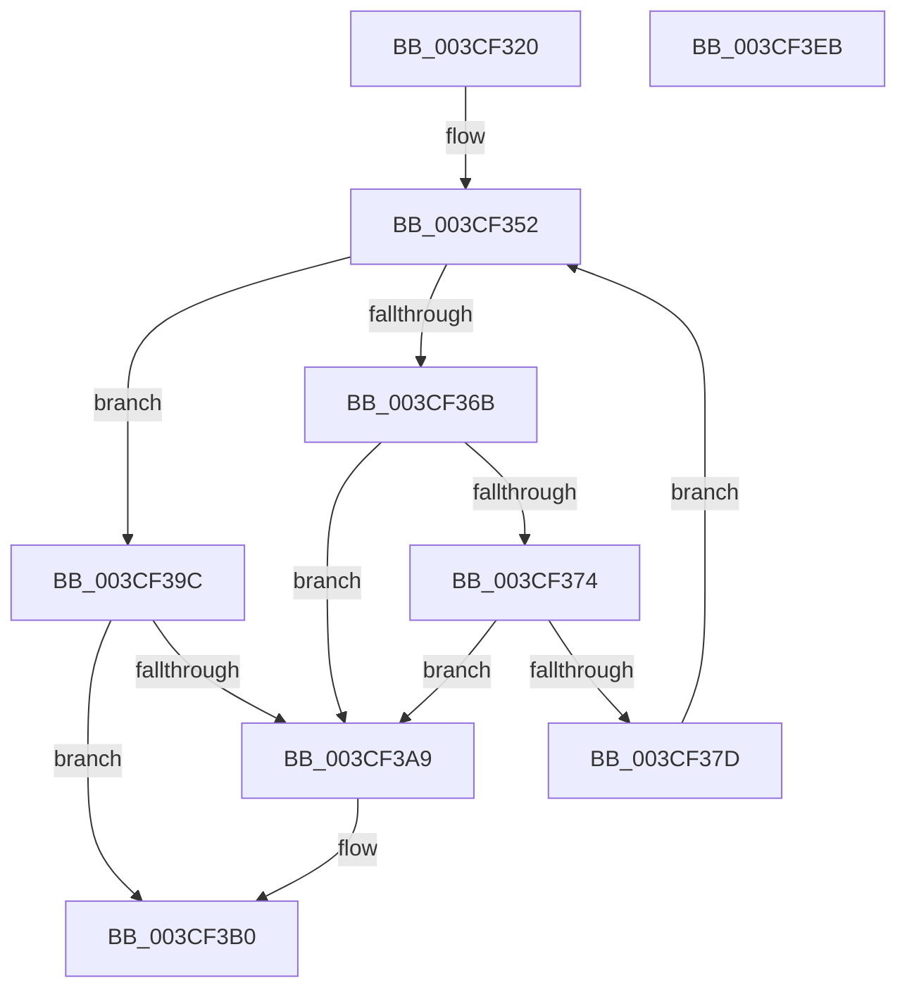

# CcReapPrivateVolumeCachemapWorkerThread

- RVA: `0x003CF320`–`0x003CF3EC` (길이 `204` bytes)
- VA: `0x00000001403CF320`
- 실행 섹션: `.text`
- PDB 이름 있음: `예`; PDB Function 태그: `아니요`
- unwind 정보 RVA: `0x00060130`
- 디코드: `55`개 명령, `204/204` bytes 표시
- 미해석 바이트: `0` (있으면 어셈블리에 `.byte`로 보존)

> 이 문서는 커널 이미지의 기계어와 PDB 기호를 분석해 생성했습니다. 4번과 5번은 함수 원형과 자료형을 바이너리 사용 방식에서 추정한 C 해석이며 원본 소스 복구 결과는 아닙니다.

## 1. Dependencies

- 직접 호출 지점: **5**; 고유 호출 대상: **4**
- 직접 호출자로 확인된 함수: **0**
- RIP 상대 이미지 참조: **0**

### Outgoing calls
- `0x003CF35E` → [KeAcquireInStackQueuedSpinLock](../27/KeAcquireInStackQueuedSpinLock_function_002757A0.md) (function, `0x002757A0`)
- `0x003CF389` → [KeReleaseInStackQueuedSpinLock](../34/KeReleaseInStackQueuedSpinLock_function_00342CE0.md) (function, `0x00342CE0`)
- `0x003CF395` → [CcReapPrivateVolumeCachemap](CcReapPrivateVolumeCachemap_function_003CF1B8.md) (function, `0x003CF1B8`)
- `0x003CF3C3` → [KeReleaseInStackQueuedSpinLock](../34/KeReleaseInStackQueuedSpinLock_function_00342CE0.md) (function, `0x00342CE0`)
- `0x003CF3CB` → [CcDereferencePartition](../35/CcDereferencePartition_function_003572F0.md) (function, `0x003572F0`)

### Direct callers
- 이 함수 시작 RVA로 연결되는 직접 call은 확인되지 않았습니다. 간접 호출은 완전히 역산할 수 없습니다.

### Static image references
- 디코드된 RIP-relative 메모리 참조가 없습니다.

## 2. Other-region calls and transfers

- 다른 실행 섹션으로 향하는 call: **0**
- 별도 외부 분기/꼬리 이동을 확인하지 못했습니다.

## 3. Assembly (complete function range)

```asm
003CF320  4C 8B DC                        mov r11, rsp
003CF323  49 89 5B 08                     mov qword ptr [r11 + 8], rbx
003CF327  49 89 6B 10                     mov qword ptr [r11 + 0x10], rbp
003CF32B  49 89 73 18                     mov qword ptr [r11 + 0x18], rsi
003CF32F  49 89 7B 20                     mov qword ptr [r11 + 0x20], rdi
003CF333  41 56                           push r14
003CF335  48 83 EC 40                     sub rsp, 0x40
003CF339  48 8B 71 38                     mov rsi, qword ptr [rcx + 0x38]
003CF33D  0F 57 C0                        xorps xmm0, xmm0
003CF340  33 C0                           xor eax, eax
003CF342  48 8B D9                        mov rbx, rcx
003CF345  0F 11 44 24 20                  movups xmmword ptr [rsp + 0x20], xmm0
003CF34A  49 89 43 E8                     mov qword ptr [r11 - 0x18], rax
003CF34E  4C 8D 76 50                     lea r14, [rsi + 0x50]
003CF352  48 8D 54 24 20                  lea rdx, [rsp + 0x20]
003CF357  48 8D 8E 00 03 00 00            lea rcx, [rsi + 0x300]
003CF35E  E8 3D 64 EA FF                  call 0x1402757a0
003CF363  49 8B 3E                        mov rdi, qword ptr [r14]
003CF366  49 3B FE                        cmp rdi, r14
003CF369  74 31                           je 0x1403cf39c
003CF36B  48 8B 0F                        mov rcx, qword ptr [rdi]
003CF36E  48 39 79 08                     cmp qword ptr [rcx + 8], rdi
003CF372  75 35                           jne 0x1403cf3a9
003CF374  48 8B 47 08                     mov rax, qword ptr [rdi + 8]
003CF378  48 39 38                        cmp qword ptr [rax], rdi
003CF37B  75 2C                           jne 0x1403cf3a9
003CF37D  48 89 08                        mov qword ptr [rax], rcx
003CF380  48 89 41 08                     mov qword ptr [rcx + 8], rax
003CF384  48 8D 4C 24 20                  lea rcx, [rsp + 0x20]
003CF389  E8 52 39 F7 FF                  call 0x140342ce0
003CF38E  48 8D 8F C0 FD FF FF            lea rcx, [rdi - 0x240]
003CF395  E8 1E FE FF FF                  call 0x1403cf1b8
003CF39A  EB B6                           jmp 0x1403cf352
003CF39C  48 8D 46 60                     lea rax, [rsi + 0x60]
003CF3A0  48 8B 48 08                     mov rcx, qword ptr [rax + 8]
003CF3A4  48 39 01                        cmp qword ptr [rcx], rax
003CF3A7  74 07                           je 0x1403cf3b0
003CF3A9  B9 03 00 00 00                  mov ecx, 3
003CF3AE  CD 29                           int 0x29
003CF3B0  48 89 4B 08                     mov qword ptr [rbx + 8], rcx
003CF3B4  48 89 03                        mov qword ptr [rbx], rax
003CF3B7  48 89 19                        mov qword ptr [rcx], rbx
003CF3BA  48 8D 4C 24 20                  lea rcx, [rsp + 0x20]
003CF3BF  48 89 58 08                     mov qword ptr [rax + 8], rbx
003CF3C3  E8 18 39 F7 FF                  call 0x140342ce0
003CF3C8  48 8B CE                        mov rcx, rsi
003CF3CB  E8 20 7F F8 FF                  call 0x1403572f0
003CF3D0  48 8B 5C 24 50                  mov rbx, qword ptr [rsp + 0x50]
003CF3D5  48 8B 6C 24 58                  mov rbp, qword ptr [rsp + 0x58]
003CF3DA  48 8B 74 24 60                  mov rsi, qword ptr [rsp + 0x60]
003CF3DF  48 8B 7C 24 68                  mov rdi, qword ptr [rsp + 0x68]
003CF3E4  48 83 C4 40                     add rsp, 0x40
003CF3E8  41 5E                           pop r14
003CF3EA  C3                              ret
003CF3EB  CC                              int3
```

## 4. C-style interpretation (structured pseudocode)

```c
__int64 __fastcall CcReapPrivateVolumeCachemapWorkerThread(__int64 a1)
{
    __int64 result;
    __int64 v_rsp;
    unsigned __int64 v_stack_m28;
    unsigned __int64 v_stack_p10;
    unsigned __int64 v_stack_p18;
    unsigned __int64 v_stack_p20;
    unsigned __int64 v_stack_p8;

    *(unsigned __int64 *)(v_rsp + 8) = v_rbx;
    *(unsigned __int64 *)(v_rsp + 16) = v_rbp;
    *(unsigned __int64 *)(v_rsp + 24) = v_rsi;
    *(unsigned __int64 *)(v_rsp + 32) = v_rdi;
    v_rsp = (v_rsp) - (64);
    result = 0;
    v_stack_m28 = v_xmm0;
    *(unsigned __int64 *)(v_rsp - 24) = 0;
loc_003CF352:
    result = KeAcquireInStackQueuedSpinLock(*(unsigned __int64 *)(a1 + 56) + 768, v_stack_m28, a3, a4);
    if ((*(unsigned __int64 *)(*(unsigned __int64 *)(a1 + 56) + 80)) == (*(unsigned __int64 *)(a1 + 56) + 80)) goto loc_003CF39C;
    if ((*(unsigned __int64 *)(*(unsigned __int64 *)(*(unsigned __int64 *)(*(unsigned __int64 *)(a1 + 56) + 80)) + 8)) != (*(unsigned __int64 *)(*(unsigned __int64 *)(a1 + 56) + 80))) goto loc_003CF3A9;
    if ((*(unsigned __int64 *)(*(unsigned __int64 *)(*(unsigned __int64 *)(*(unsigned __int64 *)(a1 + 56) + 80) + 8))) != (*(unsigned __int64 *)(*(unsigned __int64 *)(a1 + 56) + 80))) goto loc_003CF3A9;
    *(unsigned __int64 *)(*(unsigned __int64 *)(*(unsigned __int64 *)(*(unsigned __int64 *)(a1 + 56) + 80) + 8)) = *(unsigned __int64 *)(*(unsigned __int64 *)(*(unsigned __int64 *)(a1 + 56) + 80));
    *(unsigned __int64 *)(*(unsigned __int64 *)(*(unsigned __int64 *)(*(unsigned __int64 *)(a1 + 56) + 80)) + 8) = *(unsigned __int64 *)(*(unsigned __int64 *)(*(unsigned __int64 *)(a1 + 56) + 80) + 8);
    result = KeReleaseInStackQueuedSpinLock(v_stack_m28, v_stack_m28, a3, a4);
    result = CcReapPrivateVolumeCachemap(*(unsigned __int64 *)(*(unsigned __int64 *)(a1 + 56) + 80) - 576, v_stack_m28, a3, a4);
    goto loc_003CF352;
loc_003CF39C:
    if ((*(unsigned __int64 *)(*(unsigned __int64 *)(*(unsigned __int64 *)(a1 + 56) + 96 + 8))) != (*(unsigned __int64 *)(a1 + 56) + 96)) {
        a1 = 3;
    }
    *(unsigned __int64 *)(a1 + 8) = a1;
    *(unsigned __int64 *)(a1) = *(unsigned __int64 *)(a1 + 56) + 96;
    *(unsigned __int64 *)(a1) = a1;
    *(unsigned __int64 *)(*(unsigned __int64 *)(a1 + 56) + 96 + 8) = a1;
    result = KeReleaseInStackQueuedSpinLock(v_stack_m28, v_stack_m28, a3, a4);
    result = CcDereferencePartition(*(unsigned __int64 *)(a1 + 56), v_stack_m28, a3, a4);
    v_rsp = (v_rsp) + (64);
    return result;
}
```

## 5. (Beta) C Style

```c
int64_t CcReapPrivateVolumeCachemapWorkerThread(void *Arg1)
{
    uint8_t *arg1 = (uint8_t *)Arg1;

    int64_t result;
    int64_t local_rsp;
    uint64_t v_stack_m28;
    uint64_t v_stack_p10;
    uint64_t v_stack_p18;
    uint64_t v_stack_p20;
    uint64_t v_stack_p8;

    *(uint64_t *)(local_rsp + 0x8) = local_rbx;
    *(uint64_t *)(local_rsp + 0x10) = local_rbp;
    *(uint64_t *)(local_rsp + 0x18) = local_rsi;
    *(uint64_t *)(local_rsp + 0x20) = local_rdi;
    local_rsp = (local_rsp) - (64);
    result = 0;
    v_stack_m28 = v_xmm0;
    *(uint64_t *)(local_rsp - 0x18) = 0;
loc_003CF352:
    result = KeAcquireInStackQueuedSpinLock(*(uint64_t *)(arg1 + 0x38) + 768, v_stack_m28, a3, a4);
    if ((*(uint64_t *)(*(uint64_t *)(arg1 + 0x38) + 0x50)) == (*(uint64_t *)(arg1 + 0x38) + 80)) goto loc_003CF39C;
    if ((*(uint64_t *)(*(uint64_t *)(*(uint64_t *)(*(uint64_t *)(arg1 + 0x38) + 0x50)) + 0x8)) != (*(uint64_t *)(*(uint64_t *)(arg1 + 0x38) + 0x50))) goto loc_003CF3A9;
    if ((*(uint64_t *)(*(uint64_t *)(*(uint64_t *)(*(uint64_t *)(arg1 + 0x38) + 0x50) + 0x8))) != (*(uint64_t *)(*(uint64_t *)(arg1 + 0x38) + 0x50))) goto loc_003CF3A9;
    *(uint64_t *)(*(uint64_t *)(*(uint64_t *)(*(uint64_t *)(arg1 + 0x38) + 0x50) + 0x8)) = *(uint64_t *)(*(uint64_t *)(*(uint64_t *)(arg1 + 0x38) + 0x50));
    *(uint64_t *)(*(uint64_t *)(*(uint64_t *)(*(uint64_t *)(arg1 + 0x38) + 0x50)) + 0x8) = *(uint64_t *)(*(uint64_t *)(*(uint64_t *)(arg1 + 0x38) + 0x50) + 0x8);
    result = KeReleaseInStackQueuedSpinLock(v_stack_m28, v_stack_m28, a3, a4);
    result = CcReapPrivateVolumeCachemap(*(uint64_t *)(*(uint64_t *)(arg1 + 0x38) + 0x50) - 576, v_stack_m28, a3, a4);
    goto loc_003CF352;
loc_003CF39C:
    if ((*(uint64_t *)(*(uint64_t *)(*(uint64_t *)(arg1 + 0x38) + 0x60 + 0x8))) != (*(uint64_t *)(arg1 + 0x38) + 96)) {
        Arg1 = 3;
    }
    *(void **)(arg1 + 0x8) = Arg1;
    *(uint64_t *)(arg1) = *(uint64_t *)(arg1 + 0x38) + 96;
    *(void **)(arg1) = Arg1;
    *(void **)(*(uint64_t *)(arg1 + 0x38) + 0x60 + 0x8) = Arg1;
    result = KeReleaseInStackQueuedSpinLock(v_stack_m28, v_stack_m28, a3, a4);
    result = CcDereferencePartition(*(uint64_t *)(arg1 + 0x38), v_stack_m28, a3, a4);
    local_rsp = (local_rsp) + (64);
    return result;
}
```

### 관측된 메모리 오프셋

구조체 형식이 확인되지 않은 접근은 인자 기준의 오프셋으로만 기록했습니다.

| 기준 인자 | 오프셋 표현 | 폭 (bit) | 접근 |
|---|---:|---:|---|
| `Arg1` | `+ 0x0` | `64` | `W` |
| `Arg1` | `+ 0x8` | `64` | `W` |
| `Arg1` | `+ 0x38` | `64` | `R` |

## 6. Execution-region graph

[열기: 2D/3D 그래프와 함수 탐색 컨트롤 패널](../../../control-panel.html?section=text&rva=0x003CF320&view=graph)

- 2D 그래프는 위에서 아래로 흐르고, 3D 그래프는 빈 공간을 드래그해 회전합니다. Shift+드래그는 이동, 휠은 확대·축소, 함수 노드 선택은 대상 보고서 이동입니다.

### Static fallback


