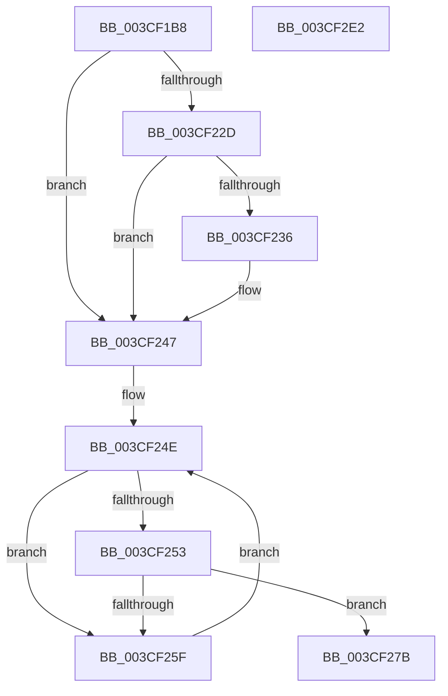

# CcReapPrivateVolumeCachemap

- RVA: `0x003CF1B8`–`0x003CF2E3` (길이 `299` bytes)
- VA: `0x00000001403CF1B8`
- 실행 섹션: `.text`
- PDB 이름 있음: `예`; PDB Function 태그: `아니요`
- unwind 정보 RVA: `0x0007F83C`
- 디코드: `68`개 명령, `299/299` bytes 표시
- 미해석 바이트: `0` (있으면 어셈블리에 `.byte`로 보존)

> 이 문서는 커널 이미지의 기계어와 PDB 기호를 분석해 생성했습니다. 4번과 5번은 함수 원형과 자료형을 바이너리 사용 방식에서 추정한 C 해석이며 원본 소스 복구 결과는 아닙니다.

## 1. Dependencies

- 직접 호출 지점: **8**; 고유 호출 대상: **6**
- 직접 호출자로 확인된 함수: **1**
- RIP 상대 이미지 참조: **2**

### Outgoing calls
- `0x003CF21B` → [DbgPrintEx](../35/DbgPrintEx_function_00359290.md) (function, `0x00359290`)
- `0x003CF242` → [KeSetEvent](../33/KeSetEvent_function_0033F310.md) (function, `0x0033F310`)
- `0x003CF256` → [CcIsDirtyCachemapListEmptyForVolume](CcIsDirtyCachemapListEmptyForVolume_function_003CF2EC.md) (function, `0x003CF2EC`)
- `0x003CF269` → [CcDeleteSectionsForPartition](../57/CcDeleteSectionsForPartition_function_0057E0F8.md) (function, `0x0057E0F8`)
- `0x003CF274` → [CcDeleteSectionsForPartition](../57/CcDeleteSectionsForPartition_function_0057E0F8.md) (function, `0x0057E0F8`)
- `0x003CF281` → [CcPostDeferredWrites](../35/CcPostDeferredWrites_function_003590FC.md) (function, `0x003590FC`)
- `0x003CF2C5` → [DbgPrintEx](../35/DbgPrintEx_function_00359290.md) (function, `0x00359290`)
- `0x003CF2CD` → [CcDeletePrivateVolumeCacheMap](CcDeletePrivateVolumeCacheMap_function_003CE950.md) (function, `0x003CE950`)

### Direct callers
- [CcReapPrivateVolumeCachemapWorkerThread](CcReapPrivateVolumeCachemapWorkerThread_function_003CF320.md) at `0x003CF395`

### Static image references
- `0x003CF204` → RVA `0x006C8B00` (` ?? ::FNODOBFM::`string'`; read)
- `0x003CF2B5` → RVA `0x006C8B70` (` ?? ::FNODOBFM::`string'`; read)

## 2. Other-region calls and transfers

- 다른 실행 섹션으로 향하는 call: **0**
- 별도 외부 분기/꼬리 이동을 확인하지 못했습니다.

## 3. Assembly (complete function range)

```asm
003CF1B8  4C 8B DC                        mov r11, rsp
003CF1BB  49 89 5B 08                     mov qword ptr [r11 + 8], rbx
003CF1BF  49 89 73 10                     mov qword ptr [r11 + 0x10], rsi
003CF1C3  57                              push rdi
003CF1C4  48 83 EC 50                     sub rsp, 0x50
003CF1C8  65 4C 8B 04 25 88 01 00 00      mov r8, qword ptr gs:[0x188]
003CF1D1  48 8B D9                        mov rbx, rcx
003CF1D4  48 8B 51 28                     mov rdx, qword ptr [rcx + 0x28]
003CF1D8  65 4C 8B 0C 25 88 01 00 00      mov r9, qword ptr gs:[0x188]
003CF1E1  8B 41 18                        mov eax, dword ptr [rcx + 0x18]
003CF1E4  89 44 24 40                     mov dword ptr [rsp + 0x40], eax
003CF1E8  8B 82 D4 00 00 00               mov eax, dword ptr [rdx + 0xd4]
003CF1EE  45 8B 89 08 05 00 00            mov r9d, dword ptr [r9 + 0x508]
003CF1F5  49 89 4B E0                     mov qword ptr [r11 - 0x20], rcx
003CF1F9  89 44 24 30                     mov dword ptr [rsp + 0x30], eax
003CF1FD  41 8B 80 10 05 00 00            mov eax, dword ptr [r8 + 0x510]
003CF204  4C 8D 05 F5 98 2F 00            lea r8, [rip + 0x2f98f5]
003CF20B  49 89 53 D0                     mov qword ptr [r11 - 0x30], rdx
003CF20F  BA 02 00 00 00                  mov edx, 2
003CF214  89 44 24 20                     mov dword ptr [rsp + 0x20], eax
003CF218  8D 4A 7D                        lea ecx, [rdx + 0x7d]
003CF21B  E8 70 A0 F8 FF                  call 0x140359290
003CF220  80 BB 95 04 00 00 00            cmp byte ptr [rbx + 0x495], 0
003CF227  48 8B 73 20                     mov rsi, qword ptr [rbx + 0x20]
003CF22B  74 1A                           je 0x1403cf247
003CF22D  80 BB D4 04 00 00 00            cmp byte ptr [rbx + 0x4d4], 0
003CF234  74 11                           je 0x1403cf247
003CF236  48 8D 8B 48 03 00 00            lea rcx, [rbx + 0x348]
003CF23D  45 33 C0                        xor r8d, r8d
003CF240  33 D2                           xor edx, edx
003CF242  E8 C9 00 F7 FF                  call 0x14033f310
003CF247  48 8D BB 60 02 00 00            lea rdi, [rbx + 0x260]
003CF24E  48 39 3F                        cmp qword ptr [rdi], rdi
003CF251  75 0C                           jne 0x1403cf25f
003CF253  48 8B CB                        mov rcx, rbx
003CF256  E8 91 00 00 00                  call 0x1403cf2ec
003CF25B  84 C0                           test al, al
003CF25D  75 1C                           jne 0x1403cf27b
003CF25F  48 8D 8B 80 02 00 00            lea rcx, [rbx + 0x280]
003CF266  48 8B D6                        mov rdx, rsi
003CF269  E8 8A EE 1A 00                  call 0x14057e0f8
003CF26E  48 8B D6                        mov rdx, rsi
003CF271  48 8B CF                        mov rcx, rdi
003CF274  E8 7F EE 1A 00                  call 0x14057e0f8
003CF279  EB D3                           jmp 0x1403cf24e
003CF27B  48 8B D3                        mov rdx, rbx
003CF27E  48 8B CE                        mov rcx, rsi
003CF281  E8 76 9E F8 FF                  call 0x1403590fc
003CF286  65 4C 8B 04 25 88 01 00 00      mov r8, qword ptr gs:[0x188]
003CF28F  BA 02 00 00 00                  mov edx, 2
003CF294  65 4C 8B 0C 25 88 01 00 00      mov r9, qword ptr gs:[0x188]
003CF29D  8B 43 18                        mov eax, dword ptr [rbx + 0x18]
003CF2A0  89 44 24 30                     mov dword ptr [rsp + 0x30], eax
003CF2A4  41 8B 80 10 05 00 00            mov eax, dword ptr [r8 + 0x510]
003CF2AB  8D 4A 7D                        lea ecx, [rdx + 0x7d]
003CF2AE  45 8B 89 08 05 00 00            mov r9d, dword ptr [r9 + 0x508]
003CF2B5  4C 8D 05 B4 98 2F 00            lea r8, [rip + 0x2f98b4]
003CF2BC  48 89 5C 24 28                  mov qword ptr [rsp + 0x28], rbx
003CF2C1  89 44 24 20                     mov dword ptr [rsp + 0x20], eax
003CF2C5  E8 C6 9F F8 FF                  call 0x140359290
003CF2CA  48 8B CB                        mov rcx, rbx
003CF2CD  E8 7E F6 FF FF                  call 0x1403ce950
003CF2D2  48 8B 5C 24 60                  mov rbx, qword ptr [rsp + 0x60]
003CF2D7  48 8B 74 24 68                  mov rsi, qword ptr [rsp + 0x68]
003CF2DC  48 83 C4 50                     add rsp, 0x50
003CF2E0  5F                              pop rdi
003CF2E1  C3                              ret
003CF2E2  CC                              int3
```

## 4. C-style interpretation (structured pseudocode)

```c
__int64 __fastcall CcReapPrivateVolumeCachemap(__int64 a1)
{
    __int64 result;
    __int64 v_rsp;
    unsigned int v_stack_m18;
    unsigned int v_stack_m28;
    unsigned __int64 v_stack_m30;
    unsigned int v_stack_m38;
    unsigned __int64 v_stack_p10;
    unsigned __int64 v_stack_p8;

    *(unsigned __int64 *)(v_rsp + 8) = v_rbx;
    *(unsigned __int64 *)(v_rsp + 16) = v_rsi;
    v_rsp = (v_rsp) - (80);
    v_stack_m18 = (unsigned int)((unsigned int)(*(unsigned int *)(a1 + 24)));
    *(unsigned __int64 *)(v_rsp - 32) = a1;
    v_stack_m28 = (unsigned int)((unsigned int)(*(unsigned int *)(*(unsigned __int64 *)(a1 + 40) + 212)));
    *(unsigned __int64 *)(v_rsp - 48) = *(unsigned __int64 *)(a1 + 40);
    v_stack_m38 = (unsigned int)((unsigned int)(*(unsigned int *)(*(unsigned __int64 *)(gs_base + (0 + 392)) + 1296)));
    result = DbgPrintEx(2 + 125, 2, v_rip + 3119349, (unsigned int)(*(unsigned int *)(*(unsigned __int64 *)(gs_base + (0 + 392)) + 1288)));
    if ((*(unsigned __int8 *)(a1 + 1173)) == 0) goto loc_003CF247;
    if ((*(unsigned __int8 *)(a1 + 1236)) != 0) {
        a1 = a1 + 840;
        a3 = 0;
        a2 = 0;
        result = KeSetEvent(a1, a2, a3, (unsigned int)(*(unsigned int *)(*(unsigned __int64 *)(gs_base + (0 + 392)) + 1288)));
    }
loc_003CF24E:
    if ((*(unsigned __int64 *)(a1 + 608)) != (a1 + 608)) goto loc_003CF25F;
    result = CcIsDirtyCachemapListEmptyForVolume(a1, a2, a3, (unsigned int)(*(unsigned int *)(*(unsigned __int64 *)(gs_base + (0 + 392)) + 1288)));
    if ((unsigned __int8)(result) != 0) goto loc_003CF27B;
loc_003CF25F:
    result = CcDeleteSectionsForPartition(a1 + 640, *(unsigned __int64 *)(a1 + 32), a3, (unsigned int)(*(unsigned int *)(*(unsigned __int64 *)(gs_base + (0 + 392)) + 1288)));
    result = CcDeleteSectionsForPartition(a1 + 608, *(unsigned __int64 *)(a1 + 32), a3, (unsigned int)(*(unsigned int *)(*(unsigned __int64 *)(gs_base + (0 + 392)) + 1288)));
    goto loc_003CF24E;
loc_003CF27B:
    result = CcPostDeferredWrites(*(unsigned __int64 *)(a1 + 32), a1, a3, (unsigned int)(*(unsigned int *)(*(unsigned __int64 *)(gs_base + (0 + 392)) + 1288)));
    v_stack_m28 = (unsigned int)((unsigned int)(*(unsigned int *)(a1 + 24)));
    v_stack_m30 = a1;
    v_stack_m38 = (unsigned int)((unsigned int)(*(unsigned int *)(*(unsigned __int64 *)(gs_base + (0 + 392)) + 1296)));
    result = DbgPrintEx(2 + 125, 2, v_rip + 3119284, (unsigned int)(*(unsigned int *)(*(unsigned __int64 *)(gs_base + (0 + 392)) + 1288)));
    result = CcDeletePrivateVolumeCacheMap(a1, 2, v_rip + 3119284, (unsigned int)(*(unsigned int *)(*(unsigned __int64 *)(gs_base + (0 + 392)) + 1288)));
    v_rsp = (v_rsp) + (80);
    return result;
}
```

## 5. (Beta) C Style

```c
int64_t CcReapPrivateVolumeCachemap(void *Arg1)
{
    uint8_t *arg1 = (uint8_t *)Arg1;

    int64_t result;
    int64_t local_rsp;
    uint32_t v_stack_m18;
    uint32_t v_stack_m28;
    uint64_t v_stack_m30;
    uint32_t v_stack_m38;
    uint64_t v_stack_p10;
    uint64_t v_stack_p8;

    *(uint64_t *)(local_rsp + 0x8) = local_rbx;
    *(uint64_t *)(local_rsp + 0x10) = local_rsi;
    local_rsp = (local_rsp) - (80);
    v_stack_m18 = (uint32_t)((uint32_t)(*(uint32_t *)(arg1 + 0x18)));
    *(void **)(local_rsp - 0x20) = Arg1;
    v_stack_m28 = (uint32_t)((uint32_t)(*(uint32_t *)(*(uint64_t *)(arg1 + 0x28) + 0xD4)));
    *(uint64_t *)(local_rsp - 0x30) = *(uint64_t *)(arg1 + 0x28);
    v_stack_m38 = (uint32_t)((uint32_t)(*(uint32_t *)(*(uint64_t *)(gs_base + (0 + 0x188)) + 0x510)));
    result = DbgPrintEx(2 + 125, 2, v_rip + 3119349, (uint32_t)(*(uint32_t *)(*(uint64_t *)(gs_base + (0 + 0x188)) + 0x508)));
    if ((*(uint8_t *)(arg1 + 0x495)) == 0) goto loc_003CF247;
    if ((*(uint8_t *)(arg1 + 0x4D4)) != 0) {
        Arg1 = Arg1 + 840;
        a3 = 0;
        a2 = 0;
        result = KeSetEvent(Arg1, a2, a3, (uint32_t)(*(uint32_t *)(*(uint64_t *)(gs_base + (0 + 0x188)) + 0x508)));
    }
loc_003CF24E:
    if ((*(uint64_t *)(arg1 + 0x260)) != (Arg1 + 608)) goto loc_003CF25F;
    result = CcIsDirtyCachemapListEmptyForVolume(Arg1, a2, a3, (uint32_t)(*(uint32_t *)(*(uint64_t *)(gs_base + (0 + 0x188)) + 0x508)));
    if ((uint8_t)(result) != 0) goto loc_003CF27B;
loc_003CF25F:
    result = CcDeleteSectionsForPartition(Arg1 + 640, *(uint64_t *)(arg1 + 0x20), a3, (uint32_t)(*(uint32_t *)(*(uint64_t *)(gs_base + (0 + 0x188)) + 0x508)));
    result = CcDeleteSectionsForPartition(Arg1 + 608, *(uint64_t *)(arg1 + 0x20), a3, (uint32_t)(*(uint32_t *)(*(uint64_t *)(gs_base + (0 + 0x188)) + 0x508)));
    goto loc_003CF24E;
loc_003CF27B:
    result = CcPostDeferredWrites(*(uint64_t *)(arg1 + 0x20), Arg1, a3, (uint32_t)(*(uint32_t *)(*(uint64_t *)(gs_base + (0 + 0x188)) + 0x508)));
    v_stack_m28 = (uint32_t)((uint32_t)(*(uint32_t *)(arg1 + 0x18)));
    v_stack_m30 = Arg1;
    v_stack_m38 = (uint32_t)((uint32_t)(*(uint32_t *)(*(uint64_t *)(gs_base + (0 + 0x188)) + 0x510)));
    result = DbgPrintEx(2 + 125, 2, v_rip + 3119284, (uint32_t)(*(uint32_t *)(*(uint64_t *)(gs_base + (0 + 0x188)) + 0x508)));
    result = CcDeletePrivateVolumeCacheMap(Arg1, 2, v_rip + 3119284, (uint32_t)(*(uint32_t *)(*(uint64_t *)(gs_base + (0 + 0x188)) + 0x508)));
    local_rsp = (local_rsp) + (80);
    return result;
}
```

### 관측된 메모리 오프셋

구조체 형식이 확인되지 않은 접근은 인자 기준의 오프셋으로만 기록했습니다.

| 기준 인자 | 오프셋 표현 | 폭 (bit) | 접근 |
|---|---:|---:|---|
| `Arg1` | `+ 0x0` | `64` | `R` |
| `Arg1` | `+ 0x18` | `32` | `R` |
| `Arg1` | `+ 0x20` | `64` | `R` |
| `Arg1` | `+ 0x28` | `64` | `R` |
| `Arg1` | `+ 0x260` | `64` | `R` |
| `Arg1` | `+ 0x280` | `64` | `R` |
| `Arg1` | `+ 0x348` | `64` | `R` |
| `Arg1` | `+ 0x495` | `8` | `R` |
| `Arg1` | `+ 0x4D4` | `8` | `R` |

## 6. Execution-region graph

[열기: 2D/3D 그래프와 함수 탐색 컨트롤 패널](../../../control-panel.html?section=text&rva=0x003CF1B8&view=graph)

- 2D 그래프는 위에서 아래로 흐르고, 3D 그래프는 빈 공간을 드래그해 회전합니다. Shift+드래그는 이동, 휠은 확대·축소, 함수 노드 선택은 대상 보고서 이동입니다.

### Static fallback


