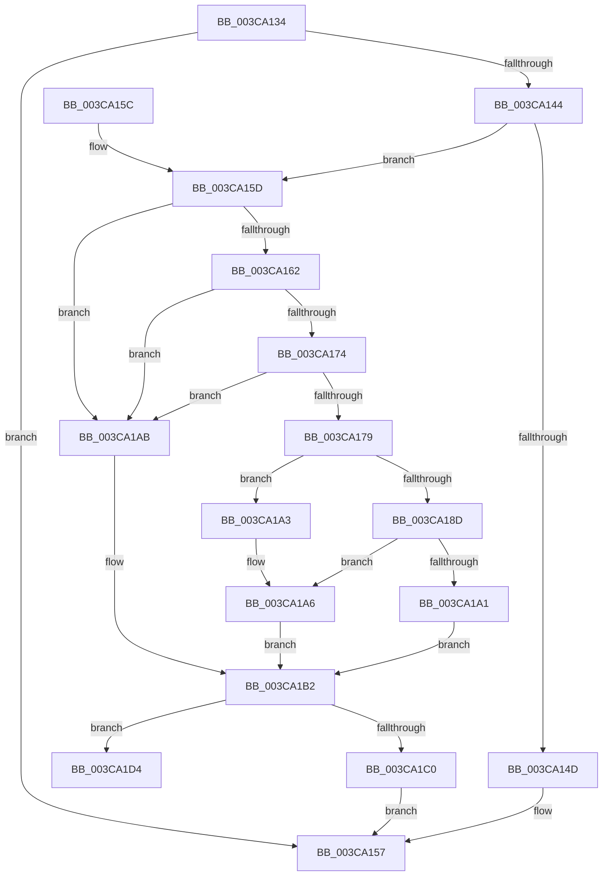

# CcRescheduleLazyWriteScan

- RVA: `0x003CA134`–`0x003CA1ED` (길이 `185` bytes)
- VA: `0x00000001403CA134`
- 실행 섹션: `.text`
- PDB 이름 있음: `예`; PDB Function 태그: `아니요`
- unwind 정보 RVA: `0x0008F658`
- 디코드: `47`개 명령, `185/185` bytes 표시
- 미해석 바이트: `0` (있으면 어셈블리에 `.byte`로 보존)

> 이 문서는 커널 이미지의 기계어와 PDB 기호를 분석해 생성했습니다. 4번과 5번은 함수 원형과 자료형을 바이너리 사용 방식에서 추정한 C 해석이며 원본 소스 복구 결과는 아닙니다.

## 1. Dependencies

- 직접 호출 지점: **3**; 고유 호출 대상: **3**
- 직접 호출자로 확인된 함수: **2**
- RIP 상대 이미지 참조: **2**

### Outgoing calls
- `0x003CA152` → [CcScheduleLazyWriteScan](CcScheduleLazyWriteScan_function_003CBD20.md) (function, `0x003CBD20`)
- `0x003CA1CD` → [KeSetCoalescableTimer](../22/KeSetCoalescableTimer_function_0022FFD0.md) (function, `0x0022FFD0`)
- `0x003CA1E7` → [KeBugCheckEx](../4F/KeBugCheckEx_function_004FD660.md) (function, `0x004FD660`)

### Direct callers
- [CcLazyWriteScan](CcLazyWriteScan_function_003C9394.md) at `0x003C94E9`
- [CcLazyWriteScan](CcLazyWriteScan_function_003C9394.md) at `0x003C9A56`
- [CcCoalescingCallBackHelper](CcCoalescingCallBackHelper_function_003CA200.md) at `0x003CA322`

### Static image references
- `0x003CA179` → RVA `0x00FC6AA0` (`ALMOSTRO`; read)
- `0x003CA194` → RVA `0x00E0A880` (`.data`; read)

## 2. Other-region calls and transfers

- 다른 실행 섹션으로 향하는 call: **0**
- 별도 외부 분기/꼬리 이동을 확인하지 못했습니다.

## 3. Assembly (complete function range)

```asm
003CA134  48 83 EC 38                     sub rsp, 0x38
003CA138  45 33 C0                        xor r8d, r8d
003CA13B  44 38 81 0C 05 00 00            cmp byte ptr [rcx + 0x50c], r8b
003CA142  75 13                           jne 0x1403ca157
003CA144  44 38 81 19 04 00 00            cmp byte ptr [rcx + 0x419], r8b
003CA14B  75 10                           jne 0x1403ca15d
003CA14D  45 33 C9                        xor r9d, r9d
003CA150  33 D2                           xor edx, edx
003CA152  E8 C9 1B 00 00                  call 0x1403cbd20
003CA157  48 83 C4 38                     add rsp, 0x38
003CA15B  C3                              ret
003CA15C  CC                              int3
003CA15D  48 85 D2                        test rdx, rdx
003CA160  74 49                           je 0x1403ca1ab
003CA162  48 8B 02                        mov rax, qword ptr [rdx]
003CA165  48 BA FF FF FF FF FF FF FF 7F   movabs rdx, 0x7fffffffffffffff
003CA16F  48 3B C2                        cmp rax, rdx
003CA172  74 37                           je 0x1403ca1ab
003CA174  48 85 C0                        test rax, rax
003CA177  74 32                           je 0x1403ca1ab
003CA179  8B 15 21 C9 BF 00               mov edx, dword ptr [rip + 0xbfc921]
003CA17F  48 0F AF D0                     imul rdx, rax
003CA183  B8 00 68 89 09                  mov eax, 0x9896800
003CA188  48 3B D0                        cmp rdx, rax
003CA18B  7F 16                           jg 0x1403ca1a3
003CA18D  48 81 FA 80 96 98 00            cmp rdx, 0x989680
003CA194  48 0F 4C 15 E4 06 A4 00         cmovl rdx, qword ptr [rip + 0xa406e4]
003CA19C  48 85 D2                        test rdx, rdx
003CA19F  7F 05                           jg 0x1403ca1a6
003CA1A1  EB 0F                           jmp 0x1403ca1b2
003CA1A3  48 8B D0                        mov rdx, rax
003CA1A6  48 F7 DA                        neg rdx
003CA1A9  EB 07                           jmp 0x1403ca1b2
003CA1AB  48 8B 15 CE 06 A4 00            mov rdx, qword ptr [rip + 0xa406ce]
003CA1B2  4C 89 44 24 20                  mov qword ptr [rsp + 0x20], r8
003CA1B7  44 38 81 18 04 00 00            cmp byte ptr [rcx + 0x418], r8b
003CA1BE  74 14                           je 0x1403ca1d4
003CA1C0  48 81 C1 D8 03 00 00            add rcx, 0x3d8
003CA1C7  41 B9 E8 03 00 00               mov r9d, 0x3e8
003CA1CD  E8 FE 5D E6 FF                  call 0x14022ffd0
003CA1D2  EB 83                           jmp 0x1403ca157
003CA1D4  45 33 C9                        xor r9d, r9d
003CA1D7  BA 03 04 00 00                  mov edx, 0x403
003CA1DC  49 C7 C0 20 04 00 C0            mov r8, 0xffffffffc0000420
003CA1E3  41 8D 49 34                     lea ecx, [r9 + 0x34]
003CA1E7  E8 74 34 13 00                  call 0x1404fd660
003CA1EC  CC                              int3
```

## 4. C-style interpretation (structured pseudocode)

```c
__int64 __fastcall CcRescheduleLazyWriteScan(__int64 a1, int a2, int a3, int a4)
{
    __int64 result;
    __int64 v_rsp;
    unsigned __int64 v_stack_p20;

    v_rsp = (v_rsp) - (56);
    a3 = 0;
    if ((*(unsigned __int8 *)(a1 + 1292)) != 0) goto loc_003CA157;
    if ((*(unsigned __int8 *)(a1 + 1049)) != 0) goto loc_003CA15D;
    a4 = 0;
    a2 = 0;
    result = CcScheduleLazyWriteScan(a1, a2, a3, a4);
loc_003CA157:
    v_rsp = (v_rsp) + (56);
    return result;
loc_003CA15D:
    if (0 == 0) goto loc_003CA1AB;
    if ((*(unsigned __int64 *)(a2)) == 0) goto loc_003CA1AB;
    if (*(unsigned __int64 *)(a2) == 0) goto loc_003CA1AB;
    a2 = ((unsigned int)(*(unsigned int *)(v_rip + 12568865))) * (*(unsigned __int64 *)(a2));
    if (a2 > ((unsigned int)(0x9896800ULL))) goto loc_003CA1A3;
    if (a2 < 0x989680ULL) { a2 = *(unsigned __int64 *)(v_rip + 10749668); }
    if (condition_is_greater) goto loc_003CA1A6;
    goto loc_003CA1B2;
loc_003CA1A3:
loc_003CA1A6:
    a2 = -((unsigned int)(0x9896800ULL));
    goto loc_003CA1B2;
loc_003CA1AB:
loc_003CA1B2:
    v_stack_p20 = 0;
    if ((*(unsigned __int8 *)(a1 + 1048)) == 0) goto loc_003CA1D4;
    a1 = (a1) + (984);
    result = KeSetCoalescableTimer(a1, *(unsigned __int64 *)(v_rip + 10749646), a3, 1000);
    goto loc_003CA157;
loc_003CA1D4:
    a4 = 0;
    result = KeBugCheckEx(a4 + 52, (unsigned int)(0x403ULL), 0xFFFFFFFFC0000420ULL, a4);
    return result;
}
```

## 5. (Beta) C Style

```c
int64_t CcRescheduleLazyWriteScan(void *Arg1, int32_t Arg2, int32_t Arg3, int32_t Arg4)
{
    uint8_t *arg1 = (uint8_t *)Arg1;

    int64_t result;
    int64_t local_rsp;
    uint64_t v_stack_p20;

    local_rsp = (local_rsp) - (56);
    Arg3 = 0;
    if ((*(uint8_t *)(arg1 + 0x50C)) != 0) goto loc_003CA157;
    if ((*(uint8_t *)(arg1 + 0x419)) != 0) goto loc_003CA15D;
    Arg4 = 0;
    Arg2 = 0;
    result = CcScheduleLazyWriteScan(Arg1, Arg2, Arg3, Arg4);
loc_003CA157:
    local_rsp = (local_rsp) + (56);
    return result;
loc_003CA15D:
    if (0 == 0) goto loc_003CA1AB;
    if ((*(uint64_t *)(Arg2)) == 0) goto loc_003CA1AB;
    if (*(uint64_t *)(Arg2) == 0) goto loc_003CA1AB;
    Arg2 = ((uint32_t)(*(uint32_t *)(v_rip + 0xBFC921))) * (*(uint64_t *)(Arg2));
    if (Arg2 > ((uint32_t)(0x9896800ULL))) goto loc_003CA1A3;
    if (Arg2 < 0x989680ULL) { Arg2 = *(uint64_t *)(v_rip + 0xA406E4); }
    if (condition_is_greater) goto loc_003CA1A6;
    goto loc_003CA1B2;
loc_003CA1A3:
loc_003CA1A6:
    Arg2 = -((uint32_t)(0x9896800ULL));
    goto loc_003CA1B2;
loc_003CA1AB:
loc_003CA1B2:
    v_stack_p20 = 0;
    if ((*(uint8_t *)(arg1 + 0x418)) == 0) goto loc_003CA1D4;
    Arg1 = (Arg1) + (984);
    result = KeSetCoalescableTimer(Arg1, *(uint64_t *)(v_rip + 0xA406CE), Arg3, 1000);
    goto loc_003CA157;
loc_003CA1D4:
    Arg4 = 0;
    result = KeBugCheckEx(Arg4 + 52, (uint32_t)(0x403ULL), 0xFFFFFFFFC0000420ULL, Arg4);
    return result;
}
```

### 관측된 메모리 오프셋

구조체 형식이 확인되지 않은 접근은 인자 기준의 오프셋으로만 기록했습니다.

| 기준 인자 | 오프셋 표현 | 폭 (bit) | 접근 |
|---|---:|---:|---|
| `Arg1` | `+ 0x418` | `8` | `R` |
| `Arg1` | `+ 0x419` | `8` | `R` |
| `Arg1` | `+ 0x50C` | `8` | `R` |

## 6. Execution-region graph

[열기: 2D/3D 그래프와 함수 탐색 컨트롤 패널](../../../control-panel.html?section=text&rva=0x003CA134&view=graph)

- 2D 그래프는 위에서 아래로 흐르고, 3D 그래프는 빈 공간을 드래그해 회전합니다. Shift+드래그는 이동, 휠은 확대·축소, 함수 노드 선택은 대상 보고서 이동입니다.

### Static fallback


