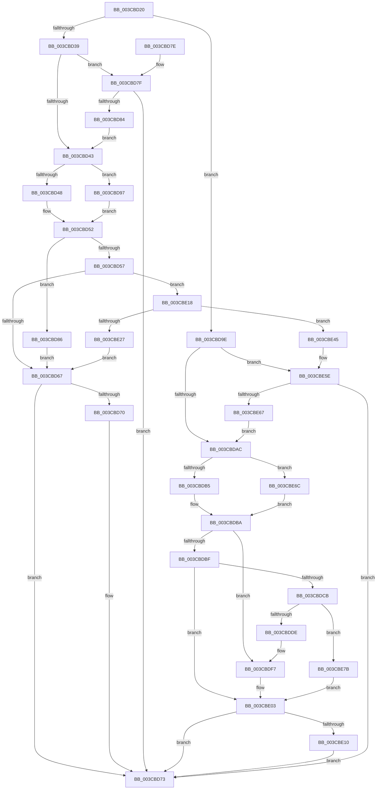

# CcScheduleLazyWriteScan

- RVA: `0x003CBD20`–`0x003CBE99` (길이 `377` bytes)
- VA: `0x00000001403CBD20`
- 실행 섹션: `.text`
- PDB 이름 있음: `예`; PDB Function 태그: `아니요`
- unwind 정보 RVA: `0x0008F85C`
- 디코드: `93`개 명령, `377/377` bytes 표시
- 미해석 바이트: `0` (있으면 어셈블리에 `.byte`로 보존)

> 이 문서는 커널 이미지의 기계어와 PDB 기호를 분석해 생성했습니다. 4번과 5번은 함수 원형과 자료형을 바이너리 사용 방식에서 추정한 C 해석이며 원본 소스 복구 결과는 아닙니다.

## 1. Dependencies

- 직접 호출 지점: **6**; 고유 호출 대상: **4**
- 직접 호출자로 확인된 함수: **19**
- RIP 상대 이미지 참조: **2**

### Outgoing calls
- `0x003CBD89` → [CcNotifyWriteBehindVolume](CcNotifyWriteBehindVolume_function_003CC134.md) (function, `0x003CC134`)
- `0x003CBDF1` → [KeBugCheckEx](../4F/KeBugCheckEx_function_004FD660.md) (function, `0x004FD660`)
- `0x003CBDF7` → [CcNotifyWriteBehindInternal](CcNotifyWriteBehindInternal_function_003CC224.md) (function, `0x003CC224`)
- `0x003CBE3B` → [KiSetTimerEx](../23/KiSetTimerEx_function_00232CB0.md) (function, `0x00232CB0`)
- `0x003CBE58` → [KeBugCheckEx](../4F/KeBugCheckEx_function_004FD660.md) (function, `0x004FD660`)
- `0x003CBE8F` → [KiSetTimerEx](../23/KiSetTimerEx_function_00232CB0.md) (function, `0x00232CB0`)

### Direct callers
- [CcSetDirtyPinnedData](../35/CcSetDirtyPinnedData_function_0035A120.md) at `0x0035A34E`
- [sub_0035A838](../35/Unknown_function_0035A838.md) at `0x0035A89F`
- [CcDecrementOpenCount](../38/CcDecrementOpenCount_function_0038B75C.md) at `0x0038B7E3`
- [CcRescheduleLazyWriteScan](CcRescheduleLazyWriteScan_function_003CA134.md) at `0x003CA152`
- [CcCoalescingCallBackHelper](CcCoalescingCallBackHelper_function_003CA200.md) at `0x003CA2F0`
- [CcSetDirtyInMask](CcSetDirtyInMask_function_003CB688.md) at `0x003CBA4F`
- [CcChargeDirtyPages](CcChargeDirtyPages_function_003CBEA0.md) at `0x003CC10F`
- [CcUninitializeCacheMap](CcUninitializeCacheMap_function_003CD520.md) at `0x003CD846`
- [CcChargeDirtyPagesInternal](CcChargeDirtyPagesInternal_function_003CDE10.md) at `0x003CE062`
- [CcNotifyOfMappedWrite](../40/CcNotifyOfMappedWrite_function_0040338C.md) at `0x00403577`
- [CcRegisterExternalCacheEx](../57/CcRegisterExternalCacheEx_function_0057C0B0.md) at `0x0057C1DA`
- [CcUpdateExternalCacheInfoEx](../57/CcUpdateExternalCacheInfoEx_function_0057C420.md) at `0x0057C58E`
- [CcWaitForCurrentLazyWriterActivityOnNode](../57/CcWaitForCurrentLazyWriterActivityOnNode_function_0057C618.md) at `0x0057C747`
- [CcDeferWrite](../57/CcDeferWrite_function_0057C860.md) at `0x0057C990`
- [CcDeleteSectionsForPartition](../57/CcDeleteSectionsForPartition_function_0057E0F8.md) at `0x0057E2B5`
- [sub_006E2B2A](../6E/Unknown_function_006E2B2A.md) at `0x006E2BD4`
- [sub_006E4F4E](../6E/Unknown_function_006E4F4E.md) at `0x006E4F6E`
- [sub_006E85B0](../6E/Unknown_function_006E85B0.md) at `0x006E85C4`
- [sub_006FCB7E](../6F/Unknown_function_006FCB7E.md) at `0x006FCBB1`

### Static image references
- `0x003CBD2A` → RVA `0x00E65B88` (`.data`; read)
- `0x003CBE27` → RVA `0x000262E0` (`.rdata`; read)

## 2. Other-region calls and transfers

- 다른 실행 섹션으로 향하는 call: **0**
- 별도 외부 분기/꼬리 이동을 확인하지 못했습니다.

## 3. Assembly (complete function range)

```asm
003CBD20  48 89 5C 24 08                  mov qword ptr [rsp + 8], rbx
003CBD25  57                              push rdi
003CBD26  48 83 EC 30                     sub rsp, 0x30
003CBD2A  80 3D 57 9E A9 00 00            cmp byte ptr [rip + 0xa99e57], 0
003CBD31  48 8B DA                        mov rbx, rdx
003CBD34  48 8B F9                        mov rdi, rcx
003CBD37  74 65                           je 0x1403cbd9e
003CBD39  8A 82 94 04 00 00               mov al, byte ptr [rdx + 0x494]
003CBD3F  84 C0                           test al, al
003CBD41  75 3C                           jne 0x1403cbd7f
003CBD43  45 84 C9                        test r9b, r9b
003CBD46  75 4F                           jne 0x1403cbd97
003CBD48  F6 D8                           neg al
003CBD4A  1B D2                           sbb edx, edx
003CBD4C  83 E2 0C                        and edx, 0xc
003CBD4F  83 C2 04                        add edx, 4
003CBD52  45 84 C0                        test r8b, r8b
003CBD55  75 2F                           jne 0x1403cbd86
003CBD57  48 8D BB D9 03 00 00            lea rdi, [rbx + 0x3d9]
003CBD5E  44 38 07                        cmp byte ptr [rdi], r8b
003CBD61  0F 84 B1 00 00 00               je 0x1403cbe18
003CBD67  80 BB 94 04 00 00 00            cmp byte ptr [rbx + 0x494], 0
003CBD6E  75 03                           jne 0x1403cbd73
003CBD70  C6 07 01                        mov byte ptr [rdi], 1
003CBD73  48 8B 5C 24 40                  mov rbx, qword ptr [rsp + 0x40]
003CBD78  48 83 C4 30                     add rsp, 0x30
003CBD7C  5F                              pop rdi
003CBD7D  C3                              ret
003CBD7E  CC                              int3
003CBD7F  45 84 C0                        test r8b, r8b
003CBD82  74 EF                           je 0x1403cbd73
003CBD84  EB BD                           jmp 0x1403cbd43
003CBD86  48 8B CB                        mov rcx, rbx
003CBD89  E8 A6 03 00 00                  call 0x1403cc134
003CBD8E  48 8D BB D9 03 00 00            lea rdi, [rbx + 0x3d9]
003CBD95  EB D0                           jmp 0x1403cbd67
003CBD97  BA 08 00 00 00                  mov edx, 8
003CBD9C  EB B4                           jmp 0x1403cbd52
003CBD9E  8A 81 0C 05 00 00               mov al, byte ptr [rcx + 0x50c]
003CBDA4  84 C0                           test al, al
003CBDA6  0F 85 B2 00 00 00               jne 0x1403cbe5e
003CBDAC  45 84 C9                        test r9b, r9b
003CBDAF  0F 84 B7 00 00 00               je 0x1403cbe6c
003CBDB5  BA 08 00 00 00                  mov edx, 8
003CBDBA  45 84 C0                        test r8b, r8b
003CBDBD  75 38                           jne 0x1403cbdf7
003CBDBF  48 8D 99 19 04 00 00            lea rbx, [rcx + 0x419]
003CBDC6  44 38 03                        cmp byte ptr [rbx], r8b
003CBDC9  75 38                           jne 0x1403cbe03
003CBDCB  48 83 64 24 20 00               and qword ptr [rsp + 0x20], 0
003CBDD1  44 38 81 18 04 00 00            cmp byte ptr [rcx + 0x418], r8b
003CBDD8  0F 85 9D 00 00 00               jne 0x1403cbe7b
003CBDDE  45 33 C9                        xor r9d, r9d
003CBDE1  BA 71 03 00 00                  mov edx, 0x371
003CBDE6  49 C7 C0 20 04 00 C0            mov r8, 0xffffffffc0000420
003CBDED  41 8D 49 34                     lea ecx, [r9 + 0x34]
003CBDF1  E8 6A 18 13 00                  call 0x1404fd660
003CBDF6  CC                              int3
003CBDF7  E8 28 04 00 00                  call 0x1403cc224
003CBDFC  48 8D 9F 19 04 00 00            lea rbx, [rdi + 0x419]
003CBE03  80 BF 0C 05 00 00 00            cmp byte ptr [rdi + 0x50c], 0
003CBE0A  0F 85 63 FF FF FF               jne 0x1403cbd73
003CBE10  C6 03 01                        mov byte ptr [rbx], 1
003CBE13  E9 5B FF FF FF                  jmp 0x1403cbd73
003CBE18  48 83 64 24 20 00               and qword ptr [rsp + 0x20], 0
003CBE1E  80 BB D8 03 00 00 00            cmp byte ptr [rbx + 0x3d8], 0
003CBE25  74 1E                           je 0x1403cbe45
003CBE27  48 8B 15 B2 A4 C5 FF            mov rdx, qword ptr [rip - 0x3a5b4e]
003CBE2E  48 8D 8B 98 03 00 00            lea rcx, [rbx + 0x398]
003CBE35  45 33 C9                        xor r9d, r9d
003CBE38  45 33 C0                        xor r8d, r8d
003CBE3B  E8 70 6E E6 FF                  call 0x140232cb0
003CBE40  E9 22 FF FF FF                  jmp 0x1403cbd67
003CBE45  45 33 C9                        xor r9d, r9d
003CBE48  BA CB 07 00 00                  mov edx, 0x7cb
003CBE4D  49 C7 C0 20 04 00 C0            mov r8, 0xffffffffc0000420
003CBE54  41 8D 49 34                     lea ecx, [r9 + 0x34]
003CBE58  E8 03 18 13 00                  call 0x1404fd660
003CBE5D  CC                              int3
003CBE5E  45 84 C0                        test r8b, r8b
003CBE61  0F 84 0C FF FF FF               je 0x1403cbd73
003CBE67  E9 40 FF FF FF                  jmp 0x1403cbdac
003CBE6C  F6 D8                           neg al
003CBE6E  1B D2                           sbb edx, edx
003CBE70  83 E2 0C                        and edx, 0xc
003CBE73  83 C2 04                        add edx, 4
003CBE76  E9 3F FF FF FF                  jmp 0x1403cbdba
003CBE7B  48 8B 15 5E A4 C5 FF            mov rdx, qword ptr [rip - 0x3a5ba2]
003CBE82  48 81 C1 D8 03 00 00            add rcx, 0x3d8
003CBE89  45 33 C9                        xor r9d, r9d
003CBE8C  45 33 C0                        xor r8d, r8d
003CBE8F  E8 1C 6E E6 FF                  call 0x140232cb0
003CBE94  E9 6A FF FF FF                  jmp 0x1403cbe03
```

## 4. C-style interpretation (structured pseudocode)

```c
__int64 __fastcall CcScheduleLazyWriteScan(__int64 a1, __int64 a2, unsigned __int8 a3, int a4)
{
    __int64 result;
    __int64 v_rsp;
    unsigned __int64 v_stack_p20;
    unsigned __int64 v_stack_p8;

    v_stack_p8 = v_rbx;
    v_rsp = (v_rsp) - (48);
    if ((*(unsigned __int8 *)(v_rip + 11116119)) == 0) goto loc_003CBD9E;
    if ((unsigned __int8)(*(unsigned __int8 *)(a2 + 1172)) != 0) goto loc_003CBD7F;
loc_003CBD43:
    if ((unsigned __int8)(a4) != 0) goto loc_003CBD97;
    result = (unsigned __int8)(-(*(unsigned __int8 *)(a2 + 1172)));
    a2 = (unsigned int)((a2) & (12));
    a2 = (unsigned int)((a2) + (4));
loc_003CBD52:
    if (a3 != 0) goto loc_003CBD86;
    if ((*(unsigned __int8 *)(a2 + 985)) == a3) goto loc_003CBE18;
loc_003CBD67:
    if ((*(unsigned __int8 *)(a2 + 1172)) == 0) {
        *(unsigned __int8 *)(a2 + 985) = 1;
    }
    v_rsp = (v_rsp) + (48);
    return result;
loc_003CBD7F:
    if (a3 == 0) goto loc_003CBD73;
    goto loc_003CBD43;
loc_003CBD86:
    result = CcNotifyWriteBehindVolume(v_stack_p8, a2, a3, a4);
    goto loc_003CBD67;
loc_003CBD97:
    goto loc_003CBD52;
loc_003CBD9E:
    if ((unsigned __int8)(*(unsigned __int8 *)(v_stack_p8 + 1292)) != 0) goto loc_003CBE5E;
loc_003CBDAC:
    if ((unsigned __int8)(a4) == 0) goto loc_003CBE6C;
loc_003CBDBA:
    if (a3 != 0) goto loc_003CBDF7;
    if ((*(unsigned __int8 *)(v_stack_p8 + 1049)) != a3) goto loc_003CBE03;
    if ((*(unsigned __int8 *)(v_stack_p8 + 1048)) != a3) goto loc_003CBE7B;
    a4 = 0;
    result = KeBugCheckEx(a4 + 52, 881, 0xFFFFFFFFC0000420ULL, a4);
loc_003CBDF7:
    result = CcNotifyWriteBehindInternal(a4 + 52, 881, 0xFFFFFFFFC0000420ULL, a4);
loc_003CBE03:
    if ((*(unsigned __int8 *)(v_stack_p8 + 985 + 1292)) != 0) goto loc_003CBD73;
    *(unsigned __int8 *)(v_stack_p8 + 985 + 1049) = 1;
    goto loc_003CBD73;
loc_003CBE18:
    if ((*(unsigned __int8 *)(v_stack_p8 + 985 + 1049 + 984)) == 0) goto loc_003CBE45;
    a4 = 0;
    a3 = 0;
    result = KiSetTimerEx(v_stack_p8 + 985 + 1049 + 920, *(unsigned __int64 *)(v_rip - 3824462), a3, a4);
    goto loc_003CBD67;
loc_003CBE45:
    a4 = 0;
    result = KeBugCheckEx(a4 + 52, (unsigned int)(0x7CBULL), 0xFFFFFFFFC0000420ULL, a4);
loc_003CBE5E:
    if ((unsigned __int8)(0xFFFFFFFFC0000420ULL) == 0) goto loc_003CBD73;
    goto loc_003CBDAC;
loc_003CBE6C:
    result = (unsigned __int8)(-(result));
    a2 = (unsigned int)(((unsigned int)(0x7CBULL)) & (12));
    a2 = (unsigned int)((a2) + (4));
    goto loc_003CBDBA;
loc_003CBE7B:
    a1 = (a4 + 52) + (984);
    a4 = 0;
    a3 = 0;
    result = KiSetTimerEx(a1, *(unsigned __int64 *)(v_rip - 3824546), a3, a4);
    goto loc_003CBE03;
}
```

## 5. (Beta) C Style

```c
int64_t CcScheduleLazyWriteScan(void *Arg1, void *Arg2, uint8_t Arg3, int32_t Arg4)
{
    uint8_t *arg1 = (uint8_t *)Arg1;
    uint8_t *arg2 = (uint8_t *)Arg2;

    int64_t result;
    int64_t local_rsp;
    uint64_t v_stack_p20;
    uint64_t v_stack_p8;

    v_stack_p8 = local_rbx;
    local_rsp = (local_rsp) - (48);
    if ((*(uint8_t *)(v_rip + 0xA99E57)) == 0) goto loc_003CBD9E;
    if ((uint8_t)(*(uint8_t *)(arg2 + 0x494)) != 0) goto loc_003CBD7F;
loc_003CBD43:
    if ((uint8_t)(Arg4) != 0) goto loc_003CBD97;
    result = (uint8_t)(-(*(uint8_t *)(arg2 + 0x494)));
    Arg2 = (uint32_t)((Arg2) & (12));
    Arg2 = (uint32_t)((Arg2) + (4));
loc_003CBD52:
    if (Arg3 != 0) goto loc_003CBD86;
    if ((*(uint8_t *)(arg2 + 0x3D9)) == Arg3) goto loc_003CBE18;
loc_003CBD67:
    if ((*(uint8_t *)(arg2 + 0x494)) == 0) {
        *(uint8_t *)(arg2 + 0x3D9) = 1;
    }
    local_rsp = (local_rsp) + (48);
    return result;
loc_003CBD7F:
    if (Arg3 == 0) goto loc_003CBD73;
    goto loc_003CBD43;
loc_003CBD86:
    result = CcNotifyWriteBehindVolume(v_stack_p8, Arg2, Arg3, Arg4);
    goto loc_003CBD67;
loc_003CBD97:
    goto loc_003CBD52;
loc_003CBD9E:
    if ((uint8_t)(*(uint8_t *)(v_stack_p8 + 0x50C)) != 0) goto loc_003CBE5E;
loc_003CBDAC:
    if ((uint8_t)(Arg4) == 0) goto loc_003CBE6C;
loc_003CBDBA:
    if (Arg3 != 0) goto loc_003CBDF7;
    if ((*(uint8_t *)(v_stack_p8 + 0x419)) != Arg3) goto loc_003CBE03;
    if ((*(uint8_t *)(v_stack_p8 + 0x418)) != Arg3) goto loc_003CBE7B;
    Arg4 = 0;
    result = KeBugCheckEx(Arg4 + 52, 881, 0xFFFFFFFFC0000420ULL, Arg4);
loc_003CBDF7:
    result = CcNotifyWriteBehindInternal(Arg4 + 52, 881, 0xFFFFFFFFC0000420ULL, Arg4);
loc_003CBE03:
    if ((*(uint8_t *)(v_stack_p8 + 0x3D9 + 0x50C)) != 0) goto loc_003CBD73;
    *(uint8_t *)(v_stack_p8 + 0x3D9 + 0x419) = 1;
    goto loc_003CBD73;
loc_003CBE18:
    if ((*(uint8_t *)(v_stack_p8 + 0x3D9 + 0x419 + 0x3D8)) == 0) goto loc_003CBE45;
    Arg4 = 0;
    Arg3 = 0;
    result = KiSetTimerEx(v_stack_p8 + 985 + 1049 + 920, *(uint64_t *)(v_rip - 0x3A5B4E), Arg3, Arg4);
    goto loc_003CBD67;
loc_003CBE45:
    Arg4 = 0;
    result = KeBugCheckEx(Arg4 + 52, (uint32_t)(0x7CBULL), 0xFFFFFFFFC0000420ULL, Arg4);
loc_003CBE5E:
    if ((uint8_t)(0xFFFFFFFFC0000420ULL) == 0) goto loc_003CBD73;
    goto loc_003CBDAC;
loc_003CBE6C:
    result = (uint8_t)(-(result));
    Arg2 = (uint32_t)(((uint32_t)(0x7CBULL)) & (12));
    Arg2 = (uint32_t)((Arg2) + (4));
    goto loc_003CBDBA;
loc_003CBE7B:
    Arg1 = (Arg4 + 52) + (984);
    Arg4 = 0;
    Arg3 = 0;
    result = KiSetTimerEx(Arg1, *(uint64_t *)(v_rip - 0x3A5BA2), Arg3, Arg4);
    goto loc_003CBE03;
}
```

### 관측된 메모리 오프셋

구조체 형식이 확인되지 않은 접근은 인자 기준의 오프셋으로만 기록했습니다.

| 기준 인자 | 오프셋 표현 | 폭 (bit) | 접근 |
|---|---:|---:|---|
| `Arg1` | `+ 0x50C` | `8` | `R` |
| `Arg2` | `+ 0x0` | `8` | `R` |
| `Arg2` | `+ 0x0` | `8` | `W` |
| `Arg2` | `+ 0x398` | `64` | `R` |
| `Arg2` | `+ 0x3D8` | `8` | `R` |
| `Arg2` | `+ 0x3D9` | `64` | `R` |
| `Arg2` | `+ 0x494` | `8` | `R` |

## 6. Execution-region graph

[열기: 2D/3D 그래프와 함수 탐색 컨트롤 패널](../../../control-panel.html?section=text&rva=0x003CBD20&view=graph)

- 2D 그래프는 위에서 아래로 흐르고, 3D 그래프는 빈 공간을 드래그해 회전합니다. Shift+드래그는 이동, 휠은 확대·축소, 함수 노드 선택은 대상 보고서 이동입니다.

### Static fallback


