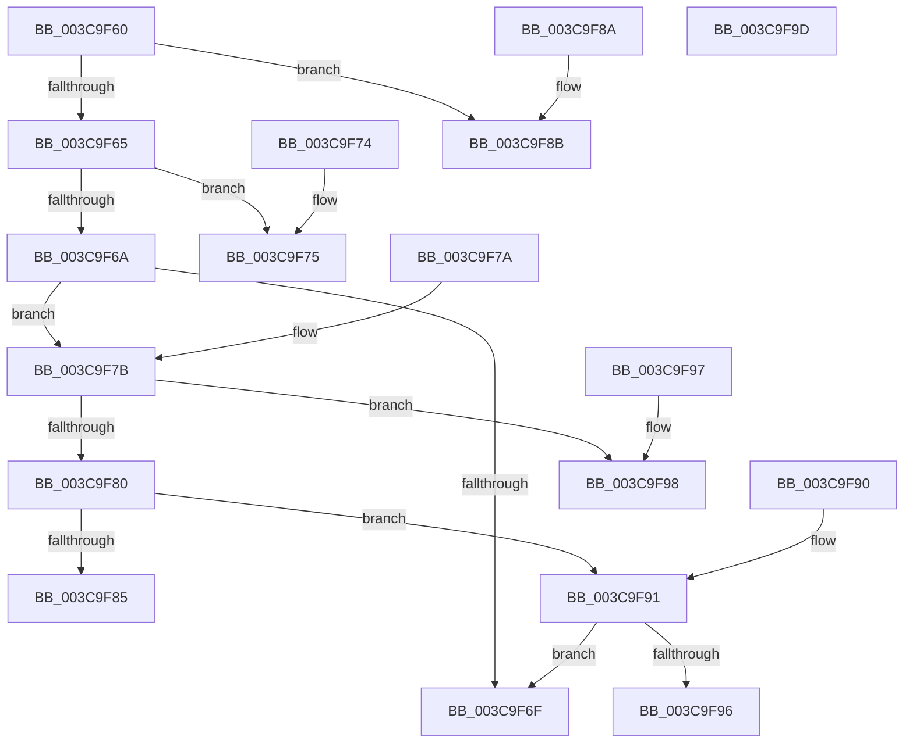

# CcSetLazyWriteScanQueuedInternal

- RVA: `0x003C9F60`–`0x003C9F9E` (길이 `62` bytes)
- VA: `0x00000001403C9F60`
- 실행 섹션: `.text`
- PDB 이름 있음: `예`; PDB Function 태그: `아니요`
- unwind 정보 RVA: `0x000DB714`
- 디코드: `29`개 명령, `62/62` bytes 표시
- 미해석 바이트: `0` (있으면 어셈블리에 `.byte`로 보존)

> 이 문서는 커널 이미지의 기계어와 PDB 기호를 분석해 생성했습니다. 4번과 5번은 함수 원형과 자료형을 바이너리 사용 방식에서 추정한 C 해석이며 원본 소스 복구 결과는 아닙니다.

## 1. Dependencies

- 직접 호출 지점: **0**; 고유 호출 대상: **0**
- 직접 호출자로 확인된 함수: **4**
- RIP 상대 이미지 참조: **0**

### Outgoing calls
- 직접 디코드된 call 명령이 없습니다.

### Direct callers
- [CcLazyWriteScanVolume](../38/CcLazyWriteScanVolume_function_00388DC0.md) at `0x00388E52`
- [CcLazyWriteScan](CcLazyWriteScan_function_003C9394.md) at `0x003C942D`
- [CcQueueLazyWriteScanThreadForVolume](CcQueueLazyWriteScanThreadForVolume_function_003C9AF0.md) at `0x003C9C6F`
- [CcQueueLazyWriteScanThreadForVolume](CcQueueLazyWriteScanThreadForVolume_function_003C9AF0.md) at `0x003C9CEF`
- [CcQueueLazyWriteScanThread](../57/CcQueueLazyWriteScanThread_function_0057BBD0.md) at `0x0057BDA4`
- [CcQueueLazyWriteScanThread](../57/CcQueueLazyWriteScanThread_function_0057BBD0.md) at `0x0057BDEE`

### Static image references
- 디코드된 RIP-relative 메모리 참조가 없습니다.

## 2. Other-region calls and transfers

- 다른 실행 섹션으로 향하는 call: **0**
- 별도 외부 분기/꼬리 이동을 확인하지 못했습니다.

## 3. Assembly (complete function range)

```asm
003C9F60  83 EA 01                        sub edx, 1
003C9F63  74 26                           je 0x1403c9f8b
003C9F65  83 EA 01                        sub edx, 1
003C9F68  74 0B                           je 0x1403c9f75
003C9F6A  83 EA 02                        sub edx, 2
003C9F6D  75 0C                           jne 0x1403c9f7b
003C9F6F  44 88 41 44                     mov byte ptr [rcx + 0x44], r8b
003C9F73  C3                              ret
003C9F74  CC                              int3
003C9F75  44 88 41 46                     mov byte ptr [rcx + 0x46], r8b
003C9F79  C3                              ret
003C9F7A  CC                              int3
003C9F7B  83 EA 04                        sub edx, 4
003C9F7E  74 18                           je 0x1403c9f98
003C9F80  83 EA 08                        sub edx, 8
003C9F83  75 0C                           jne 0x1403c9f91
003C9F85  44 88 41 47                     mov byte ptr [rcx + 0x47], r8b
003C9F89  C3                              ret
003C9F8A  CC                              int3
003C9F8B  44 88 41 45                     mov byte ptr [rcx + 0x45], r8b
003C9F8F  C3                              ret
003C9F90  CC                              int3
003C9F91  83 FA 10                        cmp edx, 0x10
003C9F94  74 D9                           je 0x1403c9f6f
003C9F96  C3                              ret
003C9F97  CC                              int3
003C9F98  44 88 41 43                     mov byte ptr [rcx + 0x43], r8b
003C9F9C  C3                              ret
003C9F9D  CC                              int3
```

## 4. C-style interpretation (structured pseudocode)

```c
void __fastcall CcSetLazyWriteScanQueuedInternal(__int64 a1, int a2, unsigned __int8 a3)
{
    a2 = (unsigned int)((a2) - (1));
    if (condition_is_equal) goto loc_003C9F8B;
    a2 = (unsigned int)((a2) - (1));
    if (condition_is_equal) goto loc_003C9F75;
    a2 = (unsigned int)((a2) - (2));
    if (condition_is_not_equal) goto loc_003C9F7B;
loc_003C9F6F:
    *(unsigned __int8 *)(a1 + 68) = a3;
    return;
loc_003C9F75:
    *(unsigned __int8 *)(a1 + 70) = a3;
    return;
loc_003C9F7B:
    a2 = (unsigned int)((a2) - (4));
    if (condition_is_equal) goto loc_003C9F98;
    a2 = (unsigned int)((a2) - (8));
    if (condition_is_not_equal) goto loc_003C9F91;
    *(unsigned __int8 *)(a1 + 71) = a3;
    return;
loc_003C9F8B:
    *(unsigned __int8 *)(a1 + 69) = a3;
    return;
loc_003C9F91:
    if (a2 == 16) goto loc_003C9F6F;
    return;
loc_003C9F98:
    *(unsigned __int8 *)(a1 + 67) = a3;
    return;
}
```

## 5. (Beta) C Style

```c
void CcSetLazyWriteScanQueuedInternal(void *Arg1, int32_t Arg2, uint8_t Arg3)
{
    uint8_t *arg1 = (uint8_t *)Arg1;

    Arg2 = (uint32_t)((Arg2) - (1));
    if (condition_is_equal) goto loc_003C9F8B;
    Arg2 = (uint32_t)((Arg2) - (1));
    if (condition_is_equal) goto loc_003C9F75;
    Arg2 = (uint32_t)((Arg2) - (2));
    if (condition_is_not_equal) goto loc_003C9F7B;
loc_003C9F6F:
    *(uint8_t *)(arg1 + 0x44) = Arg3;
    return;
loc_003C9F75:
    *(uint8_t *)(arg1 + 0x46) = Arg3;
    return;
loc_003C9F7B:
    Arg2 = (uint32_t)((Arg2) - (4));
    if (condition_is_equal) goto loc_003C9F98;
    Arg2 = (uint32_t)((Arg2) - (8));
    if (condition_is_not_equal) goto loc_003C9F91;
    *(uint8_t *)(arg1 + 0x47) = Arg3;
    return;
loc_003C9F8B:
    *(uint8_t *)(arg1 + 0x45) = Arg3;
    return;
loc_003C9F91:
    if (Arg2 == 16) goto loc_003C9F6F;
    return;
loc_003C9F98:
    *(uint8_t *)(arg1 + 0x43) = Arg3;
    return;
}
```

### 관측된 메모리 오프셋

구조체 형식이 확인되지 않은 접근은 인자 기준의 오프셋으로만 기록했습니다.

| 기준 인자 | 오프셋 표현 | 폭 (bit) | 접근 |
|---|---:|---:|---|
| `Arg1` | `+ 0x43` | `8` | `W` |
| `Arg1` | `+ 0x44` | `8` | `W` |
| `Arg1` | `+ 0x45` | `8` | `W` |
| `Arg1` | `+ 0x46` | `8` | `W` |
| `Arg1` | `+ 0x47` | `8` | `W` |

## 6. Execution-region graph

[열기: 2D/3D 그래프와 함수 탐색 컨트롤 패널](../../../control-panel.html?section=text&rva=0x003C9F60&view=graph)

- 2D 그래프는 위에서 아래로 흐르고, 3D 그래프는 빈 공간을 드래그해 회전합니다. Shift+드래그는 이동, 휠은 확대·축소, 함수 노드 선택은 대상 보고서 이동입니다.

### Static fallback


